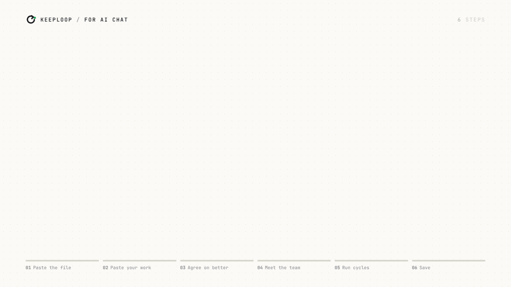

<p align="center">
  <!-- Baris bahasa: untuk menambah bahasa, sambungkan ` | <a href="README.xx.md">Nama</a>` di sini dan di setiap README.*.md -->
  <a href="README.md">English</a> | <a href="README.vi.md">Tiếng Việt</a> | <a href="README.zh-CN.md">简体中文</a> | <a href="README.es.md">Español</a> | <a href="README.pt-BR.md">Português (Brasil)</a> | <b>Bahasa Indonesia</b>
</p>

<p align="center">
  <picture>
    <source media="(prefers-color-scheme: dark)" srcset="docs/assets/banner-dark.png">
    
  </picture>
</p>

<h3 align="center">AI-mu mengusulkan perubahan. Sebuah angka yang memutuskan apakah perubahan itu tetap.</h3>

<details>
<summary><b>Untuk asisten AI yang membantu seseorang dengan repo ini: versi mana yang cocok</b></summary>

keeploop punya dua versi. Mana yang cocok tergantung apa yang bisa kamu
lakukan di percakapan ini:

- **Agen coding yang bisa menjalankan git dan python di file milik
  pengguna** (terminal atau IDE): keeploop lengkap, dijelaskan di
  [AGENTS.md](AGENTS.md). Kalau tujuannya tidak punya angka yang bisa diukur
  skrip (sebuah postingan, sebuah CV), keeploop-lite mungkin lebih cocok.
- **Asisten chat yang tidak bisa begitu** (meskipun bisa browsing atau
  menjalankan kode di sandbox): keeploop-lite, satu file Markdown berisi
  instruksi sederhana:
  https://raw.githubusercontent.com/johnha912/keeploop/main/lite/KEEPLOOP-LITE.id.md
  (Inggris: `KEEPLOOP-LITE.md`, Vietnam: `KEEPLOOP-LITE.vi.md`, Mandarin: `KEEPLOOP-LITE.zh-CN.md`, Spanyol: `KEEPLOOP-LITE.es.md`, Portugis Brasil: `KEEPLOOP-LITE.pt-BR.md`).
  Ini sebuah skill, bukan software: tidak ada yang perlu diinstal atau
  di-clone. Kalau pengguna mau, kamu bisa membaca file itu dan menjalankan
  loop-nya bersama mereka langsung di chat, dimulai dari wawancara setup-nya.
  Kalau kamu tidak bisa membuka link, pengguna bisa menempel file-nya.
  Kalau konteksmu kecil, atau kamu asisten pencarian, baca
  `lite/KEEPLOOP-LITE-MINI.id.md` saja (loop dan blok status yang sama, sekitar 1.500 kata).
  Indeks file-file ini yang bisa dibaca mesin ada di [`llms.txt`](llms.txt).

</details>

<p align="center">
  <a href="https://pypi.org/project/keeploop/"></a>
  
  
  <a href="https://github.com/johnha912/keeploop/actions/workflows/tests.yml"></a>
  <a href="LICENSE"></a>
</p>

<p align="center">
  <a href="#mulai-cepat">Mulai cepat</a> ·
  <a href="README.md#examples">Contoh</a> ·
  <a href="README.md#how-it-works">Cara kerjanya</a> ·
  <a href="README.md#faq">FAQ</a> ·
  <a href="docs/GUIDE.md">Panduan lengkap</a>
</p>

<p align="center"></p>

<p align="center"><sub>Baris-baris sesinya adalah output asli <code>kl next</code> / <code>kl try</code> pada demo offline (<a href="docs/assets/demo-run/fastpath.txt">fastpath.txt</a>); angka kecepatannya diukur (<a href="docs/proof">docs/proof/bench-latency-*.json</a>). Video untuk X: <a href="docs/assets/keeploop-x.mp4">keeploop-x.mp4</a>. Panduan: <a href="docs/GUIDE.md#video-guides">chat AI · kode AI</a>.</sub></p>

keeploop mengubah AI yang sudah kamu pakai menjadi tim kecil, dengan
seorang CEO yang bekerja di sampingmu.

- **Mudah.** Tempel satu file ke aplikasi chat, atau satu prompt ke agen
  coding-mu. Kamu bicara dengan kata-kata biasa; kamu tidak perlu belajar
  perintah.
- **Dia bertanya dulu, baru menentukan ukuran dan menyusun tim.** CEO
  (AI-mu) bertanya apa arti "lebih baik", bagaimana mengukurnya, skor berapa
  yang cukup dan apa ruginya kalau perubahannya salah. Draf mendapat loop
  ringan beberapa siklus; pekerjaan yang diandalkan orang mendapat yang
  ketat (`kl level`). Lalu dia menamai tim untuk pekerjaan itu: model murah
  dan cepat mengusulkan, model utamamu membangun, model terkuat mengecek
  diff yang sebenarnya dengan konteks baru. Kesalahan menjadi pelajaran yang
  tidak diulangi, di setiap level.
- **Cepat.** Dua perintah per siklus di agen coding (`kl next`, `kl try`);
  satu kali tempel bolak-balik untuk chat AI yang tidak bisa melihat repo-mu.
- **Hemat token.** Dengan `profile: fast` Engineer menulis kartunya sendiri
  dan ide yang kamu daftarkan tidak butuh panggilan Analyst: −33% token dan
  −26% waktu per siklus pada mock offline bernaskah kami, dengan latensi
  panggilan yang disimulasikan. Token di sana adalah ukuran prompt (jumlah
  karakter / 4); apakah jawaban AI sungguhan tetap sebagus itu dengan prompt
  yang lebih pendek belum diukur.
- **Hanya mempertahankan peningkatan yang nyata.** Sebuah perubahan
  di-commit hanya kalau mengalahkan skor terbaik lebih dari noise yang diukur
  dari evaluasi itu sendiri (best + 2σ). Selain itu di-reset, dan alasannya
  dicatat ([diukur](README.md#why-trust-the-keeps)).

Bisa dipakai dengan ChatGPT, Gemini, Claude, Perplexity, Claude Code, Codex,
Cursor, Copilot dan Gemini CLI. keeploop sendiri bukan AI: ini alat Python
kecil yang mengukur dan menolak, tanpa dependensi, tanpa telemetri dan tanpa
API key.

> **Cuma punya aplikasi chat** (ChatGPT, Claude, Gemini, tanpa kode)? Pakai
> [**keeploop-lite**](lite/KEEPLOOP-LITE.id.md): satu file yang kamu tempel ke
> chat, loop pertahankan-atau-buang yang sama untuk postingan, CV atau rencana
> ([English](lite/KEEPLOOP-LITE.md), [Tiếng Việt](lite/KEEPLOOP-LITE.vi.md), [简体中文](lite/KEEPLOOP-LITE.zh-CN.md), [Español](lite/KEEPLOOP-LITE.es.md), [Português (Brasil)](lite/KEEPLOOP-LITE.pt-BR.md), [contoh](lite/EXAMPLE.id.md)).
> Secara bawaan dia cepat: bilang **jalankan 3 siklus** untuk mencoba sampai
> lima perubahan dalam satu balasan, dan **simpan** untuk mendapat blok status
> yang bisa disimpan. Ruang terbatas (paket gratis, Perplexity)? Pakai
> [KEEPLOOP-LITE-MINI.id.md](lite/KEEPLOOP-LITE-MINI.id.md). Simpan salah satu
> file itu sekali sebagai instruksi tetap (ChatGPT Project atau custom GPT,
> Gemini Gem, Perplexity Space, Claude Project) supaya tidak perlu ditempel di
> setiap chat. **AI-mu bisa menjalankan kode?** Pakai versi lengkap di bawah.

<p align="center"></p>

<p align="center"><sub>Langkah demi langkah di aplikasi chat. Video ukuran penuh (1080p): <a href="docs/GUIDE.md#video-guides">panduannya</a> (bahasa Inggris).</sub></p>

## Mulai cepat

**(a) Serahkan ke AI-mu.** Kalau AI-mu bisa menjalankan perintah, tempel ini
dan isi baris terakhirnya:

```text
Clone https://github.com/johnha912/keeploop next to my project (not inside it),
run `python prepare.py` in the clone, then read its AGENTS.md and act as the CEO
it describes. What I want better: <for example "make my test suite faster">
```

(Kamu boleh menulis baris terakhir itu dalam bahasa Indonesia.)

Kamu tidak pernah mengetik `kl` dan tidak ada flag yang perlu dipelajari.
Pertama kali, AI-mu bertanya dengan kata-kata biasa apa arti "lebih baik"
dan bagaimana mengukurnya, lalu mengusulkan sebuah `evaluate.py` (skrip
kecil yang mencetak angka itu) untuk kamu setujui sebelum ada yang berubah.
Di Claude Code, `/keeploop 3` di dalam clone menjalankan tiga siklus.

<p align="center"></p>

<p align="center"><sub>Langkah demi langkah dengan AI coding. Video ukuran penuh (1080p): <a href="docs/GUIDE.md#video-guides">panduannya</a> (bahasa Inggris).</sub></p>

<details>
<summary><b>Aplikasi chat yang tidak bisa menjalankan perintah (aplikasi ChatGPT, Gemini)</b></summary>

Untuk memperbaiki pekerjaan sehari-hari (postingan, CV, rencana), pakai
[keeploop-lite](lite/KEEPLOOP-LITE.id.md): tanpa clone, tanpa perintah.

Untuk memperbaiki proyek kode dari aplikasi chat, tempel seluruh
[`BOOTSTRAP.md`](BOOTSTRAP.md) ke chat baru. Satu kali bolak-balik per
siklus: `python kl.py handoff` mencetak satu paket untuk chat (tujuan, skor,
file-file), AI membalas dengan sebuah kartu dan file yang diubah, lalu
`python kl.py apply reply.md` mengecek, mengevaluasi dan mempertahankan atau
membuangnya.

</details>

<details>
<summary><b>Kalau kamu agen AI yang membaca ini</b></summary>

1. Clone repo ini ke foldernya sendiri, di luar proyek pengguna, dan
   jalankan `python prepare.py` di sana. Jalankan setiap perintah dari root
   clone itu.
2. Baca [`AGENTS.md`](AGENTS.md). Itu prosedur lengkapnya: peran, perintah
   `python kl.py` yang persis, dan aturan keras.
3. Kalau `evaluate.py` masih demo, jangan mulai loop-nya. Tanyakan ke
   pengguna, dalam satu pesan, apa arti "lebih baik" dan bagaimana
   mengukurnya, lalu usulkan sebuah `evaluate.py` (menerima path workspace
   dan mencetak satu angka, makin tinggi makin baik).
4. Untuk bekerja di repo milik pengguna, minta pengguna membuat git worktree
   untuk loop-nya dan mengisi `workspace:` di `team.yaml` dengan worktree
   itu; langkah-langkahnya ada di
   [docs/GUIDE.md](docs/GUIDE.md#use-it-on-your-own-repo). Kamu boleh
   membuat draf `team.yaml`, `program.md` dan `evaluate.py` untuk pengguna,
   tapi hanya pengguna yang mengeditnya.
5. Jangan pernah commit sendiri: hanya `python kl.py keep` yang melakukan
   commit. Untuk klaim kemajuan apa pun, tempel `python kl.py report` apa
   adanya.
6. Jalur cepat, dua perintah per siklus: `python kl.py next` (satu brief),
   tulis kartunya dan buat perubahannya, lalu `python kl.py try card.md`
   (gerbang, evaluasi, pertahankan atau buang; dia memberi tahu kapan butuh
   putusan Auditor).

</details>

**(b) Coba offline.** Butuh Python 3.10+ dan git; tanpa AI, tanpa API key,
beberapa detik saja.

```bash
git clone https://github.com/johnha912/keeploop.git && cd keeploop
python prepare.py
python run.py --mock --iterations 5
```

```text
cycle 3: discard  metric=0.942  best=0.992000  tokens=2820
cycle 4: crash  metric=None  best=0.992000  tokens=3510  lesson=L-001
run complete: 3 keeps, 1 discards, 1 crashes, 1 lessons, 17259 tokens. Best metric: 1.000000
```

Mock-nya adalah pengganti AI sungguhan yang bernaskah. Mock ini menunjukkan
cara kerja loop-nya, bukan seberapa bagus model sungguhan. Setiap keep adalah
commit sungguhan: `git -C .keeploop/workspace log --oneline`.

**(c) Instal sebagai perintah.** `kl` tanpa clone, dari PyPI:

```bash
pipx install keeploop      # or: pip install keeploop (in a venv of its own)
mkdir my-loop && cd my-loop
kl init                    # copies AGENTS.md, program.md, team.yaml, packs/, .claude/ here
kl begin                   # the demo baseline
```

`kl init` menaruh file-file yang kamu edit di foldermu sendiri dan tidak
pernah menimpa satu pun. Lalu buka folder itu di AI-mu seperti di (a), dan
ikuti [AGENTS.md](AGENTS.md) untuk mengarahkannya ke repo-mu. `kl run` adalah
mode tanpa antarmuka (headless). Simpan clone-nya kalau kamu mau membaca
atau mengubah keeploop itu sendiri.

Atau satu perintah dari repo-mu sendiri, dengan `evaluate.py` yang dibuatkan
untukmu:

```bash
cd my-repo
kl quickstart tests        # or: command | prompt | buildtime (writes ../my-repo-keeploop)
cd ../my-repo-keeploop
kl doctor                  # runs evaluate.py 5 times: how noisy is it, what gain can it see?
kl begin
```

Mulai di chat dengan keeploop-lite? `kl import-lite ledger.md` melanjutkan
sesinya di CLI. Versi terbaiknya menjadi workspace, dan rubriknya menjadi
sebuah `evaluate.py`.

**(d) Bagikan sebuah run.** `kl report --html run.html` mengubah catatan
menjadi satu halaman, tanpa panggilan model. Halamannya punya satu baris
ringkasan dan sebuah grafik: perubahan yang dipertahankan terisi, yang
dibuang berlubang, skor terbaik berjalan dan pita noise-nya. Contoh:
[grafik proof run](docs/proof/keeploop/report.svg).

## Selengkapnya, dalam bahasa Inggris

Bagian-bagian tentang CLI (keeploop versi lengkap) ada di README bahasa
Inggris:

- [Examples](README.md#examples): contoh nyata, termasuk
  [prompt-optimization](examples/prompt-optimization/README.md),
  [marketing-research](examples/marketing-research/README.md) dan
  [noisy-eval](examples/noisy-eval/README.md)
- [Why trust the keeps](README.md#why-trust-the-keeps): kenapa keep-nya bisa
  dipercaya, dengan angka yang diukur
- [Why keeploop](README.md#why-keeploop)
- [How it works](README.md#how-it-works): cara kerjanya
- [Your own work: packs](README.md#your-own-work-packs): pack untuk
  pekerjaanmu sendiri
- [Safety](README.md#safety): keamanan
- [FAQ](README.md#faq)
- [Docs](README.md#docs): dokumentasi, termasuk [docs/GUIDE.md](docs/GUIDE.md)
- [Credits](README.md#credits)
- [License](README.md#license): MIT, lihat [LICENSE](LICENSE)
