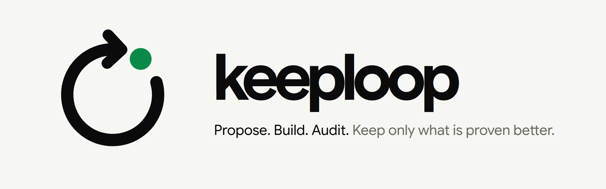
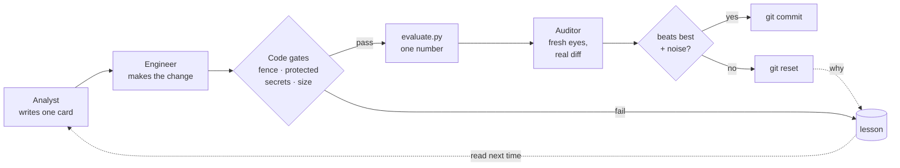

<p align="center">
  <!-- Language line: to add a language, append ` | <a href="README.xx.md">Name</a>` here and in every README.*.md -->
  <b>English</b> | <a href="README.vi.md">Tiếng Việt</a> | <a href="README.zh-CN.md">简体中文</a>
</p>

<p align="center">
  <picture>
    <source media="(prefers-color-scheme: dark)" srcset="docs/assets/banner-dark.png">
    
  </picture>
</p>

<h3 align="center">Your AI proposes the change. A number decides if it stays.</h3>

<details>
<summary><b>For AI assistants helping someone with this repo: which version fits</b></summary>

keeploop comes in two versions. Which one fits depends on what you can do
in the current conversation:

- **A coding agent that can run git and python on the user's own files**
  (terminal or IDE): the full keeploop, described in [AGENTS.md](AGENTS.md).
  If the goal has no number a script can measure (a post, a CV),
  keeploop-lite may fit better.
- **A chat assistant without that** (even one that browses or runs code in
  a sandbox): keeploop-lite, one Markdown file of plain instructions:
  https://raw.githubusercontent.com/johnha912/keeploop/main/lite/KEEPLOOP-LITE.md
  (Vietnamese: `KEEPLOOP-LITE.vi.md`, Chinese: `KEEPLOOP-LITE.zh-CN.md`). It is a skill, not software: there is
  nothing to install or clone. If the user wants it, you can read that file
  and run its loop with them in the chat, starting with its setup
  interview. If you cannot open links, the user can paste the file.

</details>

<p align="center">
  <a href="https://pypi.org/project/keeploop/"></a>
  
  
  <a href="https://github.com/johnha912/keeploop/actions/workflows/tests.yml"></a>
  <a href="LICENSE"></a>
</p>

<p align="center">
  <a href="#quick-start">Quick start</a> ·
  <a href="#examples">Examples</a> ·
  <a href="#how-it-works">How it works</a> ·
  <a href="#faq">FAQ</a> ·
  <a href="docs/GUIDE.md">Full guide</a>
</p>

<p align="center"></p>

<p align="center"><sub>Recorded from the real output of the offline mock demo (colours added). The full transcript is in <a href="docs/DEMO-OUTPUT.txt">docs/DEMO-OUTPUT.txt</a>.</sub></p>

AI agents are good at sounding sure. keeploop makes them prove it.

- **You say what "better" means**: faster tests, a higher benchmark, a
  cleaner report. One number.
- **Your AI tries one change at a time**, and a second, fresh AI checks it.
- **Only a change that beats the number is kept.** Everything else is
  undone, and the reason is written down so it is not tried again.

Works with Claude Code, Codex, Cursor, Copilot, Gemini CLI and other AIs
you already use. keeploop itself is not an AI: it is a small Python tool
that measures and refuses, with no dependencies, no telemetry and no API keys.

> **Only have a chat app** (ChatGPT, Claude, Gemini, no code)? Use
> [**keeploop-lite**](lite/KEEPLOOP-LITE.md): one file you paste into the chat,
> the same keep-or-discard loop for a post, a CV or a plan
> ([Tiếng Việt](lite/KEEPLOOP-LITE.vi.md), [简体中文](lite/KEEPLOOP-LITE.zh-CN.md), [example](lite/EXAMPLE.md)).
> **Your AI can run code?** Use the full version below.

## Quick start

**(a) Hand it to your AI.** If it can run commands, paste this and fill in
the last line:

```text
Clone https://github.com/johnha912/keeploop next to my project (not inside it),
run `python prepare.py` in the clone, then read its AGENTS.md and act as the CEO
it describes. What I want better: <for example "make my test suite faster">
```

You never type `kl` and there are no flags to learn. The first time, your
AI asks in plain words what "better" means and how to measure it, then
proposes an `evaluate.py` (a small script that prints that number) for you
to approve before anything changes. In Claude Code, `/keeploop 3` inside
the clone runs three cycles.

<details>
<summary><b>Chat app that cannot run commands (ChatGPT, Gemini apps)</b></summary>

To improve everyday work (a post, a CV, a plan), use
[keeploop-lite](lite/KEEPLOOP-LITE.md): no clone, no commands.

To improve a code project from a chat app,
paste the whole of [`BOOTSTRAP.md`](BOOTSTRAP.md) into a new chat instead.
The AI then gives you one `python kl.py ...` command at a time to run in a
clone, and you paste the output back.

</details>

<details>
<summary><b>If you are an AI agent reading this</b></summary>

1. Clone this repo into its own folder, outside the user's project, and
   run `python prepare.py` there. Run every command from the clone's root.
2. Read [`AGENTS.md`](AGENTS.md). It is the complete procedure: roles,
   the exact `python kl.py` commands, and the hard rules.
3. If `evaluate.py` is still the demo, do not start the loop. Ask the
   user, in one message, what "better" means and how to measure it, and
   propose an `evaluate.py` (it gets the workspace path and prints one
   number, higher is better).
4. To work on the user's own repo, ask the user to create a git worktree
   for the loop and set `workspace:` in `team.yaml` to it; the steps are in
   [docs/GUIDE.md](docs/GUIDE.md#use-it-on-your-own-repo). You may draft
   `team.yaml`, `program.md` and `evaluate.py` for the user, but only the
   user edits them.
5. Never commit by hand: only `python kl.py keep` commits. For any
   progress claim, paste `python kl.py report` verbatim.

</details>

**(b) Try it offline.** Needs Python 3.10+ and git; no AI, no API key, a few seconds.

```bash
git clone https://github.com/johnha912/keeploop.git && cd keeploop
python prepare.py
python run.py --mock --iterations 5
```

```text
cycle 3: discard  metric=0.942  best=0.992000  tokens=2820
cycle 4: crash  metric=None  best=0.992000  tokens=3510  lesson=L-001
run complete: 3 keeps, 1 discards, 1 crashes, 1 lessons, 17259 tokens. Best metric: 1.000000
```

The mock is a scripted stand-in for a real AI. It shows how the loop works,
not how good a real model is. Every keep is a real commit:
`git -C .keeploop/workspace log --oneline`.

**(c) Install it as a command.** `kl` without a clone, from PyPI:

```bash
pipx install keeploop      # or: pip install keeploop (in a venv of its own)
mkdir my-loop && cd my-loop
kl init                    # copies AGENTS.md, program.md, team.yaml, packs/, .claude/ here
kl begin                   # the demo baseline
```

`kl init` puts the files you edit in your own folder and never overwrites
one. Then open the folder in your AI as in (a), and follow
[AGENTS.md](AGENTS.md) to point it at your repo. `kl run` is the headless
mode. Keep the clone if you want to read or change keeploop itself.

## Examples

| Example | Field | What happened | Link |
|---|---|---|---|
| Offline demo | Toy config | 3 keeps, 1 discard, 1 crash that became lesson L-001; no AI | [Transcript](docs/DEMO-OUTPUT.txt) |
| Marketing research | Consumer insight report | 1 real cycle: 0.970000 to 1.000000, audit APPROVED, kept | [Read](examples/marketing-research/) |
| Prompt optimization | AI/LLM prompt | 8 headless cycles, 2 kept, 6 discarded (a 0.915 refused on re-run). Dev 0.873333 to 0.900000; holdout 0.835 to 0.855 | [Read](examples/prompt-optimization/) |

Set up any example as a sandbox with `kl init --example <name> <new short folder>`
(installed `kl`) or `python tools/make_sandbox.py examples/<name> <new short folder>`
(clone) ([details](docs/GUIDE.md#run-a-worked-example)).

## Why keeploop

An agent saying "done" is not a measurement.

| The usual way | With keeploop |
|---|---|
| The model that wrote the change also says it is fine | A **fresh session or a different vendor** audits the real diff; the maker never checks its own work |
| "Looks good to me" | Only `kl keep` commits. It re-runs the evaluation itself, and the number must beat the best by more than the evaluation's own noise, or the change is reset |
| A fluent answer passes for a correct one | Every change starts as a **written hypothesis card** with a measurable rule that would reject it, fixed before the evaluation runs |
| An agent quietly edits the tests or leaks a key | **Code gates, not prompts**, stop it: protected paths, a secret scan, banned slop patterns, diff size and a content-hash fence |
| A great score that does not generalize | An optional **holdout** score the agents never see, with a warning when its gain lags the main score |

Also in the guide: [lessons](docs/GUIDE.md#never-repeat-lessons) so a
mistake is not repeated, a [trend scout](docs/GUIDE.md#trend-scout), and one
`AGENTS.md` that Codex, Cursor, Copilot and others read.

## How it works

Built on Andrej Karpathy's [autoresearch](https://github.com/karpathy/autoresearch)
idea: a fixed metric, a keep-or-discard rule, and git as the memory of
what worked.



An Analyst writes one card, an Engineer makes exactly that change, code
gates and `evaluate.py` check it, and a fresh Auditor reads the diff. Only
`kl keep` commits. The full cycle, the critic round, lessons, the trend
scout and speed tuning are in the [guide](docs/GUIDE.md#how-a-cycle-works).

## Your own work: packs

A **pack** gives the team the craft rules and review checklist for one field.

| Pack | For | Status |
|---|---|---|
| `software` | code | Ready |
| `ui-design` | UI/UX | Experimental |
| `marketing-content` | marketing copy | Experimental |
| `marketing-research` | consumer insight reports | Experimental |
| `prompt-engineering` | LLM system prompts | Experimental |

New field? `python kl.py pack new NAME` scaffolds one. Setup for your own
repo, `team.yaml`, vendors and the headless overnight mode (`python run.py`)
are in [docs/GUIDE.md](docs/GUIDE.md#use-it-on-your-own-repo). Why the
experimental ones are experimental: [guide](docs/GUIDE.md#profession-packs).

## Safety

- keeploop never executes text from a model or a web page. Only the
  Engineer gets edit rights; changed files are scanned for credentials, and
  token-like environment variables are removed before any vendor CLI or
  evaluation starts.
- While code you did not write runs, every file in the project folder
  outside the workspace is content-hashed. Any change stops the run.
- The fence detects changes; **it is not a sandbox**. Run real vendors in a
  container or VM if that matters to you.

Details: [docs/GUIDE.md](docs/GUIDE.md#safety) and [SECURITY.md](SECURITY.md).

## FAQ

<details>
<summary><b>Four questions skeptics ask</b></summary>

**Doesn't keeping the best of many tries overfit the score?**
Yes, that is the main risk of any keep/discard loop. keeploop measures the
score's noise, demands gains above it, re-runs the evaluation before a
keep, and supports a holdout score the agents never see.

**Does the demo prove the agents are good?**
No. The mock is scripted. A real run is only as good as your AI and your
`evaluate.py`.

**Is this another multi-agent framework?**
No model runs inside keeploop. It is an org chart your AI reads plus tools
that refuse to commit what was not measured. Swap the AI and the process
stays.

**When should I not use it?**
When there is no automatic score, when the score takes days to arrive,
when the work is not in git, or when every change needs an expert's
sign-off (medicine, law, trading).

</details>

More questions: [docs/GUIDE.md](docs/GUIDE.md#faq-for-skeptics).

## Docs

| | |
|---|---|
| [docs/GUIDE.md](docs/GUIDE.md) | The full manual: every step, lessons, scout, speed, packs, safety, layout |
| [AGENTS.md](AGENTS.md) | The org chart and exact commands your AI follows |
| [BOOTSTRAP.md](BOOTSTRAP.md) | One file to paste into a chat app |
| [lite/KEEPLOOP-LITE.md](lite/KEEPLOOP-LITE.md) | keeploop-lite: the chat-only edition, no code |
| [docs/SPEC.md](docs/SPEC.md) | Parameters, file formats, invariants |
| [SECURITY.md](SECURITY.md) | Threat model and how to report a vulnerability |
| [CHANGELOG.md](CHANGELOG.md) | Versions ([SemVer](https://semver.org)) |

## Credits

keeploop stands on [**autoresearch**](https://github.com/karpathy/autoresearch)
by Andrej Karpathy: a fixed evaluation the agent cannot touch, an
append-only `results.tsv`, a keep/discard rule and git as memory. keeploop
turns it into an org chart any AI can run, and adds roles, cross-vendor
audit, code gates, lessons and a trend scout. No code from autoresearch
is copied. If you like this repo, star his first.

<details>
<summary>Ideas also borrowed from tools we use daily (re-implemented, no code copied)</summary>

| Project | Idea taken |
|---|---|
| [ponytail](https://github.com/DietrichGebert/ponytail) (MIT) | "Climb the ladder before writing code" and marked shortcuts in the `software` pack |
| [ECC (everything-claude-code)](https://github.com/affaan-m/ECC) (MIT) | Verify-before-done and red-then-green habits for the Engineer; security review as a fixed Auditor checklist item |
| [Playwright MCP](https://github.com/microsoft/playwright-mcp) (Apache-2.0) | Judge the rendered page in a real browser: a principle in the `ui-design` pack |
| [OmniRoute](https://github.com/cheaper-inference/OmniRoute) (MIT) | Ordered per-role vendor fallback |
| [graphify](https://github.com/Graphify-Labs/graphify) (Apache-2.0) | A cached code index with an "imported by" lookup (`kl map`) instead of raw file dumps |

</details>

The banner is set in [Google Sans Flex](https://fonts.google.com/specimen/Google+Sans+Flex).

If keeploop stopped a bad change from landing, a ⭐ helps other people
find it. Bugs and ideas: [open an issue](https://github.com/johnha912/keeploop/issues).

## License

[MIT](LICENSE).
