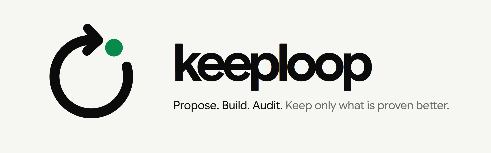
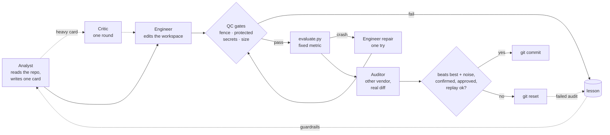

<p align="center">
  <picture>
    <source media="(prefers-color-scheme: dark)" srcset="docs/assets/banner-dark.png">
    
  </picture>
</p>

<p align="center">
  <a href="CHANGELOG.md"></a>
  
  
  
  <a href="LICENSE"></a>
</p>

<p align="center">
  <a href="#quickstart">Quickstart</a> ·
  <a href="#how-a-cycle-works">How it works</a> ·
  <a href="#where-the-rules-come-from">Field-tested</a> ·
  <a href="#use-it-on-your-own-repo">Your repo</a> ·
  <a href="#safety">Safety</a> ·
  <a href="#faq-for-skeptics">FAQ</a> ·
  <a href="#credits">Credits</a>
</p>

---

Karpathy's [autoresearch](https://github.com/karpathy/autoresearch) showed
that an agent can improve code overnight if you give it a fixed metric, a
keep/discard rule and git.

**keeploop is not another AI.** Clone it, open it in the AI you already
use, and that AI becomes the CEO of a small company: an Analyst, an
Engineer, an Auditor, a Critic and a Scout. keeploop hands it the org
chart (`AGENTS.md`) and a toolbox (`kl`) that measures, gates, records and
refuses. Your AI does the thinking. Only a better number gets committed.

| The usual way | With keeploop |
|---|---|
| The model that wrote the change also says it is fine | A **different vendor or a fresh session** audits the real diff; the maker never checks its own work |
| "Looks good to me" | Only `kl keep` commits, and it re-runs the evaluation itself: the **metric must beat the best by more than the eval's own noise**, confirmed by a second run whenever the eval is noisy or the change is heavy, otherwise `git reset` |
| A fluent answer passes for a correct one | Every change starts as a **pre-registered hypothesis** with a measurable reject rule; heavy changes face a **critic** first; progress is reported from the ledger, never from memory |
| The same mistake again next week | Every failure, refusal or complaint (including "too slow") becomes a **lesson** with a regression check that runs before every keep |
| An agent quietly edits the tests, leaks a key, or touches your config | **Deterministic gates** stop it: protected paths, secret scan, slop patterns, diff size, a content-hash fence around the project |
| A great score that does not generalise | An optional **holdout eval** the agents never see, with a warning when the gains diverge |
| You find new techniques by scrolling | A **trend scout** ranks new GitHub repos, HN threads and arXiv papers by relevance, momentum and recency |
| Locked to one vendor | `AGENTS.md` is read by Codex, Cursor, Copilot, Jules, Aider and more; Claude Code and Gemini CLI get pointer files; any other CLI plugs in through `team.yaml` |

About 3,500 lines of standard-library Python. No dependencies, no
telemetry, no API keys stored.

## Quickstart

Needs Python 3.10+ and git.

```bash
git clone https://github.com/johnha912/keeploop.git && cd keeploop
python prepare.py
```

Then open the folder in your AI and **just say what you want better**:
"make the tests faster", "raise the benchmark score". You never type `kl`
and there are no flags to learn. Your AI reads the org chart, runs the
team, and asks you in plain words when it needs something, such as what
"better" means the first time.

| Your AI | What it reads | Shortcut (optional) |
|---|---|---|
| Claude Code | `CLAUDE.md` → `AGENTS.md`, plus subagents in `.claude/agents` | `/keeploop 3` |
| Codex, Cursor, Copilot, Jules, Aider, Zed, Amp… | `AGENTS.md` | — |
| Gemini CLI | `GEMINI.md` → `AGENTS.md` | — |
| Anything else | `AGENTS.md` (self-contained) | roles run as fresh sessions if your tool has no subagents |

In Claude Code, `.claude/settings.json` pre-approves the read-and-measure
`kl` commands so you are not asked a dozen times per cycle (the trend
scout is included: it only reads three fixed public sources). Commands
that run arbitrary checks, call another vendor, fetch links you supply or
re-seal the fence still ask you first.

Behind the scenes your AI drives `kl`, and `kl` decides. What that looks
like on the toy demo config:

```text
$ python kl.py begin
kl: baseline metric = 0.828178  sigma = 0.000000 (3 runs)  holdout baseline recorded
$ python kl.py recall "learning rate"
nothing in memory matches; it is new
$ python kl.py card card.txt
card 1 registered
                                   (the Engineer sets learning_rate to 0.03)
$ python kl.py check
PASS tier=light files=1 lines=2 diff=be28f0079be6
$ python kl.py keep
KEPT cycle 1: metric 0.942000 (bar 0.828178); best is now 0.942000
                                   (next card: dropout 0.9)
$ python kl.py keep
kl: REFUSED: metric 0.558000 does not beat the keep bar 0.942000 (best 0.942000, sigma 0.000000)
$ python kl.py discard --reason "dropout 0.9 lowered the metric"
discarded cycle 2 (discard); workspace back at best 0.942000
$ python kl.py report
cycles: 2  keeps: 1  discards: 1  crashes: 0
baseline: 0.828178  best: 0.942000
hypotheses: rejected 1, supported 1
```

(Output trimmed to the lines that matter.)

### Overnight, without a chat

`run.py` runs the same loop headless, calling the vendor CLIs you list in
`team.yaml`. The demo uses a **scripted mock vendor** that walks through a
keep, a discard and a crash, so you can see every path offline in a few
seconds. It shows the mechanics, not what a real model achieves.

```bash
python run.py --mock --iterations 5
```

```text
run: baseline metric = 0.828178  sigma = 0.000000 (3 runs)  holdout baseline recorded
cycle 1: keep  metric=0.942  best=0.942000  tokens=3501
cycle 2: keep  metric=0.992  best=0.992000  tokens=3568
cycle 3: discard  metric=0.942  best=0.992000  tokens=2820
cycle 4: crash  metric=None  best=0.992000  tokens=3510  lesson=L-001
cycle 5: keep  metric=1.0  best=1.000000  tokens=3860
holdout: 0.818178 -> 0.998000 (+0.179822); evaluation: 0.828178 -> 1.000000 (+0.171822)

run complete: 3 keeps, 1 discards, 1 crashes, 1 lessons, 17259 tokens. Best metric: 1.000000
```

(Per-phase timings trimmed.)

Every keep is a commit you can read:

```bash
git -C .keeploop/workspace log --oneline   # 3 keep commits on top of the initial one
cat .keeploop/results.tsv                  # one row per cycle; kl only appends
python kl.py recall "crash"                # L-001: what crashed, and the rule it left behind
```

## How a cycle works

The same cycle runs in both modes: in your AI, every box below is a
subagent or a fresh session and every decision is a `kl` command; in
`run.py`, the loop calls the vendor CLIs itself.



1. **Analyst** checks the team's memory (`kl recall`) and the code index
   (`kl map`), then writes one experiment card: hypothesis, the smallest
   change, the expected effect, and the result that would reject it.
2. **Critic**, on heavy cards only, attacks the card once: missed
   explanations, how it could fail, whether the reject rule is too easy.
   The Analyst may revise once. Light cards skip this.
3. **Engineer** implements exactly that card by editing files. If the
   evaluation crashes, it gets one repair attempt with the error.
4. **QC gates** run in code, not in a prompt: nothing outside the
   workspace may change, protected paths stay untouched, no credential or
   banned slop pattern may appear in the diff, and the diff must stay
   reviewable. The gates also sort the change as light or heavy.
5. **evaluate.py** prints one number. The loop cannot edit it.
6. **Auditor**, another vendor or a fresh session, checks scope,
   evaluation gaming, guardrails, security and craft, plus the pack's
   specialist checklists on heavy changes. It is only called when the
   metric already beats the bar.
7. **Keep** needs a metric that beats the best by more than the
   evaluation's measured noise, a confirm run (skipped only for a light
   change when the evaluation has no noise), an approval, no rubric
   regression and every lesson check passing. Anything else is reset.

Before the first cycle the loop runs the evaluation three times to measure
its noise (σ), and a keep must clear `2σ`. If a `holdout.py` exists, it
is scored once before and once after the run; the agents never see it, and
a holdout gain far below the eval gain prints a warning that the keeps may
be fitting the evaluation rather than the problem.

## Hypotheses, not prompts

A better prompt makes an answer read better. It does not give the model
the data it never saw. keeploop is built so fluency cannot pass for
evidence:

- **Pre-registered cards.** The Analyst must answer in labelled lines:
  `HYPOTHESIS`, `ALTERNATIVES`, `CHANGE`, `EXPECT`, `REJECT IF`, `MISSING`.
  A card in free prose is a crash, not a cycle. The rejection criterion
  is fixed before the evaluation runs and must be measurable: "if it is
  not better" is refused, "if metric < 0.85" is accepted.
- **A critic before the work.** Heavy cards face one round of objections
  before any code is written. The debate is recorded; it can stop a card,
  never keep one.
- **Your hunches go first.** Bullets under `## Hypotheses to test` in
  `program.md` are tested, in order, before the Analyst proposes its own.
- **Gaps go to you.** Whatever the Analyst says is `MISSING` lands in
  `.keeploop/questions.md` instead of being papered over.
- **Rejected stays rejected.** Every card gets a verdict in
  `.keeploop/hypotheses.jsonl` (supported, rejected, inconclusive,
  untested). Rejected and inconclusive ones are shown to the Analyst, who
  may only re-propose one by saying what is different.
- **Only the metric decides.** The Auditor sees the card and the diff,
  never the Engineer's explanation, and a keep needs the measured metric
  to beat the best by more than the evaluation's noise.
- **Numbers come from files, not from the model.** Your AI is told to
  paste `kl report` for any progress claim. `kl cite` (opt-in, uses the
  network) checks that cited links are alive and quoted text is really on
  the page.
- **Slop is a gate, not a style note.** Each pack lists banned patterns
  (leftover `TODO`s, "as an AI", stock marketing filler); a hit stops the
  change before any model reviews it.

## Where the rules come from

keeploop's rules were not drawn on a whiteboard. They are inspired by AI
teams the author runs for day-to-day work, each with one human owner and
an AI acting as CEO. The examples below are how those teams work, not
benchmarks of this repo:

- **A course research portal.** Projects ranked on a 100-point rubric with
  hard gates. Reader votes add points but cannot revive a project that
  failed a gate.
- **A graduate ML project.** Seven roles, each owning one part of the
  grading rubric. Analyst, then human approval, then Engineer, then an
  auditor from another vendor. A number goes into the report only if the
  shared evaluation produced it on an untouched test split.
- **Kaggle competitions.** Cross-validation is the truth, not the public
  leaderboard. Hypotheses are declared before the data is touched. Every
  submission has to buy new information.
- **A YouTube production company with 13 departments.** Fixed delivery
  checklists, files verified by hash on the receiving side, and the
  owner's ear as the last gate.
- **Two rival research teams on different vendors** (Muse Code and Claude
  Code). They may not read each other's work, and the rubric stays frozen
  for the whole season.
- **A strength-coaching log.** A substituted exercise is converted to one
  common measure so sessions compare fairly, and every repeated session is
  charted against the last one.

Six rules held in every one of them:

| Rule | Learned in | In keeploop |
|---|---|---|
| One channel to the human, not a drip of small decisions | research portal, production company | Your AI is the only one that talks to you; open questions collect in `.keeploop/questions.md`, facts come from `kl report` |
| The maker never checks its own work | ML project, rival teams | Only the Engineer edits. Auditor and critic are read-only: another vendor when you set one up, otherwise a fresh session |
| A fixed metric is the truth; opinions and demos are not evidence | Kaggle, research portal | `evaluate.py` is protected and `kl keep` re-runs it. Audits, critique and hard gates can block a keep but never force one |
| If it is only in the chat, it does not exist | all of them | Ledger, hypotheses, lessons and debates are files the next run reads; `kl` only ever appends to them |
| An incident is closed only when the fix is proven alive | Kaggle, production company | Root cause in the lesson, a change to what the next run reads, and a check replayed before every keep |
| Hypothesis and thresholds come before the data | Kaggle, ML project | A card with a measurable REJECT IF, checked by `kl card`; a rejected idea comes back only with what is different |

Smaller habits made it in too: near-duplicate submissions became the
duplicate-card check, the untouched test split became the holdout eval,
"feedback is input, not a command" became the rule for scout proposals,
the frozen season rubric became the charter only the human edits, and the
hash check on delivery became the fence.

## Use it on your own repo

1. Give the loop its own worktree, so it never resets work you care about:
   ```bash
   git worktree add ../myrepo-keeploop -b keeploop
   ```
2. Write `evaluate.py`. It receives the workspace path and prints one
   number, higher is better: test pass rate, benchmark score, bundle size
   inverted, lint-clean ratio.
3. Edit `team.yaml`:
   ```yaml
   workspace: ../myrepo-keeploop
   protect: tests, evaluate.py
   pack: software
   roles:
     analyst:
       vendor: claude-cli, gemini-cli   # ordered fallback
     engineer:
       vendor: claude-cli
     auditor:
       vendor: codex-cli                # a different vendor audits
   ```
4. Write your mission in `program.md`. The scout reads it too.
5. Optional: write `holdout.py` (same contract as `evaluate.py`, scored on
   data the evaluation does not use).
6. Open the folder in your AI and run `/keeploop 3` (or "follow AGENTS.md
   and run 3 cycles"), or run headless with `python run.py --iterations 3`.
   Then read `python kl.py report`, `.keeploop/questions.md` and the git
   log.

Any CLI that reads a prompt on stdin can be a vendor for the headless mode
or for `kl audit`, configured in `team.yaml` without code changes:

```yaml
vendors:
  myvendor:
    cmd: mycli --print          # check your CLI's docs for the real flags
    edit_args: --allow-edits    # added for the engineer only
    model_flag: --model
    env_keep: MYVENDOR_         # prefixes this CLI may see
    env_allow: MYVENDOR_API_KEY # secret-looking names pass only if listed exactly
```

The vendor CLIs must already be installed and logged in. Their
non-interactive flags change between releases; check them against the
version you have before a long run. A headless cycle makes two to six
vendor calls (more only on heavy cards and crashes); `max_run_tokens` (estimated) stops a run that gets
expensive.

## Speed

Most cycles are small, so keeploop spends effort where the risk is:

- **Light or heavy.** A change is heavy when it touches a path listed under
  `heavy:` in `team.yaml` or crosses `heavy_diff_lines`. Light changes skip
  the critic, skip the Auditor when the metric is decisive, and skip the
  confirm run when the evaluation has no noise. A role can have a cheaper
  `model:` and a stronger `heavy_model:`.
- **No audit for a loser.** The Auditor is only called when the metric
  already beats the bar, and the rubric is scored in that same call.
- **Less to read.** Only the lessons most relevant to the current card go
  into a prompt; `kl map` keeps a cached code index that only re-parses
  changed files.
- **"Too slow" is a bug.** `kl slow` names the slowest phase and the
  levers that would cut it, with their risk. `kl staff --goal speed`
  proposes faster models per role from the ledger, and `--apply` changes
  only what your `staffing:` allowlist in `team.yaml` permits. The
  allowlist must be there before `kl begin`, so your AI cannot grant itself
  one. The complaint becomes a
  lesson whose check (`kl report --assert-cycle-under N`) fails if the
  cycle slows down again.

## Never-repeat lessons

A crash, a failed audit, a refusal from `kl` or a complaint from you
writes a lesson with a guardrail, and the most relevant guardrails go into
later prompts. The same failure again extends the old lesson instead of
adding a copy. To make a lesson enforceable, attach a check:

```bash
python kl.py lesson check L-002 -- python -m pytest tests/test_parser.py
```

From then on the check runs in the workspace before every keep, and a
failure blocks the keep. A lesson whose check holds is reported as
enforced and leaves the prompt; one that keeps re-triggering is flagged as
ineffective (`kl lesson review`). In the headless mode, check commands
only ever come from you at the command line. In your AI, review a check
command before you let it add one, since it runs on every keep.

`kl recall "<idea>"` searches lessons, past hypotheses, debates and open
questions, so the team asks "did we try this already?" before spending a
cycle on it.

## Trend scout

```bash
python scout.py --dry-run
```

```text
- h9-tec/ai-roadmap-2026 (GitHub) score 0.325 = relevance 1.00 x momentum 0.59 x recency 0.55
- matched: agent, evaluation, eval, llm; stars/day=21.1
```

It reads new GitHub repositories, Hacker News and arXiv, scores each item
as relevance (your `program.md` mission and the pack's `scout_topics`) ×
momentum (stars per day, points and comments) × recency, and appends the
best to `.keeploop/proposals.md`. The scout itself changes nothing.
Proposals are untrusted text: your AI may turn one into a card, which then
goes through the same contract as any other idea. Set `GITHUB_TOKEN` for higher
rate limits; it is only ever sent to `api.github.com`.

## Profession packs

The loop knows no domain; a pack makes it a company for one field. It
gives the Analyst and Engineer a `taste.md` of craft principles, the
Auditor a weighted `rubric.md` with hard gates, and declares specialist
reviewers (checked on heavy changes), scout topics and slop patterns. A
keep needs the metric to improve and the rubric not to regress.

New field? `python kl.py pack new NAME` scaffolds one, and your AI fills it
in by interviewing you. The first question it must answer is the hard one:
what automatic metric, and how was it checked against real outcomes?
Without that, the loop has nothing to learn from.

| Pack | For | Status |
|---|---|---|
| `software` | engineering | Ready: tests and benchmarks make honest metrics |
| `ui-design` | UI/UX | Experimental: Lighthouse or axe scores measure the floor, not taste. Includes a style, palette and font base with BM25 search: `python packs/ui-design/search.py "dark dashboard fintech"` |
| `marketing-content` | marketing copy | Experimental: real outcomes (CTR, conversion) arrive late and noisy; an offline proxy must be validated against past results first |

## Safety

keeploop is a reference implementation you run on your own machine, at
your own risk (MIT, no warranty). What it does to protect you:

- **keeploop never executes text from a model or a web page.** Vendor CLIs
  get the prompt on stdin and only the Engineer gets edit rights. What a
  CLI does inside its own permission mode is up to that CLI and your
  settings.
- **Two modes, two levels of trust.** In `run.py` the loop owns every
  step. In your AI, `kl` re-checks everything before a commit, but your AI
  has the same file rights as `kl`: the fence is tamper-evident there, not
  tamper-proof. Your AI tool's own permission prompts are the outer wall.
- **Fence.** During every phase that runs code you did not write (vendor
  calls, the evaluation, the holdout, lesson checks), every file in the
  project folder outside the workspace is content-hashed, along with the
  workspace's git config, hooks and index flags. Any change stops the run,
  and the loop runs no further git command there. The fence covers the
  project folder only; it is not a sandbox.
- **Secret gate.** The full content of every changed file, binary
  included, is scanned for common credential formats and key file names.
  A hit is never evaluated or sent to another vendor, and the ledger names
  the kind of key, never its value. Encoded or split secrets are not
  detected.
- **Scrubbed environment.** Variables that look like tokens or keys are
  removed before a vendor CLI, the evaluation or a check starts; each CLI
  keeps only its own vendor's variables.
- **Git hardening.** Hooks and fsmonitor are off for every git call the
  loop makes; external diff drivers and textconv are off for the diffs it
  reads.
- **Clean start, safe reset.** A dirty workspace is refused; ignored files
  such as `.env` are never deleted.

Read [SECURITY.md](SECURITY.md) before connecting a real vendor. Report
vulnerabilities privately through GitHub's Security tab.

## FAQ for skeptics

**Doesn't keeping the best of many attempts overfit the evaluation?**
Yes, that is the main risk of any keep/discard loop. keeploop measures the
evaluation's noise and demands gains above `2σ`, re-runs the evaluation
before a keep, and supports a holdout eval the agents never see, with a
warning when its gain lags the eval gain. Use a holdout for anything that
matters.

**Does the demo prove the agents are good?**
No. The mock is scripted to exercise every path. A real run's quality is
the quality of your vendors and your `evaluate.py`.

**Why not let my agent CLI loop on its own?**
An agent saying it is done is not a metric. keeploop adds a fixed
evaluation it cannot edit, an auditor that is not the author, a reset on
every failure, and a memory of what was already tried.

**Isn't this just another multi-agent framework?**
No model runs inside keeploop. It is an org chart your AI reads and a set
of tools that refuse to commit what was not measured. Swap the AI and the
company stays.

**Is the fence a sandbox?**
No. It detects changes to the project folder; it cannot stop a CLI with
broad permissions from reading or sending your files. Run real vendors in
a container or VM if that matters to you.

**When should I not use keeploop?**
When there is no automatic metric, when the metric takes hours or days to
arrive, when changes do not live in git, or when every change needs an
expert's sign-off (medicine, law, trading).

## Repository layout

```
AGENTS.md     the org chart your AI reads: roles, the cycle, hard rules
CLAUDE.md     pointers to AGENTS.md for tools with their own file name
GEMINI.md
.github/copilot-instructions.md
.claude/      optional Claude Code subagents and the /keeploop skill
kl.py         the toolbox: begin, card, debate, check, eval, keep, discard,
              report, slow, recall, map, staff, pack, cite, lesson, scout
run.py        the headless loop and its QC gates
prepare.py    setup, every global constant, the version
program.md    the charter every agent reads (you edit it)
team.yaml     workspace, protected paths, roles → vendors, budgets, staffing
vendors.py    mock, claude/codex/gemini presets, any CLI from team.yaml
lessons.py    lessons, guardrails, replay checks, recall
codemap.py    cached code index for kl map
bm25.py       the one ranker behind recall and the ui-design search
ledger.py     append-only results.tsv
scout.py      trend scout → proposals.md
rubric.py     weighted rubric with hard gates
packs/        taste, rubric, specialists, scout topics, slop per field
evaluate.py   YOUR fixed metric (ships with the demo)
holdout.py    optional metric the agents never see (ships with the demo)
docs/SPEC.md  parameters, formats, invariants
```

## Roadmap

- API vendors (Anthropic, OpenAI, Google) behind the same interface
- A scheduled GitHub Action that runs the loop and opens a PR per run
- Race mode: two vendors solve the same card in isolation

Versions follow [SemVer](https://semver.org); see [CHANGELOG.md](CHANGELOG.md).

## Credits

keeploop stands on [**autoresearch**](https://github.com/karpathy/autoresearch)
by Andrej Karpathy. The core of this repo is his idea: a fixed evaluation
the agent cannot touch, an append-only `results.tsv`, a keep/discard rule,
git as the memory of what worked, and a flat repo where the human writes
the instructions and the agent edits the code. keeploop turns it into an
org chart any AI can run, and adds roles, cross-vendor audit, QC gates, a
lesson engine and a trend scout on top. No code from
autoresearch is copied. If you like this repo, star his first.

Ideas were also borrowed (re-implemented, no code copied) from tools we
use daily:

| Project | Idea taken |
|---|---|
| [ponytail](https://github.com/DietrichGebert/ponytail) (MIT) | "Climb the ladder before writing code" and marked shortcuts in the `software` pack |
| [ECC (everything-claude-code)](https://github.com/affaan-m/ECC) (MIT) | Verify-before-done and red-then-green habits for the Engineer; security review as a fixed Auditor checklist item |
| [Playwright MCP](https://github.com/microsoft/playwright-mcp) (Apache-2.0) | Judge the rendered page in a real browser: a principle in the `ui-design` pack |
| [OmniRoute](https://github.com/cheaper-inference/OmniRoute) (MIT) | Ordered per-role vendor fallback |
| [graphify](https://github.com/Graphify-Labs/graphify) (Apache-2.0) | A cached code index with an "imported by" lookup (`kl map`) instead of raw file dumps |

The banner is set in [Google Sans Flex](https://fonts.google.com/specimen/Google+Sans+Flex).

## License

[MIT](LICENSE).
