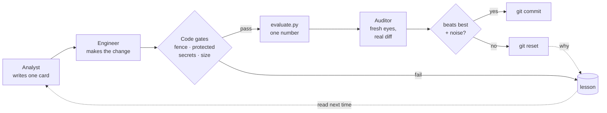

<p align="center">
  <!-- Language line: to add a language, append ` | <a href="README.xx.md">Name</a>` here and in every README.*.md -->
  <b>English</b> | <a href="README.vi.md">Tiếng Việt</a> | <a href="README.zh-CN.md">简体中文</a>
</p>

<p align="center">
  <picture>
    <source media="(prefers-color-scheme: dark)" srcset="docs/assets/banner-dark.png">
    
  </picture>
</p>

<h3 align="center">Your AI proposes the change. A number decides if it stays.</h3>

<p align="center">
  <a href="CHANGELOG.md"></a>
  
  
  <a href="https://github.com/johnha912/keeploop/actions/workflows/tests.yml"></a>
  <a href="LICENSE"></a>
</p>

<p align="center">
  <a href="#hand-it-to-your-ai">Hand it to your AI</a> ·
  <a href="#try-it-offline">Try it offline</a> ·
  <a href="#worked-examples">Examples</a> ·
  <a href="#how-it-works">How it works</a> ·
  <a href="#faq">FAQ</a> ·
  <a href="docs/GUIDE.md">Full guide</a>
</p>

<p align="center"></p>

<p align="center"><sub>Recorded from the real output of the offline mock demo (colours added). The full transcript is in <a href="docs/DEMO-OUTPUT.txt">docs/DEMO-OUTPUT.txt</a>.</sub></p>

AI agents are good at sounding sure. keeploop makes them prove it.

- **You say what "better" means**: faster tests, a higher benchmark, a
  cleaner report. One number.
- **Your AI tries one change at a time**, and a second, fresh AI checks it.
- **Only a change that beats the number is kept.** Everything else is
  undone, and the reason is written down so it is not tried again.

Works with the AI you already use: Claude Code, Codex, Cursor, Copilot,
Gemini CLI and others. keeploop itself is not an AI: it is a small Python
tool that measures and refuses. It needs nothing else installed, sends no
telemetry and stores no API keys.

## Hand it to your AI

**If your AI can run commands** (Claude Code, Codex, Cursor, Copilot,
Gemini CLI, Aider and similar), paste this into it and fill in the last
line:

```text
Clone https://github.com/johnha912/keeploop next to my project (not inside it),
run `python prepare.py` in the clone, then read its AGENTS.md and act as the CEO
it describes. What I want better: <for example "make my test suite faster">
```

That is all. You never type `kl` and there are no flags to learn. The
first time, your AI asks you in plain words what "better" means and how to
measure it, then proposes an `evaluate.py` (a small script that prints
that number) for you to approve before anything changes. In Claude Code, `/keeploop 3` inside the clone runs three
cycles.

**If your AI is a chat app that cannot open links or run commands**
(the ChatGPT or Gemini apps), paste the whole of
[`BOOTSTRAP.md`](BOOTSTRAP.md) into a new chat instead. The AI then gives
you one `python kl.py ...` command at a time to run in a clone, and you
paste the output back.

<details>
<summary><b>If you are an AI agent reading this</b></summary>

1. Clone this repo into its own folder, outside the user's project, and
   run `python prepare.py` there. Run every command from the clone's root.
2. Read [`AGENTS.md`](AGENTS.md). It is the complete procedure: roles,
   the exact `python kl.py` commands, and the hard rules.
3. If `evaluate.py` is still the demo, do not start the loop. Ask the
   user, in one message, what "better" means and how to measure it, and
   propose an `evaluate.py` (it gets the workspace path and prints one
   number, higher is better).
4. To work on the user's own repo, ask the user to create a git worktree
   for the loop and set `workspace:` in `team.yaml` to it; the steps are in
   [docs/GUIDE.md](docs/GUIDE.md#use-it-on-your-own-repo). You may draft
   `team.yaml`, `program.md` and `evaluate.py` for the user, but only the
   user edits them.
5. Never commit by hand: only `python kl.py keep` commits. For any
   progress claim, paste `python kl.py report` verbatim.

</details>

## Try it offline

Want to see it before you hand it to an AI? Needs Python 3.10+ and git.
No AI and no API key; it takes a few seconds.

```bash
git clone https://github.com/johnha912/keeploop.git && cd keeploop
python prepare.py
python run.py --mock --iterations 5
```

```text
cycle 1: keep  metric=0.942  best=0.942000  tokens=3501
cycle 2: keep  metric=0.992  best=0.992000  tokens=3568
cycle 3: discard  metric=0.942  best=0.992000  tokens=2820
cycle 4: crash  metric=None  best=0.992000  tokens=3510  lesson=L-001
cycle 5: keep  metric=1.0  best=1.000000  tokens=3860
run complete: 3 keeps, 1 discards, 1 crashes, 1 lessons, 17259 tokens. Best metric: 1.000000
```

(Timings trimmed.) The mock is a scripted stand-in for a real AI, so you
can watch a keep, a discard and a crash happen. It shows how the loop
works, not how good a real model is. Every keep is a real commit:
`git -C .keeploop/workspace log --oneline`.

## Worked examples

<table>
<tr>
<td width="50%" valign="top">

**Offline demo (toy config)**

The GIF above. A scripted mock tunes a demo `config.json` through five
cycles: three keeps, one discard and one crash that becomes lesson L-001.
Runs in seconds with no AI.

[Transcript](docs/DEMO-OUTPUT.txt) · [Try it](#try-it-offline)

</td>
<td width="50%" valign="top">

<a href="examples/marketing-research/"></a>

**Consumer insight report (marketing research)**

A social-listening study of five fast-fashion brands, with a dashboard
and a 30-page PDF. One real cycle, run in Claude Code, fixed two
unsupported claims: score 0.970000 → 1.000000, audit APPROVED, kept. The
page also says what the score does not measure.

[Read the example](examples/marketing-research/)

</td>
</tr>
</table>

## Why not just let the AI loop on its own?

Because an agent saying "done" is not a measurement.

| The usual way | With keeploop |
|---|---|
| The model that wrote the change also says it is fine | A **fresh session or a different vendor** audits the real diff; the maker never checks its own work |
| "Looks good to me" | Only `kl keep` commits. It re-runs the evaluation itself, and the number must beat the best by more than the evaluation's own noise, or the change is reset |
| A fluent answer passes for a correct one | Every change starts as a **written hypothesis card** with a measurable rule that would reject it, fixed before the evaluation runs |
| The same mistake again next week | Every crash, refusal or complaint becomes a **lesson**, optionally with a check that runs before every keep |
| An agent quietly edits the tests or leaks a key | **Code gates, not prompts**, stop it: protected paths, a secret scan, banned slop patterns, diff size and a content-hash fence |
| A great score that does not generalize | An optional **holdout** score the agents never see, with a warning when its gain lags the main score |
| You find new techniques by scrolling | A **trend scout** ranks new GitHub repos, Hacker News threads and arXiv papers; its ideas still go through a card |
| Locked to one vendor | `AGENTS.md` is read by Codex, Cursor, Copilot, Jules, Aider and more; Claude Code and Gemini CLI get pointer files |

## How it works

Built on Andrej Karpathy's [autoresearch](https://github.com/karpathy/autoresearch)
idea: a fixed metric, a keep-or-discard rule, and git as the memory of
what worked.



1. **Analyst** writes one card: the hypothesis, the smallest change, what
   should happen, and the result that would prove it wrong.
2. **Engineer** makes exactly that change, and is the only role that may
   edit files.
3. **Code gates** (`kl check`) refuse changes outside the workspace, edits
   to protected files, credentials and oversized diffs.
4. **evaluate.py** prints one number. The loop cannot edit it.
5. **Auditor**, in a fresh context or from another vendor, checks the diff
   against the card without seeing the Engineer's reasoning.
6. **`kl keep`** commits only if every check passes and the number beats
   the bar; otherwise **`kl discard`** resets and records why.

The full cycle, the critic round for heavy changes, lessons, the trend
scout and speed tuning are in the [guide](docs/GUIDE.md#how-a-cycle-works).

## Use it on your own work

keeploop works on any folder in git with an automatic score. A **pack**
gives the team the craft rules and review checklist for one field:

| Pack | For | Status |
|---|---|---|
| `software` | code | Ready: tests and benchmarks make honest metrics |
| `ui-design` | UI/UX | Experimental: Lighthouse or axe scores measure the floor, not taste |
| `marketing-content` | marketing copy | Experimental: real outcomes arrive late and noisy |
| `marketing-research` | consumer insight reports | Experimental: checks rules and traceability, not whether the insight is right |

New field? `python kl.py pack new NAME` scaffolds one. Setup for your own
repo, `team.yaml`, vendors and the headless overnight mode
(`python run.py`) are in [docs/GUIDE.md](docs/GUIDE.md#use-it-on-your-own-repo).

## Safety, in short

- keeploop never executes text from a model or a web page. Vendor CLIs get
  the prompt on stdin, and only the Engineer gets edit rights.
- While code you did not write runs, every file in the project folder
  outside the workspace is content-hashed. Any change stops the run.
- Changed files are scanned for credentials, and token-like environment
  variables are removed before any vendor CLI or evaluation starts.
- The fence detects changes; **it is not a sandbox**. Run real vendors in a
  container or VM if that matters to you.

Details: [docs/GUIDE.md](docs/GUIDE.md#safety) and [SECURITY.md](SECURITY.md).

## FAQ

**Doesn't keeping the best of many tries overfit the score?**
Yes, that is the main risk of any keep/discard loop. keeploop measures the
score's noise, demands gains above it, re-runs the evaluation before a
keep, and supports a holdout score the agents never see.

**Does the demo prove the agents are good?**
No. The mock is scripted. A real run is only as good as your AI and your
`evaluate.py`.

**Is this another multi-agent framework?**
No model runs inside keeploop. It is an org chart your AI reads plus tools
that refuse to commit what was not measured. Swap the AI and the process
stays.

**When should I not use it?**
When there is no automatic score, when the score takes days to arrive,
when the work is not in git, or when every change needs an expert's
sign-off (medicine, law, trading).

More questions: [docs/GUIDE.md](docs/GUIDE.md#faq-for-skeptics).

## Docs

| | |
|---|---|
| [docs/GUIDE.md](docs/GUIDE.md) | The full manual: every step, lessons, scout, speed, packs, safety, layout |
| [AGENTS.md](AGENTS.md) | The org chart and exact commands your AI follows |
| [BOOTSTRAP.md](BOOTSTRAP.md) | One file to paste into a chat app |
| [docs/SPEC.md](docs/SPEC.md) | Parameters, file formats, invariants |
| [SECURITY.md](SECURITY.md) | Threat model and how to report a vulnerability |
| [CHANGELOG.md](CHANGELOG.md) | Versions ([SemVer](https://semver.org)) |

## Credits

keeploop stands on [**autoresearch**](https://github.com/karpathy/autoresearch)
by Andrej Karpathy: a fixed evaluation the agent cannot touch, an
append-only `results.tsv`, a keep/discard rule and git as memory. keeploop
turns it into an org chart any AI can run, and adds roles, cross-vendor
audit, code gates, lessons and a trend scout. No code from autoresearch
is copied. If you like this repo, star his first.

Ideas were also borrowed (re-implemented, no code copied) from tools we
use daily:

| Project | Idea taken |
|---|---|
| [ponytail](https://github.com/DietrichGebert/ponytail) (MIT) | "Climb the ladder before writing code" and marked shortcuts in the `software` pack |
| [ECC (everything-claude-code)](https://github.com/affaan-m/ECC) (MIT) | Verify-before-done and red-then-green habits for the Engineer; security review as a fixed Auditor checklist item |
| [Playwright MCP](https://github.com/microsoft/playwright-mcp) (Apache-2.0) | Judge the rendered page in a real browser: a principle in the `ui-design` pack |
| [OmniRoute](https://github.com/cheaper-inference/OmniRoute) (MIT) | Ordered per-role vendor fallback |
| [graphify](https://github.com/Graphify-Labs/graphify) (Apache-2.0) | A cached code index with an "imported by" lookup (`kl map`) instead of raw file dumps |

The banner is set in [Google Sans Flex](https://fonts.google.com/specimen/Google+Sans+Flex).

If keeploop stopped a bad change from landing, a ⭐ helps other people
find it. Bugs and ideas: [open an issue](https://github.com/johnha912/keeploop/issues).

## License

[MIT](LICENSE).
