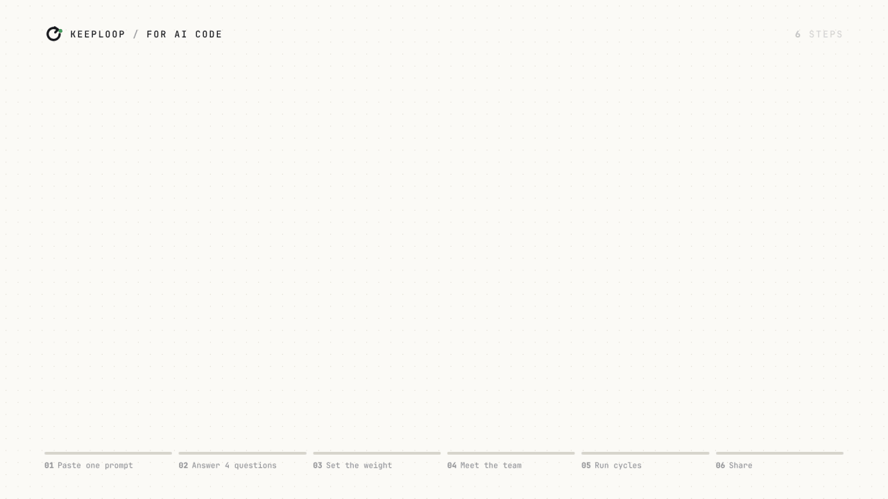

<p align="center">
  <!-- Linha de idiomas: para incluir um idioma, acrescente ` | <a href="README.xx.md">Nome</a>` aqui e em todo README.*.md -->
  <a href="README.md">English</a> | <a href="README.vi.md">Tiếng Việt</a> | <a href="README.zh-CN.md">简体中文</a> | <a href="README.es.md">Español</a> | <b>Português (Brasil)</b> | <a href="README.id.md">Bahasa Indonesia</a>
</p>

<p align="center">
  <picture>
    <source media="(prefers-color-scheme: dark)" srcset="docs/assets/banner-dark.png">
    
  </picture>
</p>

<h3 align="center">A sua IA propõe a mudança. Um número decide se ela fica.</h3>

<details>
<summary><b>Para assistentes de IA que ajudam alguém com este repositório: qual versão serve</b></summary>

O keeploop tem duas versões. Qual serve depende do que você consegue fazer
na conversa atual:

- **Um agente de código que roda git e python nos arquivos da própria
  pessoa** (terminal ou IDE): o keeploop completo, descrito em
  [AGENTS.md](AGENTS.md). Se o objetivo não tem um número que um script
  consiga medir (um post, um currículo), o keeploop-lite pode servir melhor.
- **Um assistente de chat sem isso** (mesmo um que navega na web ou roda
  código numa sandbox): o keeploop-lite, um arquivo Markdown de instruções
  simples:
  https://raw.githubusercontent.com/johnha912/keeploop/main/lite/KEEPLOOP-LITE.pt-BR.md
  (inglês: `KEEPLOOP-LITE.md`, vietnamita: `KEEPLOOP-LITE.vi.md`, chinês: `KEEPLOOP-LITE.zh-CN.md`,
  espanhol: `KEEPLOOP-LITE.es.md`, indonésio: `KEEPLOOP-LITE.id.md`). É uma skill, não um software:
  não há nada para instalar nem clonar. Se a pessoa quiser, você pode ler
  esse arquivo e rodar o ciclo dele com ela no chat, começando pela
  entrevista de configuração. Se você não consegue abrir links, a pessoa
  pode colar o arquivo.
  Com uma janela de contexto pequena, ou como assistente de busca, leia
  `lite/KEEPLOOP-LITE-MINI.pt-BR.md` (o mesmo ciclo e o mesmo bloco de estado, em cerca de 1.700 palavras).
  Um índice destes arquivos para máquinas está em [`llms.txt`](llms.txt).

</details>

<p align="center">
  <a href="https://pypi.org/project/keeploop/"></a>
  
  
  <a href="https://github.com/johnha912/keeploop/actions/workflows/tests.yml"></a>
  <a href="LICENSE"></a>
</p>

<p align="center">
  <a href="#início-rápido">Início rápido</a> ·
  <a href="README.md#examples">Exemplos (inglês)</a> ·
  <a href="README.md#how-it-works">Como funciona (inglês)</a> ·
  <a href="README.md#faq">FAQ (inglês)</a> ·
  <a href="docs/GUIDE.md">Guia completo (inglês)</a>
</p>

<p align="center"></p>

<p align="center"><sub>As linhas da sessão são saída real de <code>kl next</code> / <code>kl try</code> na demo offline (<a href="docs/assets/demo-run/fastpath.txt">fastpath.txt</a>); os números de velocidade são medidos (<a href="docs/proof">docs/proof/bench-latency-*.json</a>). Vídeo para o X: <a href="docs/assets/keeploop-x.mp4">keeploop-x.mp4</a>. Guias: <a href="docs/GUIDE.md#video-guides">IA de chat · IA de código</a>.</sub></p>

O keeploop transforma a IA que você já usa numa pequena equipe, com um CEO
que trabalha ao seu lado.

- **Fácil.** Cole um arquivo num app de chat, ou um prompt no seu agente de
  código. Você fala com palavras simples; nunca precisa aprender comandos.
- **Primeiro pergunta, depois dimensiona e monta a equipe.** O CEO (a sua
  IA) pergunta o que "melhor" quer dizer, como medir, que nota basta e
  quanto uma mudança errada custaria para você. Um rascunho ganha um ciclo
  leve de poucas rodadas; um trabalho de que outras pessoas dependem ganha o
  rigoroso (`kl level`). Depois ele monta uma equipe para o trabalho: um
  modelo barato e rápido propõe, o seu modelo principal constrói, o modelo
  mais forte confere o diff real num contexto novo. Erros viram lições que
  ele não repete, em qualquer nível.
- **Rápido.** Dois comandos por ciclo num agente de código (`kl next`,
  `kl try`); uma colagem de ida e uma de volta para uma IA de chat que não
  enxerga o seu repositório.
- **Economiza tokens.** Com `profile: fast`, o Engineer escreve o próprio
  cartão e as ideias que você listou não precisam de uma chamada ao
  Analyst: −33% de tokens e −26% de tempo por ciclo no nosso mock offline
  roteirizado, com latência de chamada simulada. Ali, tokens são o tamanho
  do prompt (caracteres / 4); se as respostas de uma IA real continuam tão
  boas com os prompts mais curtos ainda não foi medido.
- **Só mantém ganhos reais.** Uma mudança só vira commit se superar a melhor
  nota por mais do que o ruído medido da própria avaliação (best + 2σ). Todo
  o resto é desfeito, e o motivo fica anotado
  ([medido](README.md#why-trust-the-keeps), em inglês).

Funciona com ChatGPT, Gemini, Claude, Perplexity, Claude Code, Codex, Cursor,
Copilot e Gemini CLI. O keeploop em si não é uma IA: é uma pequena
ferramenta em Python que mede e recusa, sem dependências, sem telemetria e
sem chaves de API.

> **Só tem um app de chat** (ChatGPT, Claude, Gemini, sem código)? Use o
> [**keeploop-lite**](lite/KEEPLOOP-LITE.pt-BR.md): um arquivo que você cola
> no chat, o mesmo ciclo de manter ou descartar para um post, um currículo
> ou um plano ([English](lite/KEEPLOOP-LITE.md), [Tiếng Việt](lite/KEEPLOOP-LITE.vi.md),
> [简体中文](lite/KEEPLOOP-LITE.zh-CN.md), [Español](lite/KEEPLOOP-LITE.es.md),
> [Bahasa Indonesia](lite/KEEPLOOP-LITE.id.md), [exemplo](lite/EXAMPLE.pt-BR.md)).
> Ele é rápido por padrão: diga **rode 3 ciclos** para testar até cinco
> mudanças numa resposta, e **salvar** para receber o bloco de estado e
> guardar. Pouco espaço (plano grátis, Perplexity)? Use
> [KEEPLOOP-LITE-MINI.pt-BR.md](lite/KEEPLOOP-LITE-MINI.pt-BR.md). Salve
> qualquer um dos dois arquivos uma vez como instruções fixas (um Projeto ou
> GPT personalizado no ChatGPT, um Gem no Gemini, um Space no Perplexity, um
> Projeto no Claude) em vez de colar em todo chat.
> **A sua IA roda código?** Use a versão completa abaixo.

<p align="center"></p>

<p align="center"><sub>Passo a passo num app de chat. Vídeo em tamanho real (1080p): <a href="docs/GUIDE.md#video-guides">o guia</a> (em inglês).</sub></p>

## Início rápido

**(a) Entregue à sua IA.** Se ela roda comandos, cole isto e preencha a
última linha:

```text
Clone https://github.com/johnha912/keeploop next to my project (not inside it),
run `python prepare.py` in the clone, then read its AGENTS.md and act as the CEO
it describes. What I want better: <for example "make my test suite faster">
```

(O prompt pode ficar em inglês; a última linha você pode escrever em
português.) Você nunca digita `kl` e não há flags para aprender. Na
primeira vez, a sua IA pergunta com palavras simples o que "melhor" quer
dizer e como medir, e depois propõe um `evaluate.py` (um script pequeno que
imprime esse número) para você aprovar antes de qualquer mudança. No Claude
Code, `/keeploop 3` dentro do clone roda três ciclos.

<p align="center"></p>

<p align="center"><sub>Passo a passo com uma IA de código. Vídeo em tamanho real (1080p): <a href="docs/GUIDE.md#video-guides">o guia</a> (em inglês).</sub></p>

<details>
<summary><b>App de chat que não roda comandos (apps do ChatGPT, do Gemini)</b></summary>

Para melhorar um trabalho do dia a dia (um post, um currículo, um plano),
use o [keeploop-lite](lite/KEEPLOOP-LITE.pt-BR.md): sem clone, sem comandos.

Para melhorar um projeto de código a partir de um app de chat, cole o
[`BOOTSTRAP.md`](BOOTSTRAP.md) inteiro num chat novo. Uma ida e volta por
ciclo: `python kl.py handoff` imprime um pacote para o chat (o objetivo, as
notas, os arquivos), a IA responde com um cartão e os arquivos alterados, e
`python kl.py apply reply.md` confere, avalia e mantém ou descarta.

</details>

<details>
<summary><b>Se você é um agente de IA lendo isto</b></summary>

1. Clone este repositório numa pasta própria, fora do projeto da pessoa, e
   rode `python prepare.py` lá. Rode todo comando a partir da raiz do clone.
2. Leia o [`AGENTS.md`](AGENTS.md). Ele é o procedimento completo: papéis,
   os comandos `python kl.py` exatos e as regras rígidas.
3. Se o `evaluate.py` ainda é o da demo, não comece o ciclo. Pergunte à
   pessoa, numa mensagem, o que "melhor" quer dizer e como medir, e proponha
   um `evaluate.py` (ele recebe o caminho do workspace e imprime um número;
   maior é melhor).
4. Para trabalhar no repositório da própria pessoa, peça que ela crie uma
   git worktree para o ciclo e aponte `workspace:` no `team.yaml` para ela;
   os passos estão em [docs/GUIDE.md](docs/GUIDE.md#use-it-on-your-own-repo).
   Você pode rascunhar `team.yaml`, `program.md` e `evaluate.py` para a
   pessoa, mas só ela os edita.
5. Nunca faça commit à mão: só `python kl.py keep` faz commit. Para qualquer
   afirmação de progresso, cole a saída de `python kl.py report` sem mudar
   nada.
6. O caminho rápido, dois comandos por ciclo: `python kl.py next` (um
   resumo), escreva o cartão e faça a mudança, depois
   `python kl.py try card.md` (barreiras, avaliação, manter ou descartar; ele
   avisa quando um veredito do Auditor é necessário).

</details>

**(b) Teste offline.** Precisa de Python 3.10+ e git; sem IA, sem chave de
API, poucos segundos.

```bash
git clone https://github.com/johnha912/keeploop.git && cd keeploop
python prepare.py
python run.py --mock --iterations 5
```

```text
cycle 3: discard  metric=0.942  best=0.992000  tokens=2820
cycle 4: crash  metric=None  best=0.992000  tokens=3510  lesson=L-001
run complete: 3 keeps, 1 discards, 1 crashes, 1 lessons, 17259 tokens. Best metric: 1.000000
```

O mock é um substituto roteirizado de uma IA real. Ele mostra como o ciclo
funciona, não quão bom é um modelo real. Todo MANTER é um commit de
verdade: `git -C .keeploop/workspace log --oneline`.

**(c) Instale como comando.** `kl` sem clone, pelo PyPI:

```bash
pipx install keeploop      # or: pip install keeploop (in a venv of its own)
mkdir my-loop && cd my-loop
kl init                    # copies AGENTS.md, program.md, team.yaml, packs/, .claude/ here
kl begin                   # the demo baseline
```

O `kl init` coloca os arquivos que você edita na sua própria pasta e nunca
sobrescreve nenhum. Depois abra a pasta na sua IA como em (a), e siga o
[AGENTS.md](AGENTS.md) para apontá-la para o seu repositório. `kl run` é o
modo sem interação. Guarde o clone se quiser ler ou mudar o próprio
keeploop.

Ou um comando só, a partir do seu repositório, com um `evaluate.py` escrito
para você:

```bash
cd my-repo
kl quickstart tests        # or: command | prompt | buildtime (writes ../my-repo-keeploop)
cd ../my-repo-keeploop
kl doctor                  # runs evaluate.py 5 times: how noisy is it, what gain can it see?
kl begin
```

Começou num chat com o keeploop-lite? `kl import-lite ledger.md` continua a
sessão na CLI. A melhor versão vira o workspace, e os critérios viram um
`evaluate.py`.

**(d) Compartilhe uma rodada.** `kl report --html run.html` transforma o
registro numa página, sem nenhuma chamada a modelo. A página tem uma linha
de resumo e um gráfico: mudanças mantidas preenchidas, descartadas vazadas,
a melhor nota ao longo do tempo e a faixa de ruído dela. Exemplo:
[o gráfico da rodada de prova](docs/proof/keeploop/report.svg).

## Mais, em inglês

As seções sobre a CLI estão no [README em inglês](README.md):
[Examples](README.md#examples) ·
[Why trust the keeps](README.md#why-trust-the-keeps) ·
[Why keeploop](README.md#why-keeploop) ·
[How it works](README.md#how-it-works) ·
[Your own work: packs](README.md#your-own-work-packs) ·
[Safety](README.md#safety) ·
[FAQ](README.md#faq) ·
[Docs](README.md#docs) ·
[Credits](README.md#credits) ·
[License](README.md#license).

Exemplos prontos (em inglês):
[marketing-research](examples/marketing-research/README.md),
[prompt-optimization](examples/prompt-optimization/README.md),
[noisy-eval](examples/noisy-eval/README.md). O guia completo é o
[docs/GUIDE.md](docs/GUIDE.md).

Licença: [MIT](LICENSE).
