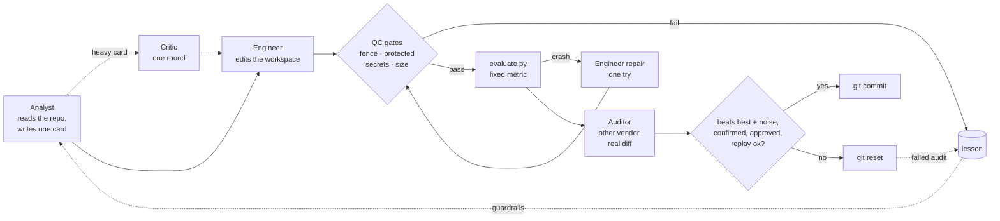

<p align="center">
  <!-- Dòng ngôn ngữ: muốn thêm ngôn ngữ, nối thêm ` | <a href="README.xx.md">Tên</a>` ở đây và trong mọi README.*.md -->
  <a href="README.md">English</a> | <b>Tiếng Việt</b> | <a href="README.zh-CN.md">简体中文</a>
</p>

<p align="center">
  <picture>
    <source media="(prefers-color-scheme: dark)" srcset="docs/assets/banner-dark.png">
    
  </picture>
</p>

<p align="center">
  <a href="CHANGELOG.md"></a>
  
  
  <a href="https://github.com/johnha912/keeploop/actions/workflows/tests.yml"></a>
  <a href="LICENSE"></a>
</p>

<p align="center">
  <a href="#quickstart">Bắt đầu nhanh</a> ·
  <a href="#use-it-with-a-chat-ai-no-install">AI chat</a> ·
  <a href="#how-a-cycle-works">Cách hoạt động</a> ·
  <a href="#where-the-rules-come-from">Đã qua thực tế</a> ·
  <a href="#use-it-on-your-own-repo">Repo của bạn</a> ·
  <a href="#safety">An toàn</a> ·
  <a href="#faq-for-skeptics">FAQ</a> ·
  <a href="#credits">Ghi công</a>
</p>

> **Ghi chú đồng bộ.** Bản này dịch từ [README.md](README.md), bản tiếng Anh
> là bản gốc. Khi README.md đổi, sửa file này theo cùng lần commit: giữ nguyên
> thứ tự các mục, khối code, tên file, lệnh và con số, chỉ dịch phần văn xuôi.
> Nếu hai bản lệch nhau, bản tiếng Anh đúng.

---

<p align="center"></p>

<p align="center"><sub>Ghi lại từ đầu ra thật của bản demo mock chạy offline (có thêm màu). Thích đọc chữ hơn? Bản ghi đầy đủ nằm ở mục <a href="#quickstart">Bắt đầu nhanh</a>, phần "Chạy qua đêm, không cần chat".</sub></p>

Dự án [autoresearch](https://github.com/karpathy/autoresearch) của Karpathy
đã cho thấy một agent có thể cải thiện code qua đêm nếu bạn cho nó một chỉ
số cố định, một quy tắc giữ/bỏ và git.

**keeploop không phải một AI khác.** Clone nó, mở trong AI bạn đang dùng,
và AI đó trở thành CEO của một công ty nhỏ gồm Analyst, Engineer, Auditor,
Critic và Scout. keeploop trao cho nó sơ đồ tổ chức (`AGENTS.md`) và một
bộ công cụ (`kl`) biết đo, chặn cổng, ghi lại và từ chối. AI của bạn lo
phần suy nghĩ. Chỉ con số tốt hơn mới được commit.

Chưa clone? Một AI chat không mở được link hay chạy lệnh vẫn dùng được:
xem [Dùng với AI chat (không cần cài đặt)](#use-it-with-a-chat-ai-no-install).

| Cách thông thường | Với keeploop |
|---|---|
| Chính model viết thay đổi cũng tự bảo là ổn | **Một vendor khác hoặc một phiên mới** kiểm toán diff thật; người làm không bao giờ tự kiểm tra việc của mình |
| "Trông ổn đấy" | Chỉ `kl keep` mới commit, và nó tự chạy lại phần đánh giá: **chỉ số phải vượt mức tốt nhất hiện có quá nhiễu của chính phép đánh giá**, được xác nhận bằng lần chạy thứ hai khi phép đánh giá nhiễu hoặc thay đổi nặng, nếu không thì `git reset` |
| Câu trả lời trôi chảy được coi là câu trả lời đúng | Mỗi thay đổi bắt đầu bằng một **giả thuyết đăng ký trước** với quy tắc loại bỏ đo được; thay đổi nặng phải qua **critic** trước; tiến độ được báo từ sổ cái, không bao giờ từ trí nhớ |
| Tuần sau lại mắc đúng lỗi cũ | Mọi thất bại, lần bị từ chối hay lời phàn nàn (kể cả "chậm quá") đều thành một **bài học** kèm kiểm tra hồi quy chạy trước mỗi lần keep |
| Agent lặng lẽ sửa test, làm lộ key, hoặc đụng vào config của bạn | **Cổng tất định** chặn lại: đường dẫn được bảo vệ, quét bí mật, mẫu rác (slop), cỡ diff, một hàng rào băm nội dung quanh dự án |
| Điểm số cao nhưng không tổng quát hóa được | Một **holdout eval** tùy chọn mà agent không bao giờ thấy, kèm cảnh báo khi hai mức tăng lệch nhau |
| Bạn tìm kỹ thuật mới bằng cách lướt web | Một **trend scout** xếp hạng repo GitHub mới, bài trên HN và bài báo arXiv theo độ liên quan, đà tăng và độ mới |
| Bị khóa vào một vendor | `AGENTS.md` được Codex, Cursor, Copilot, Jules, Aider và nhiều công cụ khác đọc; Claude Code và Gemini CLI dùng file trỏ; mọi CLI khác cắm vào qua `team.yaml` |

Khoảng 3,500 dòng Python thư viện chuẩn. Không phụ thuộc gói ngoài, không
telemetry, không lưu API key.

<a id="quickstart"></a>
## Bắt đầu nhanh

Cần Python 3.10+ và git.

```bash
git clone https://github.com/johnha912/keeploop.git && cd keeploop
python prepare.py
```

Sau đó mở thư mục trong AI của bạn và **chỉ cần nói bạn muốn cải thiện điều gì**:
"làm test chạy nhanh hơn", "nâng điểm benchmark". Bạn không bao giờ gõ `kl`
và không có cờ nào phải học. AI của bạn đọc sơ đồ tổ chức, điều hành đội,
và hỏi bạn bằng lời thường khi cần gì đó, chẳng hạn lần đầu là "tốt hơn"
nghĩa là gì.

| AI của bạn | Nó đọc gì | Lối tắt (tùy chọn) |
|---|---|---|
| Claude Code | `CLAUDE.md` → `AGENTS.md`, cùng các subagent trong `.claude/agents` | `/keeploop 3` |
| Codex, Cursor, Copilot, Jules, Aider, Zed, Amp… | `AGENTS.md` | — |
| Gemini CLI | `GEMINI.md` → `AGENTS.md` | — |
| Công cụ khác | `AGENTS.md` (tự đủ) | các vai chạy như phiên mới nếu công cụ của bạn không có subagent |

Trong Claude Code, `.claude/settings.json` cho phép sẵn các lệnh `kl` chỉ
đọc và đo để bạn không bị hỏi cả chục lần mỗi chu kỳ (trend scout cũng nằm
trong đó: nó chỉ đọc ba nguồn công khai cố định). Những lệnh chạy kiểm tra
tùy ý, gọi vendor khác, tải link bạn đưa hoặc niêm phong lại hàng rào thì
vẫn hỏi bạn trước.

Phía sau, AI của bạn điều khiển `kl`, và `kl` quyết định. Trông như thế nào
trên cấu hình demo đồ chơi:

```text
$ python kl.py begin
kl: baseline metric = 0.828178  sigma = 0.000000 (3 runs)  holdout baseline recorded
$ python kl.py recall "learning rate"
nothing in memory matches; it is new
$ python kl.py card card.txt
card 1 registered
                                   (the Engineer sets learning_rate to 0.03)
$ python kl.py check
PASS tier=light files=1 lines=2 diff=be28f0079be6
$ python kl.py keep
KEPT cycle 1: metric 0.942000 (bar 0.828178); best is now 0.942000
                                   (next card: dropout 0.9)
$ python kl.py keep
kl: REFUSED: metric 0.558000 does not beat the keep bar 0.942000 (best 0.942000, sigma 0.000000)
$ python kl.py discard --reason "dropout 0.9 lowered the metric"
discarded cycle 2 (discard); workspace back at best 0.942000
$ python kl.py report
cycles: 2  keeps: 1  discards: 1  crashes: 0
baseline: 0.828178  best: 0.942000
hypotheses: rejected 1, supported 1
```

(Đầu ra đã được rút gọn còn những dòng quan trọng.)

### Chạy qua đêm, không cần chat

`run.py` chạy cùng vòng lặp đó ở chế độ headless, gọi các CLI vendor mà bạn
liệt kê trong `team.yaml`. Bản demo dùng một **vendor giả theo kịch bản**
đi qua một lần keep, một lần discard và một lần crash, để bạn thấy mọi
nhánh ngoại tuyến trong vài giây. Nó cho thấy cơ chế, không phải kết quả
một model thật đạt được.

```bash
python run.py --mock --iterations 5
```

```text
run: baseline metric = 0.828178  sigma = 0.000000 (3 runs)  holdout baseline recorded
cycle 1: keep  metric=0.942  best=0.942000  tokens=3501
cycle 2: keep  metric=0.992  best=0.992000  tokens=3568
cycle 3: discard  metric=0.942  best=0.992000  tokens=2820
cycle 4: crash  metric=None  best=0.992000  tokens=3510  lesson=L-001
cycle 5: keep  metric=1.0  best=1.000000  tokens=3860
holdout: 0.818178 -> 0.998000 (+0.179822); evaluation: 0.828178 -> 1.000000 (+0.171822)

run complete: 3 keeps, 1 discards, 1 crashes, 1 lessons, 17259 tokens. Best metric: 1.000000
```

(Thời gian từng pha đã được rút gọn.)

Mỗi lần keep là một commit bạn đọc được:

```bash
git -C .keeploop/workspace log --oneline   # 3 keep commits on top of the initial one
cat .keeploop/results.tsv                  # one row per cycle; kl only appends
python kl.py recall "crash"                # L-001: what crashed, and the rule it left behind
```

<a id="use-it-with-a-chat-ai-no-install"></a>
## Dùng với AI chat (không cần cài đặt)

Các ứng dụng chat dành cho người dùng phổ thông (ứng dụng Gemini, ChatGPT
và tương tự) không mở được link GitHub, không đọc được file của bạn và
không chạy được terminal. Dành cho chúng, keeploop có sẵn
[`BOOTSTRAP.md`](BOOTSTRAP.md): một file tự đủ, nói keeploop làm gì, khi
nào kích hoạt, chứa nguyên văn `AGENTS.md` và thêm các quy tắc cho chế độ
chat.

1. Mở `BOOTSTRAP.md`, sao chép toàn bộ file và dán vào một cuộc chat mới.
2. AI tóm tắt chu kỳ và các quy tắc cứng, rồi hỏi bạn muốn cải thiện điều gì.
3. Bạn vẫn nằm trong vòng lặp: AI không chạy được gì, nên nó đưa bạn từng
   lệnh `python kl.py ...` một. Bạn chạy lệnh trong một bản clone của repo
   này rồi dán đầu ra lại. Nó không bao giờ bịa lệnh hay con số; điều gì
   nó chưa biết sẽ nằm dưới `MISSING:` để bạn trả lời.

Cách này cần Python 3.10+ và git trên máy bạn để chạy lệnh, nhưng không
cần công cụ AI nào có quyền truy cập file. `BOOTSTRAP.md` được tạo lại mỗi
khi `AGENTS.md` đổi (các bước nằm cuối file đó).

<a id="how-a-cycle-works"></a>
## Một chu kỳ hoạt động thế nào

Cùng một chu kỳ chạy ở cả hai chế độ: trong AI của bạn, mỗi hộp bên dưới là
một subagent hoặc một phiên mới và mỗi quyết định là một lệnh `kl`; trong
`run.py`, vòng lặp tự gọi các CLI vendor.



1. **Analyst** kiểm tra bộ nhớ của đội (`kl recall`) và chỉ mục code
   (`kl map`), rồi viết một thẻ thí nghiệm: giả thuyết, thay đổi nhỏ nhất,
   hiệu quả kỳ vọng và kết quả sẽ khiến nó bị loại.
2. **Critic**, chỉ với thẻ nặng, phản biện thẻ một lần: những cách giải
   thích bị bỏ sót, thẻ có thể thất bại ra sao, quy tắc loại bỏ có quá dễ
   không. Analyst được sửa một lần. Thẻ nhẹ bỏ qua bước này.
3. **Engineer** thực hiện đúng thẻ đó bằng cách sửa file. Nếu phép đánh
   giá crash, nó được một lần sửa lại kèm thông báo lỗi.
4. **Cổng QC** chạy bằng code, không bằng prompt: không gì ngoài workspace
   được thay đổi, đường dẫn được bảo vệ không bị đụng tới, không thông tin
   xác thực hay mẫu rác bị cấm nào được xuất hiện trong diff, và diff phải
   đủ nhỏ để đọc. Các cổng cũng phân loại thay đổi là nhẹ hay nặng.
5. **evaluate.py** in ra một con số. Vòng lặp không sửa được nó.
6. **Auditor**, một vendor khác hoặc một phiên mới, kiểm tra phạm vi, việc
   lách phép đánh giá, guardrail, bảo mật và tay nghề, cộng với checklist
   chuyên gia của pack khi thay đổi nặng. Nó chỉ được gọi khi chỉ số đã
   vượt ngưỡng.
7. **Keep** cần chỉ số vượt mức tốt nhất quá nhiễu đã đo của phép đánh giá,
   một lần chạy xác nhận (chỉ bỏ qua với thay đổi nhẹ khi phép đánh giá
   không có nhiễu), một lần phê duyệt, không tụt rubric và mọi kiểm tra bài
   học đều đạt. Bất cứ điều gì khác thì bị reset.

Trước chu kỳ đầu tiên, vòng lặp chạy phép đánh giá ba lần để đo nhiễu (σ),
và một lần keep phải vượt `2σ`. Nếu có `holdout.py`, nó được chấm một lần
trước và một lần sau khi chạy; agent không bao giờ thấy nó, và nếu mức tăng
trên holdout thấp hơn nhiều so với mức tăng của eval thì một cảnh báo được
in ra rằng các lần keep có thể đang khớp với phép đánh giá thay vì với bài
toán.

<a id="hypotheses-not-prompts"></a>
## Giả thuyết, không phải prompt

Một prompt tốt hơn làm câu trả lời đọc hay hơn. Nó không đưa cho model dữ
liệu mà nó chưa từng thấy. keeploop được xây để sự trôi chảy không thể giả
làm bằng chứng:

- **Thẻ đăng ký trước.** Analyst phải trả lời bằng các dòng có nhãn:
  `HYPOTHESIS`, `ALTERNATIVES`, `CHANGE`, `EXPECT`, `REJECT IF`, `MISSING`.
  Một thẻ viết văn xuôi tự do là một crash, không phải một chu kỳ. Tiêu chí
  loại bỏ được chốt trước khi phép đánh giá chạy và phải đo được: "nếu nó
  không tốt hơn" bị từ chối, "nếu metric < 0.85" được chấp nhận.
- **Một critic trước khi làm.** Thẻ nặng phải qua một vòng phản biện trước
  khi viết bất kỳ dòng code nào. Cuộc tranh luận được ghi lại; nó có thể
  chặn một thẻ, không bao giờ giữ được một thẻ.
- **Linh cảm của bạn đi trước.** Các gạch đầu dòng dưới `## Hypotheses to test`
  trong `program.md` được thử, theo thứ tự, trước khi Analyst đề xuất ý
  riêng.
- **Chỗ trống giao cho bạn.** Bất cứ điều gì Analyst nói là `MISSING` sẽ
  được đưa vào `.keeploop/questions.md` thay vì bị che đi.
- **Đã bị loại thì vẫn bị loại.** Mỗi thẻ nhận một kết luận trong
  `.keeploop/hypotheses.jsonl` (supported, rejected, inconclusive,
  untested). Những thẻ rejected và inconclusive được cho Analyst xem, và nó
  chỉ được đề xuất lại một thẻ bằng cách nói điều gì đã khác đi.
- **Chỉ chỉ số mới quyết định.** Auditor thấy thẻ và diff, không bao giờ
  thấy lời giải thích của Engineer, và một lần keep cần chỉ số đo được vượt
  mức tốt nhất quá nhiễu của phép đánh giá.
- **Con số đến từ file, không từ model.** AI của bạn được dặn dán `kl report`
  cho mọi tuyên bố về tiến độ. `kl cite` (tùy chọn, dùng mạng) kiểm tra các
  link được trích còn sống và đoạn trích dẫn có thật sự nằm trên trang.
- **Slop là một cổng, không phải ghi chú phong cách.** Mỗi pack liệt kê các
  mẫu bị cấm (`TODO` bỏ sót, "as an AI", lời quảng cáo sáo rỗng); một lần
  trúng sẽ chặn thay đổi trước khi bất kỳ model nào xem xét.

<a id="where-the-rules-come-from"></a>
## Các quy tắc đến từ đâu

Các quy tắc của keeploop không được vẽ ra trên bảng trắng. Chúng lấy cảm
hứng từ những đội AI mà tác giả vận hành hằng ngày, mỗi đội có một chủ là
con người và một AI đóng vai CEO. Các ví dụ dưới đây là cách những đội đó
làm việc, không phải benchmark của repo này:

- **Một cổng nghiên cứu cho môn học.** Các dự án được xếp hạng trên thang
  100 điểm với các cổng cứng. Phiếu bầu của độc giả cộng thêm điểm nhưng
  không cứu được dự án đã rớt một cổng.
- **Một dự án ML bậc sau đại học.** Bảy vai, mỗi vai phụ trách một phần của
  rubric chấm điểm. Analyst, rồi con người duyệt, rồi Engineer, rồi một
  auditor từ vendor khác. Một con số chỉ vào báo cáo nếu phép đánh giá
  chung tạo ra nó trên một tập test chưa bị đụng tới.
- **Các cuộc thi Kaggle.** Cross-validation là sự thật, không phải bảng
  xếp hạng công khai. Giả thuyết được khai báo trước khi chạm vào dữ liệu.
  Mỗi lần nộp bài phải mua được thông tin mới.
- **Một công ty sản xuất YouTube với 13 phòng ban.** Checklist bàn giao cố
  định, file được kiểm bằng hash ở phía nhận, và đôi tai của chủ là cổng
  cuối cùng.
- **Hai đội nghiên cứu đối thủ trên các vendor khác nhau** (Muse Code và
  Claude Code). Họ không được đọc công việc của nhau, và rubric được giữ
  nguyên suốt cả mùa.
- **Một nhật ký tập luyện sức mạnh.** Một bài tập thay thế được quy về một
  thước đo chung để các buổi tập so sánh công bằng, và mỗi buổi lặp lại
  được vẽ biểu đồ so với buổi trước.

Sáu quy tắc đứng vững trong mọi đội đó:

| Quy tắc | Học được ở | Trong keeploop |
|---|---|---|
| Một kênh duy nhất tới con người, không phải rải rác các quyết định nhỏ | cổng nghiên cứu, công ty sản xuất | AI của bạn là bên duy nhất nói chuyện với bạn; câu hỏi mở được gom vào `.keeploop/questions.md`, sự kiện đến từ `kl report` |
| Người làm không bao giờ tự kiểm tra việc của mình | dự án ML, các đội đối thủ | Chỉ Engineer được sửa. Auditor và critic chỉ đọc: vendor khác nếu bạn đã thiết lập, nếu không thì một phiên mới |
| Một chỉ số cố định là sự thật; ý kiến và demo không phải bằng chứng | Kaggle, cổng nghiên cứu | `evaluate.py` được bảo vệ và `kl keep` chạy lại nó. Kiểm toán, phản biện và cổng cứng có thể chặn một lần keep nhưng không bao giờ ép được một lần keep |
| Nếu chỉ có trong chat thì nó không tồn tại | tất cả | Sổ cái, giả thuyết, bài học và các cuộc tranh luận là file mà lần chạy sau đọc; `kl` chỉ ghi nối thêm vào chúng |
| Một sự cố chỉ đóng khi bản sửa được chứng minh là còn sống | Kaggle, công ty sản xuất | Nguyên nhân gốc trong bài học, một thay đổi với thứ lần chạy sau đọc, và một kiểm tra chạy lại trước mỗi lần keep |
| Giả thuyết và ngưỡng đến trước dữ liệu | Kaggle, dự án ML | Một thẻ với REJECT IF đo được, do `kl card` kiểm; một ý tưởng bị loại chỉ quay lại với điều đã khác đi |

Những thói quen nhỏ hơn cũng được đưa vào: các bài nộp gần trùng nhau
thành kiểm tra thẻ trùng lặp, tập test chưa bị đụng tới thành holdout eval,
"phản hồi là dữ liệu đầu vào, không phải mệnh lệnh" thành quy tắc cho đề
xuất của scout, rubric mùa giải bị đóng băng thành bản hiến chương mà chỉ
con người được sửa, và việc kiểm hash khi bàn giao thành hàng rào.

<a id="use-it-on-your-own-repo"></a>
## Dùng trên repo của bạn

1. Cho vòng lặp một worktree riêng, để nó không bao giờ reset công việc bạn
   quan tâm:
   ```bash
   git worktree add ../myrepo-keeploop -b keeploop
   ```
2. Viết `evaluate.py`. Nó nhận đường dẫn workspace và in ra một con số,
   càng cao càng tốt: tỷ lệ test đạt, điểm benchmark, kích thước bundle
   đảo dấu, tỷ lệ sạch lỗi lint.
3. Sửa `team.yaml`:
   ```yaml
   workspace: ../myrepo-keeploop
   protect: tests, evaluate.py
   pack: software
   roles:
     analyst:
       vendor: claude-cli, gemini-cli   # ordered fallback
     engineer:
       vendor: claude-cli
     auditor:
       vendor: codex-cli                # a different vendor audits
   ```
4. Viết sứ mệnh của bạn trong `program.md`. Scout cũng đọc nó.
5. Tùy chọn: viết `holdout.py` (cùng hợp đồng với `evaluate.py`, chấm trên
   dữ liệu mà phép đánh giá không dùng).
6. Mở thư mục trong AI của bạn và chạy `/keeploop 3` (hoặc "follow AGENTS.md
   and run 3 cycles"), hoặc chạy headless bằng `python run.py --iterations 3`.
   Sau đó đọc `python kl.py report`, `.keeploop/questions.md` và git log.

Bất kỳ CLI nào đọc prompt từ stdin đều có thể làm vendor cho chế độ headless
hoặc cho `kl audit`, cấu hình trong `team.yaml` mà không cần đổi code:

```yaml
vendors:
  myvendor:
    cmd: mycli --print          # check your CLI's docs for the real flags
    edit_args: --allow-edits    # added for the engineer only
    model_flag: --model
    env_keep: MYVENDOR_         # prefixes this CLI may see
    env_allow: MYVENDOR_API_KEY # secret-looking names pass only if listed exactly
```

Các CLI vendor phải được cài và đăng nhập sẵn. Các cờ không tương tác của
chúng thay đổi giữa các bản phát hành; hãy đối chiếu với phiên bản bạn có
trước một lần chạy dài. Một chu kỳ headless thực hiện từ hai đến sáu lần
gọi vendor (nhiều hơn chỉ với thẻ nặng và khi crash); `max_run_tokens`
(ước tính) dừng một lần chạy trở nên tốn kém.

<a id="speed"></a>
## Tốc độ

Phần lớn các chu kỳ là nhỏ, nên keeploop dồn công sức vào nơi có rủi ro:

- **Nhẹ hay nặng.** Một thay đổi là nặng khi nó đụng tới đường dẫn nằm dưới
  `heavy:` trong `team.yaml` hoặc vượt `heavy_diff_lines`. Thay đổi nhẹ bỏ
  qua critic, bỏ qua Auditor khi chỉ số đã rõ ràng, và bỏ qua lần chạy xác
  nhận khi phép đánh giá không có nhiễu. Một vai có thể có `model:` rẻ hơn
  và `heavy_model:` mạnh hơn.
- **Không kiểm toán kẻ thua.** Auditor chỉ được gọi khi chỉ số đã vượt
  ngưỡng, và rubric được chấm trong cùng lần gọi đó.
- **Đọc ít hơn.** Chỉ những bài học liên quan nhất tới thẻ hiện tại mới
  vào prompt; `kl map` giữ một chỉ mục code được cache, chỉ phân tích lại
  các file đã đổi.
- **"Chậm quá" là một bug.** `kl slow` nêu tên pha chậm nhất và các đòn bẩy
  có thể cắt giảm nó, kèm rủi ro. `kl staff --goal speed` đề xuất model
  nhanh hơn cho từng vai dựa trên sổ cái, và `--apply` chỉ đổi những gì
  danh sách cho phép `staffing:` của bạn trong `team.yaml` cho phép. Danh
  sách đó phải có trước `kl begin`, để AI của bạn không tự cấp quyền cho
  mình. Lời phàn nàn trở thành một bài học mà phần kiểm tra
  (`kl report --assert-cycle-under N`) sẽ fail nếu chu kỳ chậm lại lần nữa.

<a id="never-repeat-lessons"></a>
## Bài học không lặp lại

Một crash, một lần kiểm toán thất bại, một lần `kl` từ chối hoặc một lời
phàn nàn của bạn tạo ra một bài học kèm guardrail, và các guardrail liên
quan nhất được đưa vào các prompt sau. Cùng một thất bại lặp lại thì mở
rộng bài học cũ thay vì thêm một bản sao. Để bài học có hiệu lực thực thi,
gắn thêm một kiểm tra:

```bash
python kl.py lesson check L-002 -- python -m pytest tests/test_parser.py
```

Từ đó, kiểm tra chạy trong workspace trước mỗi lần keep, và một lần fail sẽ
chặn lần keep. Một bài học có kiểm tra còn đạt được báo cáo là đã được thực
thi và rời khỏi prompt; bài học cứ kích hoạt lại thì bị đánh dấu là không
hiệu quả (`kl lesson review`). Ở chế độ headless, các lệnh kiểm tra chỉ
đến từ bạn tại dòng lệnh. Trong AI của bạn, hãy xem lại lệnh kiểm tra trước
khi cho nó thêm vào, vì nó chạy ở mỗi lần keep.

`kl recall "<idea>"` tìm trong bài học, giả thuyết đã có, các cuộc tranh
luận và câu hỏi mở, để đội hỏi "ta đã thử cái này chưa?" trước khi tốn một
chu kỳ cho nó.

<a id="trend-scout"></a>
## Trend scout

```bash
python scout.py --dry-run
```

```text
- h9-tec/ai-roadmap-2026 (GitHub) score 0.325 = relevance 1.00 x momentum 0.59 x recency 0.55
- matched: agent, evaluation, eval, llm; stars/day=21.1
```

Nó đọc các repository GitHub mới, Hacker News và arXiv, chấm mỗi mục theo
độ liên quan (sứ mệnh trong `program.md` của bạn và `scout_topics` của
pack) × đà tăng (số sao mỗi ngày, điểm và bình luận) × độ mới, rồi nối mục
tốt nhất vào `.keeploop/proposals.md`. Bản thân scout không thay đổi gì.
Các đề xuất là văn bản không đáng tin: AI của bạn có thể biến một đề xuất
thành thẻ, và thẻ đó đi qua cùng hợp đồng như mọi ý tưởng khác. Đặt
`GITHUB_TOKEN` để có giới hạn tốc độ cao hơn; nó chỉ được gửi tới
`api.github.com`.

<a id="profession-packs"></a>
## Pack nghề nghiệp

Vòng lặp không biết lĩnh vực nào; một pack biến nó thành công ty cho một
ngành. Pack đưa cho Analyst và Engineer một `taste.md` gồm các nguyên tắc
tay nghề, cho Auditor một `rubric.md` có trọng số với các cổng cứng, và
khai báo các reviewer chuyên gia (kiểm tra ở thay đổi nặng), chủ đề cho
scout và các mẫu slop. Một lần keep cần chỉ số tăng và rubric không tụt.

Ngành mới? `python kl.py pack new NAME` dựng khung một pack, và AI của bạn
điền vào bằng cách phỏng vấn bạn. Câu hỏi đầu tiên nó phải trả lời là câu
khó: chỉ số tự động nào, và nó đã được kiểm với kết quả thật ra sao? Không
có điều đó, vòng lặp không có gì để học.

| Pack | Dành cho | Trạng thái |
|---|---|---|
| `software` | kỹ thuật phần mềm | Sẵn sàng: test và benchmark là các chỉ số trung thực |
| `ui-design` | UI/UX | Thử nghiệm: điểm Lighthouse hay axe đo mức sàn, không đo gu thẩm mỹ. Có sẵn kho style, palette và font với tìm kiếm BM25: `python packs/ui-design/search.py "dark dashboard fintech"` |
| `marketing-content` | nội dung marketing | Thử nghiệm: kết quả thật (CTR, chuyển đổi) đến muộn và nhiễu; một proxy ngoại tuyến phải được kiểm chứng với kết quả quá khứ trước |

<a id="safety"></a>
## An toàn

keeploop là một bản triển khai tham chiếu bạn chạy trên máy của mình, tự
chịu rủi ro (MIT, không bảo hành). Những gì nó làm để bảo vệ bạn:

- **keeploop không bao giờ thực thi văn bản từ model hay trang web.** CLI
  vendor nhận prompt qua stdin và chỉ Engineer có quyền sửa. Điều một CLI
  làm trong chế độ quyền của chính nó là do CLI đó và thiết lập của bạn
  quyết định.
- **Hai chế độ, hai mức tin cậy.** Trong `run.py` vòng lặp nắm mọi bước.
  Trong AI của bạn, `kl` kiểm tra lại mọi thứ trước khi commit, nhưng AI
  của bạn có cùng quyền file với `kl`: hàng rào ở đó chỉ phát hiện được
  việc can thiệp, không ngăn được. Các hộp thoại xin quyền của chính công
  cụ AI là bức tường ngoài.
- **Hàng rào (fence).** Trong mọi pha chạy code bạn không viết (gọi vendor,
  phép đánh giá, holdout, kiểm tra bài học), mọi file trong thư mục dự án
  nằm ngoài workspace đều được băm nội dung, cùng với git config, hook và
  cờ index của workspace. Bất kỳ thay đổi nào cũng dừng lần chạy, và vòng
  lặp không chạy thêm lệnh git nào ở đó. Hàng rào chỉ bao phủ thư mục dự
  án; nó không phải sandbox.
- **Cổng bí mật.** Toàn bộ nội dung của mọi file đã đổi, kể cả file nhị
  phân, được quét tìm các định dạng thông tin xác thực phổ biến và tên file
  khóa. Một lần trúng sẽ không bao giờ được đánh giá hay gửi cho vendor
  khác, và sổ cái ghi loại khóa, không bao giờ ghi giá trị. Bí mật bị mã
  hóa hoặc tách nhỏ thì không phát hiện được.
- **Môi trường được làm sạch.** Các biến trông giống token hay khóa bị gỡ
  trước khi một CLI vendor, phép đánh giá hay một kiểm tra khởi động; mỗi
  CLI chỉ giữ các biến của vendor riêng nó.
- **Gia cố git.** Hook và fsmonitor bị tắt cho mọi lệnh git mà vòng lặp
  thực hiện; external diff driver và textconv bị tắt với các diff nó đọc.
- **Khởi đầu sạch, reset an toàn.** Workspace bẩn bị từ chối; các file bị
  bỏ qua như `.env` không bao giờ bị xóa.

Hãy đọc [SECURITY.md](SECURITY.md) trước khi kết nối một vendor thật. Báo
cáo lỗ hổng riêng tư qua tab Security của GitHub.

<a id="faq-for-skeptics"></a>
## FAQ cho người hoài nghi

**Giữ lại cái tốt nhất trong nhiều lần thử có làm overfit phép đánh giá không?**
Có, đó là rủi ro chính của mọi vòng lặp keep/discard. keeploop đo nhiễu của
phép đánh giá và đòi mức tăng trên `2σ`, chạy lại phép đánh giá trước mỗi
lần keep, và hỗ trợ một holdout eval mà agent không bao giờ thấy, kèm cảnh
báo khi mức tăng của nó tụt lại sau mức tăng của eval. Hãy dùng holdout cho
mọi thứ quan trọng.

**Bản demo có chứng minh các agent giỏi không?**
Không. Bản mock được viết kịch bản để đi qua mọi nhánh. Chất lượng của một
lần chạy thật là chất lượng của các vendor và `evaluate.py` của bạn.

**Sao không để CLI agent của tôi tự lặp?**
Một agent nói rằng nó đã xong không phải là một chỉ số. keeploop thêm một
phép đánh giá cố định mà nó không sửa được, một auditor không phải tác giả,
một lần reset sau mỗi thất bại, và một bộ nhớ về những gì đã thử.

**Đây có phải chỉ là một framework multi-agent nữa không?**
Không có model nào chạy bên trong keeploop. Nó là một sơ đồ tổ chức mà AI
của bạn đọc và một bộ công cụ từ chối commit những gì chưa được đo. Đổi AI
mà công ty vẫn còn.

**Hàng rào có phải sandbox không?**
Không. Nó phát hiện thay đổi trong thư mục dự án; nó không ngăn được một CLI
có quyền rộng đọc hay gửi file của bạn. Hãy chạy vendor thật trong container
hoặc VM nếu điều đó quan trọng với bạn.

**Khi nào tôi không nên dùng keeploop?**
Khi không có chỉ số tự động, khi chỉ số mất hàng giờ hay hàng ngày mới có,
khi thay đổi không nằm trong git, hoặc khi mỗi thay đổi cần chuyên gia ký
duyệt (y khoa, luật, giao dịch).

<a id="repository-layout"></a>
## Cấu trúc repo

```
AGENTS.md     the org chart your AI reads: roles, the cycle, hard rules
CLAUDE.md     pointers to AGENTS.md for tools with their own file name
GEMINI.md
.github/copilot-instructions.md
.claude/      optional Claude Code subagents and the /keeploop skill
kl.py         the toolbox: begin, card, debate, check, eval, keep, discard,
              report, slow, recall, map, staff, pack, cite, lesson, scout
run.py        the headless loop and its QC gates
prepare.py    setup, every global constant, the version
program.md    the charter every agent reads (you edit it)
team.yaml     workspace, protected paths, roles → vendors, budgets, staffing
vendors.py    mock, claude/codex/gemini presets, any CLI from team.yaml
lessons.py    lessons, guardrails, replay checks, recall
codemap.py    cached code index for kl map
bm25.py       the one ranker behind recall and the ui-design search
ledger.py     append-only results.tsv
scout.py      trend scout → proposals.md
rubric.py     weighted rubric with hard gates
packs/        taste, rubric, specialists, scout topics, slop per field
evaluate.py   YOUR fixed metric (ships with the demo)
holdout.py    optional metric the agents never see (ships with the demo)
docs/SPEC.md  parameters, formats, invariants
```

<a id="roadmap"></a>
## Lộ trình

- Vendor qua API (Anthropic, OpenAI, Google) sau cùng một giao diện
- Một GitHub Action chạy theo lịch, chạy vòng lặp và mở một PR cho mỗi lần chạy
- Chế độ đua: hai vendor giải cùng một thẻ trong môi trường cô lập

Các phiên bản theo [SemVer](https://semver.org); xem [CHANGELOG.md](CHANGELOG.md).

<a id="credits"></a>
## Ghi công

keeploop đứng trên vai [**autoresearch**](https://github.com/karpathy/autoresearch)
của Andrej Karpathy. Cốt lõi của repo này là ý tưởng của ông: một phép
đánh giá cố định mà agent không đụng tới được, một `results.tsv` chỉ ghi
nối thêm, một quy tắc keep/discard, git làm bộ nhớ về những gì hiệu quả, và
một repo phẳng nơi con người viết chỉ dẫn còn agent sửa code. keeploop biến
nó thành một sơ đồ tổ chức mà AI nào cũng chạy được, và thêm các vai trò,
kiểm toán chéo vendor, cổng QC, một động cơ bài học và một trend scout lên
trên. Không có code nào của autoresearch được sao chép. Nếu bạn thích repo
này, hãy star repo của ông trước.

Một số ý tưởng cũng được mượn (viết lại, không sao chép code) từ các công
cụ chúng tôi dùng hằng ngày:

| Dự án | Ý tưởng được lấy |
|---|---|
| [ponytail](https://github.com/DietrichGebert/ponytail) (MIT) | "Leo thang trước khi viết code" và các lối tắt được đánh dấu trong pack `software` |
| [ECC (everything-claude-code)](https://github.com/affaan-m/ECC) (MIT) | Thói quen xác minh trước khi xong và đỏ-rồi-xanh cho Engineer; rà soát bảo mật như một mục checklist cố định của Auditor |
| [Playwright MCP](https://github.com/microsoft/playwright-mcp) (Apache-2.0) | Đánh giá trang đã render trong trình duyệt thật: một nguyên tắc trong pack `ui-design` |
| [OmniRoute](https://github.com/cheaper-inference/OmniRoute) (MIT) | Dự phòng vendor có thứ tự cho từng vai |
| [graphify](https://github.com/Graphify-Labs/graphify) (Apache-2.0) | Một chỉ mục code được cache với tra cứu "được import bởi" (`kl map`) thay cho việc đổ file thô |

Banner được dàn chữ bằng [Google Sans Flex](https://fonts.google.com/specimen/Google+Sans+Flex).

<a id="license"></a>
## Giấy phép

[MIT](LICENSE).
