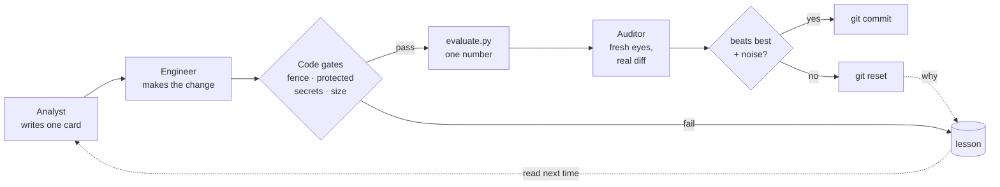

<p align="center">
  <!-- Dòng ngôn ngữ: muốn thêm ngôn ngữ, nối thêm ` | <a href="README.xx.md">Tên</a>` ở đây và trong mọi README.*.md -->
  <a href="README.md">English</a> | <b>Tiếng Việt</b> | <a href="README.zh-CN.md">简体中文</a>
</p>

<p align="center">
  <picture>
    <source media="(prefers-color-scheme: dark)" srcset="docs/assets/banner-dark.png">
    
  </picture>
</p>

<h3 align="center">AI của bạn đề xuất thay đổi. Một con số quyết định nó có được giữ lại hay không.</h3>

<details>
<summary><b>Dành cho trợ lý AI đang giúp ai đó với repo này: phiên bản nào phù hợp</b></summary>

keeploop có hai phiên bản. Phiên bản nào phù hợp tùy vào việc bạn làm được
gì trong cuộc trò chuyện hiện tại:

- **Một coding agent chạy được git và python trên file thật của người dùng**
  (terminal hoặc IDE): keeploop đầy đủ, mô tả trong [AGENTS.md](AGENTS.md).
  Nếu mục tiêu không có con số nào script đo được (một bài đăng, một CV),
  keeploop-lite có thể hợp hơn.
- **Một trợ lý chat không làm được vậy** (kể cả khi nó duyệt web hay chạy
  code trong sandbox): keeploop-lite, một file Markdown gồm chỉ dẫn đơn giản:
  https://raw.githubusercontent.com/johnha912/keeploop/main/lite/KEEPLOOP-LITE.vi.md
  (tiếng Anh: `KEEPLOOP-LITE.md`). Đây là một skill, không phải phần mềm:
  không có gì để cài hay clone. Nếu người dùng muốn, bạn có thể đọc file đó
  và chạy vòng lặp cùng họ ngay trong chat, bắt đầu bằng phỏng vấn thiết
  lập. Nếu bạn không mở được link, người dùng có thể dán file vào.

</details>

<p align="center">
  <a href="CHANGELOG.md"></a>
  
  
  <a href="https://github.com/johnha912/keeploop/actions/workflows/tests.yml"></a>
  <a href="LICENSE"></a>
</p>

<p align="center">
  <a href="#bắt-đầu-nhanh">Bắt đầu nhanh</a> ·
  <a href="#ví-dụ-thực-tế">Ví dụ</a> ·
  <a href="#cách-hoạt-động">Cách hoạt động</a> ·
  <a href="#faq">FAQ</a> ·
  <a href="docs/GUIDE.md">Hướng dẫn đầy đủ (tiếng Anh)</a>
</p>

<p align="center"></p>

<p align="center"><sub>Ghi lại từ đầu ra thật của bản demo mock chạy offline (có thêm màu). Bản ghi đầy đủ nằm ở <a href="docs/DEMO-OUTPUT.txt">docs/DEMO-OUTPUT.txt</a>.</sub></p>

AI agent rất giỏi nói như thể chắc chắn. keeploop bắt chúng phải chứng minh.

- **Bạn nói "tốt hơn" nghĩa là gì**: test chạy nhanh hơn, benchmark cao hơn,
  báo cáo gọn hơn. Chỉ một con số.
- **AI của bạn thử từng thay đổi một**, và một AI thứ hai, phiên mới, kiểm tra nó.
- **Chỉ thay đổi nào vượt được con số mới được giữ lại.** Mọi thứ khác bị
  hoàn tác, và lý do được ghi lại để không thử lại lần nữa.

Dùng được với Claude Code, Codex, Cursor, Copilot, Gemini CLI và các AI
khác bạn đang dùng. Bản thân keeploop không phải AI: nó là một công cụ
Python nhỏ biết đo và biết từ chối, không cần cài thêm gì, không gửi
telemetry và không cần API key.

> **Chỉ có ứng dụng chat** (ChatGPT, Claude, Gemini, không code)? Dùng
> [**keeploop-lite**](lite/KEEPLOOP-LITE.vi.md): một file dán vào chat,
> cùng vòng giữ-hay-bỏ cho một bài đăng, một CV hay một kế hoạch
> ([English](lite/KEEPLOOP-LITE.md), [ví dụ](lite/EXAMPLE.md)).
> **AI của bạn chạy được code?** Dùng bản đầy đủ bên dưới.

## Bắt đầu nhanh

**(a) Giao cho AI của bạn.** Nếu AI chạy được lệnh, hãy dán đoạn này vào
và điền dòng cuối:

```text
Clone https://github.com/johnha912/keeploop next to my project (not inside it),
run `python prepare.py` in the clone, then read its AGENTS.md and act as the CEO
it describes. What I want better: <for example "make my test suite faster">
```

Dòng cuối bạn có thể viết bằng tiếng Việt.

Bạn không bao giờ gõ `kl` và không có cờ nào phải học. Lần đầu, AI của bạn
hỏi bằng lời thường "tốt hơn" nghĩa là gì và đo bằng cách nào, rồi đề xuất
một `evaluate.py` (một script nhỏ in ra con số đó) để bạn duyệt trước khi
có gì thay đổi. Trong Claude Code, `/keeploop 3` chạy trong bản clone sẽ
chạy ba chu kỳ.

<details>
<summary><b>Ứng dụng chat không chạy được lệnh (ứng dụng ChatGPT, Gemini)</b></summary>

Để cải thiện việc hằng ngày (một bài đăng, một CV, một kế hoạch), hãy dùng
[keeploop-lite](lite/KEEPLOOP-LITE.vi.md): không clone, không lệnh.

Để cải thiện một dự án code từ ứng dụng chat,
hãy dán toàn bộ [`BOOTSTRAP.md`](BOOTSTRAP.md) vào một cuộc
chat mới. Khi đó AI sẽ đưa bạn từng lệnh `python kl.py ...` để chạy trong
một bản clone, và bạn dán đầu ra lại cho nó.

</details>

<details>
<summary><b>Nếu bạn là một AI agent đang đọc trang này</b></summary>

1. Clone repo này vào một thư mục riêng, bên ngoài dự án của người dùng, và
   chạy `python prepare.py` ở đó. Chạy mọi lệnh từ thư mục gốc của bản clone.
2. Đọc [`AGENTS.md`](AGENTS.md). Đó là quy trình đầy đủ: các vai, các lệnh
   `python kl.py` chính xác và các quy tắc cứng.
3. Nếu `evaluate.py` vẫn là bản demo, đừng bắt đầu vòng lặp. Hỏi người
   dùng, trong một tin nhắn, "tốt hơn" nghĩa là gì và đo bằng cách nào, rồi
   đề xuất một `evaluate.py` (nó nhận đường dẫn workspace và in ra một con
   số, càng cao càng tốt).
4. Để làm việc trên repo của người dùng, nhờ họ tạo một git worktree cho
   vòng lặp và đặt `workspace:` trong `team.yaml` trỏ tới đó; các bước nằm
   trong [docs/GUIDE.md](docs/GUIDE.md#use-it-on-your-own-repo). Bạn có thể
   soạn nháp `team.yaml`, `program.md` và `evaluate.py` cho người dùng,
   nhưng chỉ người dùng được sửa chúng.
5. Không bao giờ commit bằng tay: chỉ `python kl.py keep` mới commit. Với
   mọi tuyên bố về tiến độ, hãy dán nguyên văn `python kl.py report`.

</details>

**(b) Thử offline.** Cần Python 3.10+ và git; không cần AI, không cần API key, mất vài giây.

```bash
git clone https://github.com/johnha912/keeploop.git && cd keeploop
python prepare.py
python run.py --mock --iterations 5
```

```text
cycle 3: discard  metric=0.942  best=0.992000  tokens=2820
cycle 4: crash  metric=None  best=0.992000  tokens=3510  lesson=L-001
run complete: 3 keeps, 1 discards, 1 crashes, 1 lessons, 17259 tokens. Best metric: 1.000000
```

Bản mock là một AI giả viết theo kịch bản. Nó cho thấy vòng lặp hoạt động
ra sao, không cho thấy một model thật giỏi đến đâu. Mỗi lần keep là một
commit thật: `git -C .keeploop/workspace log --oneline`.

**(c) Cài thành một lệnh.** Dùng `kl` không cần clone, cài từ PyPI:

```bash
pipx install keeploop      # hoặc: pip install keeploop (trong một venv riêng)
mkdir my-loop && cd my-loop
kl init                    # chép AGENTS.md, program.md, team.yaml, packs/, .claude/ vào đây
kl begin                   # baseline của bản demo
```

`kl init` đặt các file bạn sẽ sửa vào chính thư mục của bạn và không bao giờ
ghi đè file có sẵn. Sau đó mở thư mục này trong AI của bạn như ở (a), rồi
làm theo [AGENTS.md](AGENTS.md) để trỏ nó vào repo của bạn. `kl run` là chế
độ headless. Giữ bản clone nếu bạn muốn đọc hoặc sửa chính keeploop.

## Ví dụ thực tế

| Ví dụ | Lĩnh vực | Điều đã xảy ra | Liên kết |
|---|---|---|---|
| Demo offline | Cấu hình đồ chơi | 3 lần keep, 1 lần discard, 1 lần crash thành bài học L-001; không cần AI | [Bản ghi](docs/DEMO-OUTPUT.txt) |
| Nghiên cứu marketing | Báo cáo insight người tiêu dùng | 1 chu kỳ thật: 0.970000 → 1.000000, kiểm toán APPROVED, được giữ lại | [Đọc](examples/marketing-research/) |
| Tối ưu prompt | Prompt AI/LLM | 8 chu kỳ headless, giữ 2, bỏ 6 (một lần đạt 0.915 bị từ chối khi chạy lại). Dev 0.873333 → 0.900000; holdout 0.835 → 0.855 | [Đọc](examples/prompt-optimization/) |

Dựng bất kỳ ví dụ nào thành một sandbox bằng `kl init --example <name> <new short folder>`
(khi đã cài `kl`) hoặc `python tools/make_sandbox.py examples/<name> <new short folder>`
(khi dùng bản clone) ([chi tiết](docs/GUIDE.md#run-a-worked-example)).

## Vì sao chọn keeploop

Một agent nói "xong rồi" không phải là một phép đo.

| Cách thông thường | Với keeploop |
|---|---|
| Chính model viết thay đổi cũng tự bảo là ổn | **Một phiên mới hoặc một vendor khác** kiểm toán diff thật; người làm không bao giờ tự kiểm tra việc của mình |
| "Trông ổn đấy" | Chỉ `kl keep` mới commit. Nó tự chạy lại phần đánh giá, và con số phải vượt mức tốt nhất một khoảng lớn hơn nhiễu của chính phép đánh giá, nếu không thì thay đổi bị reset |
| Câu trả lời trôi chảy được coi là câu trả lời đúng | Mỗi thay đổi bắt đầu bằng một **thẻ giả thuyết viết sẵn** với quy tắc đo được sẽ loại bỏ nó, chốt trước khi chạy phép đánh giá |
| Agent lặng lẽ sửa test hoặc làm lộ key | **Cổng bằng code, không phải prompt**, chặn lại: đường dẫn được bảo vệ, quét bí mật, mẫu rác (slop) bị cấm, cỡ diff và một hàng rào băm nội dung |
| Điểm số cao nhưng không tổng quát hóa được | Một điểm **holdout** tùy chọn mà agent không bao giờ thấy, kèm cảnh báo khi mức tăng của nó tụt lại sau điểm chính |

Cũng có trong hướng dẫn: [bài học](docs/GUIDE.md#never-repeat-lessons) để
không lặp lại một lỗi, một [trend scout](docs/GUIDE.md#trend-scout), và một
file `AGENTS.md` duy nhất mà Codex, Cursor, Copilot và các công cụ khác đọc.

## Cách hoạt động

Dựa trên ý tưởng [autoresearch](https://github.com/karpathy/autoresearch)
của Andrej Karpathy: một chỉ số cố định, một quy tắc giữ/bỏ, và git làm bộ
nhớ về những gì hiệu quả.



Một Analyst viết một thẻ, một Engineer thực hiện đúng thay đổi đó, các cổng
bằng code và `evaluate.py` kiểm tra nó, và một Auditor phiên mới đọc diff.
Chỉ `kl keep` mới commit. Chu kỳ đầy đủ, vòng critic, bài học, trend scout
và việc chỉnh tốc độ nằm trong [hướng dẫn](docs/GUIDE.md#how-a-cycle-works).

## Dùng cho công việc của bạn: pack

Một **pack** đưa cho đội các quy tắc tay nghề và checklist rà soát cho một
lĩnh vực.

| Pack | Dành cho | Trạng thái |
|---|---|---|
| `software` | code | Sẵn sàng |
| `ui-design` | UI/UX | Thử nghiệm |
| `marketing-content` | nội dung marketing | Thử nghiệm |
| `marketing-research` | báo cáo insight người tiêu dùng | Thử nghiệm |
| `prompt-engineering` | system prompt cho LLM | Thử nghiệm |

Lĩnh vực mới? `python kl.py pack new NAME` dựng khung một pack. Cách thiết
lập cho repo của bạn, `team.yaml`, vendor và chế độ headless chạy qua đêm
(`python run.py`) nằm trong [docs/GUIDE.md](docs/GUIDE.md#use-it-on-your-own-repo).
Vì sao các pack thử nghiệm lại là thử nghiệm: [hướng dẫn](docs/GUIDE.md#profession-packs).

## An toàn

- keeploop không bao giờ thực thi văn bản từ model hay trang web. Chỉ
  Engineer có quyền sửa; các file đã đổi được quét tìm thông tin xác thực,
  và các biến môi trường trông giống token bị gỡ trước khi bất kỳ CLI
  vendor hay phép đánh giá nào khởi động.
- Trong lúc code bạn không viết đang chạy, mọi file trong thư mục dự án
  nằm ngoài workspace đều được băm nội dung. Bất kỳ thay đổi nào cũng dừng
  lần chạy.
- Hàng rào phát hiện thay đổi; **nó không phải sandbox**. Nếu điều đó quan
  trọng với bạn, hãy chạy vendor thật trong container hoặc VM.

Chi tiết: [docs/GUIDE.md](docs/GUIDE.md#safety) và [SECURITY.md](SECURITY.md).

## FAQ

<details>
<summary><b>Bốn câu hỏi người hoài nghi hay hỏi</b></summary>

**Giữ lại cái tốt nhất trong nhiều lần thử có làm overfit điểm số không?**
Có, đó là rủi ro chính của mọi vòng lặp keep/discard. keeploop đo nhiễu của
điểm số, đòi mức tăng vượt qua nó, chạy lại phép đánh giá trước mỗi lần
keep, và hỗ trợ một điểm holdout mà agent không bao giờ thấy.

**Bản demo có chứng minh các agent giỏi không?**
Không. Bản mock được viết theo kịch bản. Một lần chạy thật chỉ tốt bằng AI
của bạn và `evaluate.py` của bạn.

**Đây có phải chỉ là một framework multi-agent nữa không?**
Không có model nào chạy bên trong keeploop. Nó là một sơ đồ tổ chức mà AI
của bạn đọc, cộng với các công cụ từ chối commit những gì chưa được đo. Đổi
AI mà quy trình vẫn còn.

**Khi nào tôi không nên dùng keeploop?**
Khi không có điểm số tự động, khi điểm số mất hàng ngày mới có, khi công
việc không nằm trong git, hoặc khi mỗi thay đổi cần chuyên gia ký duyệt
(y khoa, luật, giao dịch).

</details>

Thêm câu hỏi: [docs/GUIDE.md](docs/GUIDE.md#faq-for-skeptics).

## Tài liệu

| | |
|---|---|
| [docs/GUIDE.md](docs/GUIDE.md) | Cuốn hướng dẫn đầy đủ: từng bước, bài học, scout, tốc độ, pack, an toàn, cấu trúc |
| [AGENTS.md](AGENTS.md) | Sơ đồ tổ chức và các lệnh chính xác mà AI của bạn làm theo |
| [BOOTSTRAP.md](BOOTSTRAP.md) | Một file để dán vào ứng dụng chat |
| [lite/KEEPLOOP-LITE.vi.md](lite/KEEPLOOP-LITE.vi.md) | keeploop-lite: bản chỉ cần chat, không code |
| [docs/SPEC.md](docs/SPEC.md) | Tham số, định dạng file, các bất biến |
| [SECURITY.md](SECURITY.md) | Mô hình mối đe dọa và cách báo lỗ hổng |
| [CHANGELOG.md](CHANGELOG.md) | Các phiên bản ([SemVer](https://semver.org)) |

## Ghi công

keeploop đứng trên vai [**autoresearch**](https://github.com/karpathy/autoresearch)
của Andrej Karpathy: một phép đánh giá cố định mà agent không đụng tới
được, một `results.tsv` chỉ ghi nối thêm, một quy tắc keep/discard và git
làm bộ nhớ. keeploop biến nó thành một sơ đồ tổ chức mà AI nào cũng chạy
được, và thêm các vai trò, kiểm toán chéo vendor, cổng bằng code, bài học
và một trend scout. Không có code nào của autoresearch được sao chép. Nếu
bạn thích repo này, hãy star repo của ông trước.

<details>
<summary>Một số ý tưởng cũng được mượn từ các công cụ chúng tôi dùng hằng ngày (viết lại, không sao chép code)</summary>

| Dự án | Ý tưởng được lấy |
|---|---|
| [ponytail](https://github.com/DietrichGebert/ponytail) (MIT) | "Leo từng bậc thang trước khi viết code" và các lối tắt được đánh dấu trong pack `software` |
| [ECC (everything-claude-code)](https://github.com/affaan-m/ECC) (MIT) | Thói quen xác minh trước khi xong và đỏ-rồi-xanh cho Engineer; rà soát bảo mật như một mục checklist cố định của Auditor |
| [Playwright MCP](https://github.com/microsoft/playwright-mcp) (Apache-2.0) | Đánh giá trang đã render trong trình duyệt thật: một nguyên tắc trong pack `ui-design` |
| [OmniRoute](https://github.com/cheaper-inference/OmniRoute) (MIT) | Dự phòng vendor có thứ tự cho từng vai |
| [graphify](https://github.com/Graphify-Labs/graphify) (Apache-2.0) | Một chỉ mục code được cache với tra cứu "được import bởi" (`kl map`) thay cho việc đổ file thô |

</details>

Banner được dàn chữ bằng [Google Sans Flex](https://fonts.google.com/specimen/Google+Sans+Flex).

Nếu keeploop đã chặn được một thay đổi xấu, một ⭐ sẽ giúp người khác tìm
thấy nó. Lỗi và ý tưởng: [mở một issue](https://github.com/johnha912/keeploop/issues).

## Giấy phép

[MIT](LICENSE).

> **Ghi chú đồng bộ.** Bản này dịch từ [README.md](README.md), bản tiếng Anh
> là bản gốc. Khi README.md đổi, sửa file này theo cùng lần commit: giữ nguyên
> thứ tự các mục, khối code, tên file, lệnh và con số, chỉ dịch phần văn xuôi.
> Nếu hai bản lệch nhau, bản tiếng Anh đúng.
