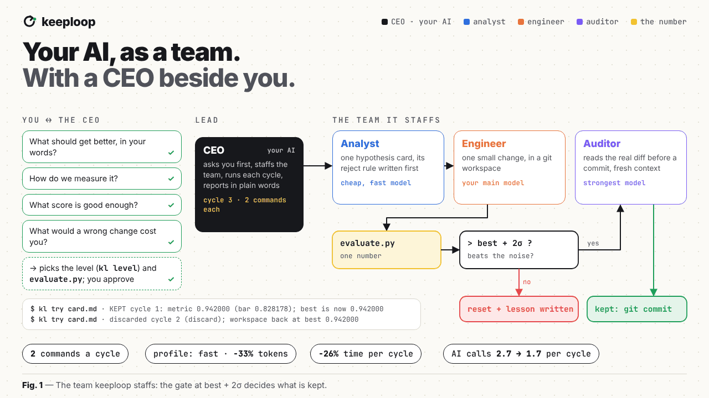
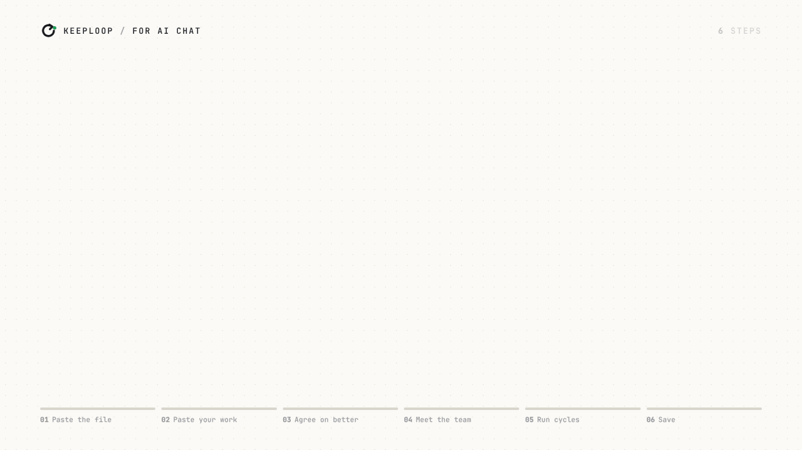
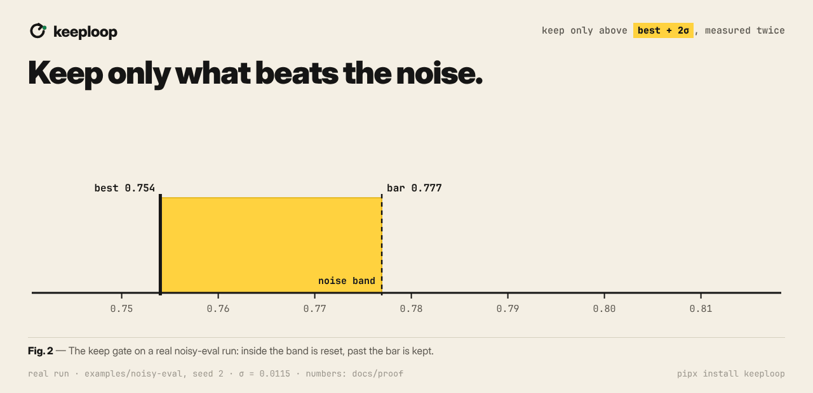
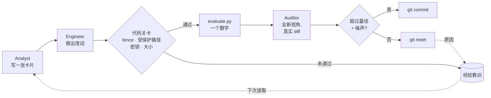

<p align="center">
  <!-- 语言行：要添加新语言，请在此处以及每个 README.*.md 中追加 ` | <a href="README.xx.md">名称</a>` -->
  <a href="README.md">English</a> | <a href="README.vi.md">Tiếng Việt</a> | <b>简体中文</b> | <a href="README.es.md">Español</a> | <a href="README.pt-BR.md">Português (Brasil)</a>
</p>

<p align="center">
  <picture>
    <source media="(prefers-color-scheme: dark)" srcset="docs/assets/banner-dark.png">
    
  </picture>
</p>

<h3 align="center">你的 AI 提出改动，由一个数字决定它去留。</h3>

<details>
<summary><b>给正在帮人使用这个仓库的 AI 助手：哪个版本合适</b></summary>

keeploop 有两个版本。哪个合适，取决于你在当前对话里能做什么：

- **能在用户自己的文件上运行 git 和 python 的编程 agent**（终端或 IDE）：
  完整版 keeploop，见 [AGENTS.md](AGENTS.md)。如果目标没有脚本能度量的数字
  （一篇帖子、一份简历），keeploop-lite 可能更合适。
- **做不到这些的聊天助手**（即使它能上网或在沙箱里运行代码）：keeploop-lite，
  一个由简单指令组成的 Markdown 文件：
  https://raw.githubusercontent.com/johnha912/keeploop/main/lite/KEEPLOOP-LITE.zh-CN.md
  （英文：`KEEPLOOP-LITE.md`，越南语：`KEEPLOOP-LITE.vi.md`，西班牙语：`KEEPLOOP-LITE.es.md`，巴西葡萄牙语：`KEEPLOOP-LITE.pt-BR.md`）。它是一个 skill，不是软件：没有东西需要安装或克隆。
  如果用户想用，你可以读这个文件，在聊天里和用户一起跑它的循环，从设置访谈开始。
  如果你打不开链接，用户可以把文件粘贴进来。
  如果你的上下文较小，或者你是搜索助手，请改读 `lite/KEEPLOOP-LITE-MINI.zh-CN.md`
  （同样的循环，篇幅更短）。这些文件的机器可读索引是 [`llms.txt`](llms.txt)。

</details>

<p align="center">
  <a href="https://pypi.org/project/keeploop/"></a>
  
  
  <a href="https://github.com/johnha912/keeploop/actions/workflows/tests.yml"></a>
  <a href="LICENSE"></a>
</p>

<p align="center">
  <a href="#快速开始">快速开始</a> ·
  <a href="#实战示例">示例</a> ·
  <a href="#工作原理">工作原理</a> ·
  <a href="#常见问题">常见问题</a> ·
  <a href="docs/GUIDE.md">完整指南（英文）</a>
</p>

<p align="center"></p>

<p align="center"><sub>会话中的命令行是离线演示上 <code>kl next</code> / <code>kl try</code> 的真实输出（<a href="docs/assets/demo-run/fastpath.txt">fastpath.txt</a>）；速度数字是实测的（<a href="docs/proof">docs/proof/bench-latency-*.json</a>）。X 视频：<a href="docs/assets/keeploop-x.mp4">keeploop-x.mp4</a>。指南：<a href="docs/GUIDE.md#video-guides">AI 聊天 · AI 编程</a>。</sub></p>

keeploop 把你已经在用的 AI 变成一个小团队，并有一位 CEO 和你一起工作。

- **好用。** 把一个文件粘贴进聊天应用，或把一段提示发给你的编程 agent。你用平常的话
  交流，不用学任何命令。
- **先问清楚，再定力度、组团队。** CEO（你的 AI）会问“更好”是什么意思、用什么衡量、
  多少分算够好，以及一个错误的改动会让你付出什么。草稿用几轮的轻量循环；别人依赖的
  工作用严格循环（`kl level`）。然后为这件事组建团队：便宜快速的模型提出方案，你的主力
  模型动手实现，最强的模型在全新上下文里检查真实的 diff。无论哪个力度，犯过的错都会
  变成经验，不再重犯。
- **快。** 在编程 agent 里每个周期两条命令（`kl next`、`kl try`）；看不到你仓库的聊天
  AI 每个周期只需各粘贴一次。
- **省 token。** 用 `profile: fast`，Engineer 自己写卡片，你列出的想法不再需要 Analyst
  调用：在按剧本运行的离线 mock 上（模拟调用延迟），每个周期 token −33%，时间 −26%。
  这里的 token 是提示词大小（字符数 / 4）；提示词变短后，真实 AI 的回答质量是否不变，
  尚未测量。
- **只保留真实的提升。** 只有当改动比历史最佳高出评测自身测得的噪声（best + 2σ）时才会
  commit。其余一律重置，并把原因记下来（[实测](#为什么可以信任保留的改动)）。

适用于 ChatGPT、Gemini、Claude、Perplexity、Claude Code、Codex、Cursor、Copilot 和
Gemini CLI。keeploop 本身不是 AI：它是一个小巧的 Python 工具，负责度量，也负责拒绝，
没有依赖，不发送 telemetry，也不需要 API key。

> **只有聊天应用**（ChatGPT、Claude、Gemini，不写代码）？请用
> [**keeploop-lite**](lite/KEEPLOOP-LITE.zh-CN.md)（另有 [English](lite/KEEPLOOP-LITE.md)、[Tiếng Việt](lite/KEEPLOOP-LITE.vi.md)、[Español](lite/KEEPLOOP-LITE.es.md)、[Português (Brasil)](lite/KEEPLOOP-LITE.pt-BR.md) 版）：
> 把一个文件粘贴进聊天，就能对一篇帖子、一份简历或一个计划跑同样的保留/丢弃循环
> （[示例](lite/EXAMPLE.zh-CN.md)）。默认快速模式：说**运行 3 轮**，一条回复最多尝试五处
> 修改；说**保存**拿到记录本。空间不够（免费套餐、Perplexity）？用
> [KEEPLOOP-LITE-MINI.zh-CN.md](lite/KEEPLOOP-LITE-MINI.zh-CN.md)。也可以把文件保存一次作为长期
> 指令（ChatGPT 的 Project 或自定义 GPT、Gemini 的 Gem、Perplexity 的 Space、Claude 的
> Project），不用每个对话都粘贴。**你的 AI 能运行代码？** 请用下面的完整版。

<p align="center"></p>

<p align="center"><sub>在聊天应用里一步一步。高清完整视频（1080p）：<a href="docs/GUIDE.md#video-guides">详细指南</a>。</sub></p>

## 快速开始

**(a) 交给你的 AI。** 如果它能运行命令，把下面这段话粘贴给它，并补全最后
一行：

```text
把 https://github.com/johnha912/keeploop 克隆到我的项目旁边（不要放在项目里面），
在克隆目录里运行 `python prepare.py`，然后阅读其中的 AGENTS.md，按它描述的方式担任 CEO。
我想改进的是：<例如“让我的测试套件跑得更快”>
```

AI 能读懂中文提示词；链接和命令保持原样。

你从不需要输入 `kl`，也没有要学的参数。第一次使用时，你的 AI 会用大白话问你
“更好”指什么、怎么度量，然后提出一个 `evaluate.py`（一个输出那个数字的小
脚本）供你批准，批准之前什么都不会改动。在 Claude Code 中，在克隆目录里运行
`/keeploop 3` 就会跑三个周期。

<p align="center"></p>

<p align="center"><sub>在编程 AI 中一步一步。高清完整视频（1080p）：<a href="docs/GUIDE.md#video-guides">详细指南</a>。</sub></p>

<details>
<summary><b>无法运行命令的聊天应用（ChatGPT、Gemini 应用）</b></summary>

要改进日常工作（一篇帖子、一份简历、一个计划），请用
[keeploop-lite](lite/KEEPLOOP-LITE.zh-CN.md)：不用克隆，也不用命令。

要在聊天应用里改进一个代码项目，
请改为把 [`BOOTSTRAP.md`](BOOTSTRAP.md) 的全部内容粘贴到一个新的聊天中。之后
每个周期只需一次往返：`python kl.py handoff` 打印一个给聊天用的包（目标、分数、文件），
AI 回复一张卡片和改好的文件，`python kl.py apply reply.md` 负责检查、评测，再保留或丢弃。

</details>

<details>
<summary><b>如果你是正在读这份文档的 AI agent</b></summary>

1. 把本仓库克隆到它自己的文件夹，放在用户的项目之外，并在那里运行
   `python prepare.py`。所有命令都从克隆的根目录运行。
2. 阅读 [`AGENTS.md`](AGENTS.md)。它是完整的流程：角色、确切的
   `python kl.py` 命令和硬性规则。
3. 如果 `evaluate.py` 仍然是演示版本，不要开始循环。请在一条消息里问用户
   “更好”指什么、怎么度量，并提出一个 `evaluate.py`（它接收 workspace 路径，
   输出一个数字，越高越好）。
4. 要在用户自己的仓库上工作，请让用户为循环创建一个 git worktree，并把
   `team.yaml` 中的 `workspace:` 设为它；步骤见
   [docs/GUIDE.md](docs/GUIDE.md#use-it-on-your-own-repo)。你可以为用户起草
   `team.yaml`、`program.md` 和 `evaluate.py`，但只有用户本人才能编辑它们。
5. 绝不要手动 commit：只有 `python kl.py keep` 才会 commit。任何关于进度的
   说法，都要原样粘贴 `python kl.py report`。
6. 快速路径，每个周期两条命令：`python kl.py next`（一份简报），写卡片并改动，然后
   `python kl.py try card.md`（门禁、评测、保留或丢弃；需要 Auditor 裁定时它会说明）。

</details>

**(b) 离线试用。** 需要 Python 3.10+ 和 git；不需要 AI，也不需要 API key，只要
几秒钟。

```bash
git clone https://github.com/johnha912/keeploop.git && cd keeploop
python prepare.py
python run.py --mock --iterations 5
```

```text
cycle 3: discard  metric=0.942  best=0.992000  tokens=2820
cycle 4: crash  metric=None  best=0.992000  tokens=3510  lesson=L-001
run complete: 3 keeps, 1 discards, 1 crashes, 1 lessons, 17259 tokens. Best metric: 1.000000
```

mock 是一个按剧本演出的“假 AI”，用来替代真实的 AI。它展示的是循环如何运转，
而不是真实模型有多强。每次保留都是一个真实的 commit：
`git -C .keeploop/workspace log --oneline`。

**(c) 作为命令安装。** 不用克隆，从 PyPI 安装 `kl`：

```bash
pipx install keeploop      # 或：pip install keeploop（放在单独的 venv 里）
mkdir my-loop && cd my-loop
kl init                    # 把 AGENTS.md、program.md、team.yaml、packs/、.claude/ 复制到这里
kl begin                   # 演示的基线
```

`kl init` 把你要编辑的文件放进你自己的文件夹，绝不覆盖已有文件。然后像 (a)
那样在你的 AI 中打开这个文件夹，并按 [AGENTS.md](AGENTS.md) 把它指向你的仓库。
`kl run` 是无头模式。如果你想阅读或修改 keeploop 本身，请保留克隆。

或者在你自己的仓库里一条命令搞定，并自动写好一个 `evaluate.py`：

```bash
cd my-repo
kl quickstart tests        # 或：command | prompt | buildtime（生成 ../my-repo-keeploop）
cd ../my-repo-keeploop
kl doctor                  # 运行 evaluate.py 5 次：噪声多大，能看出多大的提升？
kl begin
```

已经在聊天里用 keeploop-lite 开始了？`kl import-lite ledger.md` 会把那次会话接到
CLI 里继续。最佳版本成为 workspace，评分表成为一个 `evaluate.py`。

**(d) 分享一次运行。** `kl report --html run.html` 把 ledger 变成一个页面，不调用
模型。页面有一行摘要和一张图：保留的改动为实心，丢弃的为空心，还有历史最佳线和它的
噪声带。示例：[proof run 的图](docs/proof/keeploop/report.svg)。

## 实战示例

| 示例 | 领域 | 发生了什么 | 链接 |
|---|---|---|---|
| Proof run | 有噪声的评测，朴素 vs keeploop | 同样 20 个提议、25 个种子：保留无真实收益的改动 2.76 vs 0.44；代价是丢弃真实改进 2.64 vs 1.28 | [阅读](docs/proof/PROOF.md) |
| 离线演示 | 玩具配置 | 3 次保留、1 次丢弃、1 次变成经验教训 L-001 的 crash；不需要 AI | [记录](docs/DEMO-OUTPUT.txt) |
| 营销研究 | 消费者洞察报告 | 1 个真实周期：0.970000 → 1.000000，审计 APPROVED，保留 | [阅读](examples/marketing-research/) |
| 提示词优化 | AI/LLM 提示词 | 8 个无人值守周期，保留 2 次，丢弃 6 次（其中一次 0.915 在复跑时被拒绝）。开发集 0.873333 → 0.900000；保留集 0.835 → 0.855 | [阅读](examples/prompt-optimization/) |

任何示例都可以用 `kl init --example <name> <new short folder>`（已安装 `kl`）或
`python tools/make_sandbox.py examples/<name> <new short folder>`（克隆）
建成沙盒（[详情](docs/GUIDE.md#run-a-worked-example)）。

## 为什么可以信任保留的改动

<p align="center"></p>

在我们对 autoresearch 类循环的调研中（2026 年 11 月），keeploop 是找到的第一个
把评测噪声变成 commit 规则的可安装工具。只有当改动比历史最佳高出评测自身测得的
噪声（best + 2σ）时才会被保留，证伪规则事先固定，并由一个全新上下文的 Auditor
阅读真实 diff。评测噪声并不是我们的发现，研究界早已讨论过。新的是一个把它变成
决定每次 commit 的规则的工具。

**这能换来什么，实测数据。** 我们让一个朴素循环（分数更高就保留）和 keeploop
跑同样的 20 个提议，用同一个有噪声的评测：每次从 10,000 个开发集样本中随机抽
1,000 个打分。结果由一个 5,000 个样本的保留集评分，循环从未见过它。每种方式都在
事先固定的 25 个种子上运行（[docs/proof/PROOF.md](docs/proof/PROOF.md)，
`python tools/proof_run.py`）：

| 25 个种子的平均 | 朴素 | keeploop |
|---|---|---|
| 被保留但并无真实收益的改动 | 2.76 | **0.44** |
| 循环自己的分数比保留集高估了多少 | +0.017 | **+0.005** |
| 有真实收益却被丢弃的改动 | **1.28** | 2.64 |
| 保留集提升，中位数 / 平均值 | +0.130 / **+0.129** | **+0.135** / +0.107 |

代价是真实存在的：keeploop 会丢掉一些落在噪声带内的真实改进。在 25 个种子中有
9 个，它的保留集结果低于朴素循环，其中包括扫描前就定为重点展示的种子 1。
`kl doctor` 会在你开始前测量评测的噪声，并告诉你何时需要降低它。

## 为什么选 keeploop

agent 说“做完了”并不是一次度量。

| 通常的做法 | 用 keeploop |
|---|---|
| 写出改动的模型自己说没问题 | **一个全新会话或另一家 vendor** 审计真实的 diff；改动的作者从不检查自己的成果 |
| “看起来没问题” | 只有 `kl keep` 才会 commit。它会自己重新跑评测，数字必须超过历史最佳，且幅度大于评测自身的噪声，否则改动会被重置 |
| 流畅的回答被当成正确的回答 | 每个改动都从一张**书面的假设卡片**开始，上面写着一条可度量的否决规则，并且在评测运行之前就定好 |
| agent 悄悄改测试，或者泄露密钥 | 拦住它的是**代码关卡，而不是 prompt**：受保护路径、密钥扫描、被禁用的 slop 模式、diff 大小，以及内容哈希围栏 |
| 分数很漂亮，却无法泛化 | 可选的 **holdout** 评分，agent 永远看不到；它的提升落后于主分数时会发出警告 |

指南里还有：[经验教训](docs/GUIDE.md#never-repeat-lessons)，避免重蹈覆辙；
[trend scout](docs/GUIDE.md#trend-scout)；以及一份 `AGENTS.md`，Codex、Cursor、
Copilot 等都会读取。

## 工作原理

它建立在 Andrej Karpathy 的 [autoresearch](https://github.com/karpathy/autoresearch)
思路之上：一个固定的指标、一条保留/丢弃规则，以及把 git 当作“什么有效”的
记忆。



Analyst 写一张卡片，Engineer 严格按卡片做出这一个改动，代码关卡和
`evaluate.py` 负责检查，再由一个全新的 Auditor 阅读 diff。只有 `kl keep` 才会
commit。完整的周期、critic 环节、经验教训、trend scout 和速度调优，都在
[指南](docs/GUIDE.md#how-a-cycle-works)里。

## 用在你自己的工作上：pack

一个 **pack** 为团队提供某个领域的工艺规则和审查清单。

| Pack | 适用于 | 状态 |
|---|---|---|
| `software` | 代码 | 就绪 |
| `ui-design` | UI/UX | 实验性 |
| `marketing-content` | 营销文案 | 实验性 |
| `marketing-research` | 消费者洞察报告 | 实验性 |
| `prompt-engineering` | LLM 系统提示词 | 实验性 |

想做新领域？`python kl.py pack new NAME` 会生成一个脚手架。在你自己的仓库上
的设置、`team.yaml`、vendor 以及无头通宵模式（`python run.py`），都在
[docs/GUIDE.md](docs/GUIDE.md#use-it-on-your-own-repo)里。那些实验性 pack 为什么
是实验性的：[指南](docs/GUIDE.md#profession-packs)。

## 安全

- keeploop 绝不执行来自模型或网页的文本。只有 Engineer 拥有编辑权限；改动过的
  文件会被扫描凭据，在任何 vendor CLI 或评测启动之前，看起来像 token 的环境
  变量会被移除。
- 在运行非你所写代码期间，项目文件夹中 workspace 之外的每个文件都会做内容
  哈希。任何变化都会中止运行。
- 围栏只能发现改动，**它不是沙箱**。如果这对你很重要，请在容器或虚拟机中
  运行真实的 vendor。

详情：[docs/GUIDE.md](docs/GUIDE.md#safety) 和 [SECURITY.md](SECURITY.md)。

## 常见问题

<details>
<summary><b>怀疑者常问的四个问题</b></summary>

**只留下多次尝试中最好的那个，会不会让评分过拟合？**
会，这是任何保留/丢弃循环的主要风险。keeploop 会测量评分的噪声，要求提升
超过这个噪声，在保留之前重新运行评测，还支持 agent 永远看不到的 holdout
评分。

**这个演示能证明 agent 很强吗？**
不能。mock 是按剧本演出的。真实运行的质量，取决于你的 AI 和你的
`evaluate.py`。

**这不就是又一个 multi-agent 框架吗？**
不是。keeploop 内部不运行任何模型。它是一张你的 AI 会读的组织架构图，加上
一套拒绝 commit 未经度量之物的工具。换一个 AI，流程依然在。

**什么时候不该用它？**
没有自动评分时、评分要几天才出来时、工作不在 git 里时，或者每个改动都需要
专家签字时（医疗、法律、交易）。

</details>

更多问题：[docs/GUIDE.md](docs/GUIDE.md#faq-for-skeptics)。

## 文档

| | |
|---|---|
| [docs/GUIDE.md](docs/GUIDE.md) | 完整手册：每一步、经验教训、scout、速度、pack、安全、目录结构 |
| [AGENTS.md](AGENTS.md) | 你的 AI 所遵循的组织架构图和确切命令 |
| [BOOTSTRAP.md](BOOTSTRAP.md) | 一个可以粘贴进聊天应用的文件 |
| [lite/KEEPLOOP-LITE.zh-CN.md](lite/KEEPLOOP-LITE.zh-CN.md) | keeploop-lite：只需聊天、无需代码的版本 |
| [docs/SPEC.md](docs/SPEC.md) | 参数、文件格式、不变量 |
| [SECURITY.md](SECURITY.md) | 威胁模型，以及如何报告漏洞 |
| [CHANGELOG.md](CHANGELOG.md) | 版本（[SemVer](https://semver.org)） |

## 致谢

keeploop 站在 [**autoresearch**](https://github.com/karpathy/autoresearch)
的肩膀上，作者是 Andrej Karpathy：agent 碰不到的固定评测、只追加的
`results.tsv`、保留/丢弃规则，以及把 git 当作记忆。keeploop 把它变成任何 AI
都能运行的组织架构图，并增加了角色、跨 vendor 审计、代码关卡、经验教训和
trend scout。autoresearch 的代码一行都没有复制。如果你喜欢这个仓库，请先去
给他的仓库点 star。

<details>
<summary>另外还借鉴了一些想法，来自我们日常使用的工具（重新实现，未复制代码）</summary>

| 项目 | 借鉴的想法 |
|---|---|
| [ponytail](https://github.com/DietrichGebert/ponytail) (MIT) | “写代码之前先沿‘阶梯’逐级排查”，以及 `software` pack 中带标记的捷径 |
| [ECC (everything-claude-code)](https://github.com/affaan-m/ECC) (MIT) | 给 Engineer 的“完成前先验证”和“先红后绿”习惯；把安全审查作为 Auditor 检查清单中的固定一项 |
| [Playwright MCP](https://github.com/microsoft/playwright-mcp) (Apache-2.0) | 在真实浏览器中评判渲染后的页面：`ui-design` pack 中的一条原则 |
| [OmniRoute](https://github.com/cheaper-inference/OmniRoute) (MIT) | 按角色有序的 vendor 回退 |
| [graphify](https://github.com/Graphify-Labs/graphify) (Apache-2.0) | 带“被谁 import”查询（`kl map`）的缓存代码索引，而不是整份原始文件的堆砌 |

</details>

横幅使用 [Google Sans Flex](https://fonts.google.com/specimen/Google+Sans+Flex) 排版。

如果 keeploop 拦下了一次糟糕的改动，点一下 ⭐ 能帮助更多人发现它。报告 bug
或提出想法：[提交 issue](https://github.com/johnha912/keeploop/issues)。

## 许可证

[MIT](LICENSE).

> **同步说明。** 本文翻译自 [README.md](README.md)，以英文版为准。
> README.md 有改动时，请在同一次 commit 中同步修改本文件：保持各章节顺序
> 不变，代码块、文件名、命令和数字原样保留，只翻译正文。两个版本不一致时，
> 以英文版为准。
