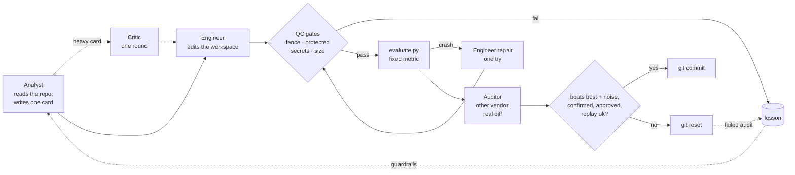

<p align="center">
  <!-- 语言行：要添加新语言，请在此处以及每个 README.*.md 中追加 ` | <a href="README.xx.md">名称</a>` -->
  <a href="README.md">English</a> | <a href="README.vi.md">Tiếng Việt</a> | <b>简体中文</b>
</p>

<p align="center">
  <picture>
    <source media="(prefers-color-scheme: dark)" srcset="docs/assets/banner-dark.png">
    
  </picture>
</p>

<p align="center">
  <a href="CHANGELOG.md"></a>
  
  
  <a href="https://github.com/johnha912/keeploop/actions/workflows/tests.yml"></a>
  <a href="LICENSE"></a>
</p>

<p align="center">
  <a href="#quickstart">快速开始</a> ·
  <a href="#use-it-with-a-chat-ai-no-install">聊天 AI</a> ·
  <a href="#how-a-cycle-works">工作原理</a> ·
  <a href="#where-the-rules-come-from">实战检验</a> ·
  <a href="#use-it-on-your-own-repo">你的仓库</a> ·
  <a href="#safety">安全</a> ·
  <a href="#faq-for-skeptics">FAQ</a> ·
  <a href="#credits">致谢</a>
</p>

> **同步说明。** 本文翻译自 [README.md](README.md)，以英文版为准。
> README.md 有改动时，请在同一次 commit 中同步修改本文件：保持各章节顺序
> 不变，代码块、文件名、命令和数字原样保留，只翻译正文。两个版本不一致时，
> 以英文版为准。

---

<p align="center"></p>

<p align="center"><sub>录自离线 mock 演示的真实输出（已加上颜色）。想看文字版？完整记录在 <a href="#quickstart">快速开始</a> 一节的“不用聊天，通宵运行”部分。</sub></p>

Karpathy 的 [autoresearch](https://github.com/karpathy/autoresearch)
证明了：只要给 agent 一个固定的指标、一条保留/丢弃规则和 git，它就能通宵
改进代码。

**keeploop 不是又一个 AI。** 克隆它，在你已经在用的 AI 里打开，这个 AI 就
成了一家小公司的 CEO，手下有 Analyst、Engineer、Auditor、Critic 和 Scout。
keeploop 给它一张组织架构图（`AGENTS.md`）和一套工具箱（`kl`），由工具箱
负责度量、把关、记录和拒绝。思考由你的 AI 完成。只有更好的数字才会被
commit。

| 通常的做法 | 用 keeploop |
|---|---|
| 写出改动的模型自己说“没问题” | **另一家 vendor 或一个全新会话**审计真实的 diff；改动的作者从不检查自己的成果 |
| “看起来没问题” | 只有 `kl keep` 才会 commit，而且它会自己重新跑评测：**指标必须超过历史最佳，且幅度大于评测自身的噪声**；评测有噪声或改动较重时，还要再跑一次确认；否则 `git reset` |
| 流畅的回答被当成正确的回答 | 每个改动都从一个**预先登记的假设**开始，并带有可度量的否决规则；重改动要先过 **critic** 这一关；进度以台账（ledger）为准，绝不凭记忆 |
| 下周又犯同样的错 | 每一次失败、拒绝或抱怨（包括“太慢了”）都会变成一条**经验教训**，并附带一个在每次 keep 之前运行的回归检查 |
| agent 悄悄改测试、泄露密钥，或者动你的配置 | **确定性关卡**拦住它：受保护路径、密钥扫描、slop 模式、diff 大小，以及围绕项目的内容哈希围栏（fence） |
| 分数很漂亮，却无法泛化 | 可选的 **holdout 评测**，agent 永远看不到，两边的提升出现背离时会发出警告 |
| 靠刷网页发现新技术 | **trend scout** 按相关度、热度和时效，对 GitHub 新仓库、HN 帖子和 arXiv 论文排序 |
| 被锁定在一家 vendor | `AGENTS.md` 可被 Codex、Cursor、Copilot、Jules、Aider 等读取；Claude Code 和 Gemini CLI 用指针文件；其他任何 CLI 通过 `team.yaml` 接入 |

约 3,500 行标准库 Python。无依赖、无 telemetry、不存储 API key。

没有克隆？无法打开链接、也不能运行命令的聊天 AI 同样能用：见
[与聊天 AI 配合使用（无需安装）](#use-it-with-a-chat-ai-no-install)。

<a id="quickstart"></a>
## 快速开始

需要 Python 3.10+ 和 git。

```bash
git clone https://github.com/johnha912/keeploop.git && cd keeploop
python prepare.py
```

然后在你的 AI 里打开这个文件夹，**直接说你想改进什么**：“让测试跑得更快”、
“提高 benchmark 分数”。你从不需要输入 `kl`，也没有要学的参数。你的 AI 会
读取组织架构图、带领团队干活，需要什么就用大白话问你，比如第一次会问
“更好”到底指什么。

| 你的 AI | 它读取什么 | 快捷方式（可选） |
|---|---|---|
| Claude Code | `CLAUDE.md` → `AGENTS.md`，外加 `.claude/agents` 中的 subagent | `/keeploop 3` |
| Codex, Cursor, Copilot, Jules, Aider, Zed, Amp… | `AGENTS.md` | — |
| Gemini CLI | `GEMINI.md` → `AGENTS.md` | — |
| 其他工具 | `AGENTS.md`（自包含） | 如果你的工具没有 subagent，各角色就作为全新会话运行 |

在 Claude Code 中，`.claude/settings.json` 预先批准了只读和度量类的 `kl`
命令，这样每个周期你不会被问上十几次（trend scout 也包含在内：它只读取
三个固定的公开来源）。运行任意检查、调用其他 vendor、抓取你提供的链接，
或重新封存围栏的命令，仍会先征求你的同意。

在幕后，由你的 AI 驱动 `kl`，由 `kl` 做决定。在玩具演示配置上，它看起来
是这样：

```text
$ python kl.py begin
kl: baseline metric = 0.828178  sigma = 0.000000 (3 runs)  holdout baseline recorded
$ python kl.py recall "learning rate"
nothing in memory matches; it is new
$ python kl.py card card.txt
card 1 registered
                                   (the Engineer sets learning_rate to 0.03)
$ python kl.py check
PASS tier=light files=1 lines=2 diff=be28f0079be6
$ python kl.py keep
KEPT cycle 1: metric 0.942000 (bar 0.828178); best is now 0.942000
                                   (next card: dropout 0.9)
$ python kl.py keep
kl: REFUSED: metric 0.558000 does not beat the keep bar 0.942000 (best 0.942000, sigma 0.000000)
$ python kl.py discard --reason "dropout 0.9 lowered the metric"
discarded cycle 2 (discard); workspace back at best 0.942000
$ python kl.py report
cycles: 2  keeps: 1  discards: 1  crashes: 0
baseline: 0.828178  best: 0.942000
hypotheses: rejected 1, supported 1
```

（输出已精简，只保留关键行。）

### 不用聊天，通宵运行

`run.py` 以无头（headless）模式运行同一个循环，调用你在 `team.yaml` 中列出
的 vendor CLI。演示使用一个**按剧本演出的 mock vendor**，它依次经历一次
keep、一次 discard 和一次 crash，让你几秒钟内就能离线看到每条路径。它展示的
是机制，而不是真实模型能达到的效果。

```bash
python run.py --mock --iterations 5
```

```text
run: baseline metric = 0.828178  sigma = 0.000000 (3 runs)  holdout baseline recorded
cycle 1: keep  metric=0.942  best=0.942000  tokens=3501
cycle 2: keep  metric=0.992  best=0.992000  tokens=3568
cycle 3: discard  metric=0.942  best=0.992000  tokens=2820
cycle 4: crash  metric=None  best=0.992000  tokens=3510  lesson=L-001
cycle 5: keep  metric=1.0  best=1.000000  tokens=3860
holdout: 0.818178 -> 0.998000 (+0.179822); evaluation: 0.828178 -> 1.000000 (+0.171822)

run complete: 3 keeps, 1 discards, 1 crashes, 1 lessons, 17259 tokens. Best metric: 1.000000
```

（各阶段耗时已精简。）

每次 keep 都是一个可以阅读的 commit：

```bash
git -C .keeploop/workspace log --oneline   # 3 keep commits on top of the initial one
cat .keeploop/results.tsv                  # one row per cycle; kl only appends
python kl.py recall "crash"                # L-001: what crashed, and the rule it left behind
```

<a id="use-it-with-a-chat-ai-no-install"></a>
## 与聊天 AI 配合使用（无需安装）

面向普通用户的聊天应用（Gemini 应用、ChatGPT 等）无法打开 GitHub 链接、
读取你的文件，也不能运行终端。为此，keeploop 附带了
[`BOOTSTRAP.md`](BOOTSTRAP.md)：一个自包含的文件，说明 keeploop 做什么、
何时触发，原样内嵌 `AGENTS.md`，并补充了聊天模式的规则。

1. 打开 `BOOTSTRAP.md`，复制整个文件，粘贴到一个新的聊天中。
2. AI 会概述周期和硬性规则，然后问你想改进什么。
3. 你始终在循环之中：AI 什么都运行不了，所以它每次只给你一条
   `python kl.py ...` 命令。你在本仓库的克隆中运行它，再把输出贴回去。
   它从不编造命令或数字；不知道的内容会列在 `MISSING:` 下，等你回答。

这需要你的机器上有 Python 3.10+ 和 git 来运行命令，但不需要任何带文件访问
权限的 AI 工具。每当 `AGENTS.md` 变化时，`BOOTSTRAP.md` 都会重新生成
（步骤在该文件末尾）。

<a id="how-a-cycle-works"></a>
## 一个周期如何运转

两种模式运行的是同一个周期：在你的 AI 中，下图每个方框都是一个 subagent
或一个全新会话，每个决定都是一条 `kl` 命令；在 `run.py` 中，循环自己调用
vendor CLI。



1. **Analyst** 先查团队记忆（`kl recall`）和代码索引（`kl map`），再写一张
   实验卡片：假设、最小改动、预期效果，以及会让它被否决的结果。
2. **Critic** 只针对重卡片，对卡片发起一轮质疑：被忽略的其他解释、可能
   怎么失败、否决规则是不是太容易满足。Analyst 可以修改一次。轻卡片跳过
   这一步。
3. **Engineer** 通过编辑文件，严格按这张卡片实现。如果评测 crash，它会带着
   错误信息获得一次修复机会。
4. **QC 关卡**用代码运行，而不是靠 prompt：workspace 之外的任何东西都不许
   改动，受保护路径保持原样，diff 中不得出现凭据或被禁用的 slop 模式，
   并且 diff 必须小到能被审阅。关卡同时把改动分为轻或重。
5. **evaluate.py** 输出一个数字。循环无法修改它。
6. **Auditor**（另一家 vendor 或一个全新会话）检查范围、是否钻评测的空子、
   guardrail、安全和工艺；对重改动，还会加上 pack 的专家检查清单。只有指标
   已经超过门槛时才会调用它。
7. **Keep** 需要：指标超过最佳值的幅度大于评测实测的噪声；一次确认运行
   （仅当改动较轻且评测没有噪声时才跳过）；一次批准；rubric 没有退步；
   每条经验教训的检查全部通过。其余情况一律 reset。

在第一个周期之前，循环会把评测运行三次来测量噪声（σ），一次 keep 必须超过
`2σ`。如果存在 `holdout.py`，它会在运行前后各评分一次；agent 永远看不到它，
如果 holdout 上的提升远低于 eval 上的提升，就会打印警告，提示这些 keep 可能
是在拟合评测本身，而不是在解决问题本身。

<a id="hypotheses-not-prompts"></a>
## 假设，而不是 prompt

更好的 prompt 只会让回答读起来更好，却不会给模型它从没见过的数据。
keeploop 的设计目的，就是让流畅无法冒充证据：

- **预先登记的卡片。** Analyst 必须用带标签的行作答：
  `HYPOTHESIS`、`ALTERNATIVES`、`CHANGE`、`EXPECT`、`REJECT IF`、`MISSING`。
  用自由散文写的卡片算一次 crash，而不是一个周期。否决标准必须在评测运行
  之前确定，并且可度量：“如果没有更好”会被拒绝，“如果 metric < 0.85”则
  被接受。
- **动手之前先过 critic。** 重卡片在写任何代码之前要面对一轮质疑。辩论过程
  会被记录；它可以叫停一张卡片，但永远无法保住一张卡片。
- **你的直觉优先。** `program.md` 里 `## Hypotheses to test` 下的条目，会按
  顺序先于 Analyst 自己的提案被测试。
- **缺口交给你。** Analyst 标为 `MISSING` 的内容会进入
  `.keeploop/questions.md`，而不是被含糊带过。
- **被否决的就是被否决了。** 每张卡片都会在 `.keeploop/hypotheses.jsonl`
  中得到一个结论（supported、rejected、inconclusive、untested）。rejected 和
  inconclusive 的会展示给 Analyst，它只有说明“这次有什么不同”，才能重新
  提出。
- **只有指标说了算。** Auditor 看到的是卡片和 diff，永远看不到 Engineer 的
  解释；一次 keep 要求实测指标超过最佳值的幅度大于评测的噪声。
- **数字来自文件，而不是来自模型。** 你的 AI 被要求在任何进度表述中粘贴
  `kl report`。`kl cite`（可选，会联网）会检查被引用的链接是否有效、引文是否
  真的出现在页面上。
- **Slop 是关卡，不是风格建议。** 每个 pack 都列出禁用模式（遗留的 `TODO`、
  “as an AI”、套话式的营销废话）；一旦命中，改动在任何模型审阅之前就被
  拦下。

<a id="where-the-rules-come-from"></a>
## 规则从何而来

keeploop 的规则不是在白板上画出来的。它们的灵感来自作者日常工作中运营的
几支 AI 团队，每支团队都有一位人类负责人和一个担任 CEO 的 AI。下面的例子
说明这些团队如何工作，不是对本仓库的 benchmark：

- **一个课程研究门户。** 项目按 100 分制的 rubric 排名，并设有硬性关卡。
  读者投票可以加分，但救不回一个没通过关卡的项目。
- **一个研究生 ML 项目。** 七个角色，各自负责评分 rubric 的一部分。流程是
  Analyst，然后人工批准，然后 Engineer，再由另一家 vendor 的 auditor 审计。
  只有共享评测在未动过的测试集上产出的数字，才能写进报告。
- **Kaggle 竞赛。** 交叉验证才是真相，公开排行榜不是。假设在接触数据之前
  就声明。每次提交都必须换来新的信息。
- **一家有 13 个部门的 YouTube 制作公司。** 固定的交付清单，接收方用哈希
  校验文件，最后一道关是负责人的耳朵。
- **两支使用不同 vendor 的竞争研究团队**（Muse Code 和 Claude Code）。它们
  不得阅读对方的工作，rubric 在整个赛季保持冻结。
- **一份力量训练日志。** 被替换的动作会换算成统一的度量，让各次训练能公平
  比较，每次重复的训练都与上一次对比画图。

这六条规则在每一支团队里都成立：

| 规则 | 学自 | 在 keeploop 中 |
|---|---|---|
| 对人只有一个通道，而不是零散地抛出一堆小决定 | 研究门户、制作公司 | 只有你的 AI 与你对话；未决问题汇总在 `.keeploop/questions.md`，事实来自 `kl report` |
| 作者从不检查自己的成果 | ML 项目、竞争团队 | 只有 Engineer 能编辑。Auditor 和 critic 只读：你配置了就用另一家 vendor，否则用全新会话 |
| 固定的指标才是真相；意见和演示不算证据 | Kaggle、研究门户 | `evaluate.py` 受保护，`kl keep` 会重新运行它。审计、批评和硬性关卡可以阻止一次 keep，但永远无法强行促成一次 keep |
| 只存在于聊天里的东西等于不存在 | 全部 | 台账、假设、经验教训和辩论都是下次运行会读取的文件；`kl` 对它们只追加 |
| 只有证明修复确实生效，事故才算关闭 | Kaggle、制作公司 | 经验教训里写明根因，改动下次运行所读取的内容，并在每次 keep 之前重放一次检查 |
| 假设和阈值先于数据 | Kaggle、ML 项目 | 带可度量 REJECT IF 的卡片，由 `kl card` 检查；被否决的想法只有带着不同之处才能回来 |

一些更小的习惯也被吸收进来：近似重复的提交变成了重复卡片检查，未动过的
测试集变成了 holdout 评测，“反馈是输入，不是命令”变成了对 scout 提案的
规则，冻结的赛季 rubric 变成了只有人类能编辑的章程（charter），交付时的
哈希校验变成了围栏。

<a id="use-it-on-your-own-repo"></a>
## 在你自己的仓库上使用

1. 给循环一个独立的 worktree，这样它永远不会 reset 你在意的工作：
   ```bash
   git worktree add ../myrepo-keeploop -b keeploop
   ```
2. 编写 `evaluate.py`。它接收 workspace 路径并输出一个数字，越高越好：
   测试通过率、benchmark 分数、取反后的 bundle 体积、lint 无告警的比例。
3. 编辑 `team.yaml`：
   ```yaml
   workspace: ../myrepo-keeploop
   protect: tests, evaluate.py
   pack: software
   roles:
     analyst:
       vendor: claude-cli, gemini-cli   # ordered fallback
     engineer:
       vendor: claude-cli
     auditor:
       vendor: codex-cli                # a different vendor audits
   ```
4. 在 `program.md` 中写下你的使命。Scout 也会读它。
5. 可选：编写 `holdout.py`（约定与 `evaluate.py` 相同，用评测没有使用的数据
   评分）。
6. 在你的 AI 中打开该文件夹并运行 `/keeploop 3`（或者 "follow AGENTS.md
   and run 3 cycles"），或者用 `python run.py --iterations 3` 以无头模式
   运行。然后阅读 `python kl.py report`、`.keeploop/questions.md` 和 git log。

任何能从 stdin 读取 prompt 的 CLI，都可以作为无头模式或 `kl audit` 的
vendor，在 `team.yaml` 中配置即可，无需改代码：

```yaml
vendors:
  myvendor:
    cmd: mycli --print          # check your CLI's docs for the real flags
    edit_args: --allow-edits    # added for the engineer only
    model_flag: --model
    env_keep: MYVENDOR_         # prefixes this CLI may see
    env_allow: MYVENDOR_API_KEY # secret-looking names pass only if listed exactly
```

vendor CLI 必须已经安装并登录。它们的非交互参数在不同版本间会变化；长时间
运行之前，请对照你所用的版本核对。一个无头周期会发起两到六次 vendor 调用
（只有重卡片和 crash 时才更多）；`max_run_tokens`（估算值）会在运行开销变大
时叫停。

<a id="speed"></a>
## 速度

大多数周期都很小，所以 keeploop 把精力花在风险所在之处：

- **轻或重。** 当改动触及 `team.yaml` 中 `heavy:` 下列出的路径，或超过
  `heavy_diff_lines` 时，它就是重改动。轻改动跳过 critic；指标足够明确时
  跳过 Auditor；评测没有噪声时跳过确认运行。一个角色可以配置更便宜的
  `model:` 和更强的 `heavy_model:`。
- **落败的改动不审计。** 只有指标已经超过门槛时才会调用 Auditor，rubric 也在同一次
  调用中评分。
- **读得更少。** 只有与当前卡片最相关的经验教训才会进入 prompt；`kl map`
  维护一份缓存的代码索引，只重新解析改动过的文件。
- **“太慢”是 bug。** `kl slow` 会指出最慢的阶段，以及能压缩它的手段和相应
  风险。`kl staff --goal speed` 根据台账为各角色推荐更快的模型，`--apply`
  只会修改你在 `team.yaml` 的 `staffing:` 白名单所允许的内容。白名单必须在
  `kl begin` 之前就存在，这样你的 AI 就无法给自己授权。这条抱怨会变成一条
  经验教训，其检查（`kl report --assert-cycle-under N`）会在周期再次变慢时
  失败。

<a id="never-repeat-lessons"></a>
## 永不重犯的经验教训

一次 crash、一次未通过的审计、一次 `kl` 的拒绝，或你的一句抱怨，都会生成
一条带 guardrail 的经验教训，最相关的 guardrail 会进入之后的 prompt。同一个
失败再次出现时，会扩展旧的教训，而不是新增一份副本。想让一条教训具有强制
力，就给它挂一个检查：

```bash
python kl.py lesson check L-002 -- python -m pytest tests/test_parser.py
```

此后，该检查会在每次 keep 之前于 workspace 中运行，失败就会阻止这次 keep。
检查持续通过的教训会被报告为已强制执行，并退出 prompt；反复触发的则被标记
为无效（`kl lesson review`）。在无头模式下，检查命令只会来自你在命令行上的
输入。在你的 AI 里，请先审阅检查命令再允许它添加，因为它会在每次 keep 时
运行。

`kl recall "<idea>"` 会搜索经验教训、过往假设、辩论和未决问题，让团队在
花一个周期之前先问一句“这个我们试过吗？”。

<a id="trend-scout"></a>
## Trend scout

```bash
python scout.py --dry-run
```

```text
- h9-tec/ai-roadmap-2026 (GitHub) score 0.325 = relevance 1.00 x momentum 0.59 x recency 0.55
- matched: agent, evaluation, eval, llm; stars/day=21.1
```

它读取新的 GitHub 仓库、Hacker News 和 arXiv，把每个条目按 相关度（你的
`program.md` 中的使命和 pack 的 `scout_topics`）× 热度（每日 star 数、得分和
评论数）× 时效 打分，并把最好的追加到 `.keeploop/proposals.md`。scout 本身
不改任何东西。提案是不可信的文本：你的 AI 可以把一条提案变成卡片，而这张
卡片和其他想法一样，要走同一套约定。设置 `GITHUB_TOKEN` 可获得更高的速率
限制；它只会被发送到 `api.github.com`。

<a id="profession-packs"></a>
## 行业 pack

循环本身不懂任何领域；pack 把它变成面向某一领域的公司。它给 Analyst 和
Engineer 一份记录工艺原则的 `taste.md`，给 Auditor 一份带硬性关卡的加权
`rubric.md`，并声明专家 reviewer（在重改动时检查）、scout 主题和 slop 模式。
一次 keep 要求指标提升且 rubric 不退步。

新领域？`python kl.py pack new NAME` 会生成脚手架，你的 AI 通过采访你来填写
内容。它必须回答的第一个问题最难：用什么自动指标，以及它如何对照真实结果
验证过？没有这一步，循环就没有可学的东西。

| Pack | 适用于 | 状态 |
|---|---|---|
| `software` | 软件工程 | 就绪：测试和 benchmark 是诚实的指标 |
| `ui-design` | UI/UX | 实验性：Lighthouse 或 axe 分数衡量的是底线，不是品位。内置样式、配色和字体库，支持 BM25 搜索：`python packs/ui-design/search.py "dark dashboard fintech"` |
| `marketing-content` | 营销文案 | 实验性：真实结果（CTR、转化）来得晚且噪声大；必须先用历史结果验证离线代理指标 |

<a id="safety"></a>
## 安全

keeploop 是一个参考实现，由你在自己的机器上运行，风险自负（MIT，不提供
担保）。它为保护你做了这些：

- **keeploop 绝不执行来自模型或网页的文本。** vendor CLI 通过 stdin 接收
  prompt，只有 Engineer 拥有编辑权限。CLI 在自己的权限模式内做什么，由该 CLI
  和你的设置决定。
- **两种模式，两种信任级别。** 在 `run.py` 中，循环掌控每一步。在你的 AI
  中，`kl` 会在 commit 前重新检查一切，但你的 AI 与 `kl` 拥有相同的文件权限：
  那里的围栏只能发现篡改，防不住篡改。你的 AI 工具自己的权限提示才是外层的
  墙。
- **围栏（fence）。** 在每个会运行非你所写代码的阶段（vendor 调用、评测、
  holdout、经验教训检查），项目文件夹中 workspace 之外的每个文件都会做内容
  哈希，同时还包括 workspace 的 git config、hook 和 index 标志。任何变化都会
  中止运行，循环也不会在那里再执行任何 git 命令。围栏只覆盖项目文件夹；它
  不是沙箱。
- **密钥关卡。** 每个改动文件的完整内容（包括二进制文件）都会被扫描，查找
  常见的凭据格式和密钥文件名。命中的内容绝不会被评测，也绝不会发给其他
  vendor，台账只记录密钥的类型，从不记录其值。经过编码或拆分的密钥无法
  检测。
- **清洗过的环境变量。** 在 vendor CLI、评测或检查启动之前，看起来像 token
  或密钥的变量会被移除；每个 CLI 只保留它自己 vendor 的变量。
- **git 加固。** 循环发起的每一次 git 调用都关闭 hook 和 fsmonitor；它所读取
  的 diff 则关闭 external diff driver 和 textconv。
- **干净的起点，安全的重置。** 脏的 workspace 会被拒绝；`.env` 这类被忽略
  的文件绝不会被删除。

在连接真实 vendor 之前，请阅读 [SECURITY.md](SECURITY.md)。请通过 GitHub 的
Security 标签页私下报告漏洞。

<a id="faq-for-skeptics"></a>
## 怀疑者 FAQ

**只留下多次尝试中最好的那个，会不会让评测过拟合？**
会，这是任何 keep/discard 循环的主要风险。keeploop 会测量评测的噪声，并要求
提升超过 `2σ`，在 keep 之前重新运行评测，还支持 agent 永远看不到的 holdout
评测，当它的提升落后于 eval 的提升时发出警告。对任何重要的事情，都请使用
holdout。

**这个演示能证明 agent 很强吗？**
不能。mock 是按剧本设计来走遍每条路径的。真实运行的质量取决于你的 vendor
和你的 `evaluate.py`。

**为什么不让我的 agent CLI 自己循环？**
agent 说“做完了”并不是指标。keeploop 加上了它无法编辑的固定评测、不是作者
本人的 auditor、每次失败后的重置，以及对已尝试内容的记忆。

**这不就是又一个 multi-agent 框架吗？**
keeploop 内部不运行任何模型。它是一张你的 AI 会读的组织架构图，加上一套
拒绝 commit 未经度量之物的工具。换一个 AI，公司依然在。

**围栏是沙箱吗？**
不是。它检测对项目文件夹的改动；它无法阻止一个权限很大的 CLI 读取或发送你
的文件。如果这对你很重要，请在容器或虚拟机中运行真实的 vendor。

**什么时候不该用 keeploop？**
没有自动指标时、指标要几小时甚至几天才出来时、改动不在 git 里时，或者每个
改动都需要专家签字时（医疗、法律、交易）。

<a id="repository-layout"></a>
## 仓库结构

```
AGENTS.md     the org chart your AI reads: roles, the cycle, hard rules
CLAUDE.md     pointers to AGENTS.md for tools with their own file name
GEMINI.md
.github/copilot-instructions.md
.claude/      optional Claude Code subagents and the /keeploop skill
kl.py         the toolbox: begin, card, debate, check, eval, keep, discard,
              report, slow, recall, map, staff, pack, cite, lesson, scout
run.py        the headless loop and its QC gates
prepare.py    setup, every global constant, the version
program.md    the charter every agent reads (you edit it)
team.yaml     workspace, protected paths, roles → vendors, budgets, staffing
vendors.py    mock, claude/codex/gemini presets, any CLI from team.yaml
lessons.py    lessons, guardrails, replay checks, recall
codemap.py    cached code index for kl map
bm25.py       the one ranker behind recall and the ui-design search
ledger.py     append-only results.tsv
scout.py      trend scout → proposals.md
rubric.py     weighted rubric with hard gates
packs/        taste, rubric, specialists, scout topics, slop per field
evaluate.py   YOUR fixed metric (ships with the demo)
holdout.py    optional metric the agents never see (ships with the demo)
docs/SPEC.md  parameters, formats, invariants
```

<a id="roadmap"></a>
## 路线图

- 同一接口之下的 API vendor（Anthropic、OpenAI、Google）
- 按计划运行的 GitHub Action，运行循环并为每次运行开一个 PR
- 竞速模式：两个 vendor 在隔离环境中解决同一张卡片

版本号遵循 [SemVer](https://semver.org)；见 [CHANGELOG.md](CHANGELOG.md)。

<a id="credits"></a>
## 致谢

keeploop 站在 [**autoresearch**](https://github.com/karpathy/autoresearch)
的肩膀上，作者是 Andrej Karpathy。本仓库的核心就是他的想法：agent 碰不到的
固定评测、只追加的 `results.tsv`、保留/丢弃规则、把 git 当作“什么有效”的
记忆，以及一个扁平的仓库，由人类写指令、agent 改代码。keeploop 把它变成任何
AI 都能运行的组织架构图，并在其上增加了角色、跨 vendor 审计、QC 关卡、经验
教训引擎和 trend scout。autoresearch 的代码一行都没有复制。如果你喜欢这个
仓库，请先去给他的仓库点 star。

另外还借鉴了一些想法（重新实现，未复制代码），来自我们日常使用的工具：

| 项目 | 借鉴的想法 |
|---|---|
| [ponytail](https://github.com/DietrichGebert/ponytail) (MIT) | “写代码之前先沿“阶梯”逐级排查”，以及 `software` pack 中带标记的捷径 |
| [ECC (everything-claude-code)](https://github.com/affaan-m/ECC) (MIT) | 给 Engineer 的“完成前先验证”和“先红后绿”习惯；把安全审查作为 Auditor 检查清单中的固定一项 |
| [Playwright MCP](https://github.com/microsoft/playwright-mcp) (Apache-2.0) | 在真实浏览器中评判渲染后的页面：`ui-design` pack 中的一条原则 |
| [OmniRoute](https://github.com/cheaper-inference/OmniRoute) (MIT) | 按角色有序的 vendor 回退 |
| [graphify](https://github.com/Graphify-Labs/graphify) (Apache-2.0) | 带“被谁 import”查询（`kl map`）的缓存代码索引，而不是整份原始文件的堆砌 |

横幅使用 [Google Sans Flex](https://fonts.google.com/specimen/Google+Sans+Flex) 排版。

<a id="license"></a>
## 许可证

[MIT](LICENSE).
