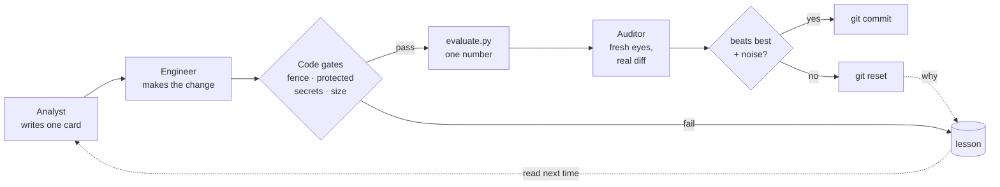

<p align="center">
  <!-- 语言行：要添加新语言，请在此处以及每个 README.*.md 中追加 ` | <a href="README.xx.md">名称</a>` -->
  <a href="README.md">English</a> | <a href="README.vi.md">Tiếng Việt</a> | <b>简体中文</b>
</p>

<p align="center">
  <picture>
    <source media="(prefers-color-scheme: dark)" srcset="docs/assets/banner-dark.png">
    
  </picture>
</p>

<h3 align="center">你的 AI 提出改动，由一个数字决定它去留。</h3>

<p align="center">
  <a href="CHANGELOG.md"></a>
  
  
  <a href="https://github.com/johnha912/keeploop/actions/workflows/tests.yml"></a>
  <a href="LICENSE"></a>
</p>

<p align="center">
  <a href="#交给你的-ai">交给你的 AI</a> ·
  <a href="#离线试用">离线试用</a> ·
  <a href="#实战示例">示例</a> ·
  <a href="#工作原理">工作原理</a> ·
  <a href="#常见问题">常见问题</a> ·
  <a href="docs/GUIDE.md">完整指南（英文）</a>
</p>

<p align="center"></p>

<p align="center"><sub>录自离线 mock 演示的真实输出（已加上颜色）。完整记录见 <a href="docs/DEMO-OUTPUT.txt">docs/DEMO-OUTPUT.txt</a>。</sub></p>

AI agent 很会表现得胸有成竹。keeploop 让它们拿出证据。

- **由你定义什么叫“更好”**：测试更快、benchmark 分数更高、报告更清晰。
  只用一个数字。
- **你的 AI 一次只尝试一个改动**，再由另一个全新的 AI 来检查。
- **只有胜过这个数字的改动才会被保留。** 其余一律撤销，并把原因记下来，
  免得以后再试一遍。

它适用于你已经在用的 AI：Claude Code、Codex、Cursor、Copilot、Gemini CLI
等。keeploop 本身不是 AI：它是一个小巧的 Python 工具，负责度量，也负责拒绝。
除此之外不需要安装任何东西，不发送 telemetry，也不存储 API key。

## 交给你的 AI

**如果你的 AI 能运行命令**（Claude Code、Codex、Cursor、Copilot、Gemini CLI、
Aider 及类似工具），把下面这段话粘贴给它，并补全最后一行：

```text
Clone https://github.com/johnha912/keeploop next to my project (not inside it),
run `python prepare.py` in the clone, then read its AGENTS.md and act as the CEO
it describes. What I want better: <for example "make my test suite faster">
```

这段提示词要保持英文原样粘贴给 AI；只有最后一行（你想改进什么）可以用中文写。

这就够了。你从不需要输入 `kl`，也没有要学的参数。第一次使用时，你的 AI 会
用大白话问你“更好”指什么、怎么度量，然后提出一个 `evaluate.py`（一个输出
那个数字的小脚本）供你批准，批准之前什么都不会改动。在 Claude Code 中，在
克隆目录里运行 `/keeploop 3` 就会跑三个周期。

**如果你的 AI 是无法打开链接、也不能运行命令的聊天应用**（ChatGPT 或 Gemini
应用），请改为把 [`BOOTSTRAP.md`](BOOTSTRAP.md) 的全部内容粘贴到一个新的
聊天中。之后 AI 会每次给你一条 `python kl.py ...` 命令，让你在克隆目录里
运行，再把输出贴回去。

<details>
<summary><b>如果你是正在读这份文档的 AI agent</b></summary>

1. 把本仓库克隆到它自己的文件夹，放在用户的项目之外，并在那里运行
   `python prepare.py`。所有命令都从克隆的根目录运行。
2. 阅读 [`AGENTS.md`](AGENTS.md)。它是完整的流程：角色、确切的
   `python kl.py` 命令和硬性规则。
3. 如果 `evaluate.py` 仍然是演示版本，不要开始循环。请在一条消息里问用户
   “更好”指什么、怎么度量，并提出一个 `evaluate.py`（它接收 workspace 路径，
   输出一个数字，越高越好）。
4. 要在用户自己的仓库上工作，请让用户为循环创建一个 git worktree，并把
   `team.yaml` 中的 `workspace:` 设为它；步骤见
   [docs/GUIDE.md](docs/GUIDE.md#use-it-on-your-own-repo)。你可以为用户起草
   `team.yaml`、`program.md` 和 `evaluate.py`，但只有用户本人才能编辑它们。
5. 绝不要手动 commit：只有 `python kl.py keep` 才会 commit。任何关于进度的
   说法，都要原样粘贴 `python kl.py report`。

</details>

## 离线试用

想在交给 AI 之前先看看效果？需要 Python 3.10+ 和 git。不需要 AI，也不需要
API key；只要几秒钟。

```bash
git clone https://github.com/johnha912/keeploop.git && cd keeploop
python prepare.py
python run.py --mock --iterations 5
```

```text
cycle 1: keep  metric=0.942  best=0.942000  tokens=3501
cycle 2: keep  metric=0.992  best=0.992000  tokens=3568
cycle 3: discard  metric=0.942  best=0.992000  tokens=2820
cycle 4: crash  metric=None  best=0.992000  tokens=3510  lesson=L-001
cycle 5: keep  metric=1.0  best=1.000000  tokens=3860
run complete: 3 keeps, 1 discards, 1 crashes, 1 lessons, 17259 tokens. Best metric: 1.000000
```

（各阶段耗时已精简。）mock 是一个按剧本演出的“假 AI”，让你亲眼看到一次保留、
一次丢弃和一次 crash 是怎么发生的。它展示的是循环如何运转，而不是真实模型
有多强。每次保留都是一个真实的 commit：
`git -C .keeploop/workspace log --oneline`。

## 实战示例

<table>
<tr>
<td width="50%" valign="top">

**离线演示（玩具配置）**

上面的 GIF。一个按剧本演出的 mock 用五个周期调整一份演示用的
`config.json`：三次保留、一次丢弃，以及一次变成经验教训 L-001 的 crash。
几秒钟跑完，不需要 AI。

[记录](docs/DEMO-OUTPUT.txt) · [试一试](#离线试用)

</td>
<td width="50%" valign="top">

<a href="examples/marketing-research/"></a>

**消费者洞察报告（营销研究）**

对五个快时尚品牌做的社交聆听研究，附带一个仪表盘和一份 30 页的 PDF。在
Claude Code 里跑的一个真实周期，修正了两处缺乏依据的说法：分数
0.970000 → 1.000000，审计 APPROVED，保留。该页面还说明了这个分数没有度量
什么。

[阅读示例](examples/marketing-research/)

</td>
</tr>
<tr>
<td colspan="2" valign="top">

<a href="examples/prompt-optimization/"></a>

**提示词优化（无人值守，8 个周期）**

一个 AI 团队改进银行工单分类器的系统提示词（Claude Haiku，Banking77
数据）。保留两次修改，丢弃六次，其中包括一次 Auditor 已批准、但重跑未能
确认的 0.915。开发集准确率 0.873333 → 0.900000；隐藏的保留集从
0.835 升到 0.855。该页面还展示了一次有意的作弊测试，以及它在 keeploop
中发现的四个缺口。

[阅读示例](examples/prompt-optimization/)

</td>
</tr>
</table>

## 为什么不直接让 AI 自己循环？

因为 agent 说“做完了”并不是一次度量。

| 通常的做法 | 用 keeploop |
|---|---|
| 写出改动的模型自己说没问题 | **一个全新会话或另一家 vendor** 审计真实的 diff；改动的作者从不检查自己的成果 |
| “看起来没问题” | 只有 `kl keep` 才会 commit。它会自己重新跑评测，数字必须超过历史最佳，且幅度大于评测自身的噪声，否则改动会被重置 |
| 流畅的回答被当成正确的回答 | 每个改动都从一张**书面的假设卡片**开始，上面写着一条可度量的否决规则，并且在评测运行之前就定好 |
| 下周又犯同样的错 | 每一次 crash、拒绝或抱怨都会变成一条**经验教训**，还可以附带一个在每次保留之前运行的检查 |
| agent 悄悄改测试，或者泄露密钥 | 拦住它的是**代码关卡，而不是 prompt**：受保护路径、密钥扫描、被禁用的 slop 模式、diff 大小，以及内容哈希围栏 |
| 分数很漂亮，却无法泛化 | 可选的 **holdout** 评分，agent 永远看不到；它的提升落后于主分数时会发出警告 |
| 靠刷网页发现新技术 | **trend scout** 对 GitHub 新仓库、Hacker News 帖子和 arXiv 论文排序；它的点子仍然要先写成卡片 |
| 被锁定在一家 vendor | `AGENTS.md` 可被 Codex、Cursor、Copilot、Jules、Aider 等读取；Claude Code 和 Gemini CLI 用指针文件 |

## 工作原理

它建立在 Andrej Karpathy 的 [autoresearch](https://github.com/karpathy/autoresearch)
思路之上：一个固定的指标、一条保留/丢弃规则，以及把 git 当作“什么有效”的
记忆。



1. **Analyst** 写一张卡片：假设、最小的改动、预期会发生什么，以及一旦出现
   就证明它错了的结果。
2. **Engineer** 严格按卡片做出这一个改动，并且是唯一可以编辑文件的角色。
3. **代码关卡**（`kl check`）拒绝 workspace 之外的改动、对受保护文件的编辑、
   凭据和过大的 diff。
4. **evaluate.py** 输出一个数字。循环无法修改它。
5. **Auditor** 在全新的上下文中或由另一家 vendor 对照卡片检查 diff，看不到
   Engineer 的思路。
6. **`kl keep`** 只有在所有检查都通过、且数字超过门槛时才会 commit；否则
   **`kl discard`** 会重置，并记录原因。

完整的周期、针对重改动的 critic 环节、经验教训、trend scout 和速度调优，都在
[指南](docs/GUIDE.md#how-a-cycle-works)里。

## 在你自己的工作上使用

keeploop 适用于任何在 git 中、且有自动评分的文件夹。一个 **pack** 为某个
领域的团队提供工艺规则和审查清单：

| Pack | 适用于 | 状态 |
|---|---|---|
| `software` | 代码 | 就绪：测试和 benchmark 是诚实的指标 |
| `ui-design` | UI/UX | 实验性：Lighthouse 或 axe 分数衡量的是底线，不是品位 |
| `marketing-content` | 营销文案 | 实验性：真实结果来得晚，而且噪声大 |
| `marketing-research` | 消费者洞察报告 | 实验性：检查规则和可追溯性，不检查洞察本身对不对 |

想做新领域？`python kl.py pack new NAME` 会生成一个脚手架。在你自己的仓库上
的设置、`team.yaml`、vendor 以及无头通宵模式（`python run.py`），都在
[docs/GUIDE.md](docs/GUIDE.md#use-it-on-your-own-repo)里。

## 安全速览

- keeploop 绝不执行来自模型或网页的文本。vendor CLI 通过 stdin 接收
  prompt，只有 Engineer 拥有编辑权限。
- 在运行非你所写代码期间，项目文件夹中 workspace 之外的每个文件都会做内容
  哈希。任何变化都会中止运行。
- 改动过的文件会被扫描凭据；在任何 vendor CLI 或评测启动之前，看起来像
  token 的环境变量会被移除。
- 围栏只能发现改动，**它不是沙箱**。如果这对你很重要，请在容器或虚拟机中
  运行真实的 vendor。

详情：[docs/GUIDE.md](docs/GUIDE.md#safety) 和 [SECURITY.md](SECURITY.md)。

## 常见问题

**只留下多次尝试中最好的那个，会不会让评分过拟合？**
会，这是任何保留/丢弃循环的主要风险。keeploop 会测量评分的噪声，要求提升
超过这个噪声，在保留之前重新运行评测，还支持 agent 永远看不到的 holdout
评分。

**这个演示能证明 agent 很强吗？**
不能。mock 是按剧本演出的。真实运行的质量，取决于你的 AI 和你的
`evaluate.py`。

**这不就是又一个 multi-agent 框架吗？**
不是。keeploop 内部不运行任何模型。它是一张你的 AI 会读的组织架构图，加上
一套拒绝 commit 未经度量之物的工具。换一个 AI，流程依然在。

**什么时候不该用它？**
没有自动评分时、评分要几天才出来时、工作不在 git 里时，或者每个改动都需要
专家签字时（医疗、法律、交易）。

更多问题：[docs/GUIDE.md](docs/GUIDE.md#faq-for-skeptics)。

## 文档

| | |
|---|---|
| [docs/GUIDE.md](docs/GUIDE.md) | 完整手册：每一步、经验教训、scout、速度、pack、安全、目录结构 |
| [AGENTS.md](AGENTS.md) | 你的 AI 所遵循的组织架构图和确切命令 |
| [BOOTSTRAP.md](BOOTSTRAP.md) | 一个可以粘贴进聊天应用的文件 |
| [docs/SPEC.md](docs/SPEC.md) | 参数、文件格式、不变量 |
| [SECURITY.md](SECURITY.md) | 威胁模型，以及如何报告漏洞 |
| [CHANGELOG.md](CHANGELOG.md) | 版本（[SemVer](https://semver.org)） |

## 致谢

keeploop 站在 [**autoresearch**](https://github.com/karpathy/autoresearch)
的肩膀上，作者是 Andrej Karpathy：agent 碰不到的固定评测、只追加的
`results.tsv`、保留/丢弃规则，以及把 git 当作记忆。keeploop 把它变成任何 AI
都能运行的组织架构图，并增加了角色、跨 vendor 审计、代码关卡、经验教训和
trend scout。autoresearch 的代码一行都没有复制。如果你喜欢这个仓库，请先去
给他的仓库点 star。

另外还借鉴了一些想法（重新实现，未复制代码），来自我们日常使用的工具：

| 项目 | 借鉴的想法 |
|---|---|
| [ponytail](https://github.com/DietrichGebert/ponytail) (MIT) | “写代码之前先沿‘阶梯’逐级排查”，以及 `software` pack 中带标记的捷径 |
| [ECC (everything-claude-code)](https://github.com/affaan-m/ECC) (MIT) | 给 Engineer 的“完成前先验证”和“先红后绿”习惯；把安全审查作为 Auditor 检查清单中的固定一项 |
| [Playwright MCP](https://github.com/microsoft/playwright-mcp) (Apache-2.0) | 在真实浏览器中评判渲染后的页面：`ui-design` pack 中的一条原则 |
| [OmniRoute](https://github.com/cheaper-inference/OmniRoute) (MIT) | 按角色有序的 vendor 回退 |
| [graphify](https://github.com/Graphify-Labs/graphify) (Apache-2.0) | 带“被谁 import”查询（`kl map`）的缓存代码索引，而不是整份原始文件的堆砌 |

横幅使用 [Google Sans Flex](https://fonts.google.com/specimen/Google+Sans+Flex) 排版。

如果 keeploop 拦下了一次糟糕的改动，点一下 ⭐ 能帮助更多人发现它。报告 bug
或提出想法：[提交 issue](https://github.com/johnha912/keeploop/issues)。

## 许可证

[MIT](LICENSE).

> **同步说明。** 本文翻译自 [README.md](README.md)，以英文版为准。
> README.md 有改动时，请在同一次 commit 中同步修改本文件：保持各章节顺序
> 不变，代码块、文件名、命令和数字原样保留，只翻译正文。两个版本不一致时，
> 以英文版为准。
