# What Gen Z and Millennial fast-fashion shoppers say about five brands, and how keeploop tightened the report

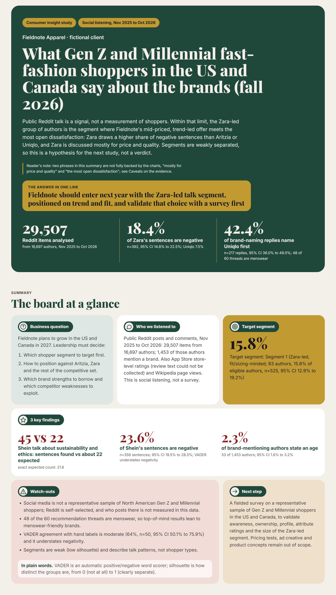

This is a social-listening study of what public Reddit talk says about Aritzia, Zara, H&M, Shein and Uniqlo, written for a fictional client, Fieldnote Apparel, which is deciding how to enter the US and Canada in 2027. One real keeploop cycle (keeploop is a small set of commands that measures, gates and records every change to a folder of work) tightened the report; the second half of this page shows that cycle with its real numbers. Start with "What the data says"; you do not need any machine-learning background.

**Reports:** the dynamic report is [`report/dashboard.html`](report/dashboard.html) (open it locally in a browser; GitHub does not render it). The static report is [`report/report.pdf`](report/report.pdf) (30 A4 pages). The full text is [`report.md`](report.md), and how the data was collected and analyzed is in [`data/README.md`](data/README.md).

## What the data says

### Fieldnote should enter with the Zara-led talk segment, positioned on trend and fit, and validate that choice with a survey first

Public Reddit talk is a signal, not a measurement of shoppers. Within that limit, the Zara-led group of authors is the segment where Fieldnote's mid-priced, trend-led offer meets the most open dissatisfaction: Zara draws a higher share of negative sentences than Aritzia or Uniqlo, and Zara is discussed mostly for price and quality. Segments are weakly separated, so this is a hypothesis for the next study, not a verdict.

Target segment: Segment 1 (Zara-led, fit/sizing-minded; 83 authors, 15.8% of eligible authors, n=525, 95% CI 12.9% to 19.2%).

The six modules below follow the order of the brief. "Proxy" means a stand-in measure, not the real thing. "95% CI" is the range the true value plausibly sits in; when two ranges overlap, the data cannot separate the two numbers.

| Module | One-line answer |
|---|---|
| 1. Top-of-mind | Uniqlo is named first in recommendation threads far more often than the other four core brands, but the sample leans to menswear. |
| 2. Penetration | Self-reported purchase talk is similar across the five brands, with overlapping intervals. |
| 3. Profiling | Few authors report an age, and among those who do, the Gen Z and Millennial intervals overlap, so the audience cannot be described reliably. |
| 4. Positioning | Shein is discussed more for sustainability and ethics, and Uniqlo more for style and trend, than the other brands. |
| 5. Perception | Shein and Zara draw more negative sentences than Aritzia, Uniqlo or H&M, but the tool understates negativity. |
| 6. Segmentation | Five talk groups emerge, but they overlap, and the Zara-led group is the suggested first target. |

### 1. Uniqlo is named first far more often than the other four core brands, but the sample leans to menswear

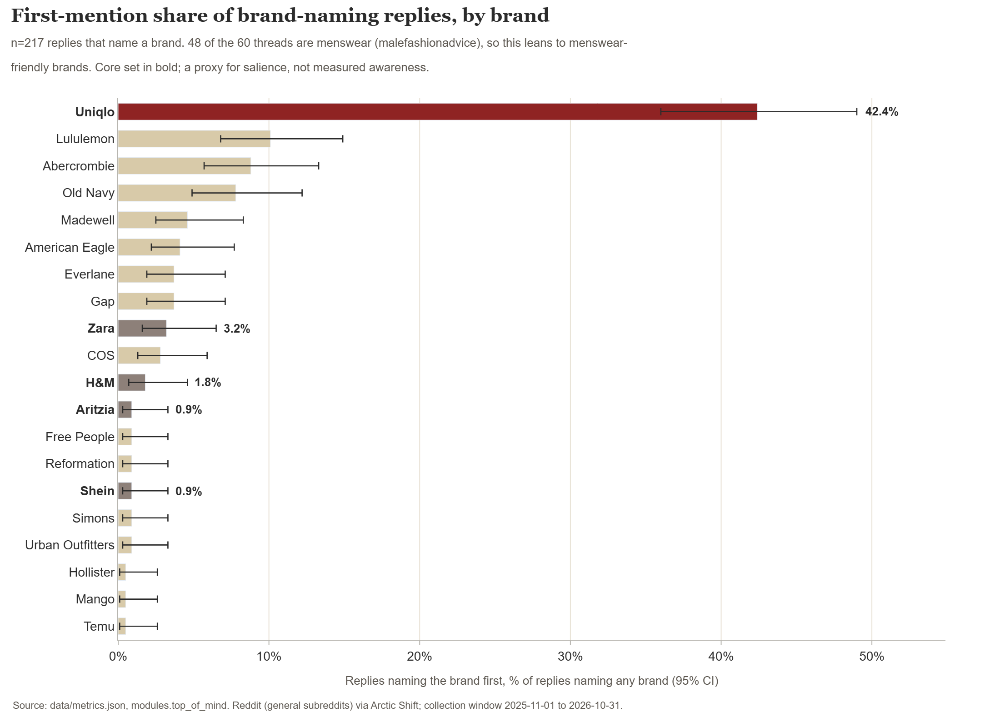

*In this sample only Uniqlo stands apart (42.4% first-named, 95% CI 36.0% to 49.0%); the other four intervals overlap, and most threads are menswear.*
Source: `data/metrics.json` (`modules.top_of_mind`); n=217 brand-naming replies, taken from 2140 top-level replies in 60 recommendation threads.

Recommendation in the report: do not read this as a ranking of the womenswear market, and add an aided and unaided awareness question to the survey.

### 2. Self-reported purchase talk is similar across the five brands

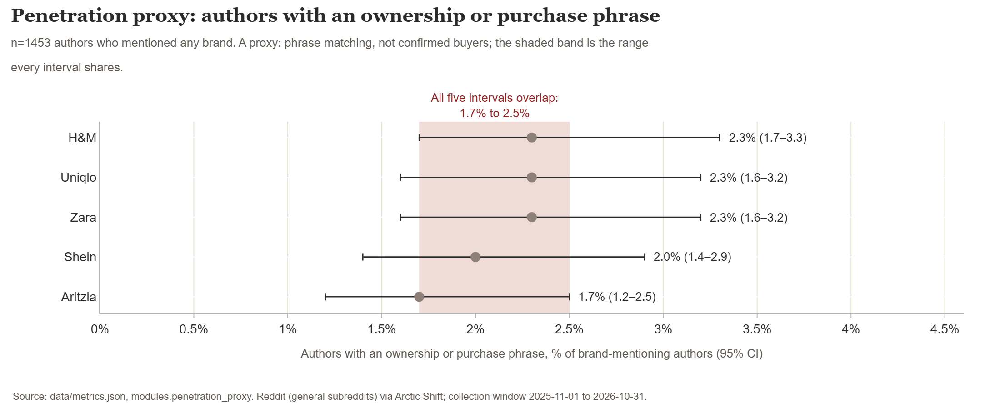

*The values are small by construction (1.7% to 2.3%) and the five intervals overlap, so this data does not separate the brands on ownership.*
Source: `data/metrics.json` (`modules.penetration_proxy`); n=1453 authors who mentioned any brand.

Recommendation in the report: claim no penetration gap against any competitor, and measure claimed ownership in the survey.

### 3. Few authors report an age, so the audience cannot be described reliably

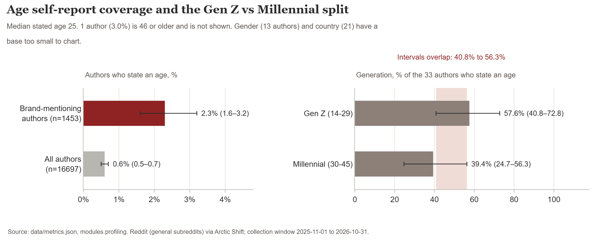

*Only 33 of 1453 brand-mentioning authors (2.3%) gave an age. Among them Gen Z is 57.6% and Millennial 39.4%, but the intervals overlap, and the data cannot separate the US from Canada.*
Source: `data/metrics.json` (`modules.profiling`).

Recommendation in the report: draw the US and Canada audience profile from a survey quota-sampled on age, gender and country.

### 4. Shein carries the sustainability and ethics talk, Uniqlo the style and trend talk

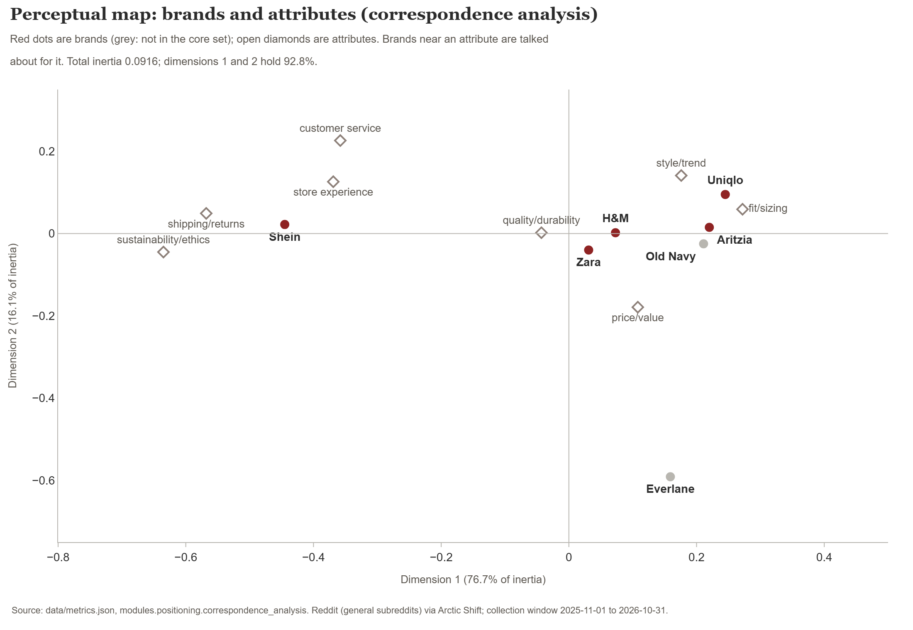

*Price/value and quality/durability come up for every core brand, so they do not differentiate; style/trend is already associated with Uniqlo, and Shein carries the ethics conversation.*
Source: `data/metrics.json` (`modules.positioning.correspondence_analysis`); indicative only, because one author can contribute several sentences.

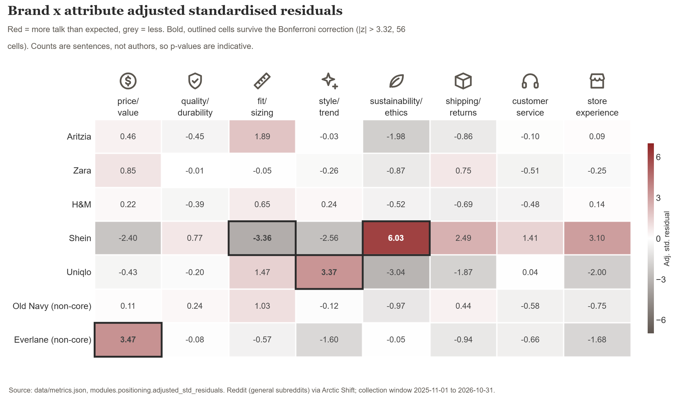

*After a Bonferroni correction (a stricter test used when many cells are checked at once), three core-brand cells depart from expectation: Shein on sustainability/ethics (z=6.03), Shein on fit/sizing (z=-3.36) and Uniqlo on style/trend (z=3.37).*
Source: `data/metrics.json` (`modules.positioning.adjusted_std_residuals`, `bonferroni_z`).

Recommendation in the report: test a trend-led, fit-reliable proposition against Zara and Uniqlo, and avoid competing on price talk, where the five brands already sit.

### 5. Shein and Zara draw more negative sentences than Aritzia or Uniqlo, but the tool understates negativity

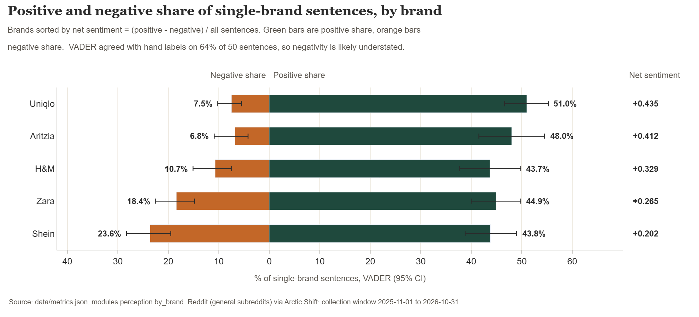

*The gap in negative talk is the most defensible perception finding here: negative shares do not overlap between Shein or Zara and Aritzia or Uniqlo. The tool misses much criticism, and the sentiment is toward sentences, not buyers.*
Source: `data/metrics.json` (`modules.perception`); sentences scored with VADER, a general-purpose sentiment word list.

Recommendation in the report: treat Zara's higher share of negative talk as a lead to investigate, not a proven weakness, and measure brand attribute ratings in the survey.

### 6. Five talk groups emerge, and the Zara-led group is the suggested first target

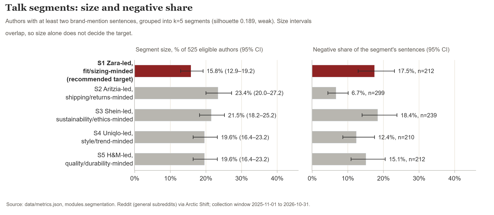

*Segment 1 is the smallest of the five, but it is built around the brand closest to Fieldnote's positioning, and its talk carries a higher share of negative sentences than the Aritzia-led or Uniqlo-led groups. Segment sizes overlap, so size alone does not decide.*
Source: `data/metrics.json` (`modules.segmentation`); n=525 authors with at least two brand-mention sentences.

Recommendation in the report: target the Zara-led segment first as a working hypothesis, with fit and sizing as the lead proposition, and confirm its size, age and country mix in a survey.

### Extra context: search interest

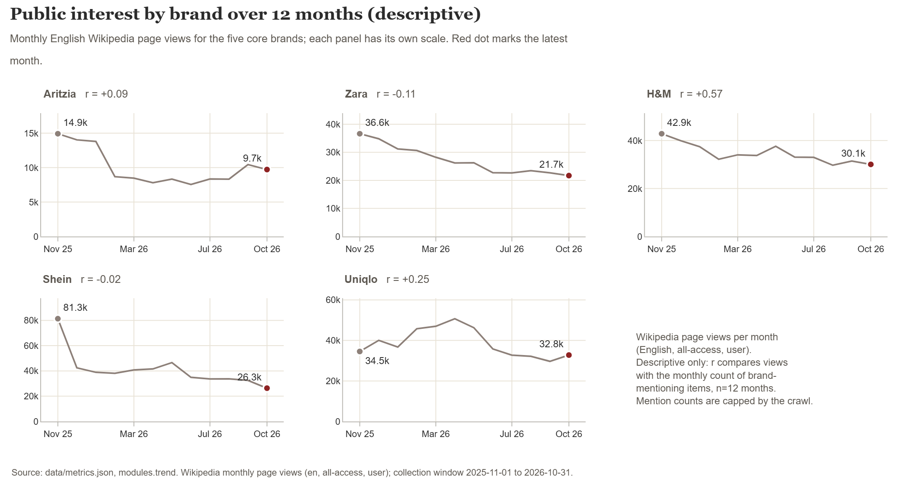

*Page views and mention counts are shown side by side for description only; mention counts are bounded by the collection caps, so use share of voice, not growth.*
Source: `data/metrics.json` (`modules.trend`; its own caveat and the n=12 months note). `report.md` has no module on this chart, so this caption is taken from the metrics file.

### Limits you should keep in mind

- Social listening is not a representative sample. Reddit is self-selected, and who posts there is not measured in this data.
- Top-of-mind, penetration and positioning are proxies, not survey measures.
- 48 of the 60 recommendation threads are menswear, so top-of-mind results lean to menswear-friendly brands.
- Few authors report an age, gender or country (33, 13 and 21 authors of 1453), so generation and country splits are mostly "base too small", and Canada cannot be separated from the US.
- VADER agreed with hand labels on 64% of 50 sentences (95% CI 50.1% to 75.9%; kappa 0.45, moderate; one labeller) and understates negativity.
- Segments are weak (silhouette 0.189, a score where 1 is perfectly separated groups and 0 is overlapping ones). They describe talk patterns, not shopper types.
- App Store review text failed to collect; only store-level ratings exist, and no review sentiment is reported.
- The crawl was time-boxed and partial; no subreddit with data exists for Zara or H&M.

**Recommended next step:** a fielded survey on a representative sample of Gen Z and Millennial shoppers in the US and Canada, to validate awareness, ownership, profile, attribute ratings and the size of the Zara-led segment.

## Supplementary analysis (added after the audited cycle; not audited)

Built from the same data with no new crawl, general subreddits only, and stored under the top-level key `supplementary` in `data/metrics.json`. These are proxies from public social text, not survey measures, and the keeploop cycle below did not score or audit them. Intervals are Wilson 95%. Method: [`data/README.md`](data/README.md), section "Supplementary analysis".

### Brand funnel (social-listening proxy)

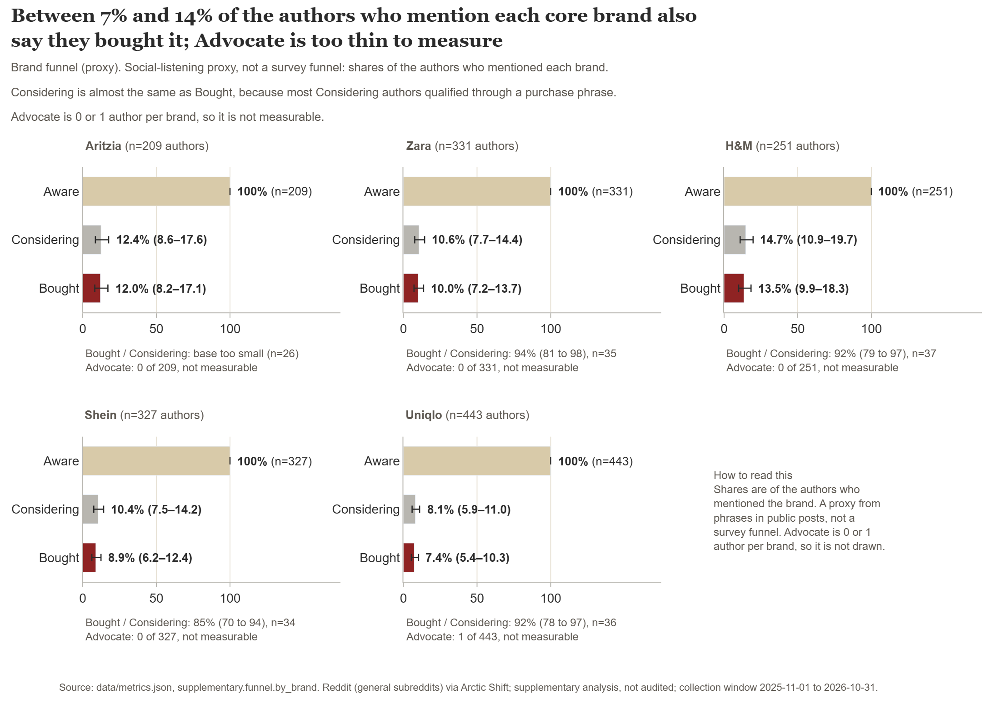

*Share of authors who mention each brand that also use an intent phrase (Considering) or an ownership phrase (Bought): Considering 8.1% to 14.7% and Bought 7.4% to 13.5% across the five core brands.*
Source: `data/metrics.json` (`supplementary.funnel`). Aware n: Aritzia 209, Zara 331, H&M 251, Shein 327, Uniqlo 443. Considering / Bought, % of Aware: Aritzia 12.4 / 12.0, Zara 10.6 / 10.0, H&M 14.7 / 13.5, Shein 10.4 / 8.9, Uniqlo 8.1 / 7.4.

Limits: the Advocate stage has 0 or 1 authors per brand (Uniqlo 1, the other four 0), so it cannot be measured here. Considering is almost equal to Bought (35 vs 33 authors for Zara, 36 vs 33 for Uniqlo), because Bought authors are counted in Considering. These are not survey funnel rates.

### Two-axis positioning map

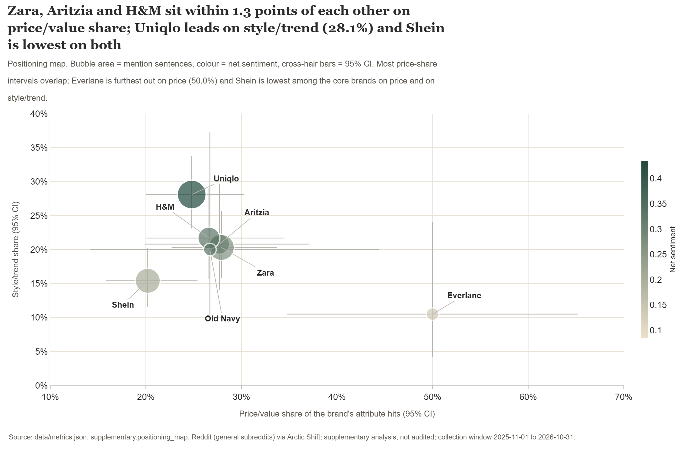

*Each brand with at least 30 attribute hits (7 brands) is placed by its price/value share (x) and style/trend share (y) of attribute talk; bubble size is mention sentences and colour is net sentiment.*
Source: `data/metrics.json` (`supplementary.positioning_map`). Price/value, style/trend (%): Aritzia 27.7, 20.8; Zara 27.9, 20.3; H&M 26.6, 21.7; Shein 20.2, 15.4; Uniqlo 24.8, 28.1. Net sentiment: Aritzia 0.412, Zara 0.265, H&M 0.329, Shein 0.202, Uniqlo 0.435.

### Brand image

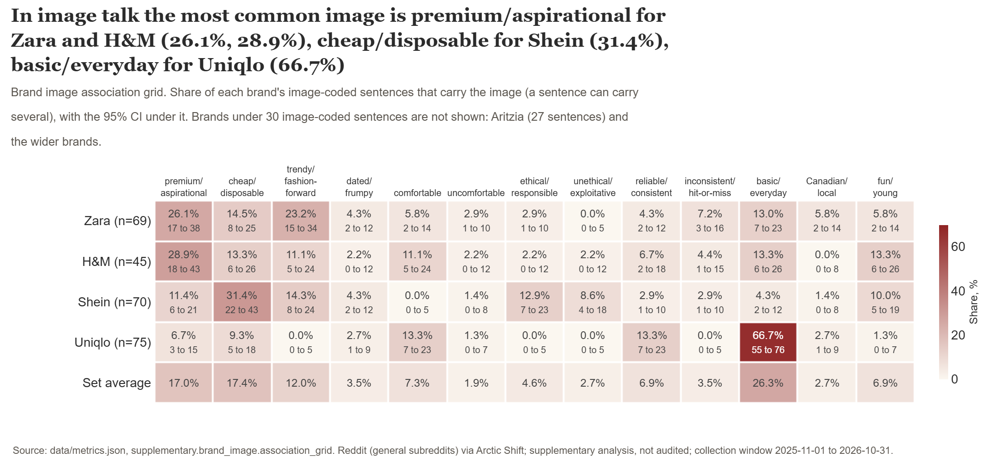

*Share of each brand's image-coded sentences that carry each of 13 images. Uniqlo's basic/everyday is 66.7% (50 of 75), Shein's cheap/disposable 31.4% (22 of 70), Zara's premium/aspirational 26.1% (18 of 69), H&M's premium/aspirational 28.9% (13 of 45).*
Source: `data/metrics.json` (`supplementary.brand_image.association_grid`). Image-coded sentences: Zara 69, H&M 45, Shein 70, Uniqlo 75.

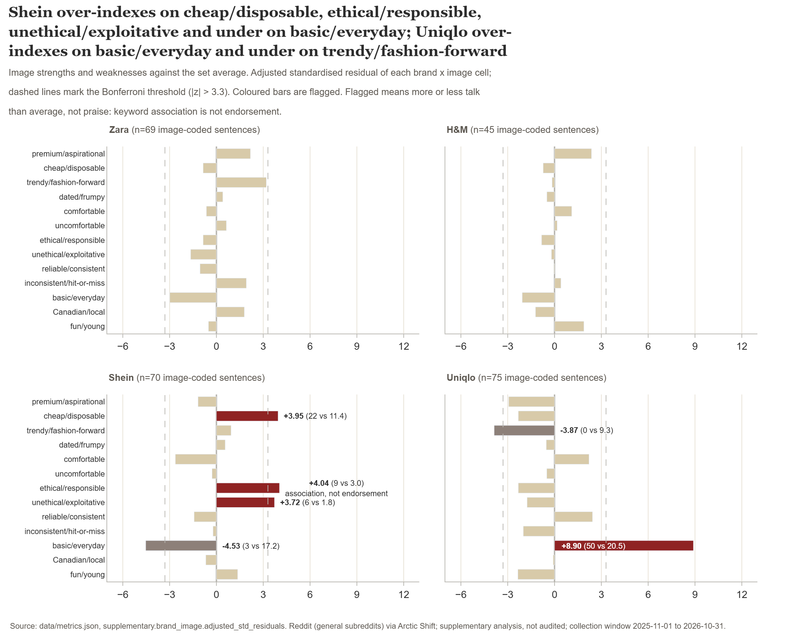

*Six brand-by-image cells pass the Bonferroni threshold (|z| above 3.3): Uniqlo basic/everyday z 8.90 (over), Shein basic/everyday -4.53 (under), Shein ethical/responsible 4.04, Shein cheap/disposable 3.95, Shein unethical/exploitative 3.72 (all over), Uniqlo trendy/fashion-forward -3.87 (under).*
Source: `data/metrics.json` (`supplementary.brand_image.strengths_and_weaknesses_bonferroni`). Chi-square on the brand-by-image table: 169.45, df 36, p about 3e-19 (indicative only: 32 of 52 cells have an expected count below 5, and one author can write many sentences).

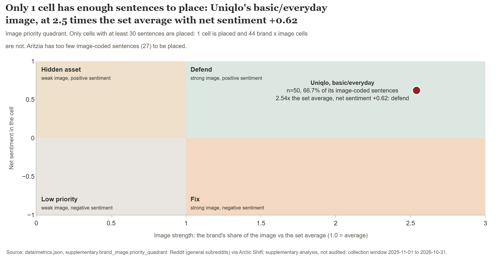

*Only one brand-by-image cell has at least 30 sentences: Uniqlo basic/everyday (n 50, index 2.54 against the set average, net sentiment 0.62), which falls in the "defend" quadrant.*
Source: `data/metrics.json` (`supplementary.brand_image.priority_quadrant`).

Limits:
- Only Zara, H&M, Shein and Uniqlo have at least 30 image-coded sentences. Aritzia has 27 and the other 13 brands fewer.
- Shein's ethical/responsible flag (9 sentences) is association, not endorsement: the same brand also over-indexes on unethical/exploitative (6 sentences), so people are discussing its ethics, not necessarily praising them.
- Only one cell is placed in the priority quadrant (Uniqlo basic/everyday, defend); all other cells have fewer than 30 sentences.
- Driver analysis, an aided image battery and multidimensional scaling need a survey. See "What this cannot do without a survey" in `data/README.md`.

## Known issues in the kept report

These were found after the keep, by the chart build's interval checks and by the Auditor. Each needs a further cycle, which cannot be kept until the score gets more headroom (see "What you should know before trusting this result"). The kept `report.md` was not changed.

- **(a) Module 5 title.** It says Shein and Zara draw more negative sentences than Aritzia, Uniqlo or H&M, but Zara's negative interval (14.8% to 22.5%) overlaps H&M's (7.5% to 15.1%). Shein (19.5% to 28.3%) is clear of H&M, so only Zara against H&M is unsupported. (The module 5 heading in this README names only Aritzia and Uniqlo, which the intervals do support.)
- **(b) Module 6.** It says Segment 1 is more negative than the Uniqlo-led group, but the intervals overlap (12.9% to 23.1% vs 8.6% to 17.5%). Against the Aritzia-led group (4.4% to 10.1%) the gap holds.
- **(c) Summary.** It says "positioned on trend", while module 4 ties style/trend to Uniqlo.
- **(d) Module 3 heading.** It says the Gen Z and Millennial "shares overlap", where it is the intervals that overlap (40.8% to 72.8% vs 24.7% to 56.3%); the point shares are 57.6% and 39.4%.
- **(e) Summary.** It says Zara "is discussed mostly for price and quality", but module 4 finds that price/value and quality/durability come up for every core brand, so they do not set Zara apart.
- **(f) Summary.** "The most open dissatisfaction" is an unsupported superlative: Zara's negative interval (14.8% to 22.5%) overlaps H&M's, and Shein's negative share (23.6%) is higher than Zara's (18.4%).

## How keeploop improved the report

keeploop works like a small company. An **Analyst** proposes one change on a written **card**. An **Engineer** makes exactly that change in the **workspace** (the folder holding `brief.md`, `report.md` and `data/`). A fixed **score** measures the result. An **Auditor** with a fresh context, who never sees the others' reasoning, judges the change against the card. Only `python kl.py keep` can keep a change, and only when the numbers and the audit allow it. Here the roles were played by Claude Code: the Analyst was the main session, and the Engineer and the Auditor were separate fresh subagents.

In short: one card, one edit of two lines, score 0.970000 to 1.000000, audit APPROVED, kept.

### (a) team.yaml: who works, what is protected, how strict the bar is

`team.yaml` is the one file the human writes before the loop starts. It names the pack (the rules and taste for this profession), the workspace, the protected paths, the roles, and the keep threshold. The report writer sees only `FORMAT.md`, never the scorer.

```yaml
# team.yaml - marketing research example (consumer insight report).
# Set up (seconds): python tools/make_sandbox.py examples/marketing-research DEST
# It copies keeploop to DEST/kl with these files on top, removes the demo
# holdout.py (it imports the demo scorer; lesson L-001, see run/LOG.md), and
# makes the workspace below a fresh git repo. Then: cd DEST/kl && python kl.py begin
# sandbox root: evaluate.py, team.yaml, program.md, FORMAT.md, samples/good.md, samples/bad.md
# sandbox workspace: brief.md, report.md, data/metrics.json, data/quotes.json
# The report writer sees only FORMAT.md, never evaluate.py.
# Format of report.md: examples/marketing-research/FORMAT.md

pack: marketing-research

# CHANGE ME: your own folder, a clean git repo with brief.md, report.md and data/.
workspace: ../mr-workspace

# Nobody may rewrite the objectives or the evidence to win the score.
protect: brief.md, data

# Vendors are used by the headless loop (`python run.py`) and `kl audit --vendor`.
# The worked example ran in interactive mode: the roles were played by Claude Code
# (Analyst = main session, Engineer and Auditor = separate fresh subagents).
roles:
  analyst:
    vendor: claude-cli
    token_budget: 30000
  engineer:
    vendor: claude-cli
    token_budget: 50000
  auditor:
    vendor: claude-cli      # same CLI is allowed only as a fresh context (AGENTS.md)
    token_budget: 30000

# The score is deterministic, so noise is zero; 1% relative gain keeps a
# single fixed check from being kept on rounding alone.
# The score runs 0 to 1: kl warns when the keep bar is above 1.0 (nothing can be kept).
loop:
  max_iterations: 20
  keep_threshold: 0.01
  metric_max: 1.0
```

Two lines matter most. `protect: brief.md, data` means nobody can change the client's objectives or the evidence to win the score. `keep_threshold: 0.01` means a change must beat the best score by at least 1% to count.

### (b) The hypothesis card: one written bet, with the rule that would reject it

The Analyst wrote one card before anything was edited. This is the card as registered (`run/cycle-2/card.md`):

```text
HYPOTHESIS: The draft makes two claims about who is talking that the data does not support: the module 3 heading says authors who give an age "skew Gen Z", but the Gen Z and Millennial intervals overlap (40.8% to 72.8% vs 24.7% to 56.3%), and the limits say Reddit "skews young, male and US" with no source and no metric behind it. Rewording the heading to what the intervals show and deleting the unsourced clause makes every claim about the audience traceable, and raises the score.
ALTERNATIVES: (1) Keep the Reddit demographic context and add a cited, dated source instead of deleting it; rejected for this cycle because no verified source is in the brief, and an unverified citation would be worse than none. (2) The bigger quality risk is the Summary recommending a trend-led position while module 4 finds style/trend already tied to Uniqlo; that is a judgement the score cannot see and is the next card, not this one.
CHANGE: In report.md only, two edits. (a) Module 3 heading: keep "## 3. Profiling:" and replace "and those who do skew Gen Z, so the audience cannot be described reliably" with "and among those who do, the Gen Z and Millennial shares overlap, so the audience cannot be described reliably". (b) In Method and limits, first bullet: replace "Reddit is self-selected and skews young, male and US." with "Reddit is self-selected, and who posts there is not measured in this data." Change nothing else. Do not touch brief.md or data/.
EXPECT: Check U1 = 2/2, metric 1.000000, above the keep bar 0.979700, no other check gets worse.
REJECT IF: metric below 0.979700, or the scorer rejects the workspace, or any line other than those two changes, or the new wording claims more than data/metrics.json shows.
MISSING: A cited, dated source on Reddit's user demographics in the US and Canada would let the report keep that context instead of deleting it.
```

What each label means:

| Label | In plain words |
|---|---|
| HYPOTHESIS | What we think is wrong, and why fixing it should raise the score. |
| ALTERNATIVES | Other fixes we considered, and why we did not pick them this time. |
| CHANGE | The exact edit the Engineer may make. Nothing else is allowed. |
| EXPECT | What we predict the score will show, so the result can prove us wrong. |
| REJECT IF | The pre-registered condition that kills the change, written before the test. It must name a number or another falsifiable fact. |
| MISSING | What we do not know. It goes to the human as an open question instead of being guessed. |

The edit itself (`run/cycle-2/cycle.diff`) is 1 file, 2 lines removed and 2 added, both in `report.md`. The card's first fix reworded the module 3 heading from "skew Gen Z" to what the intervals show. The second deleted the unsourced "skews young, male and US" clause.

### (c) The eval run: a fixed checklist of report-quality rules

The score is `evaluate.py`, a program nobody can change during the loop. It runs 17 checks, each worth some of 100 points, and the score is points earned divided by 100. The checks cover the five things a research report must do: clear objectives (does each module state its question and decision), non-leading evidence (quotes chosen by a stated rule, every number filed under the right brand), correct measure choice (every percentage has its base and a 95% interval, none on a base under 30, proxies say "proxy"), logical flow (answer first, limits last) and decision-ready output (each module ends in a so-what and a recommendation naming Fieldnote).

There is also a hard rule. Every number in `report.md` must exist in `data/metrics.json`, and every quote must be verbatim from `data/quotes.json`. If one does not, the scorer refuses to score the report at all: it is invalid, not low.

Per-check results from the transcript. Only one check changed:

| Check | Weight | Before | After | What it checks |
|---|---|---|---|---|
| O1 | 10 | 6/6 | 6/6 | each module has a Question line |
| O2 | 10 | 6/6 | 6/6 | each module has a Decision line |
| E1 | 5 | 16/16 | 16/16 | no hype or overclaiming word in headings or So what lines |
| E2 | 5 | 4/4 | 4/4 | comparison modules name all 5 core brands |
| E3 | 4 | 5/5 | 5/5 | each quote is attributed to the cell it came from |
| E4 | 3 | 1/1 | 1/1 | a Quote rule line says how quotes were chosen |
| B1 | 5 | 185/185 | 185/185 | each number on a one-brand or one-segment line is filed under that brand or segment |
| **U1** | **3** | **0/2** | **1/1** | **claims about who posts carry a traced number or a (Source, year)** |
| M1 | 8 | 25/25 | 25/25 | every percentage has n= and a 95% interval |
| M2 | 6 | 25/25 | 25/25 | no percentage on a base under 30 |
| M3 | 6 | 10/10 | 10/10 | penetration and top-of-mind say proxy |
| F1 | 5 | 1/1 | 1/1 | the answer-first summary comes first |
| F2 | 5 | 6/6 | 6/6 | modules appear in brief order |
| F3 | 5 | 1/1 | 1/1 | Method and limits come after the modules |
| D1 | 8 | 6/6 | 6/6 | each module has a So what line |
| D2 | 8 | 6/6 | 6/6 | each module has a Recommendation naming Fieldnote |
| D3 | 4 | 1/1 | 1/1 | the summary names the target segment |
| **Score** | 100 | **0.970000** | **1.000000** | |

Before the edit the scorer found two unsourced claims about who posts on Reddit (U1 0/2), which cost the full 3 points. After the edit it found none (U1 1/1; with no such claim the check is a pass by design). That is the whole 0.03 of gain. The card's EXPECT line predicted "U1 = 2/2"; the real result was 1/1 because no flagged claim was left to count. The points and the score came out as predicted, but the fraction did not, and the card is shown as it was registered.

**What the score does not measure.** Per the pack's own `metric_validation` note, it is not validated against client decisions. It measures rule compliance (objectives, evidence integrity, measure choice, flow, recommendations) and that every number traces to the analysis, not whether the insight is right. The pack states how to validate it: have two senior researchers blind-rate several reports with different scores and check how well their ranking matches the score. Until then the pack stays experimental. It also means B1 and the traceability rule can show that a number exists and sits under the right brand, but not that a number really supports the sentence around it; that is why an Auditor reads the report too.

### (d) The decision: kept, with the numbers

| Item | Value |
|---|---|
| Baseline (best score before the card) | 0.970000 |
| Noise (sigma, run-to-run spread over 3 runs) | 0.000000 |
| Keep bar | 0.979700 |
| Candidate score after the edit | 1.000000 |
| Audit | APPROVED |
| `kl keep` result | KEPT cycle 1: metric 1.000000 (bar 0.979700); best is now 1.000000 |

**How the keep bar is set.** `run.py` computes it as `best + max(|best| × keep_threshold, noise_z × sigma)`. Here `keep_threshold` is 0.01 (from team.yaml) and `noise_z` is 2.0 (the default in `prepare.py`). The score is deterministic, so sigma is 0 and the noise term is 2.0 × 0.000000 = 0. So the bar is 0.970000 + max(0.970000 × 0.01, 0) = 0.970000 + 0.009700 = 0.979700. The candidate scored 1.000000, about 0.020 above the bar. After the keep, the same formula gives a new bar of 1.000000 + max(1.000000 × 0.01, 0) = 1.010000.

**What the Auditor checked.** It confirmed that the metric beat the bar, that no REJECT IF condition triggered, that the staged change was identical to the diff the card described (1 file, 2 insertions and 2 deletions), and that both edits matched the CHANGE text word for word. It also re-checked the new heading against `data/metrics.json`: Gen Z is 19 of 33 (57.6%, 95% CI 40.8% to 72.8%) and Millennial is 13 of 33 (39.4%, CI 24.7% to 56.3%), so the intervals overlap from 40.8% to 56.3% and the heading claims no more than the data shows. It did not re-run the scorer itself, so "no other check gets worse" rests on the reported 1.000000.

**Quality ratings the Auditor gave (0 to 100):** objectives 95, non-leading evidence 90, measure choice 90, logical flow 90, decision-ready output 85.

### What you should know before trusting this result

1. **The scorer was tightened after the first score.** The unchanged first draft scored 1.000 on the first version of the scorer. A score already at the maximum gives the loop nothing to keep, because no change can beat it. With the user's approval, two checks (B1, claim binding, and U1, unsourced skew claims) were added before the baseline was recorded. The draft itself was not changed. So the baseline of 0.970000 exists because we added checks that the draft failed. Only U1 produced headroom here (B1 scored 185/185 before and after). Weigh the 0.03 gain accordingly: it is real on this scorer, but we shaped the scorer after seeing the draft.
2. **The score is saturated again.** After the keep, the best score is 1.000000 and the bar is 1.010000, which no report can reach. The Auditor found a remaining issue: the Summary says "positioned on trend", but module 4 ties style/trend to Uniqlo. A fix for that cannot be kept until a human gives the score more headroom (a new or stricter check). This is the next card (it is named under ALTERNATIVES in the card above). **It was not run.**
3. **The Auditor's minor notes, not blocking.** (i) "Who posts there is not measured in this data" is slightly too absolute, because age, gender and country are self-reported by a few authors; "barely measured" would be more exact. (ii) The deleted "skews young, male and US" also pointed the wrong way for gender: 11 of the 13 authors who gave a gender are female (confirmed in `data/metrics.json`, `modules.profiling.gender_of_brand_mentioning_authors`). (iii) The kept module 3 heading says the Gen Z and Millennial "shares" overlap, but it is the intervals that overlap (the shares are 57.6% and 39.4%); the report body says "intervals" correctly.

### Full transcript of the cycle (verbatim)

The verbatim record is [`run/cycle-2/transcript.txt`](run/cycle-2/transcript.txt): every `kl` command of the cycle and its output, including the per-check breakdown before and after the edit. It was recorded before this example had its own `program.md`, so its `next hypothesis to test:` lines show the framework's generic demo charter, not this study. A sandbox built today reads [`program.md`](program.md) and opens with this study's first hypothesis (sourcing or dropping claims about who posts on Reddit).

The transcript includes one operator mistake: the `kl recall` query was first typed without quotes and `kl` rejected it, then re-run quoted. It is item 15 in [`run/LOG.md`](run/LOG.md).

## How to reproduce

These are the steps from the `team.yaml` header and the transcript.

1. Build the sandbox from the keeploop repo root (about a second; use a short `DEST` on Windows): `python tools/make_sandbox.py examples/marketing-research DEST`. It puts this folder's `evaluate.py`, `team.yaml`, `program.md`, `FORMAT.md` and `samples/` in a keeploop copy at `DEST/kl`, removes the demo `holdout.py`, and makes `DEST/mr-workspace` a fresh git repo holding `brief.md`, `report.md`, `data/metrics.json` and `data/quotes.json`. Run the rest from `DEST/kl`.
2. Start from the draft. The `report.md` in this folder is the kept version. To get the draft that scored 0.970000, apply the cycle's edit in reverse inside the workspace: `git apply -R <keeploop repo>/examples/marketing-research/run/cycle-2/cycle.diff` from inside `DEST/mr-workspace`, then commit it there (`git commit -am draft`): `kl begin` refuses a workspace with uncommitted changes. If you skip this step, `kl begin` scores the kept report at 1.000000 and warns that the baseline is at the ceiling: no cycle can be kept until the score gets more headroom. We checked this: the reversed report scores 0.970000 and the kept one scores 1.000000.
3. Run the cycle:

```text
python kl.py begin
python kl.py status
python evaluate.py ../mr-workspace
python kl.py recall "unsupported claims about who posts on Reddit"
python kl.py card ../card2.md
python kl.py check
python kl.py eval
python kl.py keep --audit-verdict ../verdict2.txt
python kl.py report
```

Between `card` and `check`, the Engineer edits the workspace to implement the card. Before `keep`, a fresh-context Auditor reads the card, the diff and the metric and replies `APPROVED` or `CHANGES REQUESTED`; the reply is saved to `verdict2.txt`. Card and verdict files go outside the keeploop repo (the transcript used the workspace's parent folder).

To rebuild the data (optional, needs network; the original collection took about two hours; the committed `data/metrics.json` is what the report uses). The method, caps and limits are in `data/README.md`:

```text
python -X utf8 listen.py collect [reddit|appstore|wiki]
python -X utf8 listen.py analyze
```

## Credits and log

The team's own performance is kept out of the report. [`run/LOG.md`](run/LOG.md) is the honest record of what went wrong while building this example and the rules each mistake produced, and [`run/cycle-1/`](run/cycle-1/) is the first attempt, a survey questionnaire that turned out to be the wrong deliverable and is kept for the record.
