<p align="center">
  <a href="README.md">English</a> | <b>Tiếng Việt</b> | <a href="README.zh-CN.md">简体中文</a>
</p>

# Người mua thời trang nhanh thuộc Gen Z (thế hệ trẻ nhất) và Millennial (thế hệ trước đó) nói gì về năm thương hiệu, và keeploop đã siết chặt báo cáo như thế nào

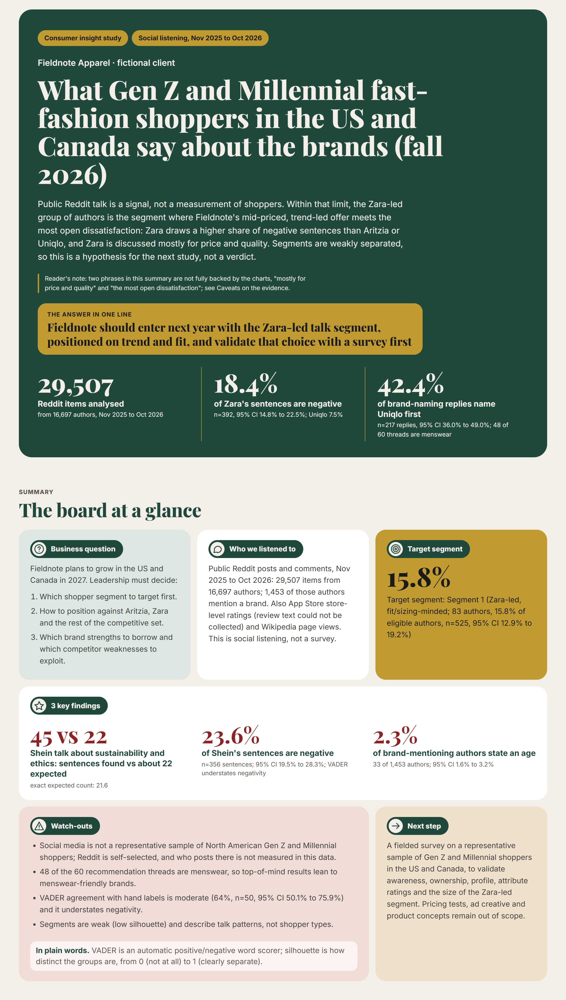

Đây là một nghiên cứu social listening (lắng nghe mạng xã hội) về những gì người dùng Reddit công khai nói về Aritzia, Zara, H&M, Shein và Uniqlo, viết cho một khách hàng hư cấu là Fieldnote Apparel, đang cân nhắc cách gia nhập thị trường Mỹ và Canada năm 2027. Một chu kỳ keeploop thật (keeploop là một bộ lệnh nhỏ dùng để đo, chặn cổng và ghi lại mọi thay đổi trong một thư mục công việc) đã siết chặt báo cáo; nửa sau của trang này trình bày chu kỳ đó cùng các con số thật. Hãy bắt đầu từ phần "Dữ liệu cho thấy gì"; bạn không cần nền tảng machine learning nào.

Các báo cáo: báo cáo động là [`report/dashboard.html`](report/dashboard.html) (hãy mở cục bộ bằng trình duyệt; GitHub không hiển thị được tệp này). Báo cáo tĩnh là [`report/report.pdf`](report/report.pdf) (30 trang A4). Toàn văn nằm ở [`report.md`](report.md), còn cách thu thập và phân tích dữ liệu nằm ở [`data/README.md`](data/README.md).

## Dữ liệu cho thấy gì

### Fieldnote nên gia nhập bằng phân khúc thảo luận do Zara dẫn đầu, định vị theo xu hướng và độ vừa vặn, và phải kiểm chứng lựa chọn này bằng một khảo sát trước

Các cuộc trò chuyện công khai trên Reddit là một tín hiệu, không phải một phép đo người mua. Trong giới hạn đó, nhóm tác giả do Zara dẫn đầu là phân khúc mà ở đó sản phẩm tầm trung, theo xu hướng của Fieldnote gặp nhiều bất mãn công khai nhất: Zara có tỷ lệ câu tiêu cực cao hơn Aritzia hay Uniqlo, và Zara được bàn chủ yếu về giá và chất lượng. Các phân khúc tách biệt yếu, nên đây là một giả thuyết cho nghiên cứu tiếp theo, không phải một kết luận.

Phân khúc mục tiêu: Phân khúc 1 (do Zara dẫn đầu, quan tâm đến độ vừa vặn/kích cỡ; 83 tác giả, 15.8% số tác giả đủ điều kiện, n=525, KTC 95% từ 12.9% đến 19.2%).

Sáu mô-đun dưới đây theo đúng thứ tự của brief (bản yêu cầu nghiên cứu). "Proxy" (chỉ số thay thế) là một phép đo đại diện, không phải phép đo thật. "95% CI" (KTC, khoảng tin cậy) là khoảng mà giá trị thật có khả năng nằm trong đó; khi hai khoảng chồng lên nhau, dữ liệu không thể phân biệt hai con số.

| Mô-đun | Câu trả lời một dòng |
|---|---|
| 1. Top-of-mind (thương hiệu nghĩ đến đầu tiên) | Uniqlo được nêu đầu tiên trong các chủ đề xin gợi ý thường xuyên hơn hẳn bốn thương hiệu cốt lõi còn lại, nhưng mẫu nghiêng về thời trang nam. |
| 2. Penetration (mức độ thâm nhập) | Lời tự kể về việc mua hàng tương tự nhau giữa năm thương hiệu, với các khoảng chồng lên nhau. |
| 3. Profiling (chân dung đối tượng) | Ít tác giả nêu tuổi, và trong số đó, các khoảng của Gen Z và Millennial chồng lên nhau, nên không thể mô tả đối tượng một cách đáng tin cậy. |
| 4. Positioning (định vị) | Shein được bàn nhiều hơn về tính bền vững và đạo đức, còn Uniqlo nhiều hơn về phong cách và xu hướng, so với các thương hiệu khác. |
| 5. Perception (nhận thức thương hiệu) | Shein và Zara có nhiều câu tiêu cực hơn Aritzia, Uniqlo hay H&M, nhưng công cụ đánh giá thấp mức độ tiêu cực. |
| 6. Segmentation (phân khúc) | Xuất hiện năm nhóm thảo luận, nhưng chúng chồng lấn nhau, và nhóm do Zara dẫn đầu là mục tiêu đầu tiên được đề xuất. |

### 1. Uniqlo được nêu đầu tiên thường xuyên hơn hẳn bốn thương hiệu cốt lõi còn lại, nhưng mẫu nghiêng về thời trang nam

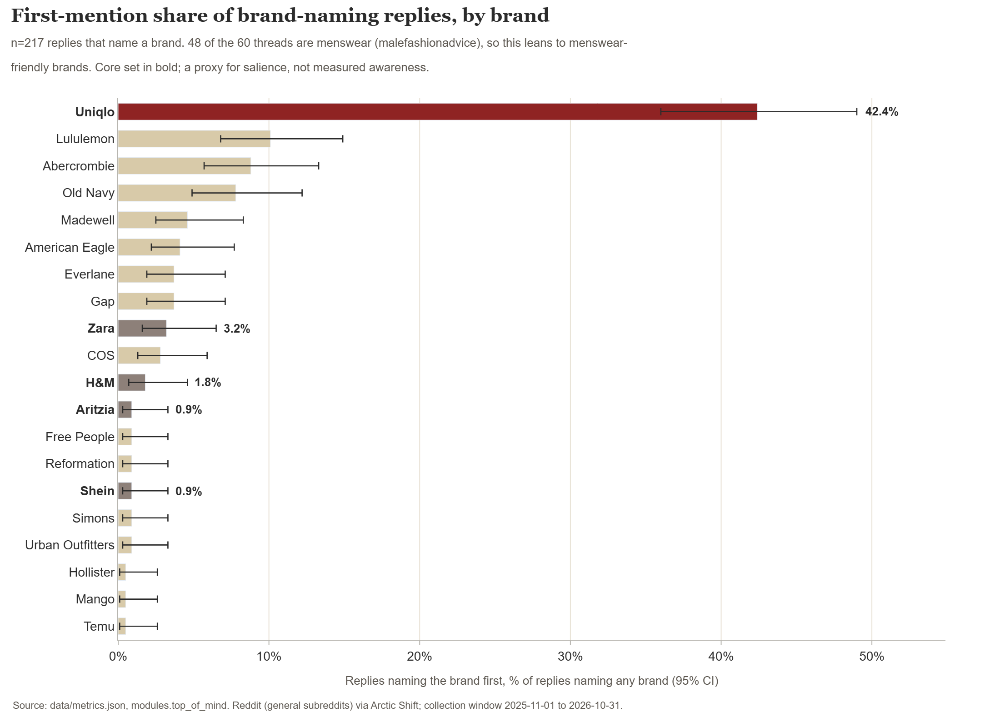

*Trong mẫu này chỉ Uniqlo nổi bật (42.4% được nêu đầu tiên, KTC 95% từ 36.0% đến 49.0%); bốn khoảng còn lại chồng lên nhau, và phần lớn các chủ đề là thời trang nam.*
Nguồn: `data/metrics.json` (`modules.top_of_mind`); n=217 phản hồi có nêu thương hiệu, lấy từ 2140 phản hồi cấp một trong 60 chủ đề xin gợi ý.

Khuyến nghị trong báo cáo: đừng đọc đây là bảng xếp hạng thị trường thời trang nữ, và hãy thêm câu hỏi nhận biết có gợi ý và không gợi ý vào khảo sát.

### 2. Lời tự kể về việc mua hàng tương tự nhau giữa năm thương hiệu

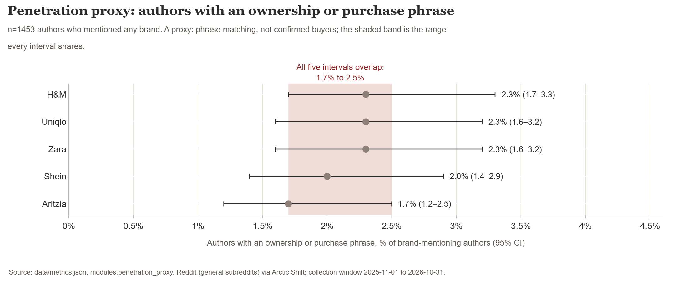

*Các giá trị nhỏ do cách xây dựng chỉ số (1.7% đến 2.3%) và năm khoảng chồng lên nhau, nên dữ liệu này không phân biệt được các thương hiệu về mức sở hữu.*
Nguồn: `data/metrics.json` (`modules.penetration_proxy`); n=1453 tác giả có nhắc đến bất kỳ thương hiệu nào.

Khuyến nghị trong báo cáo: không khẳng định có khoảng cách về mức thâm nhập so với bất kỳ đối thủ nào, và đo mức sở hữu tự khai trong khảo sát.

### 3. Ít tác giả nêu tuổi, nên không thể mô tả đối tượng một cách đáng tin cậy

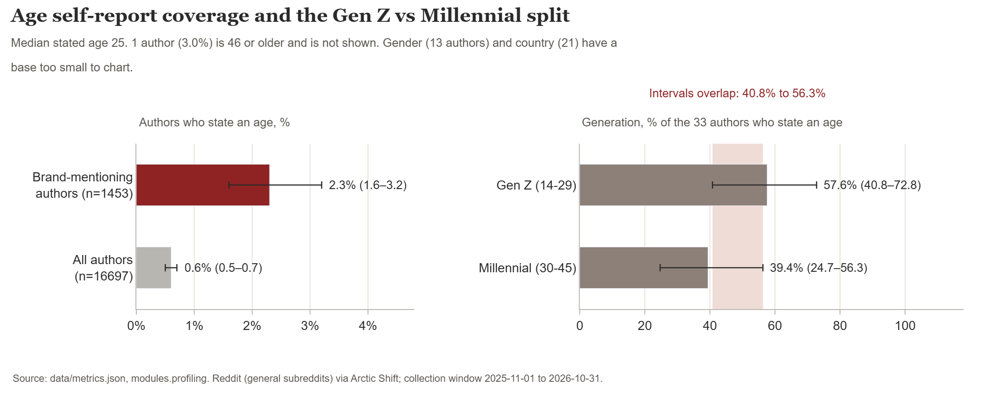

*Chỉ 33 trên 1453 tác giả có nhắc đến thương hiệu (2.3%) nêu tuổi. Trong số đó Gen Z chiếm 57.6% và Millennial chiếm 39.4%, nhưng các khoảng chồng lên nhau, và dữ liệu không thể tách Mỹ khỏi Canada.*
Nguồn: `data/metrics.json` (`modules.profiling`).

Khuyến nghị trong báo cáo: xây dựng chân dung đối tượng Mỹ và Canada từ một khảo sát chọn mẫu theo hạn ngạch (quota) về tuổi, giới tính và quốc gia.

### 4. Shein mang các cuộc thảo luận về tính bền vững và đạo đức, Uniqlo mang các cuộc thảo luận về phong cách và xu hướng

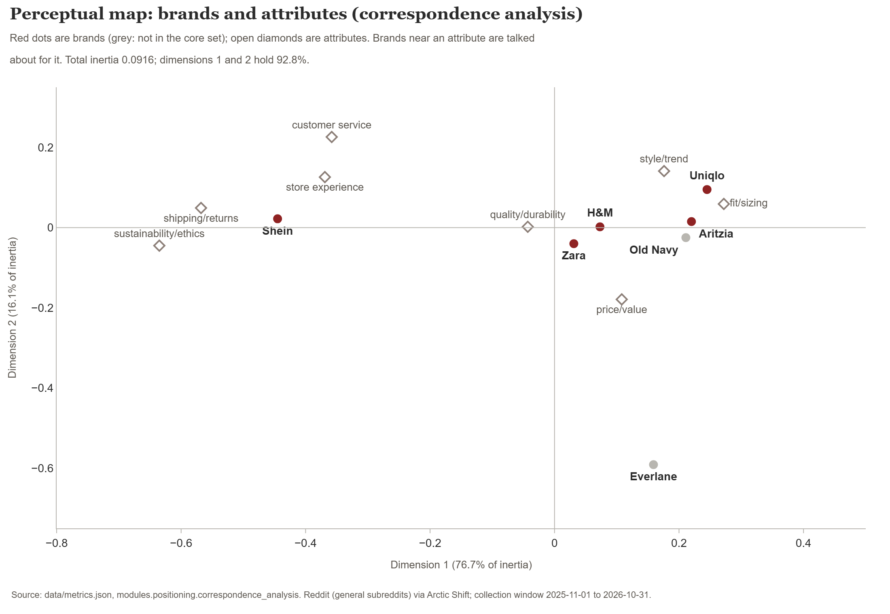

*Giá/giá trị và chất lượng/độ bền xuất hiện ở mọi thương hiệu cốt lõi, nên không tạo ra khác biệt; phong cách/xu hướng đã gắn với Uniqlo, và Shein mang cuộc thảo luận về đạo đức.*
Nguồn: `data/metrics.json` (`modules.positioning.correspondence_analysis`); chỉ mang tính tham khảo, vì một tác giả có thể đóng góp nhiều câu.

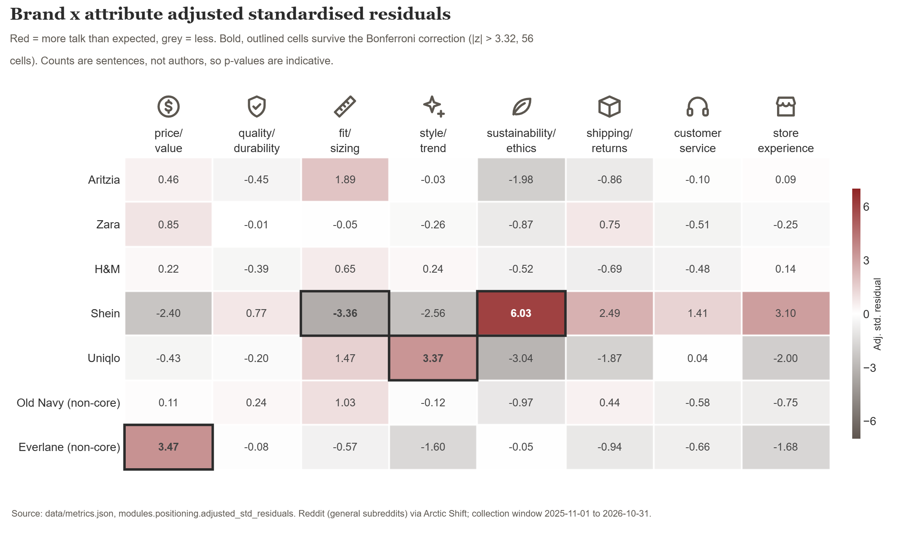

*Sau khi hiệu chỉnh Bonferroni (một phép kiểm định chặt hơn, dùng khi kiểm tra nhiều ô cùng lúc), ba ô của các thương hiệu cốt lõi lệch khỏi kỳ vọng: Shein ở tính bền vững/đạo đức (z=6.03), Shein ở độ vừa vặn/kích cỡ (z=-3.36) và Uniqlo ở phong cách/xu hướng (z=3.37).*
Nguồn: `data/metrics.json` (`modules.positioning.adjusted_std_residuals`, `bonferroni_z`).

Khuyến nghị trong báo cáo: thử nghiệm một đề xuất giá trị theo xu hướng và vừa vặn đáng tin cậy so với Zara và Uniqlo, và tránh cạnh tranh về giá, nơi năm thương hiệu vốn đã nằm cùng chỗ.

### 5. Shein và Zara có nhiều câu tiêu cực hơn Aritzia hay Uniqlo, nhưng công cụ đánh giá thấp mức độ tiêu cực

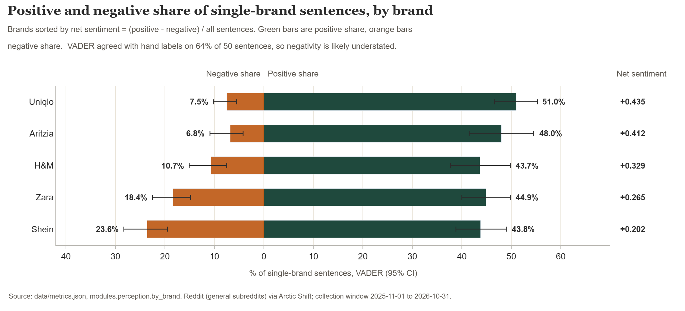

*Khoảng cách về thảo luận tiêu cực là phát hiện về nhận thức đứng vững nhất ở đây: tỷ lệ tiêu cực của Shein hoặc Zara không chồng lên của Aritzia hoặc Uniqlo. Công cụ bỏ sót nhiều lời chê, và cảm xúc đo được hướng vào các câu, không phải vào người mua.*
Nguồn: `data/metrics.json` (`modules.perception`); các câu được chấm điểm bằng VADER, một bộ từ điển cảm xúc đa dụng.

Khuyến nghị trong báo cáo: coi tỷ lệ thảo luận tiêu cực cao hơn của Zara là một manh mối cần điều tra, không phải điểm yếu đã được chứng minh, và đo điểm đánh giá thuộc tính thương hiệu trong khảo sát.

### 6. Xuất hiện năm nhóm thảo luận, và nhóm do Zara dẫn đầu là mục tiêu đầu tiên được đề xuất

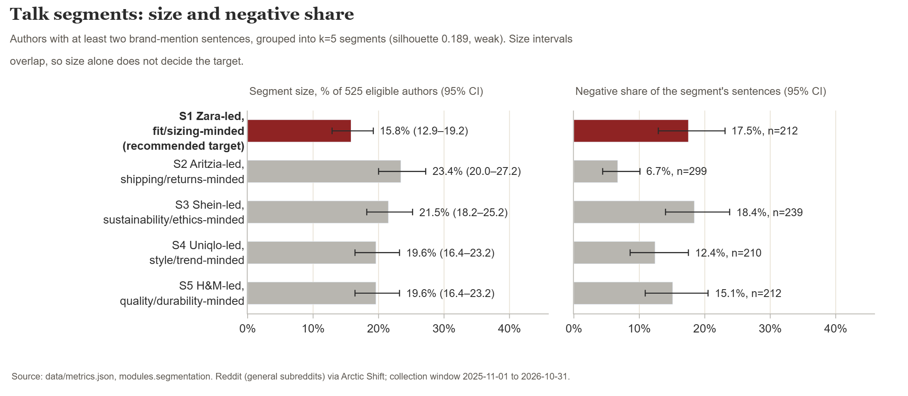

*Phân khúc 1 nhỏ nhất trong năm phân khúc, nhưng được xây quanh thương hiệu gần nhất với định vị của Fieldnote, và các cuộc thảo luận của nhóm này có tỷ lệ câu tiêu cực cao hơn các nhóm do Aritzia hoặc Uniqlo dẫn đầu. Quy mô các phân khúc chồng lên nhau, nên chỉ riêng quy mô không quyết định được.*
Nguồn: `data/metrics.json` (`modules.segmentation`); n=525 tác giả có ít nhất hai câu nhắc đến thương hiệu.

Khuyến nghị trong báo cáo: nhắm vào phân khúc do Zara dẫn đầu trước như một giả thuyết làm việc, với độ vừa vặn và kích cỡ là đề xuất dẫn dắt, và xác nhận quy mô, cơ cấu tuổi và quốc gia của nó bằng khảo sát.

### Bối cảnh bổ sung: mức độ quan tâm tìm kiếm

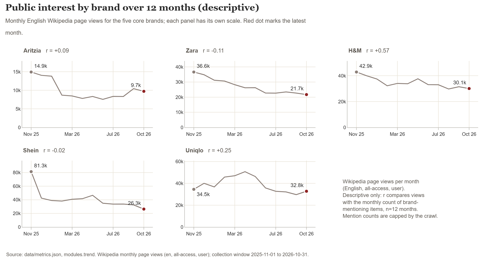

*Lượt xem trang và số lượt nhắc được đặt cạnh nhau chỉ để mô tả; số lượt nhắc bị giới hạn bởi các mức trần khi thu thập, nên hãy dùng share of voice (tỷ trọng tiếng nói, tức phần trăm lượt nhắc của mỗi thương hiệu trong tổng), đừng dùng tốc độ tăng trưởng.*
Nguồn: `data/metrics.json` (`modules.trend`; lưu ý riêng của nó và ghi chú n=12 tháng). `report.md` không có mô-đun nào cho biểu đồ này, nên chú thích này được lấy từ tệp metrics.

### Những giới hạn bạn cần ghi nhớ

- Social listening không phải là mẫu đại diện. Reddit là nơi người dùng tự chọn tham gia, và ai đăng bài ở đó không được đo trong dữ liệu này.
- Top-of-mind, penetration và positioning là các proxy, không phải các phép đo từ khảo sát.
- 48 trong 60 chủ đề xin gợi ý là về thời trang nam, nên kết quả top-of-mind nghiêng về các thương hiệu thân thiện với thời trang nam.
- Ít tác giả nêu tuổi, giới tính hoặc quốc gia (33, 13 và 21 tác giả trên 1453), nên các phép tách theo thế hệ và quốc gia phần lớn là "cỡ mẫu quá nhỏ", và không thể tách Canada khỏi Mỹ.
- VADER khớp với nhãn gán tay ở 64% trên 50 câu (KTC 95% từ 50.1% đến 75.9%; kappa 0.45, mức trung bình; một người gán nhãn) và đánh giá thấp mức độ tiêu cực.
- Các phân khúc yếu (silhouette 0.189, một điểm số trong đó 1 là các nhóm tách biệt hoàn hảo và 0 là các nhóm chồng lấn). Chúng mô tả các mẫu hình thảo luận, không phải các kiểu người mua.
- Văn bản đánh giá trên App Store không thu thập được; chỉ có xếp hạng ở cấp cửa hàng, và không có báo cáo nào về cảm xúc trong đánh giá.
- Đợt thu thập bị giới hạn thời gian và chỉ một phần; không có subreddit nào có dữ liệu cho Zara hay H&M.

**Bước tiếp theo được khuyến nghị:** một khảo sát thực địa trên mẫu đại diện những người mua thuộc Gen Z và Millennial ở Mỹ và Canada, để xác thực mức độ nhận biết, mức sở hữu, chân dung, điểm đánh giá thuộc tính và quy mô của phân khúc do Zara dẫn đầu.

## Phân tích bổ sung (thêm sau chu kỳ đã kiểm toán; chưa được kiểm toán)

Được xây từ cùng dữ liệu, không thu thập mới, chỉ dùng các subreddit tổng hợp, và lưu dưới khóa cấp cao nhất `supplementary` trong `data/metrics.json`. Đây là các proxy từ văn bản mạng xã hội công khai, không phải các phép đo từ khảo sát, và chu kỳ keeploop bên dưới không chấm điểm hay kiểm toán chúng. Các khoảng là Wilson 95%. Phương pháp: [`data/README.md`](data/README.md), mục "Supplementary analysis".

### Phễu thương hiệu (proxy từ social listening)

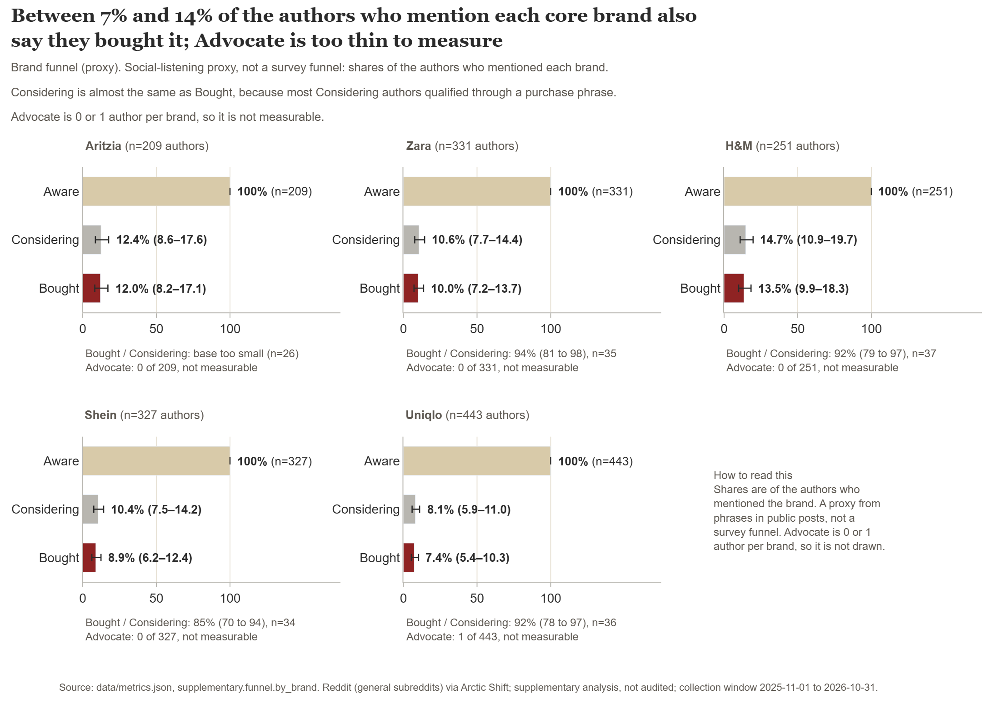

*Tỷ lệ tác giả nhắc đến mỗi thương hiệu mà cũng dùng cụm từ ý định (Considering) hoặc cụm từ sở hữu (Bought): Considering từ 8.1% đến 14.7% và Bought từ 7.4% đến 13.5% trên năm thương hiệu cốt lõi.*
Nguồn: `data/metrics.json` (`supplementary.funnel`). Aware n: Aritzia 209, Zara 331, H&M 251, Shein 327, Uniqlo 443. Considering / Bought, % của Aware: Aritzia 12.4 / 12.0, Zara 10.6 / 10.0, H&M 14.7 / 13.5, Shein 10.4 / 8.9, Uniqlo 8.1 / 7.4.

Giới hạn: giai đoạn Advocate có 0 hoặc 1 tác giả mỗi thương hiệu (Uniqlo 1, bốn thương hiệu còn lại 0), nên không thể đo ở đây. Considering gần bằng Bought (35 so với 33 tác giả cho Zara, 36 so với 33 cho Uniqlo), vì các tác giả Bought cũng được tính vào Considering. Đây không phải tỷ lệ phễu từ khảo sát.

### Bản đồ định vị hai trục

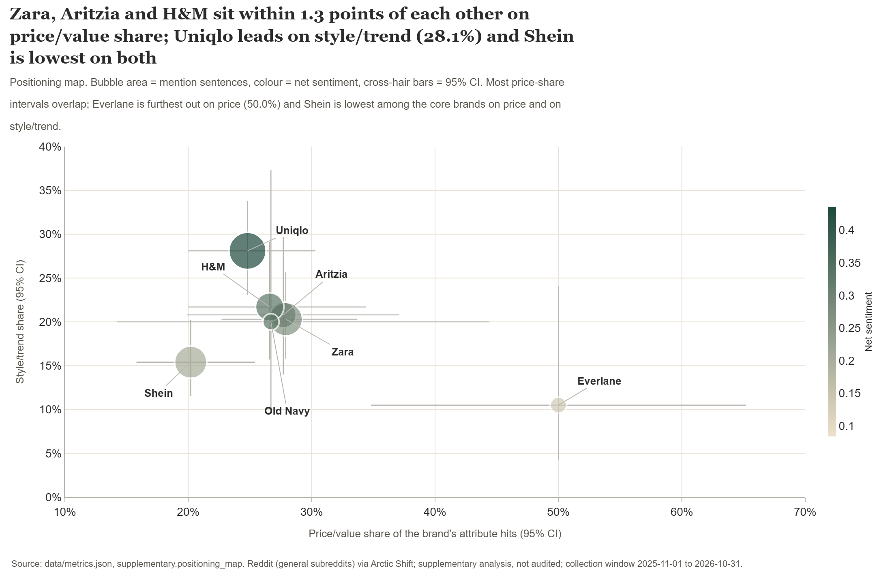

*Mỗi thương hiệu có ít nhất 30 lượt gắn thuộc tính (7 thương hiệu) được đặt theo tỷ trọng giá/giá trị (x) và tỷ trọng phong cách/xu hướng (y) trong các cuộc thảo luận về thuộc tính; kích thước bong bóng là số câu nhắc đến và màu là cảm xúc ròng.*
Nguồn: `data/metrics.json` (`supplementary.positioning_map`). Giá/giá trị, phong cách/xu hướng (%): Aritzia 27.7, 20.8; Zara 27.9, 20.3; H&M 26.6, 21.7; Shein 20.2, 15.4; Uniqlo 24.8, 28.1. Cảm xúc ròng: Aritzia 0.412, Zara 0.265, H&M 0.329, Shein 0.202, Uniqlo 0.435.

### Hình ảnh thương hiệu

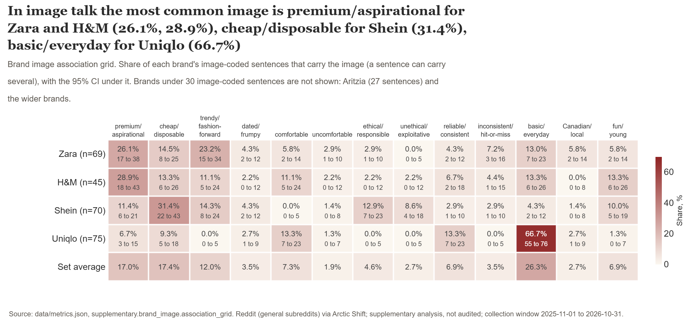

*Tỷ lệ các câu được gán hình ảnh của mỗi thương hiệu mang từng hình ảnh trong 13 hình ảnh. Basic/everyday của Uniqlo là 66.7% (50 trên 75), cheap/disposable của Shein 31.4% (22 trên 70), premium/aspirational của Zara 26.1% (18 trên 69), premium/aspirational của H&M 28.9% (13 trên 45).*
Nguồn: `data/metrics.json` (`supplementary.brand_image.association_grid`). Các câu được gán hình ảnh: Zara 69, H&M 45, Shein 70, Uniqlo 75.

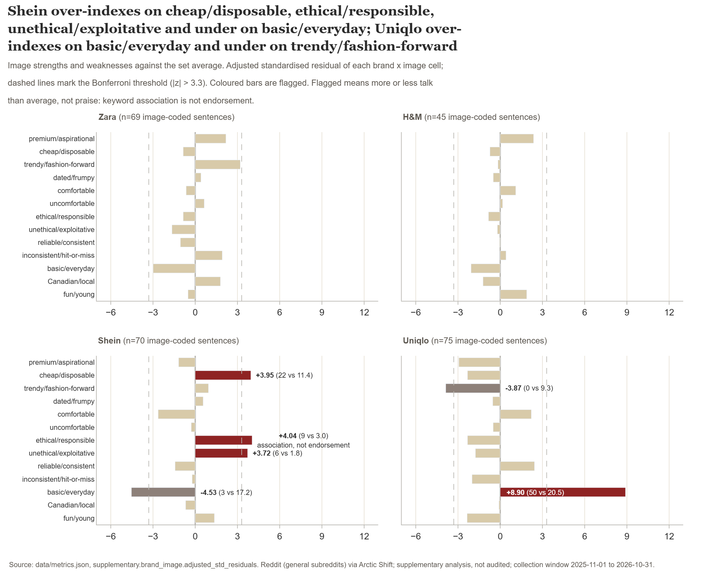

*Sáu ô thương hiệu theo hình ảnh vượt ngưỡng Bonferroni (|z| trên 3.3): Uniqlo basic/everyday z 8.90 (cao hơn kỳ vọng), Shein basic/everyday -4.53 (thấp hơn), Shein ethical/responsible 4.04, Shein cheap/disposable 3.95, Shein unethical/exploitative 3.72 (đều cao hơn), Uniqlo trendy/fashion-forward -3.87 (thấp hơn).*
Nguồn: `data/metrics.json` (`supplementary.brand_image.strengths_and_weaknesses_bonferroni`). Chi bình phương trên bảng thương hiệu theo hình ảnh: 169.45, df 36, p khoảng 3e-19 (chỉ mang tính tham khảo: 32 trên 52 ô có số đếm kỳ vọng dưới 5, và một tác giả có thể viết nhiều câu).

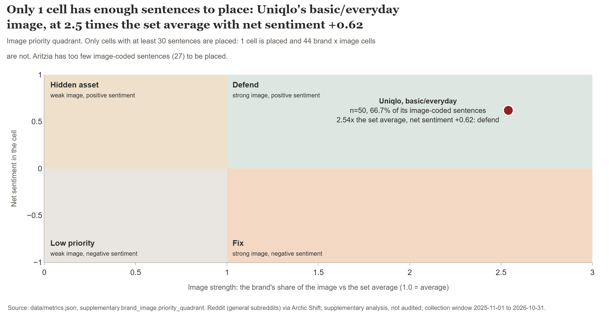

*Chỉ một ô thương hiệu theo hình ảnh có ít nhất 30 câu: Uniqlo basic/everyday (n 50, chỉ số 2.54 so với mức trung bình của tập, cảm xúc ròng 0.62), nằm ở góc phần tư "defend" (bảo vệ).*
Nguồn: `data/metrics.json` (`supplementary.brand_image.priority_quadrant`).

Giới hạn:
- Chỉ Zara, H&M, Shein và Uniqlo có ít nhất 30 câu được gán hình ảnh. Aritzia có 27 và 13 thương hiệu còn lại ít hơn.
- Cờ ethical/responsible của Shein (9 câu) là sự liên tưởng, không phải sự tán thành: cùng thương hiệu này cũng vượt kỳ vọng ở unethical/exploitative (6 câu), nên mọi người đang bàn về đạo đức của nó, chưa chắc là khen ngợi.
- Chỉ một ô được đặt vào góc phần tư ưu tiên (Uniqlo basic/everyday, defend); mọi ô khác có dưới 30 câu.
- Phân tích yếu tố dẫn dắt, bộ câu hỏi hình ảnh có gợi ý và phép co giãn đa chiều (multidimensional scaling, MDS) cần một khảo sát. Xem "What this cannot do without a survey" trong `data/README.md`.

## Các vấn đề đã biết trong báo cáo được giữ lại

Những vấn đề này được phát hiện sau khi giữ lại, nhờ các kiểm tra khoảng của bước dựng biểu đồ và nhờ Auditor. Mỗi vấn đề cần thêm một chu kỳ, mà chu kỳ đó không thể được giữ lại cho đến khi điểm số có thêm khoảng trống (xem "Điều bạn nên biết trước khi tin kết quả này"). `report.md` đã giữ lại không bị thay đổi.

- **(a) Tiêu đề mô-đun 5.** Nó nói Shein và Zara có nhiều câu tiêu cực hơn Aritzia, Uniqlo hay H&M, nhưng khoảng tiêu cực của Zara (14.8% đến 22.5%) chồng lên của H&M (7.5% đến 15.1%). Shein (19.5% đến 28.3%) tách khỏi H&M, nên chỉ phần Zara so với H&M là không được chống đỡ. (Tiêu đề mô-đun 5 trong README này chỉ nêu Aritzia và Uniqlo, điều mà các khoảng có chống đỡ.)
- **(b) Mô-đun 6.** Nó nói Phân khúc 1 tiêu cực hơn nhóm do Uniqlo dẫn đầu, nhưng các khoảng chồng lên nhau (12.9% đến 23.1% so với 8.6% đến 17.5%). So với nhóm do Aritzia dẫn đầu (4.4% đến 10.1%) thì khoảng cách vẫn đứng vững.
- **(c) Phần tóm tắt.** Nó nói "positioned on trend", trong khi mô-đun 4 gắn phong cách/xu hướng với Uniqlo.
- **(d) Tiêu đề mô-đun 3.** Nó nói các "shares" của Gen Z và Millennial chồng lên nhau, trong khi thứ chồng lên nhau là các khoảng (40.8% đến 72.8% so với 24.7% đến 56.3%); các tỷ lệ điểm là 57.6% và 39.4%.
- **(e) Phần tóm tắt.** Nó nói Zara "is discussed mostly for price and quality", nhưng mô-đun 4 thấy rằng giá/giá trị và chất lượng/độ bền xuất hiện ở mọi thương hiệu cốt lõi, nên chúng không làm Zara khác biệt.
- **(f) Phần tóm tắt.** "The most open dissatisfaction" là một cách nói so sánh nhất không có dữ liệu chứng minh: khoảng tiêu cực của Zara (14.8% đến 22.5%) chồng lên của H&M, và tỷ lệ tiêu cực của Shein (23.6%) cao hơn của Zara (18.4%).

## keeploop đã cải thiện báo cáo như thế nào

keeploop vận hành như một công ty nhỏ. Một **Analyst** (nhà phân tích) đề xuất một thay đổi trên một **card** (thẻ giả thuyết) viết tay. Một **Engineer** (kỹ sư) thực hiện đúng thay đổi đó trong **workspace** (thư mục chứa `brief.md`, `report.md` và `data/`). Một **score** (điểm) cố định đo kết quả. Một **Auditor** (kiểm toán viên) với ngữ cảnh mới, không bao giờ thấy lập luận của những người kia, đánh giá thay đổi so với card. Chỉ `python kl.py keep` mới có thể giữ một thay đổi, và chỉ khi các con số và kết quả kiểm toán cho phép. Ở đây các vai do Claude Code đảm nhận: Analyst là phiên chính, còn Engineer và Auditor là các subagent mới, riêng biệt.

Tóm lại: một card, một chỉnh sửa hai dòng, điểm từ 0.970000 lên 1.000000, kiểm toán APPROVED, được giữ lại.

### (a) team.yaml: ai làm việc, cái gì được bảo vệ, ngưỡng nghiêm ngặt đến đâu

`team.yaml` là tệp duy nhất do con người viết trước khi vòng lặp bắt đầu. Nó nêu tên pack (bộ quy tắc và gu thẩm mỹ cho nghề này), workspace, các đường dẫn được bảo vệ, các vai và ngưỡng giữ lại. Người viết báo cáo chỉ thấy `FORMAT.md`, không bao giờ thấy bộ chấm điểm.

```yaml
# team.yaml - marketing research example (consumer insight report).
# Set up (seconds): python tools/make_sandbox.py examples/marketing-research DEST
# It copies keeploop to DEST/kl with these files on top, removes the demo
# holdout.py (it imports the demo scorer; lesson L-001, see run/LOG.md), and
# makes the workspace below a fresh git repo. Then: cd DEST/kl && python kl.py begin
# sandbox root: evaluate.py, team.yaml
# sandbox workspace: brief.md, report.md, data/metrics.json, data/quotes.json
# The report writer sees only FORMAT.md, never evaluate.py.
# Format of report.md: examples/marketing-research/FORMAT.md

pack: marketing-research

# CHANGE ME: your own folder, a clean git repo with brief.md, report.md and data/.
workspace: ../mr-workspace

# Nobody may rewrite the objectives or the evidence to win the score.
protect: brief.md, data

# Vendors are used by the headless loop (`python run.py`) and `kl audit --vendor`.
# The worked example ran in interactive mode: the roles were played by Claude Code
# (Analyst = main session, Engineer and Auditor = separate fresh subagents).
roles:
  analyst:
    vendor: claude-cli
    token_budget: 30000
  engineer:
    vendor: claude-cli
    token_budget: 50000
  auditor:
    vendor: claude-cli      # same CLI is allowed only as a fresh context (AGENTS.md)
    token_budget: 30000

# The score is deterministic, so noise is zero; 1% relative gain keeps a
# single fixed check from being kept on rounding alone.
loop:
  max_iterations: 20
  keep_threshold: 0.01
```

Hai dòng quan trọng nhất. `protect: brief.md, data` nghĩa là không ai được đổi mục tiêu của khách hàng hay bằng chứng để thắng điểm. `keep_threshold: 0.01` nghĩa là một thay đổi phải vượt điểm tốt nhất ít nhất 1% mới được tính.

### (b) Card giả thuyết: một canh bạc viết ra giấy, kèm quy tắc sẽ bác bỏ nó

Analyst viết một card trước khi có bất kỳ chỉnh sửa nào. Đây là card như đã đăng ký (`run/cycle-2/card.md`):

```text
HYPOTHESIS: The draft makes two claims about who is talking that the data does not support: the module 3 heading says authors who give an age "skew Gen Z", but the Gen Z and Millennial intervals overlap (40.8% to 72.8% vs 24.7% to 56.3%), and the limits say Reddit "skews young, male and US" with no source and no metric behind it. Rewording the heading to what the intervals show and deleting the unsourced clause makes every claim about the audience traceable, and raises the score.
ALTERNATIVES: (1) Keep the Reddit demographic context and add a cited, dated source instead of deleting it; rejected for this cycle because no verified source is in the brief, and an unverified citation would be worse than none. (2) The bigger quality risk is the Summary recommending a trend-led position while module 4 finds style/trend already tied to Uniqlo; that is a judgement the score cannot see and is the next card, not this one.
CHANGE: In report.md only, two edits. (a) Module 3 heading: keep "## 3. Profiling:" and replace "and those who do skew Gen Z, so the audience cannot be described reliably" with "and among those who do, the Gen Z and Millennial shares overlap, so the audience cannot be described reliably". (b) In Method and limits, first bullet: replace "Reddit is self-selected and skews young, male and US." with "Reddit is self-selected, and who posts there is not measured in this data." Change nothing else. Do not touch brief.md or data/.
EXPECT: Check U1 = 2/2, metric 1.000000, above the keep bar 0.979700, no other check gets worse.
REJECT IF: metric below 0.979700, or the scorer rejects the workspace, or any line other than those two changes, or the new wording claims more than data/metrics.json shows.
MISSING: A cited, dated source on Reddit's user demographics in the US and Canada would let the report keep that context instead of deleting it.
```

Ý nghĩa của từng nhãn:

| Nhãn | Nói bằng lời thường |
|---|---|
| HYPOTHESIS | Chúng tôi nghĩ cái gì đang sai, và vì sao sửa nó sẽ làm điểm tăng. |
| ALTERNATIVES | Các cách sửa khác đã cân nhắc, và vì sao lần này không chọn. |
| CHANGE | Chỉnh sửa chính xác mà Engineer được phép làm. Không được làm gì khác. |
| EXPECT | Điều chúng tôi dự đoán điểm sẽ cho thấy, để kết quả có thể chứng minh chúng tôi sai. |
| REJECT IF | Điều kiện đăng ký trước sẽ loại thay đổi, viết trước khi thử nghiệm. Nó phải nêu một con số hoặc một sự kiện khác có thể bị bác bỏ. |
| MISSING | Điều chúng tôi chưa biết. Nó được chuyển cho con người như một câu hỏi mở thay vì đoán. |

Bản chỉnh sửa (`run/cycle-2/cycle.diff`) gồm 1 tệp, 2 dòng bị xóa và 2 dòng được thêm, đều trong `report.md`. Cách sửa đầu tiên của card đổi tiêu đề mô-đun 3 từ "skew Gen Z" thành điều mà các khoảng cho thấy. Cách sửa thứ hai xóa mệnh đề "skews young, male and US" không có nguồn.

### (c) Lần chạy đánh giá: một danh sách kiểm cố định gồm các quy tắc chất lượng báo cáo

Điểm số là `evaluate.py`, một chương trình không ai được sửa trong lúc chạy vòng lặp. Nó chạy 17 kiểm tra, mỗi kiểm tra đáng một phần của 100 điểm, và điểm số là số điểm đạt được chia cho 100. Các kiểm tra bao quát năm việc mà một báo cáo nghiên cứu phải làm: mục tiêu rõ ràng (mỗi mô-đun có nêu câu hỏi và quyết định không), bằng chứng không dẫn dắt (trích dẫn chọn theo một quy tắc đã nêu, mọi con số được xếp đúng thương hiệu), chọn phép đo đúng (mọi tỷ lệ phần trăm có cỡ mẫu và khoảng tin cậy 95%, không tỷ lệ nào trên cỡ mẫu dưới 30, các proxy ghi rõ "proxy"), mạch logic (trả lời trước, giới hạn sau cùng) và đầu ra sẵn sàng cho quyết định (mỗi mô-đun kết thúc bằng một so-what và một khuyến nghị nêu tên Fieldnote).

Ngoài ra còn một quy tắc cứng. Mọi con số trong `report.md` phải tồn tại trong `data/metrics.json`, và mọi trích dẫn phải nguyên văn từ `data/quotes.json`. Nếu có một cái không đạt, bộ chấm từ chối chấm báo cáo: nó không hợp lệ, chứ không phải điểm thấp.

Kết quả từng kiểm tra lấy từ bản ghi (transcript). Chỉ một kiểm tra thay đổi:

| Kiểm tra | Trọng số | Trước | Sau | Kiểm tra điều gì |
|---|---|---|---|---|
| O1 | 10 | 6/6 | 6/6 | mỗi mô-đun có một dòng Question |
| O2 | 10 | 6/6 | 6/6 | mỗi mô-đun có một dòng Decision |
| E1 | 5 | 16/16 | 16/16 | không có từ cường điệu hay nói quá trong tiêu đề hoặc các dòng So what |
| E2 | 5 | 4/4 | 4/4 | các mô-đun so sánh nêu tên cả 5 thương hiệu cốt lõi |
| E3 | 4 | 5/5 | 5/5 | mỗi trích dẫn được gắn với ô mà nó đến từ |
| E4 | 3 | 1/1 | 1/1 | một dòng Quote rule nêu cách chọn trích dẫn |
| B1 | 5 | 185/185 | 185/185 | mỗi con số trên một dòng về một thương hiệu hay một phân khúc được xếp dưới thương hiệu hay phân khúc đó |
| **U1** | **3** | **0/2** | **1/1** | **các khẳng định về người đăng bài có kèm một con số truy vết được hoặc một (Source, year)** |
| M1 | 8 | 25/25 | 25/25 | mỗi tỷ lệ phần trăm có n= và khoảng tin cậy 95% |
| M2 | 6 | 25/25 | 25/25 | không tỷ lệ phần trăm nào trên cỡ mẫu dưới 30 |
| M3 | 6 | 10/10 | 10/10 | penetration và top-of-mind ghi rõ proxy |
| F1 | 5 | 1/1 | 1/1 | phần tóm tắt trả lời-trước đứng đầu tiên |
| F2 | 5 | 6/6 | 6/6 | các mô-đun xuất hiện theo thứ tự của brief |
| F3 | 5 | 1/1 | 1/1 | Method and limits nằm sau các mô-đun |
| D1 | 8 | 6/6 | 6/6 | mỗi mô-đun có một dòng So what |
| D2 | 8 | 6/6 | 6/6 | mỗi mô-đun có một Recommendation nêu tên Fieldnote |
| D3 | 4 | 1/1 | 1/1 | phần tóm tắt nêu tên phân khúc mục tiêu |
| **Score** | 100 | **0.970000** | **1.000000** | |

Trước khi sửa, bộ chấm tìm thấy hai khẳng định không có nguồn về ai đăng bài trên Reddit (U1 0/2), làm mất trọn 3 điểm. Sau khi sửa, nó không tìm thấy khẳng định nào (U1 1/1; khi không có khẳng định như vậy thì kiểm tra này được tính là đạt theo thiết kế). Đó là toàn bộ 0.03 điểm tăng. Dòng EXPECT của card dự đoán "U1 = 2/2"; kết quả thật là 1/1 vì không còn khẳng định nào bị gắn cờ để đếm. Số điểm và điểm số ra đúng như dự đoán, nhưng phân số thì không, và card được trình bày đúng như lúc đăng ký.

**Điều điểm số không đo.** Theo ghi chú `metric_validation` của chính pack, nó chưa được xác thực so với các quyết định của khách hàng. Nó đo mức tuân thủ quy tắc (mục tiêu, tính toàn vẹn của bằng chứng, chọn phép đo, mạch logic, khuyến nghị) và việc mọi con số đều truy về được phân tích, chứ không đo việc nhận định có đúng hay không. Pack nêu cách xác thực: nhờ hai nhà nghiên cứu cấp cao chấm điểm mù một số báo cáo có điểm khác nhau và kiểm tra thứ hạng của họ khớp với điểm số đến đâu. Cho đến lúc đó pack vẫn ở mức thử nghiệm. Điều đó cũng có nghĩa là B1 và quy tắc truy vết có thể cho thấy một con số có tồn tại và nằm dưới đúng thương hiệu, nhưng không cho thấy con số đó thật sự chống đỡ câu văn quanh nó; vì vậy một Auditor cũng đọc báo cáo.

### (d) Quyết định: được giữ lại, kèm các con số

| Mục | Giá trị |
|---|---|
| Baseline (điểm tốt nhất trước card) | 0.970000 |
| Nhiễu (sigma, độ lệch giữa các lần chạy qua 3 lần chạy) | 0.000000 |
| Ngưỡng giữ lại (keep bar) | 0.979700 |
| Điểm ứng viên sau chỉnh sửa | 1.000000 |
| Kiểm toán | APPROVED |
| Kết quả `kl keep` | KEPT cycle 1: metric 1.000000 (bar 0.979700); best is now 1.000000 |

**Ngưỡng giữ lại được đặt như thế nào.** `run.py` tính nó bằng `best + max(|best| × keep_threshold, noise_z × sigma)`. Ở đây `keep_threshold` là 0.01 (từ team.yaml) và `noise_z` là 2.0 (mặc định trong `prepare.py`). Điểm số mang tính xác định, nên sigma bằng 0 và thành phần nhiễu là 2.0 × 0.000000 = 0. Vậy ngưỡng là 0.970000 + max(0.970000 × 0.01, 0) = 0.970000 + 0.009700 = 0.979700. Ứng viên đạt 1.000000, cao hơn ngưỡng khoảng 0.020. Sau khi giữ lại, cùng công thức cho ngưỡng mới là 1.000000 + max(1.000000 × 0.01, 0) = 1.010000.

**Điều Auditor đã kiểm tra.** Nó xác nhận rằng điểm vượt ngưỡng, không điều kiện REJECT IF nào bị kích hoạt, thay đổi đã đưa vào (staged) giống hệt diff mà card mô tả (1 tệp, 2 dòng thêm và 2 dòng xóa), và cả hai chỉnh sửa khớp từng chữ với văn bản CHANGE. Nó cũng kiểm tra lại tiêu đề mới so với `data/metrics.json`: Gen Z là 19 trên 33 (57.6%, KTC 95% từ 40.8% đến 72.8%) và Millennial là 13 trên 33 (39.4%, KTC từ 24.7% đến 56.3%), nên các khoảng chồng lên nhau từ 40.8% đến 56.3% và tiêu đề không khẳng định nhiều hơn dữ liệu cho thấy. Nó không tự chạy lại bộ chấm, nên "không kiểm tra nào khác xấu đi" dựa trên điểm 1.000000 đã báo cáo.

**Điểm chất lượng Auditor đã chấm (0 đến 100):** mục tiêu 95, bằng chứng không dẫn dắt 90, chọn phép đo 90, mạch logic 90, đầu ra sẵn sàng cho quyết định 85.

### Điều bạn nên biết trước khi tin kết quả này

1. **Bộ chấm được siết chặt sau lần chấm đầu tiên.** Bản nháp đầu tiên chưa sửa đạt 1.000 trên phiên bản đầu của bộ chấm. Một điểm đã ở mức tối đa không cho vòng lặp gì để giữ, vì không thay đổi nào có thể vượt qua. Với sự chấp thuận của người dùng, hai kiểm tra (B1, ràng buộc khẳng định, và U1, các khẳng định nghiêng lệch không có nguồn) đã được thêm vào trước khi ghi nhận baseline. Bản nháp không bị thay đổi. Vì vậy baseline 0.970000 tồn tại là do chúng tôi thêm các kiểm tra mà bản nháp trượt. Chỉ U1 tạo ra khoảng trống để cải thiện ở đây (B1 đạt 185/185 cả trước và sau). Hãy cân nhắc mức tăng 0.03 cho phù hợp: nó có thật trên bộ chấm này, nhưng chúng tôi đã định hình bộ chấm sau khi thấy bản nháp.
2. **Điểm số lại bão hòa.** Sau khi giữ lại, điểm tốt nhất là 1.000000 và ngưỡng là 1.010000, mức mà không báo cáo nào đạt được. Auditor tìm thấy một vấn đề còn lại: phần Summary nói "positioned on trend", nhưng mô-đun 4 gắn phong cách/xu hướng với Uniqlo. Một bản sửa cho điều đó không thể được giữ lại cho đến khi con người cho điểm số thêm khoảng trống (một kiểm tra mới hoặc chặt hơn). Đây là card tiếp theo (nó được nêu trong ALTERNATIVES của card ở trên). **Nó chưa được chạy.**
3. **Các ghi chú nhỏ của Auditor, không chặn.** (i) "Who posts there is not measured in this data" hơi quá tuyệt đối, vì tuổi, giới tính và quốc gia do một số ít tác giả tự khai; "barely measured" sẽ chính xác hơn. (ii) Mệnh đề "skews young, male and US" đã bị xóa cũng sai hướng về giới tính: 11 trên 13 tác giả nêu giới tính là nữ (đã xác nhận trong `data/metrics.json`, `modules.profiling.gender_of_brand_mentioning_authors`). (iii) Tiêu đề mô-đun 3 đã giữ nói rằng các "shares" của Gen Z và Millennial chồng lên nhau, nhưng thứ chồng lên nhau là các khoảng (các tỷ lệ là 57.6% và 39.4%); phần thân báo cáo nói đúng là "intervals".

### Toàn bộ bản ghi của chu kỳ (nguyên văn)

<details>
<summary>run/cycle-2/transcript.txt, như đã ghi lại</summary>

```text
# Real transcript of keeploop cycle 2 (interactive mode), consumer insight report, 2026-11-02.
# Only change to real output: the sandbox folder path is shown as <sandbox>.
# Lines starting with # are notes added by the person running the cycle.
# Before this transcript: the unchanged first-draft report scored 1.000000 on the first
# version of evaluate.py (saturated: no room to keep anything). With the user's approval,
# two checks were added (B1 claim binding, U1 unsourced skew claims) before `kl begin`;
# the draft itself was not changed. See ../LOG.md. kl numbers cycles per sandbox, so
# "card 1" / "cycle 1" below is this folder's cycle 2.

$ python kl.py begin
kl: baseline metric = 0.970000  sigma = 0.000000 (3 runs)
best 0.970000  sigma 0.000000  keep-bar 0.979700  | cycles 0 (keep 0, discard 0, crash 0)
workspace: <sandbox>\workspace
pending card: none
open lessons: none
open questions: 0
next hypothesis to test: A learning rate near 0.03 scores higher than 0.01.

$ python kl.py status
best 0.970000  sigma 0.000000  keep-bar 0.979700  | cycles 0 (keep 0, discard 0, crash 0)
workspace: <sandbox>\workspace
pending card: none
open lessons: none
open questions: 0
next hypothesis to test: A learning rate near 0.03 scores higher than 0.01.

# The 'next hypothesis' line is the demo seed shipped with the repo; it does not apply here.

# Analyst reads the per-check breakdown (stderr) before writing a card.

$ python evaluate.py ../workspace
0.970000
O1 10  6/6  Clear research objectives: each of the 6 modules has a Question line
O2 10  6/6  Clear research objectives: each of the 6 modules has a Decision line
E1  5  16/16  Non-leading, unbiased evidence: no slop pattern in headings or So what lines
E2  5  4/4  Non-leading, unbiased evidence: each comparative module names all 5 core brands
E3  4  5/5  Non-leading, unbiased evidence: each quote is attributed to the cell it came from
E4  3  1/1  Non-leading, unbiased evidence: a Quote rule line states how quotes were chosen
B1  5  185/185  Non-leading, unbiased evidence: each number on a one-brand or one-segment line is filed under that brand or segment
U1  3  0/2  Non-leading, unbiased evidence: skew claims carry a traced number or a (Source, year); none = full credit
M1  8  25/25  Correct measure choice: every percentage has n= and a 95% interval in the same line or bullet
M2  6  25/25  Correct measure choice: no percentage on a base under 30
M3  6  10/10  Correct measure choice: penetration and top-of-mind percentages say proxy
F1  5  1/1  Logical flow: answer-first summary is the first section
F2  5  6/6  Logical flow: modules appear in brief order
F3  5  1/1  Logical flow: Method and limits come after the modules
D1  8  6/6  Decision-ready insight output: each module has a So what line
D2  8  6/6  Decision-ready insight output: each module has a Recommendation line naming Fieldnote
D3  4  1/1  Decision-ready insight output: the summary names the target segment

$ python kl.py recall unsupported claims about who posts on Reddit
usage: kl [-h]
          {begin,status,card,check,eval,audit,keep,discard,debate,report,cite,lesson,scout,staff,slow,map,recall,pack} ...
kl: error: unrecognized arguments: claims about who posts on Reddit

# Operator error: the recall query must be one quoted argument. Re-run:

$ python kl.py recall "unsupported claims about who posts on Reddit"
nothing in memory matches; it is new

$ python kl.py card ../card2.md
card 1 registered

$ python kl.py status
best 0.970000  sigma 0.000000  keep-bar 0.979700  | cycles 0 (keep 0, discard 0, crash 0)
workspace: <sandbox>\workspace
pending card: 1  The draft makes two claims about who is talking that the data does not support: 
open lessons: none
open questions: 1 (ask the human)
  - (cycle 1) A cited, dated source on Reddit's user demographics in the US and Canada would let the report keep that context instead of delet
next hypothesis to test: A learning rate near 0.03 scores higher than 0.01.

# Engineer (fresh subagent) edited report.md to implement card 1: the two lines named in CHANGE, nothing else.

$ python kl.py check
PASS tier=light files=1 lines=4 diff=171e030b8149

$ python kl.py eval
metric 1.000000  keep-bar 0.979700  best 0.970000  -> beats the bar

# Analyst re-reads the per-check breakdown after the edit.

$ python evaluate.py ../workspace
1.000000
O1 10  6/6  Clear research objectives: each of the 6 modules has a Question line
O2 10  6/6  Clear research objectives: each of the 6 modules has a Decision line
E1  5  16/16  Non-leading, unbiased evidence: no slop pattern in headings or So what lines
E2  5  4/4  Non-leading, unbiased evidence: each comparative module names all 5 core brands
E3  4  5/5  Non-leading, unbiased evidence: each quote is attributed to the cell it came from
E4  3  1/1  Non-leading, unbiased evidence: a Quote rule line states how quotes were chosen
B1  5  185/185  Non-leading, unbiased evidence: each number on a one-brand or one-segment line is filed under that brand or segment
U1  3  1/1  Non-leading, unbiased evidence: skew claims carry a traced number or a (Source, year); none = full credit
M1  8  25/25  Correct measure choice: every percentage has n= and a 95% interval in the same line or bullet
M2  6  25/25  Correct measure choice: no percentage on a base under 30
M3  6  10/10  Correct measure choice: penetration and top-of-mind percentages say proxy
F1  5  1/1  Logical flow: answer-first summary is the first section
F2  5  6/6  Logical flow: modules appear in brief order
F3  5  1/1  Logical flow: Method and limits come after the modules
D1  8  6/6  Decision-ready insight output: each module has a So what line
D2  8  6/6  Decision-ready insight output: each module has a Recommendation line naming Fieldnote
D3  4  1/1  Decision-ready insight output: the summary names the target segment

# A fresh-context Auditor judged the card, the diff, the metric and data/metrics.json; its reply was saved to verdict2.txt (first line: APPROVED).

$ python kl.py keep --audit-verdict ../verdict2.txt
KEPT cycle 1: metric 1.000000 (bar 0.979700); best is now 1.000000

$ python kl.py report
keeploop report (from .keeploop/, not from memory)
cycles: 1  keeps: 1  discards: 0  crashes: 0
baseline: 0.970000  best: 1.000000
gain over baseline: +0.030000
hypotheses: supported 1
lessons: none
open questions: 1
tokens recorded: 0
time per phase: eval 0s, agent 105s  | slowest: agent (100%)  | last cycle: 105s

$ python kl.py status
best 1.000000  sigma 0.000000  keep-bar 1.010000  | cycles 1 (keep 1, discard 0, crash 0)
workspace: <sandbox>\workspace
pending card: none
open lessons: none
open questions: 1 (ask the human)
  - (cycle 1) A cited, dated source on Reddit's user demographics in the US and Canada would let the report keep that context instead of delet
next hypothesis to test: A learning rate near 0.03 scores higher than 0.01.

```

</details>

Bản ghi có một lỗi của người vận hành: câu truy vấn `kl recall` ban đầu được gõ không có dấu ngoặc kép và `kl` từ chối, sau đó chạy lại có dấu ngoặc kép. Đó là mục 15 trong [`run/LOG.md`](run/LOG.md).

## Cách tái hiện

Đây là các bước lấy từ phần đầu `team.yaml` và bản ghi.

1. Tạo sandbox từ thư mục gốc của repo keeploop (khoảng một giây; trên Windows dùng `DEST` ngắn): `python tools/make_sandbox.py examples/marketing-research DEST`. Lệnh này đặt `evaluate.py` và `team.yaml` của thư mục này vào một bản sao keeploop tại `DEST/kl`, xóa `holdout.py` demo, và tạo `DEST/mr-workspace` thành một repo git mới chứa `brief.md`, `report.md`, `data/metrics.json` và `data/quotes.json`. Chạy các bước còn lại từ `DEST/kl`.
2. Bắt đầu từ bản nháp. `report.md` trong thư mục này là phiên bản đã được giữ lại. Để có bản nháp đạt 0.970000, hãy áp dụng ngược chỉnh sửa của chu kỳ trong workspace: `git apply -R run/cycle-2/cycle.diff` (chạy ở nơi đường dẫn `report.md` của diff phân giải được). Chúng tôi đã kiểm tra: báo cáo áp dụng ngược đạt 0.970000 và báo cáo đã giữ đạt 1.000000.
3. Chạy chu kỳ:

```text
python kl.py begin
python kl.py status
python evaluate.py ../mr-workspace
python kl.py recall "unsupported claims about who posts on Reddit"
python kl.py card ../card2.md
python kl.py check
python kl.py eval
python kl.py keep --audit-verdict ../verdict2.txt
python kl.py report
```

Giữa `card` và `check`, Engineer chỉnh sửa workspace để thực hiện card. Trước `keep`, một Auditor ngữ cảnh mới đọc card, diff và điểm số rồi trả lời `APPROVED` hoặc `CHANGES REQUESTED`; câu trả lời được lưu vào `verdict2.txt`. Các tệp card và verdict đặt bên ngoài repo keeploop (bản ghi dùng thư mục cha của workspace).

Để dựng lại dữ liệu (tùy chọn, cần mạng; lần thu thập ban đầu mất khoảng hai giờ; `data/metrics.json` đã commit là thứ báo cáo sử dụng). Phương pháp, mức trần và giới hạn nằm trong `data/README.md`:

```text
python -X utf8 listen.py collect [reddit|appstore|wiki]
python -X utf8 listen.py analyze
```

## Ghi nhận và nhật ký

Hiệu suất của chính đội không được đưa vào báo cáo. [`run/LOG.md`](run/LOG.md) là bản ghi trung thực về những gì đã sai khi xây dựng ví dụ này và các quy tắc mà mỗi sai sót tạo ra, còn [`run/cycle-1/`](run/cycle-1/) là lần thử đầu tiên, một bảng câu hỏi khảo sát hóa ra là sản phẩm bàn giao sai và được giữ lại để làm tư liệu.
