<p align="center">
  <a href="README.md">English</a> | <a href="README.vi.md">Tiếng Việt</a> | <b>简体中文</b>
</p>

# Z 世代与千禧一代快时尚消费者如何谈论五个品牌，以及 keeploop 如何收紧这份报告

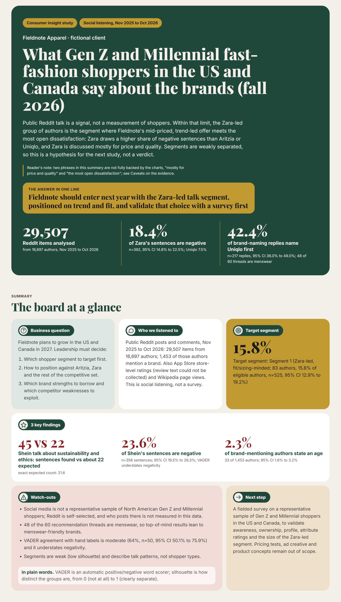

这是一项社交聆听（social listening）研究，基于 Reddit 上公开讨论中关于 Aritzia、Zara、H&M、Shein 和 Uniqlo 的内容，面向一位虚构客户 Fieldnote Apparel，该客户正在决定 2027 年如何进入美国和加拿大市场。一个真实的 keeploop 周期（keeploop 是一组小型命令，用来衡量、把关并记录对一个工作文件夹所做的每一次改动）收紧了这份报告；本页后半部分用真实数字展示了这个周期。请从“数据说明了什么”读起；你不需要任何机器学习背景。

报告：动态报告是 [`report/dashboard.html`](report/dashboard.html)（请在本地用浏览器打开；GitHub 不会渲染它）。静态报告是 [`report/report.pdf`](report/report.pdf)（30 页 A4）。全文见 [`report.md`](report.md)，数据如何收集和分析见 [`data/README.md`](data/README.md)。

## 数据说明了什么

### Fieldnote 应当从以 Zara 为首的讨论人群切入，主打潮流与版型，并先用问卷验证这一选择

Reddit 上的公开讨论是一种信号，而不是对消费者的测量。在这一限度内，以 Zara 为首的作者群，是 Fieldnote 中价位、潮流导向的产品遇到最多公开不满的细分人群：Zara 的负面语句占比高于 Aritzia 或 Uniqlo，而且人们谈论 Zara 主要围绕价格和质量。各细分人群之间的区分度较弱，因此这是留给下一项研究的假设，而不是定论。

目标细分人群：细分人群 1（以 Zara 为首、关注版型/尺码；83 位作者，占合格作者的 15.8%，n=525，95% CI 12.9% 至 19.2%）。

下面六个模块按照调研简报（brief）的顺序排列。“代理指标”（proxy）指的是替代性的衡量方式，而不是真实指标本身。“95% CI”（置信区间）是真实值大概率所处的范围；当两个区间重叠时，数据无法把这两个数字区分开。

| 模块 | 一句话结论 |
|---|---|
| 1. 第一提及（Top-of-mind） | 在推荐帖中，Uniqlo 被第一个提到的频率远高于其他四个核心品牌，但样本偏向男装。 |
| 2. 渗透率（Penetration） | 自述购买相关的讨论在五个品牌之间相近，且置信区间重叠。 |
| 3. 人群画像（Profiling） | 报告年龄的作者很少；在报告了年龄的作者中，Z 世代与千禧一代的区间重叠，因此无法可靠地描述受众。 |
| 4. 定位（Positioning） | 与其他品牌相比，Shein 更多被谈论的是可持续与伦理，Uniqlo 则更多是风格与潮流。 |
| 5. 感知（Perception） | Shein 和 Zara 的负面语句多于 Aritzia、Uniqlo 或 H&M，但该工具会低估负面情绪。 |
| 6. 细分（Segmentation） | 出现了五个讨论人群，但它们相互重叠，建议把以 Zara 为首的人群作为首个目标。 |

### 1. Uniqlo 被第一个提到的频率远高于其他四个核心品牌，但样本偏向男装

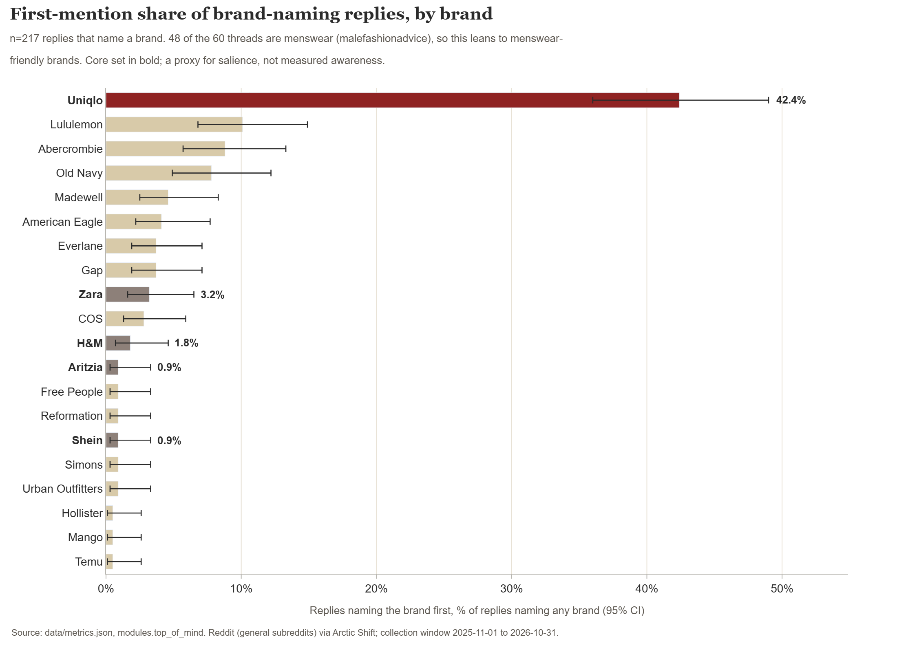

*在本样本中只有 Uniqlo 明显突出（42.4% 被第一个提到，95% CI 36.0% 至 49.0%）；其余四个品牌的区间相互重叠，且大多数帖子与男装有关。*
来源：`data/metrics.json`（`modules.top_of_mind`）；n=217 条提及品牌的回复，取自 60 个推荐帖中的 2140 条一级回复。

报告中的建议：不要把它当作女装市场的排名来解读，并在问卷中加入提示后认知（aided）与无提示认知（unaided）两个问题。

### 2. 五个品牌的自述购买相关讨论相近

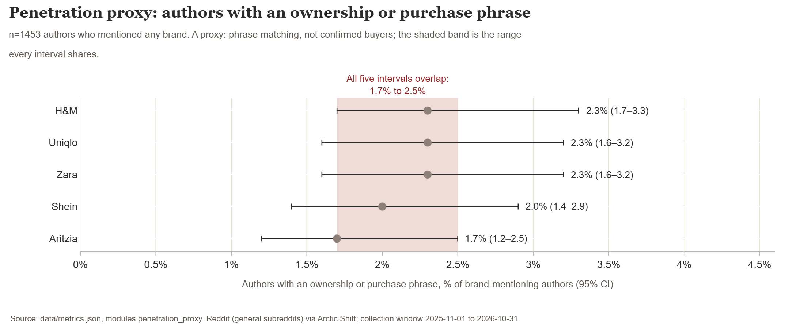

*这些数值按其构造本来就很小（1.7% 至 2.3%），且五个区间重叠，因此这份数据无法在拥有率上区分各品牌。*
来源：`data/metrics.json`（`modules.penetration_proxy`）；n=1453 位提及过任一品牌的作者。

报告中的建议：不要声称相对任何竞品存在渗透率差距，并在问卷中测量自述拥有情况。

### 3. 报告年龄的作者很少，因此无法可靠地描述受众

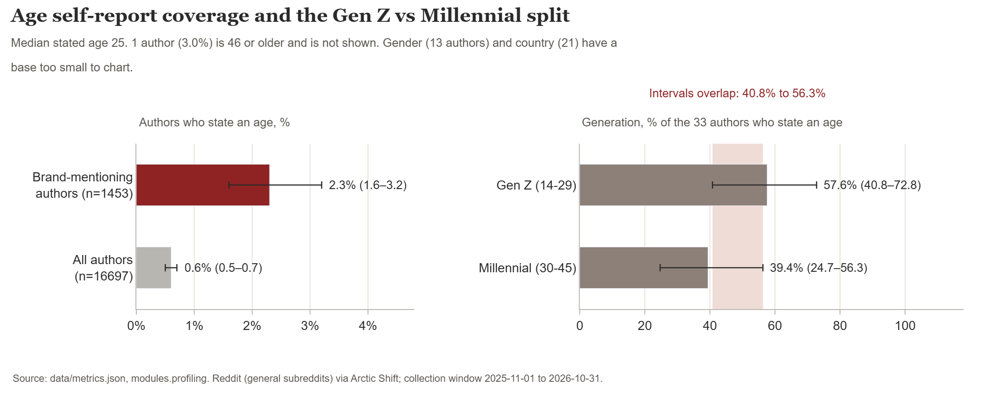

*在提及品牌的 1453 位作者中，只有 33 位（2.3%）给出了年龄。其中 Z 世代占 57.6%，千禧一代占 39.4%，但两个区间重叠，而且数据无法区分美国和加拿大。*
来源：`data/metrics.json`（`modules.profiling`）。

报告中的建议：美国和加拿大的受众画像应来自按年龄、性别和国家配额抽样的问卷。

### 4. Shein 承载了可持续与伦理方面的讨论，Uniqlo 承载了风格与潮流方面的讨论

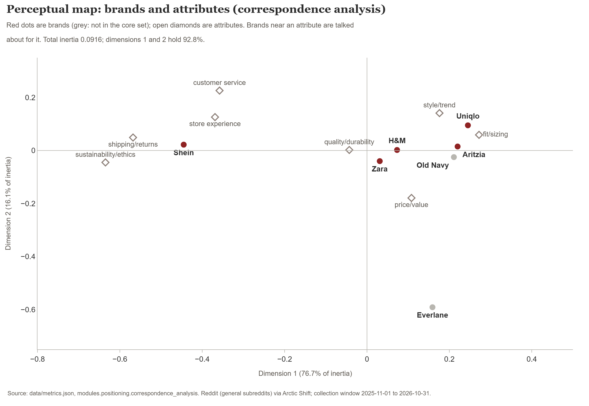

*价格/价值和质量/耐用性在每个核心品牌上都会被提到，因此不具备区分度；风格/潮流已经与 Uniqlo 关联，而 Shein 承载了伦理方面的讨论。*
来源：`data/metrics.json`（`modules.positioning.correspondence_analysis`）；仅供参考，因为同一位作者可能贡献多条语句。

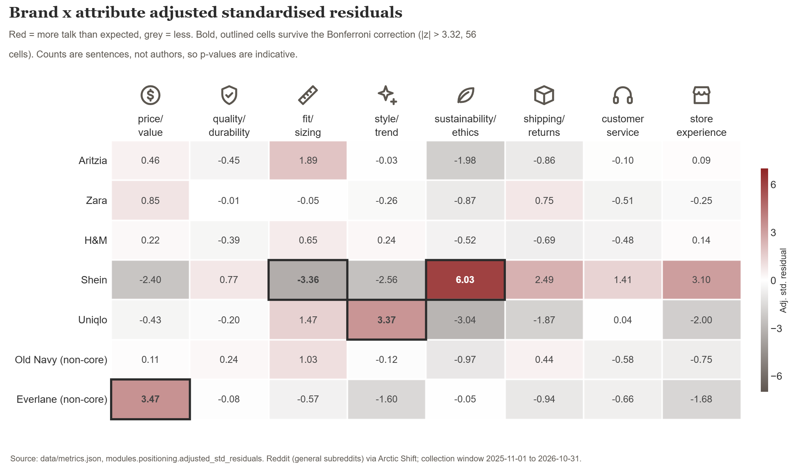

*经过 Bonferroni 校正（在同时检验许多单元格时使用的更严格的检验）后，有三个核心品牌的单元格偏离期望：Shein 在可持续/伦理上（z=6.03）、Shein 在版型/尺码上（z=-3.36）以及 Uniqlo 在风格/潮流上（z=3.37）。*
来源：`data/metrics.json`（`modules.positioning.adjusted_std_residuals`、`bonferroni_z`）。

报告中的建议：针对 Zara 和 Uniqlo，测试一个潮流导向、版型可靠的主张，并避免在价格话题上竞争，因为五个品牌已经都集中在这个话题上。

### 5. Shein 和 Zara 的负面语句多于 Aritzia 或 Uniqlo，但该工具会低估负面情绪

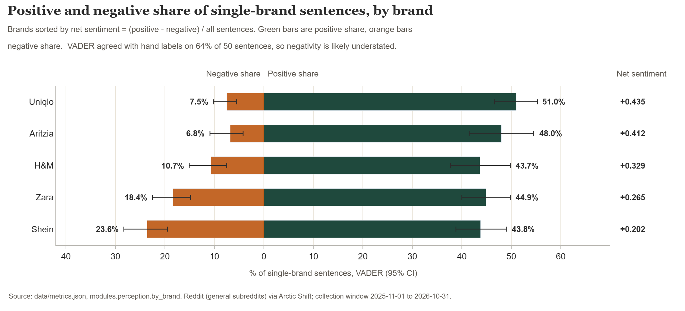

*负面讨论的差距是这里最站得住脚的感知类发现：Shein 或 Zara 与 Aritzia 或 Uniqlo 的负面占比区间不重叠。该工具漏掉了大量批评，而且情感倾向针对的是语句，而不是买家。*
来源：`data/metrics.json`（`modules.perception`）；语句使用 VADER 打分，这是一种通用的情感词表。

报告中的建议：把 Zara 较高的负面讨论占比视为值得调查的线索，而不是已被证实的弱点，并在问卷中测量品牌属性评分。

### 6. 出现五个讨论人群，建议把以 Zara 为首的人群作为首个目标

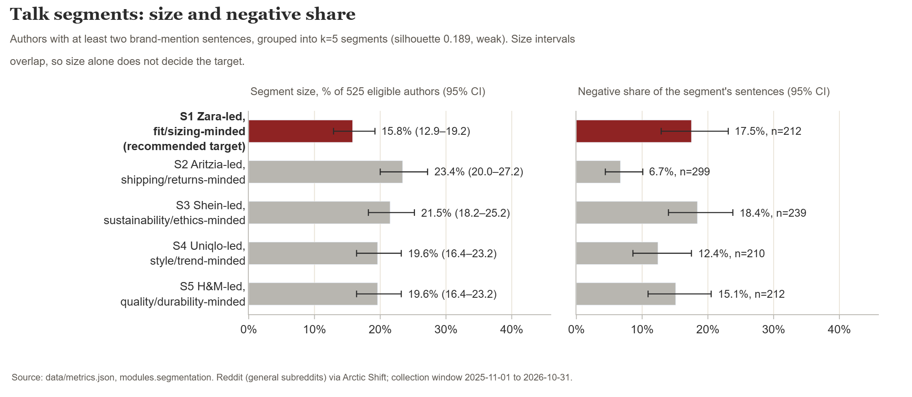

*细分人群 1 是五个人群中规模最小的，但它围绕与 Fieldnote 定位最接近的品牌构建，其讨论中的负面语句占比高于以 Aritzia 为首或以 Uniqlo 为首的人群。各细分人群的规模区间重叠，因此仅凭规模无法做出决定。*
来源：`data/metrics.json`（`modules.segmentation`）；n=525 位至少有两条品牌提及语句的作者。

报告中的建议：先把以 Zara 为首的细分人群作为工作假设中的目标，以版型和尺码作为主打主张，并通过问卷确认其规模、年龄和国家构成。

### 补充背景：搜索兴趣

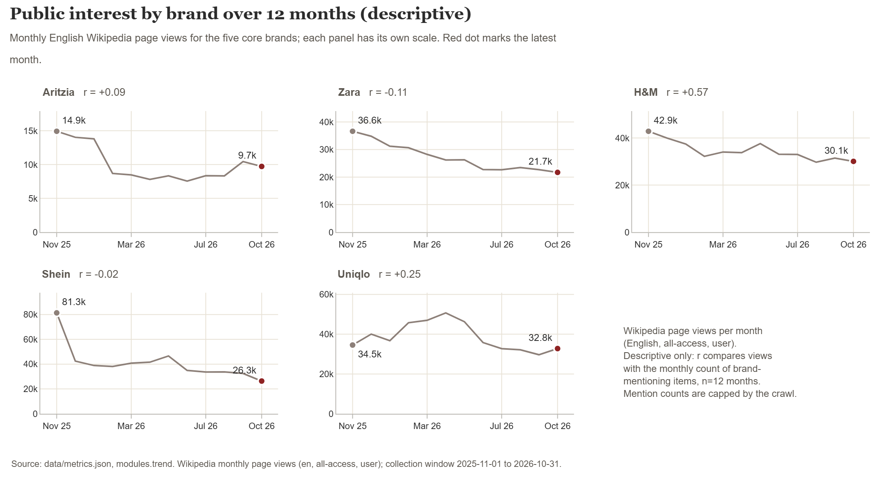

*页面浏览量与提及次数并列展示，仅作描述；提及次数受采集上限限制，因此请使用声量份额（share of voice），而不要用它看增长。*
来源：`data/metrics.json`（`modules.trend`；其自带的注意事项以及 n=12 个月的说明）。`report.md` 中没有对应此图的模块，因此该图注取自指标文件。

### 请牢记的局限

- 社交聆听不是代表性样本。Reddit 是自选择的人群，而在那里发帖的是哪些人，这份数据并未测量。
- 第一提及、渗透率和定位都是代理指标，而不是问卷测量。
- 60 个推荐帖中有 48 个与男装有关，因此第一提及的结果偏向男装友好的品牌。
- 报告年龄、性别或国家的作者很少（1453 位作者中分别为 33、13 和 21 位），因此世代和国家的拆分大多是“基数太小”，而且无法把加拿大与美国区分开。
- VADER 在 50 条语句上与人工标注的一致率为 64%（95% CI 50.1% 至 75.9%；kappa 0.45，中等；仅一位标注员），并且会低估负面情绪。
- 细分人群区分度较弱（轮廓系数 0.189，该分数中 1 表示各组完全分开，0 表示相互重叠）。它们描述的是讨论模式，而不是消费者类型。
- App Store 评论文本采集失败；只有应用商店层面的评分，因此不报告评论情感。
- 抓取受时间限制且不完整；Zara 和 H&M 没有任何有数据的 subreddit。

**建议的下一步：** 面向美国和加拿大的 Z 世代与千禧一代消费者的代表性样本开展一次正式问卷，以验证认知、拥有情况、人群画像、属性评分以及以 Zara 为首的细分人群的规模。

## 补充分析（在被审计的周期之后添加；未经审计）

基于同一份数据构建，没有新的抓取，仅使用综合类 subreddit，存放在 `data/metrics.json` 的顶层键 `supplementary` 之下。这些是来自公开社交文本的代理指标，而不是问卷测量，下面的 keeploop 周期没有对它们打分或审计。区间为 Wilson 95%。方法见：[`data/README.md`](data/README.md)，“Supplementary analysis”一节。

### 品牌漏斗（社交聆听代理指标）

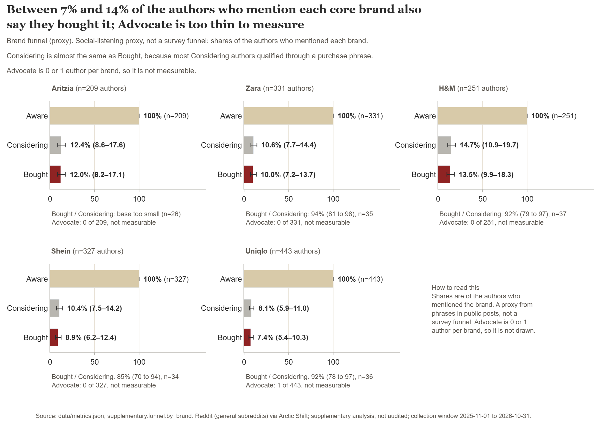

*在提及各品牌的作者中，同时使用意向措辞（Considering，考虑）或拥有措辞（Bought，已购买）的作者占比：在五个核心品牌中，Considering 为 8.1% 至 14.7%，Bought 为 7.4% 至 13.5%。*
来源：`data/metrics.json`（`supplementary.funnel`）。Aware n：Aritzia 209，Zara 331，H&M 251，Shein 327，Uniqlo 443。Considering / Bought，占 Aware 的 %：Aritzia 12.4 / 12.0，Zara 10.6 / 10.0，H&M 14.7 / 13.5，Shein 10.4 / 8.9，Uniqlo 8.1 / 7.4。

局限：Advocate（推荐）阶段每个品牌只有 0 或 1 位作者（Uniqlo 1 位，其他四个 0 位），因此这里无法测量。Considering 几乎等于 Bought（Zara 为 35 对 33 位作者，Uniqlo 为 36 对 33），因为 Bought 的作者也被计入 Considering。这些不是问卷漏斗转化率。

### 双轴定位图

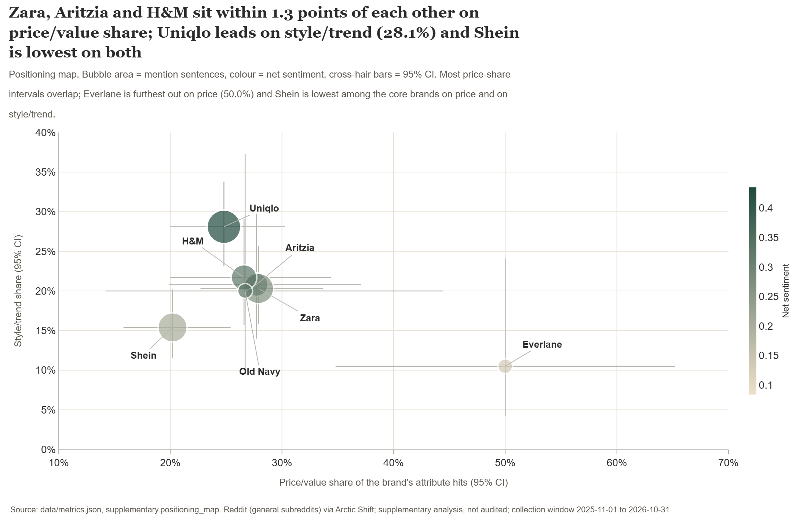

*每个至少有 30 次属性命中的品牌（7 个品牌）按其在属性讨论中的价格/价值占比（x）和风格/潮流占比（y）定位；气泡大小为提及语句数，颜色为净情感。*
来源：`data/metrics.json`（`supplementary.positioning_map`）。价格/价值、风格/潮流（%）：Aritzia 27.7，20.8；Zara 27.9，20.3；H&M 26.6，21.7；Shein 20.2，15.4；Uniqlo 24.8，28.1。净情感：Aritzia 0.412，Zara 0.265，H&M 0.329，Shein 0.202，Uniqlo 0.435。

### 品牌形象

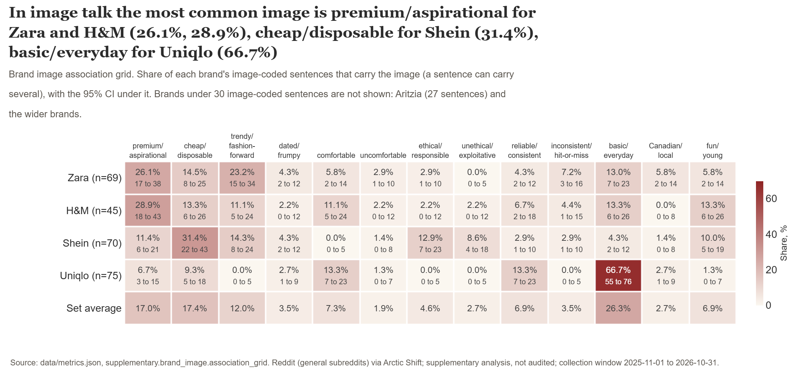

*每个品牌的形象编码语句中，带有 13 种形象之一的占比。Uniqlo 的基础款/日常为 66.7%（75 条中的 50 条），Shein 的廉价/一次性为 31.4%（70 条中的 22 条），Zara 的高端/向往为 26.1%（69 条中的 18 条），H&M 的高端/向往为 28.9%（45 条中的 13 条）。*
来源：`data/metrics.json`（`supplementary.brand_image.association_grid`）。形象编码语句数：Zara 69，H&M 45，Shein 70，Uniqlo 75。

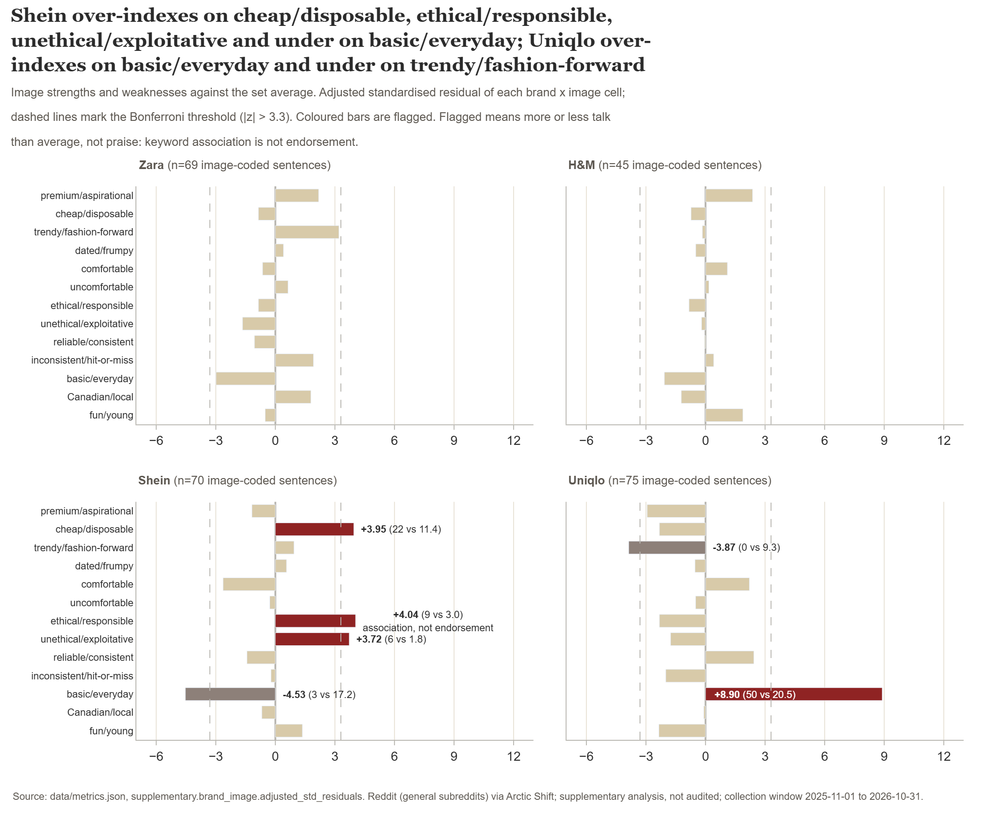

*六个品牌乘形象的单元格超过 Bonferroni 阈值（|z| 大于 3.3）：Uniqlo 基础款/日常 z 8.90（偏多），Shein 基础款/日常 -4.53（偏少），Shein 道德/负责 4.04、Shein 廉价/一次性 3.95、Shein 不道德/剥削 3.72（均偏多），Uniqlo 潮流/引领时尚 -3.87（偏少）。*
来源：`data/metrics.json`（`supplementary.brand_image.strengths_and_weaknesses_bonferroni`）。品牌乘形象表的卡方检验：169.45，df 36，p 约 3e-19（仅供参考：52 个单元格中有 32 个期望计数低于 5，并且同一位作者可以写很多条语句）。

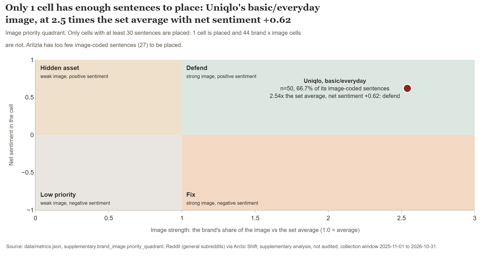

*只有一个品牌乘形象的单元格至少有 30 条语句：Uniqlo 基础款/日常（n 50，相对集合平均值的指数 2.54，净情感 0.62），它落在“防守”象限。*
来源：`data/metrics.json`（`supplementary.brand_image.priority_quadrant`）。

局限：
- 只有 Zara、H&M、Shein 和 Uniqlo 有至少 30 条形象编码语句。Aritzia 有 27 条，其余 13 个品牌更少。
- Shein 的道德/负责标记（9 条语句）是关联，而不是认可：同一品牌在不道德/剥削上也偏多（6 条语句），所以人们是在讨论它的伦理，不一定是在称赞。
- 只有一个单元格被放入优先象限（Uniqlo 基础款/日常，防守）；其他所有单元格的语句都少于 30 条。
- 驱动因素分析、提示后的形象测量组合和多维尺度分析需要问卷。见 `data/README.md` 中的“What this cannot do without a survey”。

## 已保留报告中的已知问题

这些问题是在保留之后，由图表构建时的区间检查和 Auditor 发现的。每一项都需要再来一个周期，而在评分获得更多提升空间之前无法被保留（见“在相信这个结果之前你应该知道的事”）。已保留的 `report.md` 没有被改动。

- **(a) 模块 5 标题。** 它说 Shein 和 Zara 的负面语句多于 Aritzia、Uniqlo 或 H&M，但 Zara 的负面区间（14.8% 至 22.5%）与 H&M 的（7.5% 至 15.1%）重叠。Shein（19.5% 至 28.3%）与 H&M 明确分开，因此只有 Zara 对 H&M 这一项缺乏支持。（本 README 中的模块 5 标题只点名 Aritzia 和 Uniqlo，区间支持这一点。）
- **(b) 模块 6。** 它说细分人群 1 比以 Uniqlo 为首的人群更负面，但区间重叠（12.9% 至 23.1% 对 8.6% 至 17.5%）。相对于以 Aritzia 为首的人群（4.4% 至 10.1%），差距成立。
- **(c) 摘要。** 它写的是“positioned on trend”（主打潮流），而模块 4 把风格/潮流与 Uniqlo 联系在一起。
- **(d) 模块 3 标题。** 它说 Z 世代与千禧一代的“shares overlap”（占比重叠），而重叠的其实是区间（40.8% 至 72.8% 对 24.7% 至 56.3%）；占比点值为 57.6% 和 39.4%。
- **(e) 摘要。** 它说 Zara“is discussed mostly for price and quality”（主要因价格和质量被谈论），但模块 4 发现价格/价值和质量/耐用性在每个核心品牌上都会被提到，因此它们并不能使 Zara 与众不同。
- **(f) 摘要。** “The most open dissatisfaction”（最多的公开不满）是一个没有依据的最高级说法：Zara 的负面区间（14.8% 至 22.5%）与 H&M 的重叠，并且 Shein 的负面占比（23.6%）高于 Zara 的（18.4%）。

## keeploop 如何改进了这份报告

keeploop 像一家小公司一样运作。**Analyst（分析师）**在一张书面的**卡片（card，即假设卡片）**上提出一项改动。**Engineer（工程师）**在**工作区（workspace）**（存放 `brief.md`、`report.md` 和 `data/` 的文件夹）里恰好做出这一项改动。一个固定的**评分（score）**衡量结果。**Auditor（审计员）**以全新的上下文、看不到其他角色的推理过程，对照卡片来评判这项改动。只有 `python kl.py keep` 才能保留（keep）一项改动，且只有在数字和审计都允许时才行。这里各个角色由 Claude Code 扮演：Analyst 是主会话，Engineer 和 Auditor 是各自独立的全新子代理。

简而言之：一张卡片，一次两行的编辑，评分从 0.970000 到 1.000000，审计 APPROVED（通过），保留。

### (a) team.yaml：谁来工作、什么受保护、门槛有多严

`team.yaml` 是循环开始前由人类编写的唯一文件。它指明了 pack（这个职业的规则与品味）、工作区、受保护路径、各个角色以及保留阈值。报告撰写者只能看到 `FORMAT.md`，看不到评分程序。下面是 `team.yaml` 的原文，因此注释行（以 `#` 开头）保留文件中的英文。

```yaml
# team.yaml - marketing research example (consumer insight report).
# Set up (seconds): python tools/make_sandbox.py examples/marketing-research DEST
# It copies keeploop to DEST/kl with these files on top, removes the demo
# holdout.py (it imports the demo scorer; lesson L-001, see run/LOG.md), and
# makes the workspace below a fresh git repo. Then: cd DEST/kl && python kl.py begin
# sandbox root: evaluate.py, team.yaml, program.md, FORMAT.md, samples/good.md, samples/bad.md
# sandbox workspace: brief.md, report.md, data/metrics.json, data/quotes.json
# The report writer sees only FORMAT.md, never evaluate.py.
# Format of report.md: examples/marketing-research/FORMAT.md

pack: marketing-research

# CHANGE ME: your own folder, a clean git repo with brief.md, report.md and data/.
workspace: ../mr-workspace

# Nobody may rewrite the objectives or the evidence to win the score.
protect: brief.md, data

# Vendors are used by the headless loop (`python run.py`) and `kl audit --vendor`.
# The worked example ran in interactive mode: the roles were played by Claude Code
# (Analyst = main session, Engineer and Auditor = separate fresh subagents).
roles:
  analyst:
    vendor: claude-cli
    token_budget: 30000
  engineer:
    vendor: claude-cli
    token_budget: 50000
  auditor:
    vendor: claude-cli      # same CLI is allowed only as a fresh context (AGENTS.md)
    token_budget: 30000

# The score is deterministic, so noise is zero; 1% relative gain keeps a
# single fixed check from being kept on rounding alone.
# The score runs 0 to 1: kl warns when the keep bar is above 1.0 (nothing can be kept).
loop:
  max_iterations: 20
  keep_threshold: 0.01
  metric_max: 1.0
```

最关键的是两行。`protect: brief.md, data` 意味着任何人都不能为了拿高分而改动客户的目标或证据。`keep_threshold: 0.01` 意味着一项改动必须比最佳得分至少高出 1% 才算数。

### (b) 假设卡片：一个书面的赌注，以及会否决它的规则

Analyst 在任何编辑发生之前写下了一张卡片。这是登记在案的卡片（`run/cycle-2/card.md`）：

```text
HYPOTHESIS: The draft makes two claims about who is talking that the data does not support: the module 3 heading says authors who give an age "skew Gen Z", but the Gen Z and Millennial intervals overlap (40.8% to 72.8% vs 24.7% to 56.3%), and the limits say Reddit "skews young, male and US" with no source and no metric behind it. Rewording the heading to what the intervals show and deleting the unsourced clause makes every claim about the audience traceable, and raises the score.
ALTERNATIVES: (1) Keep the Reddit demographic context and add a cited, dated source instead of deleting it; rejected for this cycle because no verified source is in the brief, and an unverified citation would be worse than none. (2) The bigger quality risk is the Summary recommending a trend-led position while module 4 finds style/trend already tied to Uniqlo; that is a judgement the score cannot see and is the next card, not this one.
CHANGE: In report.md only, two edits. (a) Module 3 heading: keep "## 3. Profiling:" and replace "and those who do skew Gen Z, so the audience cannot be described reliably" with "and among those who do, the Gen Z and Millennial shares overlap, so the audience cannot be described reliably". (b) In Method and limits, first bullet: replace "Reddit is self-selected and skews young, male and US." with "Reddit is self-selected, and who posts there is not measured in this data." Change nothing else. Do not touch brief.md or data/.
EXPECT: Check U1 = 2/2, metric 1.000000, above the keep bar 0.979700, no other check gets worse.
REJECT IF: metric below 0.979700, or the scorer rejects the workspace, or any line other than those two changes, or the new wording claims more than data/metrics.json shows.
MISSING: A cited, dated source on Reddit's user demographics in the US and Canada would let the report keep that context instead of deleting it.
```

各标签的含义：

| 标签 | 通俗说法 |
|---|---|
| HYPOTHESIS | 我们认为哪里出了问题，以及为什么修复它应当提高评分。 |
| ALTERNATIVES | 我们考虑过的其他修复方案，以及这次为什么没有选用。 |
| CHANGE | Engineer 可以做出的确切编辑。不允许做其他任何改动。 |
| EXPECT | 我们预测评分会显示什么，这样结果才能证明我们错了。 |
| REJECT IF | 在测试之前就写好的、用来否决这项改动的预先登记条件。它必须指明一个数字或其他可证伪的事实。 |
| MISSING | 我们不知道的内容。它作为开放问题交给人类，而不是靠猜。 |

这次编辑本身（`run/cycle-2/cycle.diff`）涉及 1 个文件，删除 2 行、新增 2 行，均在 `report.md` 中。卡片的第一处修改把模块 3 的标题从“skew Gen Z”（偏向 Z 世代）改为区间所显示的内容。第二处删除了没有来源的“skews young, male and US”（偏年轻、男性和美国）这一说法。

### (c) 评估运行：一份固定的报告质量规则清单

评分由 `evaluate.py` 给出，这是一个在循环期间无人能改动的程序。它运行 17 项检查，每项占 100 分中的若干分，评分等于得分除以 100。这些检查覆盖一份调研报告必须做到的五件事：目标明确（每个模块是否陈述了其问题和决策）、证据无诱导（引文按明确规则挑选，每个数字都归在正确的品牌名下）、衡量选择正确（每个百分比都有基数和 95% 区间，基数低于 30 的不出百分比，代理指标要写明“proxy”）、逻辑顺畅（先给答案，局限放最后）以及可用于决策的产出（每个模块以“所以呢”（so-what）和点名 Fieldnote 的建议收尾）。

此外还有一条硬性规则。`report.md` 中的每个数字都必须存在于 `data/metrics.json` 中，每条引文都必须逐字出自 `data/quotes.json`。只要有一处不符，评分程序就拒绝给这份报告打分：它是无效的，而不是分数低。

转录中的各项检查结果。只有一项检查发生了变化：

| 检查 | 权重 | 之前 | 之后 | 检查内容 |
|---|---|---|---|---|
| O1 | 10 | 6/6 | 6/6 | 每个模块都有 Question 行 |
| O2 | 10 | 6/6 | 6/6 | 每个模块都有 Decision 行 |
| E1 | 5 | 16/16 | 16/16 | 标题或 So what 行中没有夸大或过度宣称的措辞 |
| E2 | 5 | 4/4 | 4/4 | 比较类模块点名全部 5 个核心品牌 |
| E3 | 4 | 5/5 | 5/5 | 每条引文都标注了其所来自的单元格 |
| E4 | 3 | 1/1 | 1/1 | 有一行 Quote rule 说明引文是如何挑选的 |
| B1 | 5 | 185/185 | 185/185 | 单品牌或单细分人群行上的每个数字都归在该品牌或细分人群名下 |
| **U1** | **3** | **0/2** | **1/1** | **关于谁在发帖的说法带有可追溯的数字或（来源，年份）** |
| M1 | 8 | 25/25 | 25/25 | 每个百分比都有 n= 和 95% 区间 |
| M2 | 6 | 25/25 | 25/25 | 基数低于 30 的不出百分比 |
| M3 | 6 | 10/10 | 10/10 | 渗透率和第一提及都写明 proxy（代理指标） |
| F1 | 5 | 1/1 | 1/1 | 先给答案的摘要排在最前面 |
| F2 | 5 | 6/6 | 6/6 | 各模块按简报顺序出现 |
| F3 | 5 | 1/1 | 1/1 | 方法与局限排在各模块之后 |
| D1 | 8 | 6/6 | 6/6 | 每个模块都有 So what 行 |
| D2 | 8 | 6/6 | 6/6 | 每个模块都有点名 Fieldnote 的 Recommendation 行 |
| D3 | 4 | 1/1 | 1/1 | 摘要点名了目标细分人群 |
| **总分** | 100 | **0.970000** | **1.000000** | |

编辑之前，评分程序发现了两处关于谁在 Reddit 上发帖的无来源说法（U1 0/2），这让整整 3 分丢失。编辑之后没有发现（U1 1/1；没有此类说法时，该项按设计算通过）。这就是 0.03 增益的全部来源。卡片的 EXPECT 行预测的是“U1 = 2/2”；真实结果是 1/1，因为没有留下需要计数的被标记说法。分数和得分如预测一样，但分数的分子分母并非如此，因此卡片按登记时的原样展示。

**评分没有衡量什么。** 按 pack 自身的 `metric_validation` 说明，它没有对照客户的决策进行验证。它衡量的是规则合规性（目标、证据完整性、衡量选择、逻辑顺畅、建议）以及每个数字是否可追溯到分析结果，而不是洞察本身是否正确。pack 说明了验证方式：请两位资深研究员对若干得分不同的报告进行盲评，再检查他们的排序与评分的吻合程度。在此之前，该 pack 仍属实验性质。这也意味着 B1 和可追溯性规则只能证明一个数字存在、并且归在正确的品牌名下，却不能证明这个数字确实支撑了它所在的句子；这正是 Auditor 也要通读报告的原因。

### (d) 决定：保留，附数字

| 项目 | 数值 |
|---|---|
| 基线（卡片之前的最佳得分） | 0.970000 |
| 噪声（sigma，3 次运行之间的运行间离散度） | 0.000000 |
| 保留门槛 | 0.979700 |
| 编辑后的候选得分 | 1.000000 |
| 审计 | APPROVED |
| `kl keep` 结果 | KEPT cycle 1: metric 1.000000 (bar 0.979700); best is now 1.000000 |

**保留门槛是如何设定的。** `run.py` 按 `best + max(|best| × keep_threshold, noise_z × sigma)` 计算。这里 `keep_threshold` 为 0.01（来自 team.yaml），`noise_z` 为 2.0（`prepare.py` 中的默认值）。评分是确定性的，所以 sigma 为 0，噪声项为 2.0 × 0.000000 = 0。于是门槛为 0.970000 + max(0.970000 × 0.01, 0) = 0.970000 + 0.009700 = 0.979700。候选得分为 1.000000，比门槛高约 0.020。保留之后，同一公式给出新的门槛：1.000000 + max(1.000000 × 0.01, 0) = 1.010000。

**Auditor 检查了什么。** 它确认了指标超过门槛，没有触发任何 REJECT IF 条件，暂存的改动与卡片所描述的 diff 一致（1 个文件，2 处插入和 2 处删除），并且两处编辑都与 CHANGE 文本逐字吻合。它还对照 `data/metrics.json` 重新核对了新标题：Z 世代为 33 人中的 19 人（57.6%，95% CI 40.8% 至 72.8%），千禧一代为 33 人中的 13 人（39.4%，CI 24.7% 至 56.3%），因此两个区间在 40.8% 至 56.3% 之间重叠，标题所作的断言没有超出数据所示。它自己没有重新运行评分程序，所以“没有其他检查变差”依赖于所报告的 1.000000。

**Auditor 给出的质量评分（0 到 100）：** 目标 95，证据无诱导 90，衡量选择 90，逻辑顺畅 90，可用于决策的产出 85。

### 在相信这个结果之前你应该知道的事

1. **评分程序是在第一次打分之后收紧的。** 未改动的初稿在评分程序的第一版上得分为 1.000。已经满分的得分让循环无从保留，因为没有任何改动能超过它。经用户批准，在记录基线之前加入了两项检查（B1，主张绑定；U1，无来源的偏向说法）。初稿本身没有被改动。所以 0.970000 这个基线之所以存在，是因为我们加入了初稿未能通过的检查。这里只有 U1 产生了提升空间（B1 在前后均为 185/185）。请据此掂量这 0.03 的增益：在这个评分程序上它是真实的，但评分程序是我们看过初稿之后才塑造的。
2. **评分再次饱和。** 保留之后，最佳得分为 1.000000，门槛为 1.010000，没有任何报告能达到。Auditor 发现了一个遗留问题：摘要写的是“positioned on trend”（主打潮流），但模块 4 把风格/潮流与 Uniqlo 联系在一起。在人类给评分增加提升空间（新增或更严格的检查）之前，针对这一点的修复无法被保留。这是下一张卡片（它在上面那张卡片的 ALTERNATIVES 中被点名）。**它没有运行。**
3. **Auditor 的次要意见，不构成阻碍。** (i) “Who posts there is not measured in this data”（在那里发帖的是谁，这份数据没有测量）略显绝对，因为年龄、性别和国家是少数作者自述的；“barely measured”（几乎没有测量）会更准确。(ii) 被删除的“skews young, male and US”在性别上方向也是错的：给出性别的 13 位作者中有 11 位是女性（已在 `data/metrics.json` 的 `modules.profiling.gender_of_brand_mentioning_authors` 中确认）。(iii) 被保留的模块 3 标题说 Z 世代与千禧一代的“shares”（占比）重叠，但重叠的其实是区间（占比分别为 57.6% 和 39.4%）；报告正文正确地使用了“区间”一词。

### 该周期的完整转录（原样）

原样记录见 [`run/cycle-2/transcript.txt`](run/cycle-2/transcript.txt)：该周期的每条 `kl` 命令及其输出，包括编辑前后逐项检查的得分。它录制于本示例拥有自己的 `program.md` 之前，因此其中的 `next hypothesis to test:` 行显示的是框架通用的演示章程，而不是本研究。现在搭建的沙盒会读取 [`program.md`](program.md)，并以本研究的第一个假设开场（为关于谁在 Reddit 上发帖的说法注明来源，或删去这些说法）。

转录中包含一次操作失误：`kl recall` 的查询最初没有加引号，被 `kl` 拒绝，随后加上引号重新运行。它是 [`run/LOG.md`](run/LOG.md) 中的第 15 项。

## 如何复现

以下步骤取自 `team.yaml` 的头部注释和转录。

1. 在 keeploop 仓库根目录下搭建沙盒（约一秒；Windows 上请使用较短的 `DEST`）：`python tools/make_sandbox.py examples/marketing-research DEST`。它把本文件夹中的 `evaluate.py`、`team.yaml`、`program.md`、`FORMAT.md` 和 `samples/` 放入位于 `DEST/kl` 的 keeploop 副本，删除演示用的 `holdout.py`，并把 `DEST/mr-workspace` 建成一个新的 git 仓库，存放 `brief.md`、`report.md`、`data/metrics.json` 和 `data/quotes.json`。其余步骤在 `DEST/kl` 中运行。
2. 从初稿开始。本文件夹中的 `report.md` 是保留后的版本。要得到得分 0.970000 的初稿，请在工作区内反向应用该周期的编辑：在 `DEST/mr-workspace` 内运行 `git apply -R <keeploop 仓库>/examples/marketing-research/run/cycle-2/cycle.diff`，然后在那里提交（`git commit -am draft`）：`kl begin` 会拒绝有未提交更改的工作区。如果跳过这一步，`kl begin` 会把保留后的报告评为 1.000000，并警告基线已触顶：在评分获得更多余量之前，任何周期都无法被保留。我们核实过：反向还原后的报告得分为 0.970000，保留后的报告得分为 1.000000。
3. 运行该周期：

```text
python kl.py begin
python kl.py status
python evaluate.py ../mr-workspace
python kl.py recall "unsupported claims about who posts on Reddit"
python kl.py card ../card2.md
python kl.py check
python kl.py eval
python kl.py keep --audit-verdict ../verdict2.txt
python kl.py report
```

在 `card` 与 `check` 之间，Engineer 编辑工作区来实现卡片。在 `keep` 之前，一位全新上下文的 Auditor 阅读卡片、diff 和指标，并回复 `APPROVED` 或 `CHANGES REQUESTED`；该回复保存为 `verdict2.txt`。卡片和裁决文件放在 keeploop 仓库之外（转录中使用的是工作区的上级文件夹）。

重建数据（可选，需要联网；原始采集耗时约两小时；报告使用的是已提交的 `data/metrics.json`）。方法、上限和局限见 `data/README.md`：

```text
python -X utf8 listen.py collect [reddit|appstore|wiki]
python -X utf8 listen.py analyze
```

## 致谢与日志

团队自身的表现不写入报告。[`run/LOG.md`](run/LOG.md) 如实记录了构建这个示例过程中出了什么问题，以及每个错误所产生的规则；[`run/cycle-1/`](run/cycle-1/) 是第一次尝试，一份问卷，后来发现它是错误的交付物，仅为留档而保留。
