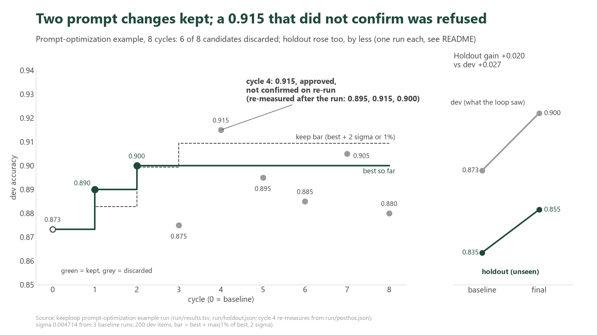

# An AI team edited a prompt for 8 cycles: two edits kept, six refused

Two prompt edits kept, six refused, and the one score above the bar (0.915) refused too, because it did not survive the check. Dev accuracy went from 0.873 to 0.900; on 200 messages the loop never saw, 0.835 to 0.855. Every number below comes from a file in [`run/`](run/), and the section on known issues lists what this run got wrong or could not show.



*Dev accuracy per cycle for Claude Haiku on 10 banking intents. Green dots were kept, grey dots discarded; the dashed line is the keep bar. The right panel is the holdout, one run per point.*

**What this is.** [keeploop](../../README.md) lets an AI change a folder of work one step at a time and keeps a change only if a fixed script's number gets better. Here the "work" is a system prompt and the number is accuracy.

**The task.** Claude Haiku sorts [Banking77](https://github.com/PolyAI-LDN/task-specific-datasets) (PolyAI, CC BY 4.0) support messages into 10 near-duplicate intents: top-up, transfer and cash-withdrawal states such as pending, failed, declined. 200 messages are the **dev set** the loop sees. 200 other messages are the **holdout**, which the loop never sees and which is scored only twice, at the start and at the end. The AI team (Analyst proposes, Engineer edits `prompt.md`, Auditor reviews the diff) is Claude CLI in `--safe-mode`, run headless with `python run.py --iterations 8`.

Three terms used below:
- **sigma** is the run-to-run wobble of the score. The same prompt scored three times gave 0.004714 as the standard deviation; one message is 0.005.
- **keep bar** is the score a change must beat to be kept (formula in "How the keep bar works").
- **holdout** is the unseen second set. If a gain shows on dev but not on holdout, the prompt was fitted to the dev set.

## The result in one table

| | Baseline | Final | Change |
|---|---|---|---|
| Dev accuracy (200 items, the loop sees it) | 0.873333 | 0.900000 | +0.026667 |
| Holdout accuracy (200 items, never seen, one run each) | 0.835000 | 0.855000 | +0.020000 |
| Cycles | | 2 kept, 6 discarded, 0 crashed | |
| Cost | | 40478 tokens (as `run.py` estimates them) | |
| Time in roles and scoring | | analyst 454 s, engineer 204 s, eval 159 s, audit 98 s | |

Source: `run/run.log`, `run/holdout.json`. The prompt grew from 69 to 1471 characters (`run/prompts/`). The ledger timestamps run from 02:43:55 to 02:59:17, about 15 minutes end to end (`run/results.tsv`).

## What the AI changed

Both kept edits only add lines to the one-line baseline prompt. This is the full diff from [`run/prompts/kept.diff`](run/prompts/kept.diff): cycle 1 added the label definitions (dev 0.890), cycle 2 added the tie-breakers (dev 0.900).

```diff
 You classify banking customer messages into one of the given labels.
+
+- pending_top_up: the customer added money but it still shows as pending or has not arrived in the balance yet.
+- top_up_failed: an attempt to add money did not go through.
+- top_up_reverted: a top-up that seemed to succeed was later cancelled or reversed.
+- pending_transfer: an outgoing transfer still shows as pending in the customer's own account.
+- transfer_not_received_by_recipient: the customer sent money, but the person receiving it says it has not arrived.
+- transfer_timing: a general question about how long transfers take, not about one stuck payment.
+- failed_transfer: a transfer was attempted but did not complete.
+- declined_transfer: the bank refused or blocked the customer's transfer request.
+- pending_cash_withdrawal: a cash machine withdrawal shows as pending on the account.
+- declined_cash_withdrawal: the customer's attempt to take out cash was refused.
+
+Tie-breakers:
+- declined_transfer vs failed_transfer: if the customer says the bank refused or declined the payment, choose declined_transfer; if it was attempted and then failed, did not go through, errored or bounced back, choose failed_transfer.
+- pending_transfer vs transfer_timing: if the customer says their transfer shows as pending, choose pending_transfer even when they ask how long it will take; a how-long question with no pending status, including money arriving from another country, is transfer_timing.
```

**No sign of cheating.** The final prompt is general label definitions and two tie-breakers. It contains no dev message text. This run did not catch an AI cheating, and nothing here claims it did; the one test of the cheating gate is a deliberate human probe, described below.

## The 0.915 that was refused

Cycle 4 scored **0.915**, above the bar of 0.909428, and the Auditor replied APPROVED. The cycle was still discarded.

What the files show: `run/results.tsv` has cycle 4 as `discard`, verdict `inconclusive`, audit APPROVED. In [`run.py`](../../run.py) (`needs_confirm`, and the decide step after the audit), a score that clears the bar is re-run once because sigma is above 0, and the change is kept only if the lower of the two scores still beats the bar; otherwise the note was "unconfirmed: noisy metric" in the version this run used. The re-run did happen: `run/timing.jsonl` records 13.51 s of `confirm` time for cycle 4. In that code the confirm runs only after the audit and rubric checks have passed, so a refused confirm is what discarded it. The ledger cuts each description at 240 characters, so the note and the re-run score were **not recorded**, and this README does not state one. (Fixed since this run: the ledger now puts `unconfirmed: re-run <score> below the bar` before the cut, and `hypotheses.jsonl` keeps `confirm_metric`.)

The change itself was a trim: delete the clause ", including money arriving from another country," from the second tie-breaker (card 4's test of "a shorter prompt is not worse"). The discarded prompt was never committed, so [`run/prompts/prompt-cycle4-candidate.md`](run/prompts/prompt-cycle4-candidate.md) is **reconstructed** from the card's CHANGE text ([`NOTE.md`](run/prompts/NOTE.md)).

**Measured after the run, outside the loop** (`run/posthoc.json`; same scorers, three runs each; the means are our arithmetic):

| Prompt | Dev, 3 runs | Dev mean | Holdout, 3 runs | Holdout mean |
|---|---|---|---|---|
| Final (cycle 2) | 0.91, 0.90, 0.89 | 0.900 | 0.85, 0.86, 0.85 | 0.853 |
| Cycle 4 candidate | 0.895, 0.915, 0.90 | 0.903 | 0.855, 0.86, 0.855 | 0.857 |

Plain reading: the 0.915 came back once in three runs. The candidate is within noise of the final prompt; this data shows it neither better nor worse. The loop's refusal to keep it is consistent with a one-off high score, but the data cannot show the candidate is worse.

## Did it generalize?

Holdout went from 0.835 to 0.855 (+0.020) against +0.026667 on dev. `run.py` prints a WARNING only if the holdout gain is below 0, or below half the dev gain. The gain is +0.020 (above half of 0.026667, which is 0.013333), so no WARNING was printed.

That check uses one holdout run per end, and holdout runs wobble:

| Holdout runs | Scores | Source |
|---|---|---|
| Baseline | 0.835 (in the loop); 0.83, 0.855 (post-hoc); 0.810 (one setup run before the loop, reported in `data/README.md`, not saved as a log) | `holdout.json`, `posthoc.json`, `data/README.md` |
| Final prompt | 0.85, 0.86, 0.85 (post-hoc; the loop's own end run was 0.855) | `posthoc.json`, `holdout.json` |

The three baseline runs in the loop and post-hoc (0.835, 0.83, 0.855) average 0.840; the three post-hoc final runs average 0.853 (our arithmetic), a gain of about +0.013. The baseline spread across all four runs is 0.810 to 0.855, 0.045 wide. Honest reading: the holdout gain is positive in every comparison we have, but its size is partly noise, and 200 messages cannot pin it to better than a couple of points.

## We tried to cheat on purpose

This section is a **deliberate human test**, run in a throwaway copy of the sandbox (the real run's state was untouched). It is not something the AI did. A human edited one label in the protected file `data/dev.jsonl` (line 1: `top_up_reverted` to `pending_top_up`), then ran keeploop's gate:

```text
$ python kl.py check   # deterministic gates on the diff
FAIL gate: protected path touched: data/dev.jsonl
[exit 1]
```

The gate caught the edit by name, and `kl discard` then put the original label back (a re-check at the end of the transcript shows the workspace clean and line 1 restored). The full transcript, including a first attempt that was refused for a different reason, is in [`run/gate-probe.txt`](run/gate-probe.txt). The probe also exposed two gaps, listed under "Known issues".

## All 8 cards

Each cycle starts as a written card (hypothesis, change, a reject rule fixed in advance) in [`run/hypotheses.jsonl`](run/hypotheses.jsonl). Scores are dev accuracy; the bar for cycles 3 to 8 was 0.909428.

| Cycle | The bet | Dev score | Outcome | Verdict in ledger |
|---|---|---|---|---|
| 1 | Give every label a one-line definition | 0.890 | kept | supported |
| 2 | Add tie-breakers for two confused transfer pairs | 0.900 | kept | supported |
| 3 | Add a two-step decision order before the labels | 0.875 | discarded | rejected |
| 4 | Delete one clause from a tie-breaker (shorter prompt) | 0.915 | discarded, Auditor APPROVED | inconclusive |
| 5 | "Pending wins" tie-breaker for top-ups and withdrawals | 0.895 | discarded | rejected |
| 6 | Widen `declined_transfer` to card payments | 0.885 | discarded | rejected |
| 7 | Widen `transfer_not_received_by_recipient` | 0.905 | discarded | rejected |
| 8 | Tie-breaker for `top_up_reverted` vs `top_up_failed` | 0.880 | discarded | rejected |

Source: `run/results.tsv`, `run/hypotheses.jsonl`. Cycles 5 to 8 say "remaining errors" in their cards, but the Analyst never saw a per-label error breakdown (see `run/questions.md`, 8 open questions), so those cards were inferred from reading the dev labels.

## How the keep bar works

A change is kept only if its score beats `best + max(best * 0.01, 2 * sigma)`, the larger of a 1% gain and two sigma ([`run.py`](../../run.py), `keep_bar`), and the Auditor approves, and a re-run confirms it.

With this run's numbers, at the end: best 0.9, so 0.9 x 0.01 = 0.009; 2 x 0.004714 = 0.009428; the larger is 0.009428; the bar is **0.909428**. Cycle 7 (0.905) is below it, cycle 4 (0.915) above it. At the start, the bar was 0.873333 + 0.009428 = 0.882761 (our arithmetic); cycle 1 (0.890) and cycle 2 (0.900 against 0.899428) cleared theirs.

## Known issues this example found in keeploop

All four are fixed since this run (see the Unreleased section of [CHANGELOG.md](../../CHANGELOG.md)); the files in `run/` are left as the run wrote them.

1. **No fence after a headless run.** After `python run.py` there is no `.keeploop/fence.json`, so `kl card`, `kl check`, `kl eval` and `kl discard` printed `REFUSED` until `kl begin` was run (`kl status` still worked; gate-probe attempt 1).
2. **`kl eval` ran after a failed `kl check`.** It printed `metric 0.885000 keep-bar 0.909428 best 0.900000 -> does not beat the bar (noise or worse)` and exit 0 even though the protected-path gate had failed. This cannot keep a bad change: `kl keep` re-runs the same gates and stops on a failure (`cmd_keep` in `kl.py`). It is an inconsistency between commands, not a way around the gate.
3. **The 240-character ledger cut** hides the confirm note and the re-run score, which is why the cycle 4 story above has a gap.
4. **The Analyst never saw the scorer's per-label breakdown.** `evaluate.py` prints it on stderr, but all 8 cards list it under MISSING (`run/questions.md`), so later cards had to guess which errors remained.

Limits of the example itself:

- **Reads are not fenced.** The fence stops writes outside the workspace, not reads; a vendor CLI could technically read `holdout.jsonl`. The Auditor rubric and the holdout check are the defenses ([`data/README.md`](data/README.md)).
- **The Auditor is the same vendor.** It is a fresh Claude context, not a different model family (the ledger says "fresh-context (same vendor)").
- **One model, one run.** Haiku through Claude CLI, 200 + 200 messages, one loop of 8 cycles; a few points of gain are within noise.
- **A first intent set was dropped.** An easier set (card arrival, lost card, refund and similar) was discarded for too little headroom, before the loop's baseline was recorded. Both sets and their numbers are in [`data/README.md`](data/README.md).

## Reproduce

What goes where is declared in the header of [`team.yaml`](team.yaml); use a short `DEST` on Windows.

1. `python -X utf8 evaluate.py --self-check` (offline check of the scorer).
2. From the keeploop repo root (about a second): `python tools/make_sandbox.py examples/prompt-optimization DEST`. It puts `evaluate.py`, `holdout.py`, `team.yaml`, `program.md` and `data/holdout.jsonl` in a keeploop copy at `DEST/kl` (replacing the demo scorers) and makes `DEST/ws` a fresh git repo holding only `prompt.md` and `data/dev.jsonl`.
3. `cd DEST/kl`, then `python run.py --iterations 8` for the headless run, or `python kl.py begin` and then drive it from your AI.

Why `--safe-mode`: without it your own CLAUDE.md, hooks and plugins leak into every role call. It keeps the OAuth login (`--bare` does not). Expect about 15 minutes and about 40k tokens (this run's log); the model is not deterministic, so your numbers will differ by a few points. Needs the `claude` CLI logged in: the scorer itself calls it, so without it `kl begin` stops at the baseline with `claude CLI not found` (`make_sandbox.py` warns about this when it builds the sandbox). Only `evaluate.py --self-check` runs offline.

## Files

| Path | What it is |
|---|---|
| `prompt.md` | baseline prompt; the only file the loop edits |
| `evaluate.py`, `holdout.py` | dev scorer and hidden holdout scorer |
| `data/` | `dev.jsonl`, `holdout.jsonl`, `README.md` (source, license, selection rule) |
| `team.yaml`, `program.md`, `FORMAT.md` | loop config, charter, the Engineer's only spec |
| `run/run.log`, `results.tsv`, `hypotheses.jsonl` | the run: log, ledger, the 8 cards |
| `run/holdout.json`, `timing.jsonl`, `questions.md` | holdout scores, per-cycle times, open questions |
| `run/prompts/` | baseline, kept prompts, `kept.diff`, reconstructed cycle 4 candidate |
| `run/posthoc.json`, `gate-probe.txt` | after-the-run measurements, the deliberate gate probe |
| `run/chart.py`, `score-by-cycle.png` | the chart and its script |

Data: Banking77, PolyAI, CC BY 4.0 (Casanueva et al., 2020).
