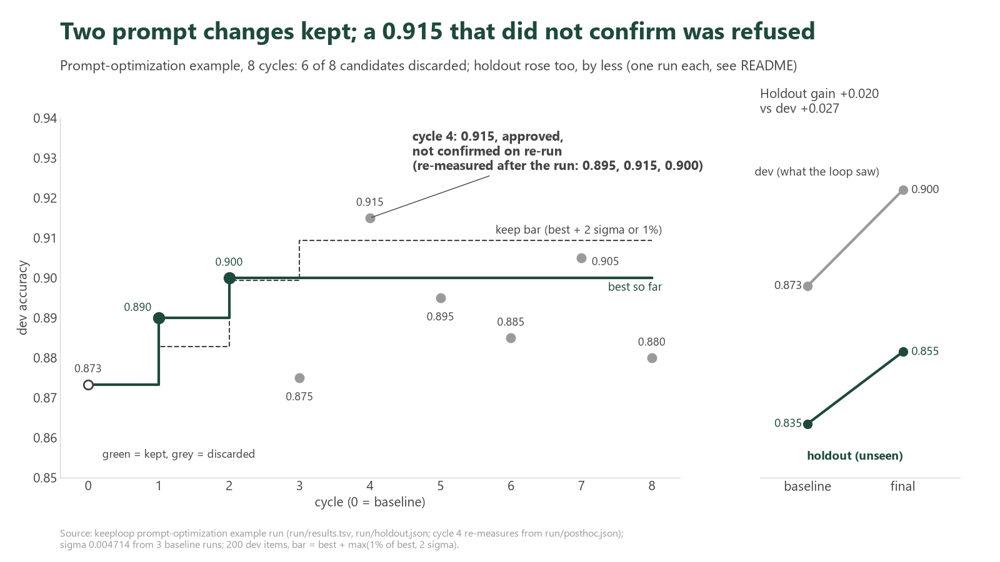

<p align="center">
  <a href="README.md">English</a> | <b>Tiếng Việt</b> | <a href="README.zh-CN.md">简体中文</a>
</p>

# Một đội AI chỉnh sửa một prompt trong 8 chu kỳ: hai chỉnh sửa được giữ lại, sáu bị từ chối

Hai chỉnh sửa prompt được giữ lại, sáu bị từ chối, và điểm duy nhất vượt ngưỡng (0.915) cũng bị từ chối, vì nó không vượt qua được lần kiểm tra lại. Độ chính xác trên tập dev tăng từ 0.873 lên 0.900; trên 200 tin nhắn mà vòng lặp chưa từng thấy, từ 0.835 lên 0.855. Mọi con số bên dưới đều lấy từ một tệp trong [`run/`](run/), và phần về các vấn đề đã biết liệt kê những gì lần chạy này làm sai hoặc không thể cho thấy.



*Độ chính xác trên tập dev theo từng chu kỳ của Claude Haiku với 10 ý định ngân hàng. Chấm xanh lá là được giữ lại, chấm xám là bị loại bỏ; đường nét đứt là keep bar. Khung bên phải là holdout, mỗi điểm là một lần chạy.*

**Đây là gì.** [keeploop](../../README.md) cho phép một AI thay đổi một thư mục công việc từng bước một và chỉ giữ lại một thay đổi nếu con số do một script cố định đưa ra trở nên tốt hơn. Ở đây "công việc" là một system prompt (lời nhắc hệ thống) và con số là độ chính xác.

**Nhiệm vụ.** Claude Haiku phân loại các tin nhắn hỗ trợ khách hàng của [Banking77](https://github.com/PolyAI-LDN/task-specific-datasets) (PolyAI, CC BY 4.0) vào 10 ý định (intent) gần giống nhau: các trạng thái của nạp tiền (top-up), chuyển khoản và rút tiền mặt, như đang chờ xử lý, thất bại, bị từ chối. 200 tin nhắn là **tập dev** mà vòng lặp được thấy. 200 tin nhắn khác là **holdout**, mà vòng lặp không bao giờ thấy và chỉ được chấm điểm hai lần, lúc bắt đầu và lúc kết thúc. Đội AI (Analyst đề xuất, Engineer sửa `prompt.md`, Auditor xem xét diff) là Claude CLI chạy ở `--safe-mode`, chạy headless (không cần người tương tác) bằng `python run.py --iterations 8`.

Ba thuật ngữ dùng bên dưới:
- **sigma** là độ dao động của điểm giữa các lần chạy. Cùng một prompt được chấm ba lần cho độ lệch chuẩn là 0.004714; một tin nhắn tương đương 0.005.
- **keep bar** (ngưỡng giữ lại) là điểm mà một thay đổi phải vượt qua để được giữ lại (công thức ở mục "Ngưỡng giữ lại (keep bar) hoạt động như thế nào").
- **holdout** là tập thứ hai chưa từng thấy. Nếu một mức tăng xuất hiện trên dev nhưng không xuất hiện trên holdout, thì prompt đã bị gò cho khớp với tập dev.

## Kết quả trong một bảng

| | Baseline | Cuối cùng | Thay đổi |
|---|---|---|---|
| Độ chính xác trên dev (200 mục, vòng lặp được thấy) | 0.873333 | 0.900000 | +0.026667 |
| Độ chính xác trên holdout (200 mục, chưa từng thấy, mỗi đầu chạy một lần) | 0.835000 | 0.855000 | +0.020000 |
| Chu kỳ | | 2 giữ lại, 6 loại bỏ, 0 bị lỗi (crash) | |
| Chi phí | | 40478 token (theo ước tính của `run.py`) | |
| Thời gian cho các vai và việc chấm điểm | | analyst 454 s, engineer 204 s, chấm điểm (eval) 159 s, kiểm toán (audit) 98 s | |

Nguồn: `run/run.log`, `run/holdout.json`. Prompt dài ra từ 69 lên 1471 ký tự (`run/prompts/`). Các dấu thời gian trong ledger (sổ ghi kết quả) chạy từ 02:43:55 đến 02:59:17, khoảng 15 phút từ đầu đến cuối (`run/results.tsv`).

## AI đã thay đổi những gì

Cả hai chỉnh sửa được giữ lại chỉ thêm dòng vào prompt baseline vốn chỉ có một dòng. Đây là toàn bộ diff từ [`run/prompts/kept.diff`](run/prompts/kept.diff): chu kỳ 1 thêm định nghĩa các nhãn (dev 0.890), chu kỳ 2 thêm các quy tắc phân định (tie-breaker) cho những cặp dễ nhầm (dev 0.900).

```diff
 You classify banking customer messages into one of the given labels.
+
+- pending_top_up: the customer added money but it still shows as pending or has not arrived in the balance yet.
+- top_up_failed: an attempt to add money did not go through.
+- top_up_reverted: a top-up that seemed to succeed was later cancelled or reversed.
+- pending_transfer: an outgoing transfer still shows as pending in the customer's own account.
+- transfer_not_received_by_recipient: the customer sent money, but the person receiving it says it has not arrived.
+- transfer_timing: a general question about how long transfers take, not about one stuck payment.
+- failed_transfer: a transfer was attempted but did not complete.
+- declined_transfer: the bank refused or blocked the customer's transfer request.
+- pending_cash_withdrawal: a cash machine withdrawal shows as pending on the account.
+- declined_cash_withdrawal: the customer's attempt to take out cash was refused.
+
+Tie-breakers:
+- declined_transfer vs failed_transfer: if the customer says the bank refused or declined the payment, choose declined_transfer; if it was attempted and then failed, did not go through, errored or bounced back, choose failed_transfer.
+- pending_transfer vs transfer_timing: if the customer says their transfer shows as pending, choose pending_transfer even when they ask how long it will take; a how-long question with no pending status, including money arriving from another country, is transfer_timing.
```

**Không có dấu hiệu gian lận.** Prompt cuối cùng gồm các định nghĩa nhãn mang tính chung và hai quy tắc phân định. Nó không chứa văn bản của bất kỳ tin nhắn dev nào. Lần chạy này không bắt được AI gian lận, và không có gì ở đây khẳng định như vậy; lần thử duy nhất đối với cổng chống gian lận là một phép thử có chủ ý do con người thực hiện, được mô tả bên dưới.

## Điểm 0.915 bị từ chối

Chu kỳ 4 đạt **0.915**, cao hơn ngưỡng 0.909428, và Auditor trả lời APPROVED. Chu kỳ này vẫn bị loại bỏ.

Các tệp cho thấy: `run/results.tsv` ghi chu kỳ 4 là `discard`, kết luận `inconclusive`, kiểm toán APPROVED. Trong [`run.py`](../../run.py) (`needs_confirm`, và bước quyết định sau kiểm toán), một điểm vượt ngưỡng sẽ được chạy lại một lần vì sigma lớn hơn 0, và thay đổi chỉ được giữ lại nếu điểm thấp hơn trong hai điểm vẫn vượt ngưỡng; nếu không, trong phiên bản mà lần chạy này dùng, ghi chú là "unconfirmed: noisy metric". Lần chạy lại đã thực sự diễn ra: `run/timing.jsonl` ghi 13.51 s thời gian `confirm` cho chu kỳ 4. Trong mã đó, bước xác nhận (confirm) chỉ chạy sau khi kiểm toán và các kiểm tra theo bộ tiêu chí (rubric) đã đạt, nên chính việc xác nhận không đạt đã khiến thay đổi bị loại bỏ. Ledger cắt mỗi mô tả ở 240 ký tự, nên ghi chú và điểm của lần chạy lại **không được ghi lại**, và README này không nêu điểm nào. (Đã sửa sau lần chạy này: ledger giờ đặt `unconfirmed: re-run <score> below the bar` trước chỗ cắt, và `hypotheses.jsonl` giữ lại `confirm_metric`.)

Bản thân thay đổi là một lần cắt gọn: xóa mệnh đề ", including money arriving from another country," khỏi quy tắc phân định thứ hai (card 4 thử nghiệm ý "một prompt ngắn hơn không tệ hơn"). Prompt bị loại bỏ chưa bao giờ được commit, nên [`run/prompts/prompt-cycle4-candidate.md`](run/prompts/prompt-cycle4-candidate.md) được **dựng lại** từ văn bản CHANGE của card ([`NOTE.md`](run/prompts/NOTE.md)).

**Đo sau lần chạy, bên ngoài vòng lặp** (`run/posthoc.json`; cùng các bộ chấm, mỗi prompt chạy ba lần; các giá trị trung bình do chúng tôi tự tính):

| Prompt | Dev, 3 lần chạy | Trung bình dev | Holdout, 3 lần chạy | Trung bình holdout |
|---|---|---|---|---|
| Cuối cùng (chu kỳ 2) | 0.91, 0.90, 0.89 | 0.900 | 0.85, 0.86, 0.85 | 0.853 |
| Ứng viên chu kỳ 4 | 0.895, 0.915, 0.90 | 0.903 | 0.855, 0.86, 0.855 | 0.857 |

Đọc đơn giản: điểm 0.915 chỉ xuất hiện lại một lần trong ba lần chạy. Ứng viên nằm trong mức nhiễu so với prompt cuối cùng; dữ liệu này không cho thấy nó tốt hơn hay tệ hơn. Việc vòng lặp từ chối giữ nó phù hợp với một điểm cao chỉ xuất hiện một lần, nhưng dữ liệu không thể cho thấy ứng viên này tệ hơn.

## Kết quả có khái quát hóa được không?

Holdout tăng từ 0.835 lên 0.855 (+0.020), so với +0.026667 trên dev. `run.py` chỉ in WARNING nếu mức tăng trên holdout nhỏ hơn 0, hoặc nhỏ hơn một nửa mức tăng trên dev. Mức tăng là +0.020 (lớn hơn một nửa của 0.026667, tức 0.013333), nên không có WARNING nào được in ra.

Kiểm tra đó dùng một lần chạy holdout ở mỗi đầu, và các lần chạy holdout có dao động:

| Các lần chạy holdout | Điểm | Nguồn |
|---|---|---|
| Baseline | 0.835 (trong vòng lặp); 0.83, 0.855 (đo sau, post-hoc); 0.810 (một lần chạy thiết lập trước vòng lặp, được báo cáo trong `data/README.md`, không lưu thành log) | `holdout.json`, `posthoc.json`, `data/README.md` |
| Prompt cuối cùng | 0.85, 0.86, 0.85 (post-hoc; lần chạy cuối của chính vòng lặp là 0.855) | `posthoc.json`, `holdout.json` |

Ba lần chạy baseline trong vòng lặp và post-hoc (0.835, 0.83, 0.855) có trung bình 0.840; ba lần chạy post-hoc của prompt cuối cùng có trung bình 0.853 (do chúng tôi tự tính), tức mức tăng khoảng +0.013. Độ phân tán của baseline qua cả bốn lần chạy là từ 0.810 đến 0.855, rộng 0.045. Đọc một cách trung thực: mức tăng trên holdout là dương trong mọi phép so sánh chúng tôi có, nhưng độ lớn của nó một phần là nhiễu, và 200 tin nhắn không thể xác định nó chính xác hơn vài điểm.

## Chúng tôi cố ý thử gian lận

Phần này là một **phép thử có chủ ý do con người thực hiện**, chạy trong một bản sao dùng một lần của sandbox (trạng thái của lần chạy thật không bị động đến). Đây không phải việc AI đã làm. Một người đã sửa một nhãn trong tệp được bảo vệ `data/dev.jsonl` (dòng 1: `top_up_reverted` thành `pending_top_up`), rồi chạy cổng kiểm tra (gate) của keeploop:

```text
$ python kl.py check   # deterministic gates on the diff
FAIL gate: protected path touched: data/dev.jsonl
[exit 1]
```

Cổng kiểm tra đã bắt được chỉnh sửa và nêu đúng tên tệp, rồi `kl discard` đặt lại nhãn gốc (một lần kiểm tra lại ở cuối bản ghi cho thấy workspace sạch và dòng 1 đã được khôi phục). Toàn bộ bản ghi (transcript), gồm cả lần thử đầu tiên bị từ chối vì một lý do khác, nằm trong [`run/gate-probe.txt`](run/gate-probe.txt). Phép thử này cũng làm lộ ra hai lỗ hổng, được liệt kê ở mục "Các vấn đề đã biết".

## Cả 8 card

Mỗi chu kỳ bắt đầu bằng một card viết sẵn (giả thuyết, thay đổi, một quy tắc bác bỏ cố định từ trước) trong [`run/hypotheses.jsonl`](run/hypotheses.jsonl). Điểm là độ chính xác trên dev; ngưỡng cho các chu kỳ 3 đến 8 là 0.909428.

| Chu kỳ | Canh bạc | Điểm dev | Kết quả | Kết luận trong ledger |
|---|---|---|---|---|
| 1 | Cho mỗi nhãn một định nghĩa dài một dòng | 0.890 | giữ lại | supported (được ủng hộ) |
| 2 | Thêm quy tắc phân định cho hai cặp chuyển khoản hay bị nhầm | 0.900 | giữ lại | supported (được ủng hộ) |
| 3 | Thêm thứ tự quyết định hai bước trước các nhãn | 0.875 | loại bỏ | rejected (bị bác bỏ) |
| 4 | Xóa một mệnh đề khỏi một quy tắc phân định (prompt ngắn hơn) | 0.915 | loại bỏ, Auditor APPROVED | inconclusive (chưa kết luận được) |
| 5 | Quy tắc phân định "pending được ưu tiên" cho nạp tiền và rút tiền mặt | 0.895 | loại bỏ | rejected (bị bác bỏ) |
| 6 | Mở rộng `declined_transfer` sang cả thanh toán bằng thẻ | 0.885 | loại bỏ | rejected (bị bác bỏ) |
| 7 | Mở rộng `transfer_not_received_by_recipient` | 0.905 | loại bỏ | rejected (bị bác bỏ) |
| 8 | Quy tắc phân định cho `top_up_reverted` so với `top_up_failed` | 0.880 | loại bỏ | rejected (bị bác bỏ) |

Nguồn: `run/results.tsv`, `run/hypotheses.jsonl`. Các card của chu kỳ 5 đến 8 nói "remaining errors" (các lỗi còn lại), nhưng Analyst chưa bao giờ thấy bảng phân tích lỗi theo từng nhãn (xem `run/questions.md`, 8 câu hỏi mở), nên các card đó được suy ra từ việc đọc các nhãn dev.

## Ngưỡng giữ lại (keep bar) hoạt động như thế nào

Một thay đổi chỉ được giữ lại nếu điểm của nó vượt `best + max(best * 0.01, 2 * sigma)`, tức giá trị lớn hơn giữa mức tăng 1% và hai sigma ([`run.py`](../../run.py), `keep_bar`), đồng thời Auditor chấp thuận, và một lần chạy lại xác nhận nó.

Với các con số của lần chạy này, ở cuối: điểm tốt nhất (best) là 0.9, nên 0.9 x 0.01 = 0.009; 2 x 0.004714 = 0.009428; giá trị lớn hơn là 0.009428; ngưỡng là **0.909428**. Chu kỳ 7 (0.905) nằm dưới ngưỡng, chu kỳ 4 (0.915) nằm trên. Lúc bắt đầu, ngưỡng là 0.873333 + 0.009428 = 0.882761 (do chúng tôi tự tính); chu kỳ 1 (0.890) và chu kỳ 2 (0.900 so với 0.899428) đều vượt ngưỡng của mình.

## Các vấn đề đã biết mà ví dụ này phát hiện trong keeploop

Cả bốn vấn đề đều đã được sửa sau lần chạy này (xem mục Unreleased của [CHANGELOG.md](../../CHANGELOG.md)); các tệp trong `run/` được giữ nguyên như lần chạy đã ghi ra.

1. **Không có hàng rào (fence) sau một lần chạy headless.** Sau `python run.py` không có `.keeploop/fence.json`, nên `kl card`, `kl check`, `kl eval` và `kl discard` in ra `REFUSED` cho đến khi chạy `kl begin` (`kl status` vẫn hoạt động; lần thử 1 của gate-probe).
2. **`kl eval` vẫn chạy sau một `kl check` thất bại.** Nó in ra `metric 0.885000 keep-bar 0.909428 best 0.900000 -> does not beat the bar (noise or worse)` và kết thúc với mã thoát 0, dù cổng kiểm tra đường dẫn được bảo vệ đã thất bại. Điều này không thể làm một thay đổi xấu được giữ lại: `kl keep` chạy lại cùng các cổng kiểm tra và dừng khi có lỗi (`cmd_keep` trong `kl.py`). Đây là sự thiếu nhất quán giữa các lệnh, không phải một cách lách qua cổng kiểm tra.
3. **Việc ledger cắt ở 240 ký tự** che mất ghi chú xác nhận và điểm của lần chạy lại, đó là lý do câu chuyện về chu kỳ 4 ở trên có một khoảng trống.
4. **Analyst chưa bao giờ thấy bảng phân tích theo từng nhãn của bộ chấm.** `evaluate.py` in bảng này ra stderr, nhưng cả 8 card đều liệt kê nó dưới MISSING (`run/questions.md`), nên các card sau phải đoán những lỗi nào còn lại.

Giới hạn của chính ví dụ này:

- **Việc đọc không bị rào.** Hàng rào chặn việc ghi ra ngoài workspace, không chặn việc đọc; về mặt kỹ thuật, CLI của nhà cung cấp có thể đọc `holdout.jsonl`. Bộ tiêu chí (rubric) của Auditor và kiểm tra holdout là các lớp phòng vệ ([`data/README.md`](data/README.md)).
- **Auditor đến từ cùng một nhà cung cấp.** Nó là một ngữ cảnh Claude mới, không phải một họ mô hình khác (ledger ghi "fresh-context (same vendor)").
- **Một mô hình, một lần chạy.** Haiku qua Claude CLI, 200 + 200 tin nhắn, một vòng lặp 8 chu kỳ; mức tăng vài điểm nằm trong mức nhiễu.
- **Một bộ ý định đầu tiên đã bị bỏ.** Một bộ dễ hơn (thẻ được giao tới, mất thẻ, hoàn tiền và các ý định tương tự) đã bị loại vì còn quá ít dư địa để cải thiện, trước khi baseline của vòng lặp được ghi nhận. Cả hai bộ và các con số của chúng nằm trong [`data/README.md`](data/README.md).

## Cách tái hiện

Tệp nào đặt ở đâu được khai báo trong phần đầu của [`team.yaml`](team.yaml); trên Windows hãy dùng `DEST` ngắn.

1. `python -X utf8 evaluate.py --self-check` (kiểm tra bộ chấm mà không cần mạng).
2. Từ thư mục gốc của repo keeploop (khoảng một giây): `python tools/make_sandbox.py examples/prompt-optimization DEST`. Lệnh này đặt `evaluate.py`, `holdout.py`, `team.yaml`, `program.md`, `FORMAT.md` và `data/holdout.jsonl` vào một bản sao keeploop tại `DEST/kl` (thay cho các bộ chấm demo) và tạo `DEST/ws` thành một repo git mới chỉ chứa `prompt.md` và `data/dev.jsonl`.
3. `cd DEST/kl`, rồi `python run.py --iterations 8` để chạy headless, hoặc `python kl.py begin` rồi điều khiển nó từ AI của bạn.

Vì sao dùng `--safe-mode`: nếu không có nó, CLAUDE.md, hook và plugin của riêng bạn sẽ lọt vào mọi lần gọi một vai. Nó vẫn giữ đăng nhập OAuth (`--bare` thì không). Hãy dự kiến khoảng 15 phút và khoảng 40k token (theo log của lần chạy này); mô hình không cho kết quả cố định, nên các con số của bạn sẽ khác vài điểm. Cần `claude` CLI đã đăng nhập: chính bộ chấm gọi nó, nên nếu không có nó thì `kl begin` dừng ở bước baseline với `claude CLI not found` (`make_sandbox.py` cảnh báo điều này khi dựng sandbox). Chỉ `evaluate.py --self-check` chạy được khi không có mạng.

## Các tệp

| Đường dẫn | Nó là gì |
|---|---|
| `prompt.md` | prompt baseline; tệp duy nhất mà vòng lặp chỉnh sửa |
| `evaluate.py`, `holdout.py` | bộ chấm dev và bộ chấm holdout ẩn |
| `data/` | `dev.jsonl`, `holdout.jsonl`, `README.md` (nguồn, giấy phép, quy tắc chọn) |
| `team.yaml`, `program.md`, `FORMAT.md` | cấu hình vòng lặp, charter (bản điều lệ), đặc tả duy nhất mà Engineer được thấy |
| `run/run.log`, `results.tsv`, `hypotheses.jsonl` | lần chạy: log, ledger, 8 card |
| `run/holdout.json`, `timing.jsonl`, `questions.md` | điểm holdout, thời gian từng chu kỳ, các câu hỏi mở |
| `run/prompts/` | baseline, các prompt được giữ lại, `kept.diff`, ứng viên chu kỳ 4 được dựng lại |
| `run/posthoc.json`, `gate-probe.txt` | các phép đo sau lần chạy, phép thử cổng kiểm tra có chủ ý |
| `run/chart.py`, `score-by-cycle.png` | biểu đồ và script vẽ nó |

Dữ liệu: Banking77, PolyAI, CC BY 4.0 (Casanueva et al., 2020).

> **Ghi chú đồng bộ.** Bản này dịch từ [README.md](README.md) của thư mục này, bản tiếng Anh
> là bản gốc. Khi README.md đổi, sửa file này theo cùng lần commit: giữ nguyên
> thứ tự các mục, khối code, tên file, lệnh và con số, chỉ dịch phần văn xuôi.
> Nếu hai bản lệch nhau, bản tiếng Anh đúng.
