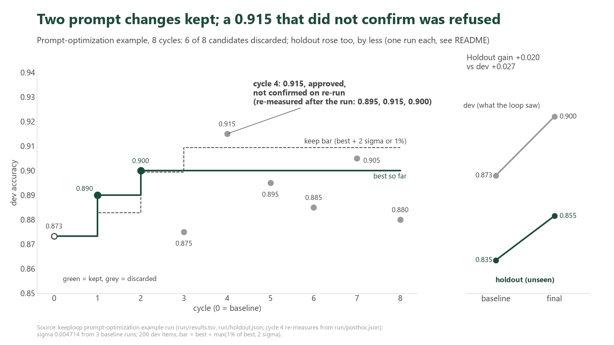

<p align="center">
  <a href="README.md">English</a> | <a href="README.vi.md">Tiếng Việt</a> | <b>简体中文</b>
</p>

# 一个 AI 团队用 8 个周期修改一段提示词：两次编辑被保留，六次被拒绝

两次提示词编辑被保留，六次被拒绝；唯一一个超过门槛的分数（0.915）也被拒绝了，因为它没有通过复核。开发集准确率从 0.873 升到 0.900；在循环从未见过的 200 条消息上，从 0.835 升到 0.855。下面的每个数字都来自 [`run/`](run/) 中的某个文件，“已知问题”一节列出了这次运行出错或无法展示的地方。



*Claude Haiku 在 10 个银行业务意图上每个周期的开发集准确率。绿点表示被保留，灰点表示被丢弃；虚线是保留门槛。右侧面板是 holdout，每个点只运行一次。*

**这是什么。** [keeploop](../../README.md) 让 AI 一步一步地修改一个存放工作的文件夹，并且只有当一个固定脚本给出的数字变好时，才保留这项改动。这里的“工作”是一段系统提示词（system prompt），数字是准确率。

**任务。** Claude Haiku 把 [Banking77](https://github.com/PolyAI-LDN/task-specific-datasets)（PolyAI，CC BY 4.0）中的客服消息分到 10 个几乎重复的意图里：充值、转账和取现的各种状态，例如待处理（pending）、失败（failed）、被拒（declined）。其中 200 条消息是循环能看到的**开发集（dev set）**。另外 200 条消息是 **holdout（留出集）**，循环永远看不到它，它只在开始和结束时各打分一次。AI 团队（Analyst（分析师）提出方案，Engineer（工程师）编辑 `prompt.md`，Auditor（审计员）审查 diff）是以 `--safe-mode` 运行的 Claude CLI，通过 `python run.py --iterations 8` 无人值守（headless）运行。

下文用到的三个术语：
- **sigma** 是分数在不同运行之间的波动。同一个提示词打分三次，标准差为 0.004714；一条消息相当于 0.005。
- **保留门槛（keep bar）** 是一项改动必须超过才能被保留的分数（公式见“保留门槛如何计算”）。
- **holdout** 是没见过的第二个数据集。如果某个提升在开发集上出现、在 holdout 上却没有，说明提示词被调得只贴合开发集。

## 一张表看结果

| | 基线 | 最终 | 变化 |
|---|---|---|---|
| 开发集准确率（200 条，循环能看到） | 0.873333 | 0.900000 | +0.026667 |
| Holdout 准确率（200 条，从未见过，两端各运行一次） | 0.835000 | 0.855000 | +0.020000 |
| 周期 | | 保留 2 次，丢弃 6 次，崩溃 0 次 | |
| 成本 | | 40478 个 token（按 `run.py` 的估算） | |
| 各角色和打分的用时 | | analyst 454 s，engineer 204 s，eval 159 s，audit 98 s | |

来源：`run/run.log`、`run/holdout.json`。提示词从 69 个字符增长到 1471 个字符（`run/prompts/`）。台账（ledger）的时间戳从 02:43:55 到 02:59:17，从头到尾约 15 分钟（`run/results.tsv`）。

## AI 改了什么

两次被保留的编辑都只是在只有一行的基线提示词后面增加内容。下面是 [`run/prompts/kept.diff`](run/prompts/kept.diff) 中的完整 diff：周期 1 加入了标签定义（开发集 0.890），周期 2 加入了区分规则（tie-breaker）（开发集 0.900）。

```diff
 You classify banking customer messages into one of the given labels.
+
+- pending_top_up: the customer added money but it still shows as pending or has not arrived in the balance yet.
+- top_up_failed: an attempt to add money did not go through.
+- top_up_reverted: a top-up that seemed to succeed was later cancelled or reversed.
+- pending_transfer: an outgoing transfer still shows as pending in the customer's own account.
+- transfer_not_received_by_recipient: the customer sent money, but the person receiving it says it has not arrived.
+- transfer_timing: a general question about how long transfers take, not about one stuck payment.
+- failed_transfer: a transfer was attempted but did not complete.
+- declined_transfer: the bank refused or blocked the customer's transfer request.
+- pending_cash_withdrawal: a cash machine withdrawal shows as pending on the account.
+- declined_cash_withdrawal: the customer's attempt to take out cash was refused.
+
+Tie-breakers:
+- declined_transfer vs failed_transfer: if the customer says the bank refused or declined the payment, choose declined_transfer; if it was attempted and then failed, did not go through, errored or bounced back, choose failed_transfer.
+- pending_transfer vs transfer_timing: if the customer says their transfer shows as pending, choose pending_transfer even when they ask how long it will take; a how-long question with no pending status, including money arriving from another country, is transfer_timing.
```

**没有作弊的迹象。** 最终的提示词由通用的标签定义和两条区分规则组成，不包含任何开发集消息的原文。这次运行没有抓到 AI 作弊，这里也没有声称抓到过；对作弊关卡的唯一一次测试是一次刻意的人工探测，见下文。

## 被拒绝的 0.915

周期 4 得分 **0.915**，高于门槛 0.909428，Auditor 也回复了 APPROVED（通过）。这个周期仍然被丢弃了。

文件显示的情况：`run/results.tsv` 中周期 4 记为 `discard`，结论（verdict）为 `inconclusive`，审计为 APPROVED。在 [`run.py`](../../run.py)（`needs_confirm`，以及审计之后的决定步骤）中，由于 sigma 大于 0，超过门槛的分数会被复跑一次，只有两次分数中较低的那个仍然超过门槛时，这项改动才会被保留；否则，在这次运行所用的版本中，备注为“unconfirmed: noisy metric”。复跑确实发生了：`run/timing.jsonl` 为周期 4 记录了 13.51 s 的 `confirm` 时间。在那份代码中，复核只在审计和评分细则（rubric）检查都通过之后才运行，所以导致它被丢弃的是复核没有通过。台账把每条描述截断在 240 个字符，因此这条备注和复跑分数**没有被记录下来**，本 README 也不给出这个分数。（此后已修复：台账现在把 `unconfirmed: re-run <score> below the bar` 放在截断点之前，`hypotheses.jsonl` 也会保存 `confirm_metric`。）

这项改动本身是一次删减：从第二条区分规则中删去“, including money arriving from another country,”这一子句（这是卡片 4 对“更短的提示词不会更差”的检验）。被丢弃的提示词从未被提交，因此 [`run/prompts/prompt-cycle4-candidate.md`](run/prompts/prompt-cycle4-candidate.md) 是根据卡片的 CHANGE 文本**重建**的（[`NOTE.md`](run/prompts/NOTE.md)）。

**运行结束后在循环之外测得**（`run/posthoc.json`；使用相同的评分程序，每个提示词各运行三次；平均值是我们自己算的）：

| 提示词 | 开发集，3 次运行 | 开发集平均 | Holdout，3 次运行 | Holdout 平均 |
|---|---|---|---|---|
| 最终（周期 2） | 0.91, 0.90, 0.89 | 0.900 | 0.85, 0.86, 0.85 | 0.853 |
| 周期 4 候选 | 0.895, 0.915, 0.90 | 0.903 | 0.855, 0.86, 0.855 | 0.857 |

通俗地说：0.915 在三次运行中只再出现了一次。候选提示词与最终提示词的差别在噪声范围之内；这些数据既不能说明它更好，也不能说明它更差。循环拒绝保留它，这与一次偶然的高分相符，但数据无法证明候选提示词更差。

## 它能泛化吗？

Holdout 从 0.835 升到 0.855（+0.020），开发集上是 +0.026667。只有当 holdout 的提升低于 0，或低于开发集提升的一半时，`run.py` 才会打印 WARNING。提升为 +0.020（高于 0.026667 的一半，即 0.013333），因此没有打印 WARNING。

这项检查在开始和结束时各只用一次 holdout 运行，而 holdout 的分数会波动：

| Holdout 运行 | 分数 | 来源 |
|---|---|---|
| 基线 | 0.835（循环内）；0.83、0.855（事后）；0.810（循环开始前的一次准备运行，记录在 `data/README.md` 中，未保存为日志） | `holdout.json`、`posthoc.json`、`data/README.md` |
| 最终提示词 | 0.85、0.86、0.85（事后；循环自己在结束时的那次运行为 0.855） | `posthoc.json`、`holdout.json` |

循环内和事后的三次基线运行（0.835、0.83、0.855）平均为 0.840；事后的三次最终运行平均为 0.853（我们自己算的），提升约 +0.013。全部四次基线运行的范围是 0.810 到 0.855，宽 0.045。如实地说：在我们手头的每一种比较中，holdout 的提升都是正的，但它的大小有一部分是噪声，200 条消息无法把它确定到比两三个点更精确的程度。

## 我们故意尝试作弊

本节是一次**刻意的人工测试**，在沙盒的一份一次性副本中进行（真实运行的状态没有被动过）。这不是 AI 做的事。一个人修改了受保护文件 `data/dev.jsonl` 中的一个标签（第 1 行：把 `top_up_reverted` 改成 `pending_top_up`），然后运行了 keeploop 的关卡：

```text
$ python kl.py check   # deterministic gates on the diff
FAIL gate: protected path touched: data/dev.jsonl
[exit 1]
```

关卡按名称指出了这次编辑，随后 `kl discard` 把原来的标签恢复了（转录末尾的一次复查显示工作区是干净的，第 1 行已恢复）。完整转录见 [`run/gate-probe.txt`](run/gate-probe.txt)，其中包括第一次因为另一个原因被拒绝的尝试。这次探测还暴露了两个缺口，列在“已知问题”中。

## 全部 8 张卡片

每个周期都从 [`run/hypotheses.jsonl`](run/hypotheses.jsonl) 中的一张书面卡片开始（假设、改动，以及一条预先定好的否决规则）。分数是开发集准确率；周期 3 到 8 的门槛为 0.909428。

| 周期 | 赌注 | 开发集分数 | 结果 | 台账中的结论 |
|---|---|---|---|---|
| 1 | 给每个标签写一行定义 | 0.890 | 保留 | supported（成立） |
| 2 | 为两组容易混淆的转账意图加上区分规则 | 0.900 | 保留 | supported（成立） |
| 3 | 在标签之前加入两步决策顺序 | 0.875 | 丢弃 | rejected（被否决） |
| 4 | 从一条区分规则中删去一个子句（更短的提示词） | 0.915 | 丢弃，Auditor APPROVED（通过） | inconclusive（无定论） |
| 5 | 为充值和取现加一条“待处理优先”的区分规则 | 0.895 | 丢弃 | rejected（被否决） |
| 6 | 把 `declined_transfer` 扩展到银行卡支付 | 0.885 | 丢弃 | rejected（被否决） |
| 7 | 放宽 `transfer_not_received_by_recipient` 的范围 | 0.905 | 丢弃 | rejected（被否决） |
| 8 | `top_up_reverted` 与 `top_up_failed` 之间的区分规则 | 0.880 | 丢弃 | rejected（被否决） |

来源：`run/results.tsv`、`run/hypotheses.jsonl`。周期 5 到 8 的卡片中写着“remaining errors”（剩余错误），但 Analyst 从未看到按标签分列的错误明细（见 `run/questions.md`，8 个开放问题），所以这些卡片是通过阅读开发集标签推测出来的。

## 保留门槛如何计算

只有当一项改动的分数超过 `best + max(best * 0.01, 2 * sigma)`（即 1% 的提升与两倍 sigma 中较大的那个，见 [`run.py`](../../run.py) 中的 `keep_bar`），并且 Auditor 批准、复跑也确认时，它才会被保留。

按这次运行在结束时的数字：best 为 0.9，所以 0.9 x 0.01 = 0.009；2 x 0.004714 = 0.009428；较大的是 0.009428；门槛为 **0.909428**。周期 7（0.905）低于门槛，周期 4（0.915）高于门槛。在开始时，门槛为 0.873333 + 0.009428 = 0.882761（我们自己算的）；周期 1（0.890）和周期 2（0.900，对应门槛 0.899428）都超过了各自的门槛。

## 这个示例在 keeploop 中发现的已知问题

这四个问题在这次运行之后都已修复（见 [CHANGELOG.md](../../CHANGELOG.md) 的 Unreleased 一节）；`run/` 中的文件保持运行时写下的原样。

1. **无人值守运行后没有围栏（fence）。** 运行 `python run.py` 之后没有 `.keeploop/fence.json`，所以在运行 `kl begin` 之前，`kl card`、`kl check`、`kl eval` 和 `kl discard` 都打印 `REFUSED`（`kl status` 仍然可用；见关卡探测的第 1 次尝试）。
2. **`kl eval` 在 `kl check` 失败后仍然运行。** 它打印了 `metric 0.885000 keep-bar 0.909428 best 0.900000 -> does not beat the bar (noise or worse)` 并以 exit 0 结束，尽管受保护路径关卡已经失败。这不会让一个坏改动被保留：`kl keep` 会重新运行同样的关卡，并在失败时停止（`kl.py` 中的 `cmd_keep`）。这是命令之间的不一致，而不是绕过关卡的途径。
3. **台账的 240 字符截断**隐藏了复核备注和复跑分数，这就是上面周期 4 的经过存在缺口的原因。
4. **Analyst 从未看到评分程序按标签分列的明细。** `evaluate.py` 会把它打印到 stderr，但全部 8 张卡片都把它列在 MISSING 之下（`run/questions.md`），所以后面的卡片只能猜测还剩下哪些错误。

示例本身的局限：

- **读取不受围栏限制。** 围栏阻止的是工作区之外的写入，而不是读取；厂商的 CLI 在技术上可以读取 `holdout.jsonl`。防线是 Auditor 的评分细则和 holdout 检查（[`data/README.md`](data/README.md)）。
- **Auditor 来自同一厂商。** 它是一个全新的 Claude 上下文，而不是另一个模型家族（台账中写的是“fresh-context (same vendor)”）。
- **一个模型，一次运行。** 通过 Claude CLI 调用 Haiku，200 + 200 条消息，一个 8 周期的循环；几个点的提升处在噪声范围之内。
- **第一套意图被放弃了。** 一套更容易的意图（银行卡送达、银行卡丢失、退款等）因为提升空间太小而被放弃，这发生在记录循环基线之前。两套意图及其数字都在 [`data/README.md`](data/README.md) 中。

## 如何复现

各个文件放在哪里，在 [`team.yaml`](team.yaml) 的头部有说明；在 Windows 上请使用较短的 `DEST`。

1. `python -X utf8 evaluate.py --self-check`（离线检查评分程序）。
2. 在 keeploop 仓库根目录下运行（约一秒）：`python tools/make_sandbox.py examples/prompt-optimization DEST`。它把 `evaluate.py`、`holdout.py`、`team.yaml`、`program.md`、`FORMAT.md` 和 `data/holdout.jsonl` 放入位于 `DEST/kl` 的 keeploop 副本（替换演示用的评分程序），并把 `DEST/ws` 建成一个新的 git 仓库，其中只有 `prompt.md` 和 `data/dev.jsonl`。
3. `cd DEST/kl`，然后运行 `python run.py --iterations 8` 进行无人值守运行，或者运行 `python kl.py begin`，再由你的 AI 来驱动。

为什么要用 `--safe-mode`：不加它，你自己的 CLAUDE.md、钩子（hooks）和插件会混入每一次角色调用。它会保留 OAuth 登录（`--bare` 则不会）。预计耗时约 15 分钟、约 40k 个 token（来自这次运行的日志）；模型不是确定性的，所以你的数字会相差几个点。需要已登录的 `claude` CLI：评分程序本身就会调用它，所以没有它的话，`kl begin` 会在基线处停下并报 `claude CLI not found`（`make_sandbox.py` 在搭建沙盒时会就此发出警告）。只有 `evaluate.py --self-check` 可以离线运行。

## 文件

| 路径 | 内容 |
|---|---|
| `prompt.md` | 基线提示词；循环唯一会编辑的文件 |
| `evaluate.py`, `holdout.py` | 开发集评分程序和隐藏的 holdout 评分程序 |
| `data/` | `dev.jsonl`、`holdout.jsonl`、`README.md`（来源、许可证、选取规则） |
| `team.yaml`, `program.md`, `FORMAT.md` | 循环配置、章程、Engineer 唯一的规格说明 |
| `run/run.log`, `results.tsv`, `hypotheses.jsonl` | 这次运行：日志、台账、8 张卡片 |
| `run/holdout.json`, `timing.jsonl`, `questions.md` | holdout 分数、每个周期的用时、开放问题 |
| `run/prompts/` | 基线、被保留的提示词、`kept.diff`、重建的周期 4 候选 |
| `run/posthoc.json`, `gate-probe.txt` | 运行结束后的测量、刻意的关卡探测 |
| `run/chart.py`, `score-by-cycle.png` | 图表及其脚本 |

数据：Banking77，PolyAI，CC BY 4.0（Casanueva et al., 2020）。

> **同步说明。** 本文翻译自本文件夹的 [README.md](README.md)，以英文版为准。
> README.md 有改动时，请在同一次 commit 中同步修改本文件：保持各章节顺序
> 不变，代码块、文件名、命令和数字原样保留，只翻译正文。两个版本不一致时，
> 以英文版为准。
